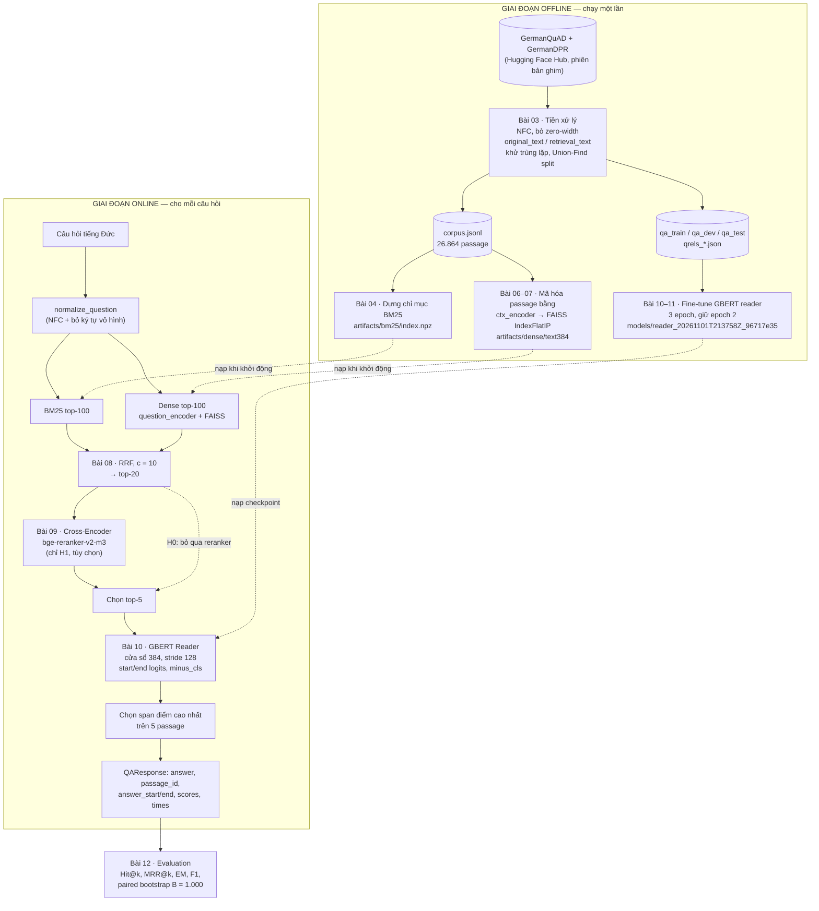
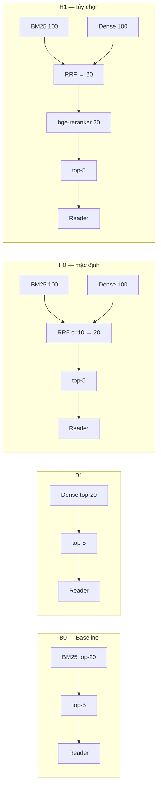
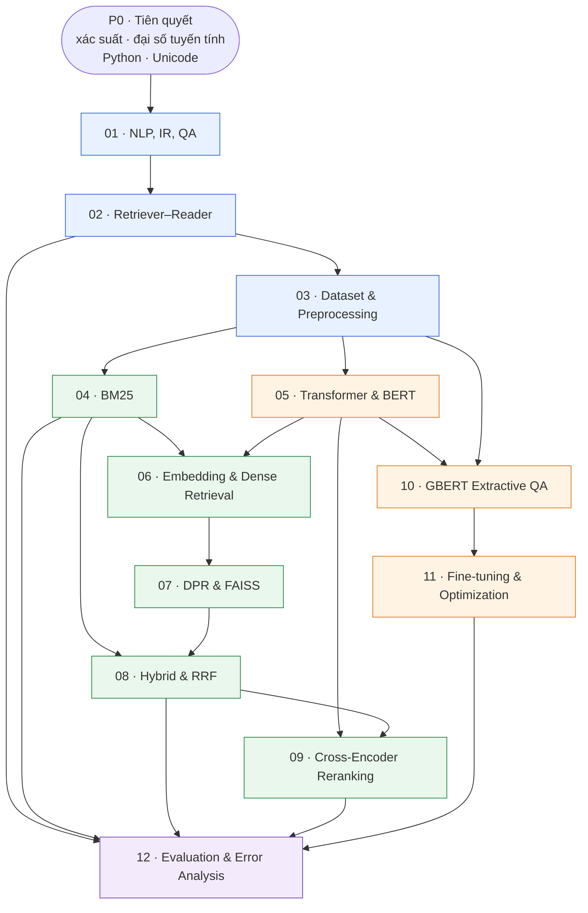

# 00 — LEARNING ROADMAP

**Giáo trình lý thuyết: Hệ thống hỏi đáp và truy hồi đoạn văn tiếng Đức (GermanQuAD + GermanDPR)**

> Tài liệu này là "bản đồ" của cả giáo trình. Đọc nó trước, rồi quay lại đây mỗi khi xong một bài để đánh dấu tiến độ.

---

## Mục lục

1. [Cách dùng giáo trình](#1-cách-dùng-giáo-trình)
2. [Phân tích báo cáo: hệ thống của nhóm thực sự gồm những gì](#2-phân-tích-báo-cáo-hệ-thống-của-nhóm-thực-sự-gồm-những-gì)
3. [Tổng quan toàn bộ pipeline](#3-tổng-quan-toàn-bộ-pipeline)
4. [Ví dụ chạy xuyên suốt giáo trình](#4-ví-dụ-chạy-xuyên-suốt-giáo-trình)
5. [Kiến thức tiên quyết (Module P0)](#5-kiến-thức-tiên-quyết-module-p0)
6. [Sơ đồ phụ thuộc kiến thức giữa các bài](#6-sơ-đồ-phụ-thuộc-kiến-thức-giữa-các-bài)
7. [Thứ tự học và lịch đề xuất](#7-thứ-tự-học-và-lịch-đề-xuất)
8. [Bảng liên kết bài học ↔ thành phần implementation](#8-bảng-liên-kết-bài-học--thành-phần-implementation)
9. [Bảng tham số cần nhớ](#9-bảng-tham-số-cần-nhớ)
10. [Những điểm báo cáo và mã nguồn khác với đề bài / còn thiếu](#10-những-điểm-báo-cáo-và-mã-nguồn-khác-với-đề-bài--còn-thiếu)
11. [Checklist tổng: sẵn sàng implementation](#11-checklist-tổng-sẵn-sàng-implementation)
12. [Danh sách tài liệu tham khảo](#12-danh-sách-tài-liệu-tham-khảo)

---

## 1. Cách dùng giáo trình

### 1.1. Cấu trúc thư mục

```
GERMAN_QA_THEORY/
├── 00_LEARNING_ROADMAP.md          ← bạn đang đọc
├── 01_NLP_IR_QA.md
├── 02_RETRIEVER_READER.md
├── 03_DATASET_PREPROCESSING.md
├── 04_BM25_SPARSE_RETRIEVAL.md
├── 05_TRANSFORMER_BERT.md
├── 06_EMBEDDING_DENSE_RETRIEVAL.md
├── 07_DPR_FAISS.md
├── 08_HYBRID_RRF.md
├── 09_CROSS_ENCODER_RERANKING.md
├── 10_GBERT_EXTRACTIVE_QA.md
├── 11_FINE_TUNING_OPTIMIZATION.md
├── 12_EVALUATION_ERROR_ANALYSIS.md
└── 13_YOUTUBE_RESOURCES.md
```

### 1.2. Cấu trúc cố định của mỗi bài

| Phần | Nội dung | Câu hỏi bài học trả lời |
|---|---|---|
| A. Learning Objectives | Mục tiêu, điều cần nhớ, thành phần pipeline dùng kiến thức | Học để làm gì? |
| B. Prerequisite Knowledge | Kiến thức cần trước, thuật ngữ, liên hệ bài trước | Cần biết gì trước? |
| C. Theoretical Foundation | Bản chất, cơ chế, so sánh, ưu/nhược | Nó là gì, tại sao cần? |
| D. Mathematical Foundation | Công thức, ký hiệu, ví dụ số | Toán đằng sau là gì? |
| E. Architecture & Mechanism | Sơ đồ, Input → Processing → Output | Nó chạy thế nào? |
| F. Application in Our Project | Vị trí trong pipeline, tham số, nếu bỏ đi thì sao | Nhóm dùng ở đâu? |
| G. Implementation Mapping | Thư viện, class, pseudocode, code minh họa, cách kiểm tra | Code trông như thế nào? |
| H. YouTube Resources | Video đã kiểm chứng, thứ tự xem, đoạn cần tập trung | Xem gì để hiểu thêm? |
| I. Knowledge Check | 5 + 5 + 3 + 2 + 1 câu, đáp án ở cuối | Đã hiểu thật chưa? |
| J. Implementation Readiness | Checklist | Đã sẵn sàng viết code chưa? |

### 1.3. Ba nhãn nguồn gốc kiến thức

Mỗi ý quan trọng trong giáo trình được gắn một trong ba nhãn, đúng yêu cầu "phân biệt rõ":

| Nhãn | Ý nghĩa | Ví dụ |
|---|---|---|
| 📘 **[BÁO CÁO]** | Nội dung có trong báo cáo của nhóm (Chương 1–7) hoặc đọc trực tiếp từ `configs/`, `src/`, `results/` | `k1 = 0,7; b = 0,2` |
| 📗 **[NỀN TẢNG]** | Kiến thức học thuật bổ sung, có trích dẫn paper / tài liệu chính thức | Công thức Adam của Kingma & Ba (2015) |
| 📙 **[MỞ RỘNG]** | Kiến thức không dùng trực tiếp trong project, chỉ để hiểu bối cảnh | HNSW, RAG, ColBERT |

Khi báo cáo **không nói** một chi tiết, giáo trình ghi rõ ⚠️ **[THIẾU TRONG BÁO CÁO]** thay vì tự suy diễn.

### 1.4. Phương pháp học của mỗi bài

```
Concept → Mechanism → Mathematics → Architecture → Example → Project Application → Implementation
```

Gợi ý học một bài (khoảng 4–6 giờ):

1. Đọc phần A, B (15 phút) — biết mình đang học để làm gì.
2. Đọc phần C, D với giấy bút; **tự tính lại** mọi ví dụ số (1,5–2 giờ).
3. Vẽ lại sơ đồ phần E bằng tay, không nhìn tài liệu (20 phút).
4. Đọc phần F, mở file mã nguồn tương ứng trong project để đối chiếu (45 phút).
5. Chạy code minh họa phần G trong `venv` của project (45 phút).
6. Xem video phần H theo thứ tự đề xuất (1 giờ).
7. Làm phần I **trước khi** xem đáp án; tự chấm (45 phút).
8. Tick checklist phần J. Chỉ sang bài sau khi tick đủ.

---

## 2. Phân tích báo cáo: hệ thống của nhóm thực sự gồm những gì

### 2.1. Nguồn đã phân tích

| Tài liệu | Nội dung chính | Dùng cho bài |
|---|---|---|
| `Bao_cao_muc_1_3_Phat_bieu_bai_toan_v2.docx` | Phát biểu bài toán: input, output, quy trình | 01, 02 |
| `Bao_cao_Chuong_2_Co_so_ly_thuyet.docx` | Lý thuyết 2.1–2.9 (24 công thức, 40 tài liệu tham khảo) | Tất cả |
| `Bao_cao_Chuong_3_Du_lieu_va_tien_xu_ly.docx` | GermanQuAD, GermanDPR, NFC, chia tập Union-Find, corpus, qrels | 03 |
| `Bao_cao_Chuong_4_Xay_dung_va_huan_luyen_he_thong.docx` | Baseline: BM25, reader, dense 256, pipeline, đánh giá | 02, 04, 07, 10, 11, 12 |
| `Bao_cao_Chuong_5_Cai_tien_pipeline.docx` | Ma trận B0/B1/H0/H1, nhiễm bẩn dense, RRF, reranker, kết quả test | 07, 08, 09, 12 |
| `Bao_cao_Chuong_7_Ket_luan.docx` | Kết quả, hạn chế, hướng phát triển | 12 |
| `configs/*.yaml`, `src/germanqa/**` | Cấu hình và mã nguồn thật | Phần F, G mọi bài |

> ⚠️ Đề bài nói tài liệu nguồn gồm "Chương 2 – Cơ sở lý thuyết và Chương 3 – Phương pháp đề xuất và triển khai". Trong thư mục project, nội dung "phương pháp và triển khai" thực tế được chia thành **ba chương**: Chương 3 (Dữ liệu và tiền xử lý), Chương 4 (Baseline) và Chương 5 (Cải tiến). Giáo trình dùng cả ba.

### 2.2. Bài toán trong một câu

📘 **[BÁO CÁO]** Cho một **câu hỏi tiếng Đức** (không kèm đoạn văn), hệ thống phải **tìm** trong kho **26.864 đoạn văn** những đoạn liên quan, rồi **trích nguyên văn** một cụm từ làm câu trả lời, kèm **bằng chứng** (mã đoạn, vị trí ký tự `[start, end)`).

Đây là bài toán **Open-Domain Extractive Question Answering** (hỏi đáp trích xuất miền mở) — bài 01 giải thích từng chữ trong cụm từ này.

### 2.3. Các thành phần và trạng thái thật

| # | Thành phần | Có trong project? | Được **huấn luyện** bởi nhóm? | Nguồn |
|---|---|---|---|---|
| 1 | Data Preprocessing (NFC, zero-width, original/retrieval text, Union-Find split) | ✅ | — | Ch.3; `src/germanqa/data/` |
| 2 | BM25 (tự cài đặt) | ✅ | ❌ chỉ dò lưới `k1, b` trên dev | Ch.4.2; `retrieval/bm25.py` |
| 3 | Dense DPR (2 encoder gbert-base-germandpr) | ✅ | ❌ dùng checkpoint của deepset | Ch.4.4, 5.2; `retrieval/dense.py` |
| 4 | FAISS `IndexFlatIP` | ✅ | — (exact search) | Ch.2.3.5; `retrieval/dense.py` |
| 5 | Hybrid RRF (`c = 10`) | ✅ | ❌ chọn `c`, độ sâu trên train-select | Ch.5.3; `retrieval/rrf.py`, `hybrid.py` |
| 6 | Cross-Encoder `BAAI/bge-reranker-v2-m3` | ✅ (tùy chọn) | ❌ dùng checkpoint có sẵn | Ch.5.4; `rerank/cross_encoder.py` |
| 7 | Reader GBERT (`deepset/gbert-base` + QA head) | ✅ | ✅ **fine-tune 3 epoch, giữ epoch 2** | Ch.4.3; `reader/trainer.py` |
| 8 | Fine-tuning & optimization | ✅ chỉ cho reader | ✅ | Ch.2.7, 4.3 |
| 9 | Evaluation & Error analysis (Hit@k, MRR, EM, F1, paired bootstrap) | ✅ | — | Ch.2.8, 4.6, 5.6; `evaluation/` |
| — | FastAPI backend + React frontend | ✅ | — | Ch.6 (chưa có file chương riêng); `api/`, `frontend/` |

> 💡 **Điều quan trọng nhất cần nhớ về mặt "ai học cái gì"**: trong toàn hệ thống, **chỉ reader** có trọng số được cập nhật bằng dữ liệu của nhóm. Mọi thứ khác hoặc không có tham số học (BM25, RRF), hoặc dùng checkpoint dựng sẵn (DPR, reranker). Bài 11 (fine-tuning) vì vậy chỉ xoay quanh reader.

### 2.4. Các con số "neo" của project (📘 [BÁO CÁO])

| Đại lượng | Giá trị | Nguồn |
|---|---|---|
| Kho văn bản (corpus) | 26.864 passage | Ch.2.3.7, Ch.3.4.4 |
| Câu hỏi train | 10.301 → 13.263 cửa sổ huấn luyện | Ch.4.1.2 |
| Câu hỏi dev | 1.176 (≈ 46 bài viết) | Ch.4 |
| Câu hỏi test | 2.203 | Ch.4, Ch.5 |
| Tập chọn (selection set) | 2.223 = 1.989 train-select + 234 dev-unseen | Ch.5.1.3 |
| Reader dev, đoạn gold cho trước | EM 0,469 · F1 0,699 | Bảng 4.12 |
| B0 dev end-to-end | EM 0,236 · F1 0,380 | Bảng 4.12 |
| Test Hit@5 B0 / B1 / H0 / H1 | 0,793 / 0,709 / 0,919 / 0,969 | Bảng 5.13 |
| Test EM (first_ref) B0 / B1 / H0 / H1 | 0,222 / 0,220 / 0,261 / 0,250 | Bảng 5.14 |
| Test p50 latency B0 / B1 / H0 / H1 | 63,8 / 116,1 / 141,9 / 743,6 ms | Bảng 5.12 |
| Cấu hình triển khai mặc định | **H0** (hybrid, không reranker) | `configs/api.yaml` |

---

## 3. Tổng quan toàn bộ pipeline

### 3.1. Hai giai đoạn: Offline và Online



### 3.2. Bốn cấu hình của ma trận thực nghiệm (📘 Ch.5.1.2)



Điểm thiết kế cần hiểu: **reader, top-5, và mọi tham số đọc hiểu giữ nguyên ở cả bốn cấu hình**. Nhờ vậy, mọi chênh lệch EM/F1 được quy cho khâu truy hồi và xếp hạng (bài 02 giải thích vì sao đây là "so sánh có kiểm soát").

### 3.3. Dạng dữ liệu đi qua từng bước

| Bước | Input | Output | Kiểu dữ liệu (Python) |
|---|---|---|---|
| Chuẩn hóa | `str` câu hỏi thô | `str` NFC | `str` |
| BM25 / Dense | câu hỏi, `k` | danh sách xếp hạng | `list[dict(passage_id, score, rank)]` |
| RRF | 2 danh sách × 100 | 1 danh sách × 20 | `list[dict(passage_id, score, rank)]` |
| Reranker | câu hỏi + 20 passage có `text` | 20 passage xếp lại | `list[dict(..., rank_before, rerank_score)]` |
| Chọn | 20 hoặc 20 đã rerank | 5 passage đầu | slicing `[:5]` |
| Reader | câu hỏi (≤ 64 token) + 5 passage | 5 span tốt nhất (mỗi passage 1) | `list[dict(text, start, end, score)]` |
| Tổng hợp | 5 span | 1 đáp án | `QAResponse` (`src/germanqa/schemas.py`) |

---

## 4. Ví dụ chạy xuyên suốt giáo trình

📘 **[BÁO CÁO]** Mọi bài dùng chung **một câu hỏi thật từ tập dev** (Ch.1.3, 2.1.4, 2.4.3, 2.6.5):

| Thành phần | Giá trị |
|---|---|
| Câu hỏi | **„Wann wurde Hundefett in der Medizin verwendet?“** (Mỡ chó được dùng trong y học khi nào?) |
| Bài viết | „Haushund“ (Chó nhà) |
| Câu chứa đáp án | „Von Hundefett (…) nahm man vom Mittelalter bis in die Neuzeit an, dass es bei der Behandlung von Gelenkerkrankungen (…) hilfreich sei“ |
| Đáp án | **„vom Mittelalter bis in die Neuzeit“** — vị trí ký tự `[576, 610)` |
| Term BM25 sau lọc stopword | `hundefett`, `medizin`, `verwendet` |
| WordPiece GBERT | „Hundefett“ → `[Hunde, ##fe, ##tt]` |
| Hạng của passage đúng | BM25: hạng 3 · Dense: hạng 1 |
| Điểm thô | BM25 = 9,94 · Dense (dot) = 168,27 |
| Điểm RRF (c = 10) | 1/(10+3) + 1/(10+1) ≈ 0,1678 → **hạng 1** sau hợp nhất |

Bạn sẽ gặp lại câu hỏi này ở mọi bài: bài 04 tính điểm BM25 của nó, bài 07 giải thích vì sao dense xếp nó hạng 1, bài 08 tính RRF, bài 10 trích span `[576, 610)`, bài 12 tính EM/F1 cho các dự đoán khác nhau.

---

## 5. Kiến thức tiên quyết (Module P0)

Các kiến thức dưới đây **không có bài riêng** nhưng được giảng lại ngắn gọn ở phần B của bài cần đến chúng. Cột "Vì sao pipeline cần" trả lời yêu cầu "giải thích rõ vì sao cần thiết".

| Kiến thức | Mức cần | Vì sao pipeline cần | Được giảng lại ở |
|---|---|---|---|
| Python: `dict`, `list`, comprehension, `dataclass`, đọc JSONL | Thành thạo | Mọi dữ liệu trong project là JSONL/JSON; `QAResponse` là dataclass | 01, 03 |
| Unicode: code point, NFC/NFD, UTF-8 vs UTF-16 | Hiểu khái niệm | Câu hỏi NFD làm BM25 tách „höchste“ thành „ho“ + „chste“ (Ch.4.1.2); offset UTF-16 cho React | 03 |
| Xác suất: biến cố, xác suất có điều kiện, xác suất toàn phần | Tính được | Công thức phân rã lỗi (2.2); softmax là phân phối | 01, 02 |
| Logarit, hàm mũ | Tính được | IDF, softmax, cross-entropy, log-likelihood | 04, 10, 11 |
| Đại số tuyến tính: vector, tích vô hướng, chuẩn, ma trận × vector | Tính được bằng tay | Dense retrieval = tích vô hướng; attention = `QKᵀ` | 05, 06, 07 |
| Giải tích: đạo hàm, quy tắc dây chuyền, gradient | Hiểu cơ chế | Backpropagation, AdamW | 11 |
| ML cơ bản: train/dev/test, overfitting, loss | Hiểu | Chọn checkpoint trên dev, test-một-lần, nhiễm bẩn | 01, 11, 12 |
| Thống kê: trung bình mẫu, phân vị, khoảng tin cậy | Hiểu | Bootstrap CI cho mọi so sánh | 12 |
| PyTorch: `Tensor`, `nn.Module`, `.backward()`, `optimizer.step()` | Đọc được code | Trainer của reader | 05, 11 |
| Hugging Face: `AutoTokenizer`, `AutoModel*`, `offset_mapping` | Đọc được code | Reader, DPR, reranker đều nạp qua `transformers` | 05, 07, 10 |

---

## 6. Sơ đồ phụ thuộc kiến thức giữa các bài



**Cách đọc**: mũi tên `A → B` nghĩa là "phải hiểu A trước khi học B". Màu xanh dương = nền tảng; xanh lá = nhánh truy hồi; cam = nhánh đọc hiểu; tím = đánh giá.

**Hai nhánh song song**: sau bài 05, có thể học nhánh truy hồi (06 → 07 → 08 → 09) và nhánh đọc hiểu (10 → 11) theo thứ tự tùy ý. Bài 12 hội tụ cả hai.

### 6.1. Khái niệm nào "chảy" qua nhiều bài

| Khái niệm | Xuất hiện lần đầu | Dùng lại ở |
|---|---|---|
| Tích vô hướng | 05 (attention) | 06, 07 (DPR score), 09 (`wᵀh_CLS`), 10 (`w_sᵀh_i`) |
| Softmax | 05 | 07 (contrastive loss), 10 (start/end), 11 (cross-entropy) |
| Token `[CLS]` | 05 | 07 (vector DPR), 09 (điểm reranker), 10 (nhãn "không có đáp án", `minus_cls`) |
| Sliding window, stride 128 | 09 / 10 | 09 (MaxP), 10 (reader) |
| Hạng (rank) | 02 | 04, 08 (RRF), 09, 12 (MRR) |
| Rò rỉ / nhiễm bẩn dữ liệu | 01 | 03 (Union-Find split), 07 (dev-unseen), 12 (test-một-lần) |
| Công thức phân rã lỗi (2.2) | 01 | 02, 09 (vì sao H1 không tăng EM), 12 |

---

## 7. Thứ tự học và lịch đề xuất

| Tuần | Bài | Thời lượng ước tính | Mốc kiểm tra cuối tuần |
|---|---|---|---|
| 1 | P0 (ôn) · 01 · 02 | 10–12 giờ | Vẽ lại pipeline H0 từ trí nhớ; giải thích công thức (2.2) với số của dev |
| 2 | 03 · 04 | 10–12 giờ | Tự tính BM25 cho 1 query, 3 passage bằng tay và bằng code |
| 3 | 05 | 8–10 giờ | Tính self-attention 3 token bằng tay; đọc `config.json` của reader |
| 4 | 06 · 07 | 10–12 giờ | Dựng FAISS `IndexFlatIP` trên 100 vector; giải thích vì sao không chuẩn hóa |
| 5 | 08 · 09 | 8–10 giờ | Cài RRF 20 dòng; giải thích vì sao H1 Hit@5 tăng nhưng EM giảm |
| 6 | 10 · 11 | 12–14 giờ | Theo dõi một cửa sổ từ token → nhãn start/end → loss |
| 7 | 12 + ôn tập | 8–10 giờ | Paired bootstrap trên 2 file prediction; điền phân rã lỗi 4 tầng |

**Quy tắc chuyển bài**: chỉ chuyển sang bài kế tiếp khi phần J (Implementation Readiness) của bài hiện tại được tick ≥ 90%.

---

## 8. Bảng liên kết bài học ↔ thành phần implementation

| Bài | Thành phần pipeline | File mã nguồn chính (`src/germanqa/`) | Cấu hình | Artifact / kết quả | Script tiêu biểu |
|---|---|---|---|---|---|
| 01 | Định nghĩa bài toán, hợp đồng dữ liệu | `schemas.py` | — | — | — |
| 02 | Pipeline điều phối | `pipeline.py` (`QAPipeline`, `build_retriever`, `build_pipeline`) | `pipeline.yaml` | `reports/pipeline_dev_*.jsonl` | `scripts/GD5/05_run_dev.py` |
| 03 | Tiền xử lý, chia tập, corpus, qrels | `data/text_utils.py`, `build_corpus.py`, `build_qa.py`, `split.py`, `validate_spans.py` | `baseline.yaml: preprocess` | `data/processed/*` | `scripts/02_preprocess.py` |
| 04 | BM25 | `retrieval/bm25.py`, `bm25_store.py`, `tokenizer.py` | `pipeline.yaml: bm25` | `artifacts/bm25/` | `scripts/03_bm25_eval.py` |
| 05 | Nền Transformer/BERT (dùng chung) | `tokenization.py`, `reader/model_io.py` | `reader.yaml: model_name` | `models/*/config.json` | — |
| 06 | Biểu diễn vector, similarity | `retrieval/dense.py` (`DPREncoder`) | `dense.yaml: similarity` | `reports/dense_format_probe.json` | — |
| 07 | DPR + FAISS | `retrieval/dense.py` (`DenseRetriever`) | `dense.yaml` | `artifacts/dense/text384/` | `scripts/GD6/06b_encode_corpus.py` |
| 08 | Hybrid RRF | `retrieval/rrf.py`, `hybrid.py`, `evaluation/fusion_select.py` | `hybrid.yaml` | `results/13_prereg.json`, `rrf_sweep.json` | `13a_sweep.py` |
| 09 | Cross-Encoder | `rerank/cross_encoder.py`, `factory.py`, `select.py`, `exposure.py` | `rerank.yaml`, `api.yaml: reranker` | `models/rerank_bge_m3_976fb4ad/`, `results/14_prereg.json` | — |
| 10 | Reader & hậu xử lý span | `reader/features.py`, `inference.py`, `postprocess.py` | `reader.yaml`, `pipeline.yaml: reader` | `reports/reader_gold_context.json` | — |
| 11 | Fine-tuning | `reader/trainer.py`, `model_io.py` | `reader.yaml: train` | `models/reader_20261101T213758Z_96717e35/` | `scripts/GD4/04c_train_reader.py` |
| 12 | Đánh giá & phân tích lỗi | `evaluation/retrieval_metrics.py`, `reader/qa_metrics.py`, `evaluation/bootstrap.py`, `paired.py`, `errors.py`, `experiment_rules.py` | `evaluation.yaml` | `results/final_test_matrix.json`, `reports/error_analysis_dev.json` | `15f_run_test.py` |
| (ngoài phạm vi lý thuyết) | API + giao diện | `api/app.py`, `schemas.py`; `frontend/src/` | `api.yaml` | `reports/api_measurements.json` | — |

---

## 9. Bảng tham số cần nhớ

📘 **[BÁO CÁO]** — tất cả đọc trực tiếp từ `configs/*.yaml`.

| Thành phần | Tham số | Giá trị | Ý nghĩa ngắn | Bài |
|---|---|---|---|---|
| BM25 | `k1` | 0,7 | mức bão hòa tần suất từ | 04 |
| BM25 | `b` | 0,2 | mức phạt độ dài (nhẹ) | 04 |
| BM25 | `use_stopwords` | true (66 từ) | lọc từ chức năng | 04 |
| Dense | `passage_field` | `original_text` | giữ chữ hoa (lowercase làm top-1 probe tụt 0,84 → 0,52) | 07 |
| Dense | `passage_max_length` / `question_max_length` | 384 / 64 | cắt token | 07 |
| Dense | `similarity` | dot, **không** chuẩn hóa | khớp cách DPR được huấn luyện | 06, 07 |
| Hybrid | `bm25_top_k` / `dense_top_k` | 100 / 100 | độ sâu mỗi nhánh | 08 |
| Hybrid | `rrf_c` | 10 | hằng số làm trơn (không phải top-k) | 08 |
| Hybrid | `w_dense` | 1,0 | RRF chuẩn | 08 |
| Hybrid | `fusion_top_k` | 20 | số ứng viên sau hợp nhất | 08 |
| Reranker | `model` | bge-reranker-v2-m3 (XLM-R, 24 lớp, 1.024 ẩn, ~568M tham số) | cross-encoder | 09 |
| Reranker | `max_length` / `stride` / `overflow` | 512 / 128 / windows (MaxP) | chia cửa sổ | 09 |
| Reranker | `pool` | 20 | số passage xếp lại | 09 |
| Pipeline | `retrieval_top_k` / `reader_top_k` | 20 / 5 | K và k | 02 |
| Reader | `model_name` | `deepset/gbert-base` (12 lớp, 768, 12 head, vocab 31.102) | backbone | 05, 10 |
| Reader | `max_length` / `stride` | 384 / 128 | cửa sổ trượt | 10 |
| Reader | `n_best` | 20 | số start/end ứng viên | 10 |
| Reader | `max_answer_tokens` | **80** (pipeline.yaml; reader.yaml ghi 30 là giá trị mặc định trước khi dò) | độ dài span tối đa | 10 |
| Reader | `score_mode` | `minus_cls` | điểm span − điểm `[CLS]` | 10 |
| Train | `epochs` / `lr` | 3 / 3e-5 | | 11 |
| Train | `batch_size` × `grad_accum` | 8 × 2 = 16 | lô hiệu dụng | 11 |
| Train | `warmup_ratio` / `weight_decay` / `max_grad_norm` | 0,1 / 0,01 / 1,0 | | 11 |
| Train | `fp16` | true + GradScaler | mixed precision | 11 |
| Train | chọn checkpoint | EM + F1 cao nhất trên dev → epoch 2 | không early stopping | 11 |
| Eval | `ks` | 1, 5, 10, 20 | | 12 |
| Eval | `bootstrap_samples` / `confidence` | 1.000 / 0,95 | seed 42 | 12 |

---

## 10. Những điểm báo cáo và mã nguồn khác với đề bài / còn thiếu

Phần này thực hiện yêu cầu "nếu báo cáo không cung cấp đủ thông tin, hãy chỉ rõ phần còn thiếu".

| # | Điểm | Thực tế trong project | Hệ quả cho việc học |
|---|---|---|---|
| 1 | Đề bài liệt kê **Sentence Transformers** | `requirements.txt` không có `sentence-transformers`; `rerank/cross_encoder.py` tự cài lớp `CrossEncoderReranker` trên `transformers` | Bài 09 dạy cơ chế cross-encoder bằng `transformers`; `sentence_transformers.CrossEncoder` chỉ nêu ở dạng 📙 [MỞ RỘNG] |
| 2 | "Fine-tuning và Model Optimization" | Chỉ reader được fine-tune. DPR và reranker là checkpoint dựng sẵn; fine-tune dense (GĐ16) và reranker **chưa làm** (Ch.7.2.6) | Bài 11 tập trung vào reader; contrastive loss của DPR (2.9) được dạy ở bài 07 ở mức nguyên lý |
| 3 | "Chương 3 – Phương pháp đề xuất và triển khai" | Nội dung nằm ở Ch.3, 4, 5 | Giáo trình trích dẫn đúng số chương thực tế |
| 4 | Vector Embedding | Dense dùng vector `[CLS]` 768 chiều (`pooler_output`, `projection_dim = 0`), lưu float32 | Bài 06 giải thích pooling; không có embedding nào khác |
| 5 | Chương 6 (API, React) | Chưa có file docx Chương 6 trong project; chỉ có mã và `reports/api_*.json` | API chỉ được nhắc ở phần F/G khi liên quan |
| 6 | Tiêu chuẩn trích dẫn | Ch.2 dùng APA 7; dàn ý báo cáo từng ghi IEEE | Giáo trình dùng APA 7 như Ch.2 |
| 7 | Kết quả dense đảo chiều | Dev-unseen dense tốt hơn BM25, test thì kém hơn (Hit@5 −8,4 điểm). Báo cáo ghi là giả thuyết (passage exposure), chưa giải thích đầy đủ (Ch.7) | Bài 07, 12 trình bày đúng mức "giả thuyết" |
| 8 | Hybrid/rerank qua API | Parity API↔CLI cho hybrid(+rerank), VRAM dịch vụ chưa đo (Ch.5.5.2) | Không dùng số API cho H0/H1 |

---

## 11. Checklist tổng: sẵn sàng implementation

Tick khi đã hoàn thành phần J của từng bài.

- [ ] 01 · Phân biệt được IR, MRC, QA; extractive vs generative; closed vs open domain
- [ ] 02 · Vẽ lại pipeline H0/H1; giải thích công thức phân rã lỗi với số thật
- [ ] 03 · Giải thích `original_text` vs `retrieval_text`, NFC, Union-Find split, qrels
- [ ] 04 · Tính BM25 bằng tay; giải thích `k1 = 0,7`, `b = 0,2`
- [ ] 05 · Tính self-attention nhỏ bằng tay; giải thích `[CLS]`, `[SEP]`, segment, position
- [ ] 06 · Giải thích embedding, dot vs cosine, khi nào thứ tự khác nhau
- [ ] 07 · Mô tả dual encoder, contrastive loss, `IndexFlatIP`, nhiễm bẩn dev
- [ ] 08 · Tính RRF bằng tay; giải thích vì sao không cộng điểm thô
- [ ] 09 · So sánh bi- vs cross-encoder; MaxP; giải thích H1 vs H0
- [ ] 10 · Theo dõi cửa sổ → logits → span → offset; giải thích `minus_cls`
- [ ] 11 · Viết vòng lặp huấn luyện bằng pseudocode, đủ AdamW, warmup, clip, fp16
- [ ] 12 · Tính Hit@k, MRR, EM, F1, paired bootstrap; phân rã lỗi 4 tầng

**Khi tick đủ 12 mục**, bạn có thể bắt đầu giai đoạn implementation theo thứ tự: tiền xử lý → BM25 → reader (train + inference) → pipeline B0 → dense → RRF → reranker → đánh giá.

---

## 12. Danh sách tài liệu tham khảo

APA 7. Đây là danh sách hợp nhất 40 tài liệu đã được trích dẫn trong Chương 2 của báo cáo (DOI/arXiv đã được kiểm khi viết Chương 2). Mỗi bài trong giáo trình liệt kê lại các tài liệu nó dùng ngay dưới phần tương ứng.

**Dữ liệu và bài toán QA**
- Chen, D., Fisch, A., Weston, J., & Bordes, A. (2017). Reading Wikipedia to answer open-domain questions. *ACL 2017*, 1870–1879. https://doi.org/10.18653/v1/P17-1171
- Lee, K., Chang, M.-W., & Toutanova, K. (2019). Latent retrieval for weakly supervised open domain question answering. *ACL 2019*, 6086–6096. https://doi.org/10.18653/v1/P19-1612
- Lewis, P., Stenetorp, P., & Riedel, S. (2021). Question and answer test-train overlap in open-domain question answering datasets. *EACL 2021*, 1000–1008. https://doi.org/10.18653/v1/2021.eacl-main.86
- Möller, T., Risch, J., & Pietsch, M. (2021). GermanQuAD and GermanDPR: Improving non-English question answering and passage retrieval. *MRQA Workshop 2021*, 42–50. https://doi.org/10.18653/v1/2021.mrqa-1.4
- Rajpurkar, P., Zhang, J., Lopyrev, K., & Liang, P. (2016). SQuAD: 100,000+ questions for machine comprehension of text. *EMNLP 2016*, 2383–2392. https://doi.org/10.18653/v1/D16-1264
- Wang, Z., Ng, P., Ma, X., Nallapati, R., & Xiang, B. (2019). Multi-passage BERT. *EMNLP-IJCNLP 2019*, 5877–5881. https://doi.org/10.18653/v1/D19-1599
- Yang, W., Xie, Y., Lin, A., Li, X., Tan, L., Xiong, K., Li, M., & Lin, J. (2019). End-to-end open-domain question answering with BERTserini. *NAACL 2019 Demos*, 72–77. https://doi.org/10.18653/v1/N19-4013

**Truy hồi thưa**
- Manning, C. D., Raghavan, P., & Schütze, H. (2008). *Introduction to information retrieval*. Cambridge University Press. https://doi.org/10.1017/CBO9780511809071
- Robertson, S., & Zaragoza, H. (2009). The probabilistic relevance framework: BM25 and beyond. *Foundations and Trends in IR*. https://doi.org/10.1561/1500000019
- Sparck Jones, K. (1972). A statistical interpretation of term specificity and its application in retrieval. *Journal of Documentation, 28*(1), 11–21. https://doi.org/10.1108/eb026526
- Thakur, N., Reimers, N., Rücklé, A., Srivastava, A., & Gurevych, I. (2021). BEIR. *NeurIPS Datasets and Benchmarks*. https://arxiv.org/abs/2104.08663

**Truy hồi dày, FAISS, hybrid**
- Cormack, G. V., Clarke, C. L. A., & Buettcher, S. (2009). Reciprocal rank fusion outperforms Condorcet and individual rank learning methods. *SIGIR 2009*, 758–759. https://doi.org/10.1145/1571941.1572114
- Jégou, H., Douze, M., & Schmid, C. (2011). Product quantization for nearest neighbor search. *IEEE TPAMI, 33*(1), 117–128. https://doi.org/10.1109/TPAMI.2010.57
- Johnson, J., Douze, M., & Jégou, H. (2021). Billion-scale similarity search with GPUs. *IEEE Transactions on Big Data, 7*(3), 535–547. https://doi.org/10.1109/TBDATA.2019.2921572
- Karpukhin, V., Oguz, B., Min, S., Lewis, P., Wu, L., Edunov, S., Chen, D., & Yih, W. (2020). Dense passage retrieval for open-domain question answering. *EMNLP 2020*, 6769–6781. https://doi.org/10.18653/v1/2020.emnlp-main.550
- Luan, Y., Eisenstein, J., Toutanova, K., & Collins, M. (2021). Sparse, dense, and attentional representations for text retrieval. *TACL, 9*, 329–345. https://doi.org/10.1162/tacl_a_00369
- Ma, X., Sun, K., Pradeep, R., & Lin, J. (2021). A replication study of dense passage retriever. arXiv. https://arxiv.org/abs/2104.05740
- Malkov, Y. A., & Yashunin, D. A. (2020). Efficient and robust approximate nearest neighbor search using HNSW graphs. *IEEE TPAMI, 42*(4), 824–836. https://doi.org/10.1109/TPAMI.2018.2889473

**Reranking**
- BAAI. (n.d.). *BAAI/bge-reranker-v2-m3* [Model card]. Hugging Face. https://huggingface.co/BAAI/bge-reranker-v2-m3
- Chen, J., Xiao, S., Zhang, P., Luo, K., Lian, D., & Liu, Z. (2024). M3-Embedding. arXiv. https://arxiv.org/abs/2402.03216
- Conneau, A., et al. (2020). Unsupervised cross-lingual representation learning at scale. *ACL 2020*, 8440–8451. https://doi.org/10.18653/v1/2020.acl-main.747
- Dai, Z., & Callan, J. (2019). Deeper text understanding for IR with contextual neural language modeling. *SIGIR 2019*, 985–988. https://doi.org/10.1145/3331184.3331303
- Lin, J., Nogueira, R., & Yates, A. (2022). *Pretrained transformers for text ranking: BERT and beyond*. Springer. https://doi.org/10.1007/978-3-031-02181-7
- Nogueira, R., & Cho, K. (2019). Passage re-ranking with BERT. arXiv. https://arxiv.org/abs/1901.04085
- Reimers, N., & Gurevych, I. (2019). Sentence-BERT. *EMNLP-IJCNLP 2019*, 3980–3990. https://doi.org/10.18653/v1/D19-1410

**Transformer, BERT, GBERT**
- Chan, B., Schweter, S., & Möller, T. (2020). German's next language model. *COLING 2020*, 6788–6796. https://doi.org/10.18653/v1/2020.coling-main.598
- Devlin, J., Chang, M.-W., Lee, K., & Toutanova, K. (2019). BERT. *NAACL-HLT 2019*, 4171–4186. https://doi.org/10.18653/v1/N19-1423
- Vaswani, A., et al. (2017). Attention is all you need. *NeurIPS 30*, 5998–6008. https://arxiv.org/abs/1706.03762

**Huấn luyện và tối ưu**
- Goyal, P., et al. (2017). Accurate, large minibatch SGD: Training ImageNet in 1 hour. arXiv. https://arxiv.org/abs/1706.02677
- Kingma, D. P., & Ba, J. (2015). Adam: A method for stochastic optimization. *ICLR 2015*. https://arxiv.org/abs/1412.6980
- Loshchilov, I., & Hutter, F. (2019). Decoupled weight decay regularization. *ICLR 2019*. https://arxiv.org/abs/1711.05101
- Micikevicius, P., et al. (2018). Mixed precision training. *ICLR 2018*. https://arxiv.org/abs/1710.03740
- Pascanu, R., Mikolov, T., & Bengio, Y. (2013). On the difficulty of training recurrent neural networks. *ICML 2013*, 1310–1318. https://arxiv.org/abs/1211.5063
- Rumelhart, D. E., Hinton, G. E., & Williams, R. J. (1986). Learning representations by back-propagating errors. *Nature, 323*(6088), 533–536. https://doi.org/10.1038/323533a0

**Đánh giá**
- Dror, R., Baumer, G., Shlomov, S., & Reichart, R. (2018). The hitchhiker's guide to testing statistical significance in NLP. *ACL 2018*, 1383–1392. https://doi.org/10.18653/v1/P18-1128
- Efron, B., & Tibshirani, R. J. (1993). *An introduction to the bootstrap*. Springer. https://doi.org/10.1007/978-1-4899-4541-9
- Koehn, P. (2004). Statistical significance tests for machine translation evaluation. *EMNLP 2004*, 388–395. https://aclanthology.org/W04-3250/
- Voorhees, E. M. (1999). The TREC-8 question answering track report. *TREC-8*, 77–82. https://trec.nist.gov/pubs/trec8/papers/qa_report.pdf

**Hướng sinh (📙 mở rộng)**
- Izacard, G., & Grave, E. (2021). Leveraging passage retrieval with generative models for open domain question answering. *EACL 2021*, 874–880. https://doi.org/10.18653/v1/2021.eacl-main.74
- Lewis, P., et al. (2020). Retrieval-augmented generation for knowledge-intensive NLP tasks. *NeurIPS 33*. https://arxiv.org/abs/2005.11401

---

*Trạng thái giáo trình (2026-11-15):* `00` ✅ · `01` ✅ · `02` ✅ · `03` ✅ · `04` ✅ · `05` ✅ · `06` ✅ · `07` ✅ · `08` ✅ · `09` ✅ · `10` ✅ · `11` ✅ · `12`–`13` ⏳ đang xây dựng lần lượt.
