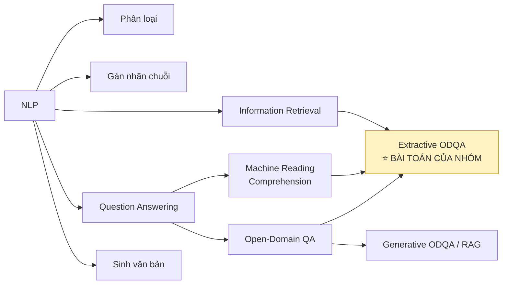
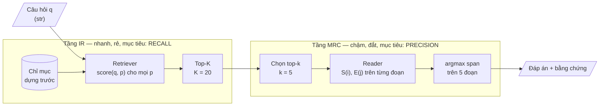

# BÀI 01 — NLP, INFORMATION RETRIEVAL VÀ QUESTION ANSWERING

> **Vị trí trong giáo trình**: bài mở đầu. Không có code mô hình nào ở đây; bài này dựng **ngôn ngữ chung** (thuật ngữ, cách phân loại bài toán, hợp đồng dữ liệu) để mọi bài sau dùng lại.
>
> **Ví dụ xuyên suốt**: „Wann wurde Hundefett in der Medizin verwendet?“ → „vom Mittelalter bis in die Neuzeit“ (xem `00_LEARNING_ROADMAP.md` §4).

---

## Mục lục

- [A. Learning Objectives](#a-learning-objectives)
- [B. Prerequisite Knowledge](#b-prerequisite-knowledge)
- [C. Theoretical Foundation](#c-theoretical-foundation)
- [D. Mathematical Foundation](#d-mathematical-foundation)
- [E. Architecture & Working Mechanism](#e-architecture--working-mechanism)
- [F. Application in Our Project](#f-application-in-our-project)
- [G. Implementation Mapping](#g-implementation-mapping)
- [H. YouTube Learning Resources](#h-youtube-learning-resources)
- [I. Knowledge Check](#i-knowledge-check)
- [J. Implementation Readiness](#j-implementation-readiness)
- [Đáp án và lời giải](#đáp-án-và-lời-giải)
- [Tài liệu tham khảo bài 01](#tài-liệu-tham-khảo-bài-01)

---

## A. LEARNING OBJECTIVES

### A.1. Mục tiêu học tập

Sau bài này, bạn phải làm được năm việc:

1. **Định vị** bài toán của nhóm trong bản đồ NLP: nó thuộc nhánh nào, khác các bài toán lân cận ở đâu.
2. **Phân biệt** ba cặp khái niệm hay bị nhầm:
   - Information Retrieval (IR) ↔ Question Answering (QA) ↔ Machine Reading Comprehension (MRC)
   - Closed-domain ↔ Open-domain (và hai nghĩa khác nhau của cặp này)
   - Extractive QA ↔ Generative QA
3. **Phát biểu toán học** bài toán extractive QA: tìm cặp chỉ số `(i, j)` trên đoạn văn.
4. **Giải thích** vì sao chất lượng truy hồi đặt "trần" cho chất lượng câu trả lời, bằng công thức xác suất toàn phần và **số liệu thật của project**.
5. **Đọc** được hợp đồng dữ liệu (`Passage`, `QAExample`, `QAResponse`) trong `src/germanqa/schemas.py` và biết từng trường dùng để làm gì.

### A.2. Sau bài học phải hiểu được gì

| Câu hỏi | Câu trả lời ngắn bạn phải tự nói được |
|---|---|
| Bài toán của nhóm tên chính xác là gì? | Open-domain extractive QA tiếng Đức, kiến trúc Retriever–Reader |
| Hệ thống nhận gì? | Một chuỗi câu hỏi tiếng Đức, **không** kèm đoạn văn |
| Hệ thống trả gì? | Một span nguyên văn + passage chứa nó + offset `[start, end)` + điểm + thời gian |
| Vì sao chọn extractive? | Cần bằng chứng truy vết được; GermanQuAD gán nhãn dạng span |
| Vì sao không đọc cả kho? | Đọc 5 đoạn ≈ 58 ms → đọc 26.864 đoạn ≈ 5 phút/câu hỏi |
| Lỗi đến từ đâu? | Từ cả tầng truy hồi lẫn tầng đọc; lỗi truy hồi không sửa được ở sau |

### A.3. Kiến thức cần ghi nhớ

- **Corpus** 26.864 passage; **train** 10.301 câu; **dev** 1.176; **test** 2.203.
- Đáp án là **span** = chuỗi con liên tục của `original_text`, offset tính theo **ký tự, nửa mở** `[start, end)`.
- Công thức phân rã: `P(A) = P(g∈R_k)·P(A | g∈R_k) + P(g∉R_k)·P(A | g∉R_k)`.
- Dev B0: Hit@5 = 0,638; EM = 0,236; EM khi cho sẵn gold = 0,469.

### A.4. Thành phần pipeline sử dụng kiến thức này

| Kiến thức trong bài | Được dùng ở |
|---|---|
| Phân loại extractive vs generative | Thiết kế reader (bài 10): đầu ra là start/end, không phải token sinh |
| Open-domain | Lý do phải có retriever (bài 04, 07, 08) |
| Inverted index, ranking | BM25 (bài 04) |
| Phân rã xác suất | Phân tích lỗi 4 tầng (bài 12); vì sao H1 không tăng EM (bài 09) |
| Hợp đồng dữ liệu | Mọi module: tiền xử lý (03), pipeline (02), API |

---

## B. PREREQUISITE KNOWLEDGE

### B.1. Kiến thức cần biết trước

| Kiến thức | Mức cần | Tự kiểm tra nhanh |
|---|---|---|
| Xác suất có điều kiện `P(A|B) = P(A∩B)/P(B)` | Tính được | Tung 2 xúc xắc, biết tổng ≥ 10, xác suất có một mặt 6? (đáp: 5/6) |
| Xác suất toàn phần | Tính được | Xem §D.3 |
| Python `dict`, `list`, `set` | Thành thạo | Viết hàm đếm từ trong một chuỗi |
| Chuỗi Python, slicing `s[a:b]` | Thành thạo | `"Haushund"[0:4]` = ? (đáp: `"Haus"`) |

### B.2. Thuật ngữ chuyên ngành (giải thích lần đầu)

| Thuật ngữ | Giải thích |
|---|---|
| **NLP** (Natural Language Processing) | Lĩnh vực làm cho máy tính xử lý ngôn ngữ con người: phân loại, dịch, tóm tắt, hỏi đáp… |
| **Corpus** (kho văn bản) | Tập hợp văn bản mà hệ thống làm việc trên đó. Trong project: 26.864 đoạn văn Wikipedia tiếng Đức |
| **Passage** (đoạn văn) | Đơn vị văn bản nhỏ nhất được truy hồi. Không phải cả bài viết, không phải câu |
| **Document** | Bài viết gốc (ví dụ bài „Haushund“). Một document có nhiều passage |
| **Query** (truy vấn) | Biểu diễn nhu cầu thông tin. Trong project: chính là câu hỏi |
| **Token** | Đơn vị sau khi tách văn bản. Có nhiều cách tách: theo từ (`\w+`, dùng cho BM25) hoặc theo từ con (WordPiece, dùng cho GBERT) |
| **Term** | Token được dùng làm đơn vị đánh chỉ mục trong IR (sau chữ thường, lọc stopword) |
| **Relevance** (mức liên quan) | Passage có đáp ứng nhu cầu thông tin của query không. Trong project: passage có chứa đáp án không |
| **Qrels** (query relevance judgments) | Bảng ghi passage nào là đúng cho câu hỏi nào. Ví dụ `qrels_dev.json` |
| **Span** | Đoạn văn bản liên tục, xác định bằng vị trí bắt đầu và kết thúc |
| **Gold** | Nhãn đúng do con người gán: gold passage, gold answer |
| **Offset** | Vị trí ký tự trong chuỗi. Project dùng `[start, end)`: lấy `text[start:end]` |
| **Ranking** | Danh sách được sắp theo điểm giảm dần. Hạng 1 là tốt nhất |
| **Top-k** | k phần tử đầu của danh sách xếp hạng |
| **Pipeline** | Chuỗi các bước nối tiếp, đầu ra bước trước là đầu vào bước sau |
| **Checkpoint** | Bản lưu trọng số mô hình tại một thời điểm |

### B.3. Mối liên hệ với bài trước

Đây là bài đầu tiên. Bài này **cung cấp** cho bài 02 (Retriever–Reader) ba thứ: định nghĩa bài toán, khái niệm top-k, và công thức phân rã lỗi.

---

## C. THEORETICAL FOUNDATION

### C.1. NLP: từ bài toán tổng quát đến bài toán của nhóm

📗 **[NỀN TẢNG]** NLP bao gồm rất nhiều bài toán. Có thể nhóm theo **dạng đầu ra**:

| Dạng đầu ra | Ví dụ bài toán | Ví dụ đầu ra |
|---|---|---|
| Một nhãn cho cả văn bản | Phân loại cảm xúc, phân loại chủ đề | `positive` |
| Một nhãn cho mỗi token | Nhận diện thực thể (NER), gán nhãn từ loại | `Konrad/B-PER Adenauer/I-PER` |
| **Một span trong văn bản** | **Extractive QA** | `[576, 610)` |
| Một danh sách xếp hạng | **Information Retrieval**, tìm kiếm | `[p_3a.., p_91.., …]` |
| Một chuỗi mới | Dịch máy, tóm tắt, generative QA | „Im Mittelalter.“ |

📘 **[BÁO CÁO]** Hệ thống của nhóm **kết hợp hai dạng**: tầng truy hồi tạo ra **danh sách xếp hạng**, tầng đọc tạo ra **một span**. Đây là lý do bài toán vừa là IR vừa là QA.



### C.2. Information Retrieval (IR)

#### C.2.1. Bản chất

📗 **[NỀN TẢNG]** IR là bài toán tìm trong một tập văn bản lớn những văn bản thỏa mãn một nhu cầu thông tin (Manning et al., 2008). Ba ý cốt lõi:

1. **Đầu ra là danh sách, không phải câu trả lời.** Google trả 10 đường link; người dùng tự đọc.
2. **Mức liên quan là một điểm số**, không phải đúng/sai tuyệt đối. Hệ thống gán điểm `score(q, d)` cho mỗi cặp, rồi sắp xếp.
3. **Phải nhanh trên kho rất lớn.** Không thể so câu hỏi với từng văn bản một cách đắt đỏ → cần **chỉ mục** dựng trước.

#### C.2.2. Cơ chế: vì sao cần chỉ mục ngược (inverted index)

Giả sử kho có N văn bản. Cách ngây thơ: với mỗi câu hỏi, duyệt cả N văn bản, kiểm tra từng từ. Chi phí tỉ lệ với **tổng độ dài kho** cho **mỗi** câu hỏi.

Chỉ mục ngược đảo chiều quan hệ: thay vì "văn bản → các từ nó chứa", lưu "**từ → các văn bản chứa nó**" (posting list).

Ví dụ với 3 passage nhỏ (đã chữ thường, bỏ stopword):

| Passage | Nội dung (term) |
|---|---|
| p1 | hundefett, medizin, mittelalter |
| p2 | hund, haustier, wolf |
| p3 | medizin, antike, galen |

Chỉ mục ngược:

| Term | Posting list |
|---|---|
| hundefett | p1 |
| medizin | p1, p3 |
| mittelalter | p1 |
| hund | p2 |
| … | … |

Với query `{hundefett, medizin, verwendet}`, hệ thống chỉ đọc 3 posting list → ứng viên `{p1, p3}`. **p2 không bao giờ được chạm tới.** Chi phí tỉ lệ với độ dài các posting list liên quan, không phải kích thước kho.

📘 **[BÁO CÁO]** Đây chính là cơ chế BM25 của project dùng (Ch.2.2.1, Hình 2.2). Bài 04 thêm phần **trọng số** cho từng (term, passage).

#### C.2.3. Hai họ phương pháp truy hồi

| | Sparse (thưa) | Dense (dày) |
|---|---|---|
| Biểu diễn | Vector cỡ từ vựng, hầu hết = 0. Chỉ mục BM25 của project có **284.585** term (📘 Ch.4.2.3) | Vector nhỏ (768 chiều), hầu hết ≠ 0 |
| So khớp | Trùng **từ bề mặt** | Gần nhau về **nghĩa** |
| Ví dụ | TF-IDF, **BM25** | **DPR** |
| Cần huấn luyện? | Không | Có (dữ liệu có nhãn) |
| Trong project | B0, nhánh BM25 của H0/H1 | B1, nhánh dense của H0/H1 |
| Bài | 04 | 06, 07 |

### C.3. Question Answering (QA)

#### C.3.1. Bản chất: QA đi thêm một bước so với IR

📗 **[NỀN TẢNG]** Một hệ thống QA nhận câu hỏi bằng ngôn ngữ tự nhiên và trả về **chính thông tin cần tìm**, thường là một cụm ngắn (tên, địa danh, thời điểm, số lượng).

```
IR : "Wann wurde Hundefett …?"  →  [Haushund#12, Haushund#3, Wolf#7, …]   (người dùng tự đọc)
QA : "Wann wurde Hundefett …?"  →  "vom Mittelalter bis in die Neuzeit"     (+ bằng chứng)
```

#### C.3.2. Machine Reading Comprehension (MRC)

📗 **[NỀN TẢNG]** MRC là bài toán **đọc một đoạn văn cho trước** và trả lời câu hỏi về đoạn đó. SQuAD (Rajpurkar et al., 2016) là bộ dữ liệu chuẩn: hơn 100.000 câu hỏi do con người đặt trên đoạn văn Wikipedia, mỗi đáp án là một span của đoạn đó.

GermanQuAD (Möller et al., 2021) là "SQuAD tiếng Đức": cùng định dạng span.

> **Quan hệ quan trọng**: QA miền mở = IR (tìm đoạn) + MRC (đọc đoạn). Chen et al. (2017) gọi đây là "machine reading at scale".

#### C.3.3. Closed-domain vs Open-domain — hai nghĩa khác nhau

📘 **[BÁO CÁO]** (Ch.2.1.2) nhấn mạnh có **hai cách hiểu**. Đây là chỗ sinh viên hay nhầm khi bảo vệ.

| | Nghĩa 1: theo **chủ đề** | Nghĩa 2: theo **việc có cho đoạn văn hay không** |
|---|---|---|
| Closed | Chỉ một lĩnh vực hẹp (y tế, luật) | Đoạn văn chứa đáp án được cho kèm câu hỏi (= MRC) |
| Open | Mọi chủ đề | Chỉ cho câu hỏi; hệ thống phải tự tìm trong kho lớn |
| Đề tài thuộc | Open (Wikipedia đủ chủ đề) | **Open** — đây là nghĩa báo cáo dùng |

Bảng so sánh thiết lập (📘 Bảng 2.1):

| Tiêu chí | Đọc hiểu (đoạn cho trước) | Hỏi đáp miền mở |
|---|---|---|
| Đầu vào | Câu hỏi + đoạn văn chứa đáp án | Câu hỏi + kho chuẩn bị sẵn |
| Nhiệm vụ | Định vị đáp án trong 1 đoạn | Tìm đoạn liên quan, rồi định vị |
| Nguồn lỗi | Chỉ bước đọc | Cả truy hồi và đọc |
| Trong đề tài | Đánh giá riêng reader (**gold context**) | **Thiết lập chính** |

💡 Project dùng **cả hai** thiết lập: open-domain là bài toán thật; gold-context là "phòng thí nghiệm" để đo riêng năng lực reader (bài 12).

#### C.3.4. Extractive vs Generative QA

📘 **[BÁO CÁO]** Bảng 2.2, mở rộng thêm ví dụ:

| Tiêu chí | Extractive | Generative |
|---|---|---|
| Dạng đáp án | Span nguyên văn | Chuỗi do mô hình sinh |
| Đầu ra mô hình | 2 điểm cho mỗi token: start, end | Phân phối trên từ vựng cho từng bước sinh |
| Kiến trúc | Encoder (BERT) + đầu span | Encoder–decoder (T5, BART) hoặc decoder-only (GPT) |
| Kiểm chứng | Trực tiếp: có offset trong nguồn | Gián tiếp: phải đối chiếu |
| Lỗi đặc trưng | Sai ranh giới span | Bịa nội dung (hallucination) |
| Không làm được | Đáp án không nằm nguyên văn; cần tổng hợp nhiều đoạn | — |
| Ví dụ với câu hỏi mẫu | „vom Mittelalter bis in die Neuzeit“ | „Seit dem Mittelalter wurde Hundefett gegen Gelenkleiden eingesetzt.“ |
| Ví dụ hệ thống | DrQA, BERTserini, **project này** | RAG, FiD (📙 mở rộng) |

**Hai lý do nhóm chọn extractive** (📘 Ch.2.1.3):
1. **Yêu cầu bằng chứng**: mọi câu trả lời phải truy vết được về văn bản nguồn. Extractive đáp ứng ngay từ định nghĩa.
2. **Dữ liệu sẵn có**: GermanQuAD gán nhãn dạng span → huấn luyện và đánh giá trực tiếp.

📙 **[MỞ RỘNG]** Lý do thứ ba ngầm định: phần cứng RTX 3050 4 GB. Một mô hình sinh đủ tốt cho tiếng Đức thường lớn hơn nhiều so với GBERT-base 110M tham số. Báo cáo không nêu lý do này; đây là nhận xét của giáo trình.

### C.4. Hệ thống QA miền mở hiện đại: lịch sử ngắn

| Năm | Hệ thống | Retriever | Reader | Ý nghĩa |
|---|---|---|---|---|
| 2016 | SQuAD | — | — | Chuẩn hóa dạng span + EM/F1 |
| 2017 | DrQA (Chen et al.) | TF-IDF bigram băm | RNN | Khai sinh kiến trúc Retriever–Reader |
| 2019 | BERTserini (Yang et al.) | BM25 (Anserini) | BERT | **Gần nhất với B0 của nhóm** |
| 2019 | ORQA (Lee et al.) | Dense, học được | BERT | Tiền đề DPR |
| 2020 | DPR (Karpukhin et al.) | Dual encoder BERT | BERT | Dense vượt BM25 trên ODQA tiếng Anh |
| 2021 | GermanQuAD/DPR (Möller et al.) | DPR tiếng Đức (dựa trên GBERT) | Reader tiếng Đức huấn luyện trên GermanQuAD | **Dữ liệu và checkpoint DPR của nhóm** (nhóm tự fine-tune reader, không dùng reader của bài báo) |
| 2020–21 | RAG, FiD | DPR | Generator | Hướng sinh (📙 ngoài phạm vi) |

### C.5. Đặc thù tiếng Đức ảnh hưởng tới cả IR và QA

📘 **[BÁO CÁO]** (Ch.2.2.5, 2.6.4) — tóm tắt; bài 03, 04, 10 đi sâu:

| Đặc điểm | Ví dụ | Ảnh hưởng tới IR (BM25) | Ảnh hưởng tới reader (GBERT) |
|---|---|---|---|
| Danh từ ghép | „Bundesverfassungsgericht“ | „Verfassungsgericht“ không khớp | WordPiece tách: `[Bundesver, ##fassungs, ##gericht]` |
| Biến đổi hình thái | Hund, Hundes, Hunde, Hunden | 4 term khác nhau | Gần nhau trong không gian embedding |
| Viết hoa danh từ | „das Fett“ vs „fett“ (tính từ) | BM25 chữ thường → mất phân biệt | GBERT **cased** → giữ phân biệt |
| Ký tự ä ö ü ß | „höchste“ | NFD tách „ho“ + „chste“ nếu không chuẩn hóa | Tokenizer cần NFC |
| Dấu ngoặc Đức | „ “ ‚ ‘ » « | — | Chuẩn hóa EM/F1 phải bỏ các dấu này |

### C.6. Ưu điểm, hạn chế, trường hợp sử dụng

| | Extractive ODQA (hướng nhóm chọn) |
|---|---|
| ✅ Ưu điểm | Kiểm chứng được; mô hình nhỏ; đánh giá rõ ràng bằng EM/F1; module hóa |
| ❌ Hạn chế | Không trả lời được câu cần tổng hợp; lỗi truy hồi lan truyền; đáp án phải nằm nguyên văn |
| 🎯 Phù hợp | Tra cứu sự kiện (factoid): wann, wer, wo, wie viele |
| ⛔ Không phù hợp | „Warum…“ cần giải thích dài; so sánh nhiều nguồn; câu hỏi có/không |

---

## D. MATHEMATICAL FOUNDATION

### D.1. Phát biểu hình thức của extractive QA trên một đoạn

📘 **[BÁO CÁO]** công thức (2.1):

$$
(\hat{i}, \hat{j}) = \arg\max_{(i,j) \in V(c)} s(i, j), \qquad \hat{a} = c_{\hat{i}:\hat{j}}
$$

| Ký hiệu | Ý nghĩa |
|---|---|
| `q` | Câu hỏi |
| `c = (c₁, …, cₙ)` | Đoạn văn gồm n token |
| `(i, j)` | Cặp chỉ số token: bắt đầu i, kết thúc j |
| `s(i, j)` | Điểm mô hình gán cho span từ token i đến j |
| `V(c)` | Tập cặp **hợp lệ**: `i ≤ j`, cả hai nằm trong phần đoạn văn, `j − i + 1 ≤ L` |
| `L` | Độ dài span tối đa. Project: `max_answer_tokens = 80` |
| `â` | Đáp án dự đoán |

**Vì sao thiết kế như vậy?** Nếu chấm điểm độc lập từng cặp `(i, j)`, số đại lượng là cỡ `n²/2`. Với `n = 300`, đó là ~45.000 cặp. BERT tách thành `s(i, j) = S(i) + E(j)` → chỉ cần **2n = 600** điểm (bài 10).

**Ví dụ nhỏ bằng số.** Đoạn 6 token, giả sử mô hình cho:

| Token i | vom | Mittelalter | bis | in | die | Neuzeit |
|---|---|---|---|---|---|---|
| S(i) | **4,1** | 1,2 | −0,5 | −1,0 | −0,8 | 0,3 |
| E(i) | −0,7 | 1,9 | −1,1 | −0,9 | 0,2 | **3,6** |

*(số minh họa, không phải giá trị đo)*

- Span `(vom, Neuzeit)`: `4,1 + 3,6 = 7,7`
- Span `(vom, Mittelalter)`: `4,1 + 1,9 = 6,0`
- Span `(Mittelalter, Neuzeit)`: `1,2 + 3,6 = 4,8`
- Span `(Neuzeit, vom)`: **không hợp lệ** vì `i > j`

→ Đáp án: „vom Mittelalter bis in die Neuzeit“, điểm 7,7.

### D.2. Precision và Recall trong IR

📗 **[NỀN TẢNG]** Với một câu hỏi, gọi `Rel` là tập passage đúng, `Ret_k` là k passage trả về:

$$
\text{Precision@}k = \frac{|Rel \cap Ret_k|}{k}, \qquad \text{Recall@}k = \frac{|Rel \cap Ret_k|}{|Rel|}
$$

Ví dụ: `Rel = {p7}`, `Ret_5 = {p3, p7, p1, p9, p2}` → Precision@5 = 1/5 = 0,2; Recall@5 = 1/1 = 1.

**Ý nghĩa thực tế cho project**: reader đọc cả 5 đoạn, nên 4 đoạn sai "không mất phí" về mặt có được đọc hay không — thứ cần là **Recall** (đoạn đúng có lọt vào không). Đó là lý do báo cáo dùng **Hit@k** (bài 12) làm chỉ số chính, không dùng Precision.

> ⚠️ Nhưng 4 đoạn sai **có** gây hại theo cách khác: chúng là "đối thủ" mà reader có thể chọn nhầm. §D.4 đo hiệu ứng này bằng số thật.

### D.3. Công thức phân rã lỗi — trái tim của bài này

📘 **[BÁO CÁO]** công thức (2.2), dựa trên xác suất toàn phần:

$$
P(A) = \underbrace{P(g \in R_k)}_{\text{retriever}} \cdot \underbrace{P(A \mid g \in R_k)}_{\text{reader khi có đoạn đúng}} \;+\; P(g \notin R_k) \cdot \underbrace{P(A \mid g \notin R_k)}_{\text{"may mắn"}}
$$

| Ký hiệu | Ý nghĩa | Đo bằng |
|---|---|---|
| `A` | Biến cố "hệ thống trả lời đúng" (EM = 1) | EM end-to-end |
| `g` | Gold passage | qrels |
| `R_k(q)` | k passage đưa vào reader | output của retriever |
| `P(g ∈ R_k)` | Xác suất đoạn đúng lọt vào top-k | **Hit@k** |
| `P(A | g ∈ R_k)` | Reader đúng khi đã có đoạn đúng (giữa k−1 đoạn khác) | EM có điều kiện |
| `P(A | g ∉ R_k)` | Đúng dù không có đoạn đúng (chuỗi đáp án tình cờ có trong đoạn khác) | thường rất nhỏ |

**Hai hệ quả** (📘 Ch.2.1.5):
1. `P(A) ≤ P(g∈R_k) + P(A|g∉R_k)` ≈ Hit@k → truy hồi đặt **trần gần đúng** cho toàn hệ.
2. Tăng Hit@k chỉ giúp nếu `P(A | g ∈ R_k)` không giảm.

### D.4. Ví dụ tính toán với số thật của project (dev, cấu hình B0)

Dữ liệu 📘 **[BÁO CÁO]** (Bảng 4.11, 4.12, 4.14): dev có `n = 1.176` câu; Hit@5 = 0,638; EM end-to-end = 0,236 (278 câu đúng); trong 898 câu sai có 253 *wrong passage* và 226 *wrong span* (hai loại này đều có gold trong top-5).

**Bước 1 — số câu có gold trong top-5:**
`0,638 × 1.176 ≈ 750` câu.

**Bước 2 — trong 750 câu đó, bao nhiêu câu sai?**
Sai mà gold có trong top-5 = wrong passage + wrong span = `253 + 226 = 479`.
→ Đúng: `750 − 479 = 271`.

**Bước 3 — các xác suất có điều kiện:**
- `P(A | g ∈ R_5) = 271 / 750 ≈ 0,361`
- Câu đúng mà gold **không** trong top-5: `278 − 271 = 7` trên `1.176 − 750 = 426` câu → `P(A | g ∉ R_5) = 7/426 ≈ 0,016`

**Bước 4 — ghép lại theo (2.2):**

$$
P(A) = 0{,}638 \times 0{,}361 + 0{,}362 \times 0{,}016 = 0{,}2303 + 0{,}0059 = 0{,}236 \checkmark
$$

Khớp đúng EM đo được.

**Bước 5 — phân tích kết quả. Đây là phát hiện quan trọng:**

| Đại lượng | Giá trị | Diễn giải |
|---|---|---|
| EM khi **chỉ** cho gold passage (gold context) | **0,469** | Năng lực đọc "trong phòng thí nghiệm" |
| EM khi gold nằm **giữa 4 đoạn khác** | **0,361** | Năng lực đọc "ngoài đời" |
| Chênh lệch | −0,108 | Cái giá của **đoạn gây nhiễu** (distractor) |

→ `P(A | g ∈ R_k)` **không** bằng EM gold-context. Có 4 đoạn cạnh tranh làm reader chọn nhầm (253 câu *wrong passage*). Điều này giải thích một kết quả mà nếu không hiểu (2.2) thì sẽ thấy vô lý:

> 📘 Trên test, H1 (thêm reranker) tăng Hit@5 từ 0,919 lên 0,969 nhưng EM **giảm** từ 0,261 xuống 0,250 (Ch.5.6). Theo (2.2): Hit@5 tăng, nhưng reranker đưa các đoạn "rất liên quan nhưng không chứa đáp án đúng nguyên văn" lên top, làm `P(A | g ∈ R_5)` giảm nhiều hơn. Bài 09 và 12 phân tích chi tiết.

**Bước 6 — "trần" của hệ thống B0 trên dev:**
Nếu reader hoàn hảo khi có gold (`P(A|g∈R_5) = 1`): `P(A) ≤ 0,638 + 0,006 ≈ 0,644`. Không reader nào vượt được ~64% EM với retriever B0 ở top-5.

### D.5. Ví dụ về chi phí: vì sao phải tách hai tầng

📘 **[BÁO CÁO]** Ch.4.1.1: reader xử lý 5 đoạn ≈ 58 ms → ≈ 12 ms/đoạn (trung bình dev).

$$
26.864 \text{ đoạn} \times 12 \text{ ms} \approx 322.000 \text{ ms} \approx 5{,}4 \text{ phút / câu hỏi}
$$

(Báo cáo ghi rõ đây là ước tính suy ra, chưa đo trực tiếp.) So với BM25: 0,7 ms cho **toàn kho** nhờ chỉ mục ngược (Bảng 4.13). Tỉ lệ chi phí mỗi đoạn chênh nhau khoảng **5 bậc độ lớn**.

---

## E. ARCHITECTURE & WORKING MECHANISM

### E.1. Sơ đồ tổng quát của một hệ thống ODQA trích xuất



### E.2. Input → Processing → Output của toàn hệ thống

| | Nội dung | Ví dụ thật |
|---|---|---|
| **Input** | Chuỗi câu hỏi tiếng Đức | `"Wann wurde Hundefett in der Medizin verwendet?"` |
| **Processing 1** | Chuẩn hóa NFC, bỏ ký tự vô hình | (không đổi với câu này) |
| **Processing 2** | Truy hồi K đoạn | BM25: gold ở hạng 3; Dense: hạng 1 |
| **Processing 3** | Chọn k = 5 | gold có trong 5 đoạn |
| **Processing 4** | Đọc từng đoạn, mỗi đoạn cho 1 span tốt nhất | 5 span ứng viên kèm điểm |
| **Processing 5** | Chọn span điểm cao nhất | span từ passage „Haushund“ |
| **Output** | `QAResponse` | `answer="vom Mittelalter bis in die Neuzeit"`, `answer_start=576`, `answer_end=610`, … |

### E.3. Ví dụ chạy xuyên suốt ở mức khái niệm

```
① Query       : "Wann wurde Hundefett in der Medizin verwendet?"
② Term (BM25) : [hundefett, medizin, verwendet]            ← "wann", "wurde", "in", "der" bị lọc stopword
③ Inverted idx: hundefett → {Haushund#k, …}  medizin → {…}  verwendet → {…}
④ Ranking     : BM25 hạng 3 (điểm 9,94)  |  Dense hạng 1 (điểm 168,27)
⑤ Top-5       : chứa Haushund#k                            ← P(g ∈ R_5) "xảy ra"
⑥ Reader      : start = "vom", end = "Neuzeit"
⑦ Offset      : passage_text[576:610]
⑧ Output      : "vom Mittelalter bis in die Neuzeit"       ← A "xảy ra"
```

Mỗi mũi tên trên là chủ đề của một bài: ②③④ → bài 04; ④ dense → 06–07; ④ hợp nhất → 08; ⑤ → 02, 09; ⑥⑦ → 10.

---

## F. APPLICATION IN OUR PROJECT

### F.1. Thành phần này nằm ở đâu trong pipeline?

Bài 01 không phải một module; nó là **định nghĩa bài toán** mà cả pipeline phục vụ. Trong mã, định nghĩa này được hiện thực hóa thành **hợp đồng dữ liệu** `src/germanqa/schemas.py` — file đầu tiên được viết (GĐ0) và mọi giai đoạn sau đọc/ghi đúng các dạng này.

### F.2. Tại sao nhóm cần định nghĩa này rõ ràng?

| Quyết định | Hệ quả kỹ thuật | Ở đâu trong mã |
|---|---|---|
| Open-domain | Phải có retriever + corpus + chỉ mục | `retrieval/`, `artifacts/` |
| Extractive | Reader xuất start/end; đáp án = `original_text[start:end]` | `reader/postprocess.py`; kiểm tra bất biến ở `pipeline.py` |
| Offset ký tự nửa mở | Thống nhất giữa dữ liệu, reader, API, React | `schemas.py` docstring; `to_utf16_offset` |
| Bằng chứng | Output luôn có `passage_id`, `passage_text` | `QAResponse` |
| Đo riêng từng tầng | Cần cả qrels (cho IR) lẫn answers (cho QA) | `data/processed/qrels_*.json`, `qa_*.jsonl` |

### F.3. Đầu vào thực tế và đầu ra thực tế

📘 **[BÁO CÁO]** Ch.4.1.1 và `schemas.py`:

**Đầu vào**: một `str`. API giới hạn `max_question_chars: 500` (`configs/api.yaml`); reader cắt câu hỏi còn tối đa **64 token** (`MAX_QUESTION_TOKENS` trong `pipeline.py`).

**Đầu ra** — `QAResponse`, các trường và ý nghĩa:

| Trường | Kiểu | Ý nghĩa | Liên quan bài |
|---|---|---|---|
| `answer` | str | Span nguyên văn | 10 |
| `passage_id` | str | `"p_" + 16 ký tự băm nội dung` | 03 |
| `passage_text` | str | Toàn văn passage (bằng chứng) | 03 |
| `answer_start`, `answer_end` | int | Offset ký tự `[start, end)` trên `passage_text` | 10 |
| `retrieval_score` | float | Điểm retriever của passage được chọn (BM25, dot, hoặc RRF) | 04, 07, 08 |
| `reader_score` | float | Điểm span (`minus_cls`) — **không phải xác suất** | 10 |
| `rerank_score` | float \| None | Logit reranker (chỉ H1) | 09 |
| `retrieval_time`, `reader_time`, `rerank_time`, `total_time` | float | Giây | 12 |
| `model_version`, `corpus_version`, `experiment_id` | str | Truy vết tái lập | 12 |
| `status` | str | `ok` \| `empty_question` \| `no_passages` \| `no_valid_span` \| `question_truncated` | 02 |
| `trace` | dict \| None | Vết từng bước khi bật | 02 |

### F.4. Đầu ra truyền sang thành phần nào?

`QAResponse` → (a) bộ đánh giá (`scripts/GD5/05_run_dev.py` ghi `reports/pipeline_dev_*.jsonl`, bài 12) hoặc (b) FastAPI (`api/app.py`) → React hiển thị đáp án tô sáng trong passage (dùng `to_utf16_offset` vì JavaScript đếm UTF-16).

### F.5. Nếu bỏ "định nghĩa extractive" và chuyển sang generative thì sao?

| Khía cạnh | Hệ quả |
|---|---|
| Bằng chứng | Mất offset → không tô sáng được, không kiểm chứng tự động |
| Bất biến `passage_text[start:end] == answer` | Không còn ý nghĩa |
| EM/F1 | Vẫn tính được nhưng kém tin cậy hơn (diễn đạt lại bị chấm sai) |
| Dữ liệu | Nhãn span của GermanQuAD không dùng trực tiếp làm target |
| Phần cứng | Cần mô hình lớn hơn nhiều so với 4 GB VRAM |

### F.6. Tham số trong báo cáo cần đặc biệt chú ý ở bài này

| Tham số | Giá trị | Vì sao cần chú ý |
|---|---|---|
| `retrieval_top_k` (K) | 20 | Trần Hit@20 dùng để phân tích |
| `reader_top_k` (k) | 5 | Quyết định `P(g ∈ R_k)` = Hit@5 là chỉ số chính |
| `MAX_QUESTION_TOKENS` | 64 | Câu dài hơn bị cắt → `status = question_truncated` |
| `max_answer_tokens` (L) | 80 | Ràng buộc `V(c)` trong (2.1) |
| Quy ước offset | ký tự, `[start, end)` | Sai lệch 1 ký tự = EM 0 |

---

## G. IMPLEMENTATION MAPPING

### G.1. Thư viện sử dụng ở mức bài này

| Thư viện | Dùng để | Bài đi sâu |
|---|---|---|
| `dataclasses` (chuẩn) | Định nghĩa `Passage`, `QAExample`, `QAResponse` | 01 |
| `json` (chuẩn) | Đọc/ghi JSONL | 03 |
| `unicodedata` (chuẩn) | NFC | 03 |
| `transformers` | Tokenizer, reader | 05, 10 |
| `faiss` | Chỉ mục vector | 07 |

### G.2. Class và function quan trọng

| Tên | File | Vai trò |
|---|---|---|
| `Passage`, `Answer`, `QAExample`, `QAResponse` | `schemas.py` | Hợp đồng dữ liệu |
| `to_utf16_offset(text, index)` | `schemas.py` | Đổi offset Python → JavaScript |
| `QAPipeline.answer(question, …)` | `pipeline.py` | Điểm vào online |
| `build_pipeline(retriever=…, reranker=…)` | `pipeline.py` | Dựng B0/B1/H0/H1 |

### G.3. Cấu trúc dữ liệu (một bản ghi mỗi loại)

Các bản ghi dưới đây được **đọc trực tiếp** từ `data/processed/` cho câu hỏi ví dụ (văn bản dài được cắt bằng `…`, danh sách `source` rút gọn còn 2 trong 8 phần tử):

```jsonc
// corpus.jsonl — một Passage (original_text dài 991 ký tự)
{"passage_id": "p_c25e144a863973b9",
 "original_text": "Haushund\n\n=== Fleisch- und Arzneimittellieferant ===\nHundefleisch wird in einigen Ländern gegessen …",
 "retrieval_text": "haushund === fleisch- und arzneimittellieferant === hundefleisch wird in einigen ländern gegessen …",
 "title": "Haushund", "document_id": "d_a948295c9577",
 "source": [{"dataset": "germanquad", "role": "context",  "source_id": "57718",  "split": "train", "title": "Haushund"},
            {"dataset": "germandpr",  "role": "positive", "source_id": "row242", "split": "train", "title": "Haushund"}, …]}

// qa_dev.jsonl — một QAExample
{"question_id": "q_0801808ed0ccd8b5", "question": "Wann wurde Hundefett in der Medizin verwendet?",
 "passage_id": "p_c25e144a863973b9",
 "answers": [{"start": 576, "text": "vom Mittelalter bis in die Neuzeit"}], "origin": "germanquad"}

// qrels_dev.json — question_id → danh sách passage đúng
{"q_0801808ed0ccd8b5": ["p_c25e144a863973b9"]}
```

Ba điều quan sát được ngay từ dữ liệu thật:
- `retrieval_text` không chỉ là chữ thường: xuống dòng cũng bị gộp thành khoảng trắng. Reader và offset luôn dùng `original_text`.
- `source` có `split: "train"` dù câu hỏi thuộc **dev**: tập dev của project được tách ra từ GermanQuAD **train** (bài 03 giải thích cách chia).
- Passage này xuất hiện trong GermanDPR với vai trò `positive` → encoder DPR **đã thấy** nó khi huấn luyện. Đây là hiện tượng *passage exposure* mà bài 07 và 12 phân tích.

### G.4. Pseudocode toàn hệ thống

```text
function ANSWER(question):
    q ← NORMALIZE(question)                       # NFC, bỏ zero-width
    if q is empty: return EMPTY("empty_question")
    hits ← RETRIEVER.retrieve(q, K=20)            # list of (passage_id, score, rank)
    if hits is empty: return EMPTY("no_passages")
    if RERANKER: hits ← RERANKER.rerank(q, hits)  # chỉ H1
    used ← hits[0:5]
    q_reader ← CUT_TO_64_TOKENS(q)
    spans ← READER.read(q_reader, used)           # mỗi passage một span tốt nhất
    valid ← [s for s in spans if s.start ≥ 0]
    if valid is empty: return EMPTY("no_valid_span")
    best ← argmax(valid, by score)                # hòa điểm → giữ passage hạng cao hơn
    assert passage_text[best.start:best.end] == best.text   # bất biến extractive
    return QAResponse(best, …)
```

So với mã thật: đây là rút gọn của `QAPipeline.answer` (`src/germanqa/pipeline.py`).

### G.5. Code minh họa cơ chế cốt lõi

**(a) Chỉ mục ngược đồ chơi + truy hồi theo đếm term trùng** — chạy được với Python chuẩn:

```python
import re
from collections import defaultdict

STOP = {"wann", "wurde", "in", "der", "die", "das", "von", "man", "es", "bei", "an", "bis", "dass", "sei"}

def tokenize(text):
    return [t for t in re.findall(r"\w+", text.lower()) if t not in STOP]

corpus = {
    "p1": "Haushund. Von Hundefett nahm man vom Mittelalter bis in die Neuzeit an, dass es in der Medizin hilfreich sei.",
    "p2": "Der Haushund stammt vom Wolf ab und ist ein Haustier.",
    "p3": "In der Medizin der Antike verwendete Galen viele tierische Fette.",
}

# Dựng chỉ mục ngược: term -> {passage_id: tf}
index = defaultdict(dict)
for pid, text in corpus.items():
    for t in tokenize(text):
        index[t][pid] = index[t].get(pid, 0) + 1

def retrieve(query, k=2):
    scores = defaultdict(int)
    for t in tokenize(query):
        for pid in index.get(t, {}):        # chỉ chạm posting list của term trong query
            scores[pid] += 1
    ranked = sorted(scores.items(), key=lambda x: (-x[1], x[0]))
    return [{"passage_id": p, "score": s, "rank": r + 1} for r, (p, s) in enumerate(ranked[:k])]

q = "Wann wurde Hundefett in der Medizin verwendet?"
print(tokenize(q))      # ['hundefett', 'medizin', 'verwendet']
print(retrieve(q))      # p1 (2 term trùng) trước p3 (1 term trùng); p2 không được chạm
```

Quan sát: `verwendet` (query) ≠ `verwendete` (p3) → không khớp. Đây là **lexical gap** do biến đổi hình thái, chủ đề của bài 04.

**(b) Bất biến extractive và offset nửa mở:**

```python
passage = "… nahm man vom Mittelalter bis in die Neuzeit an …"
answer = "vom Mittelalter bis in die Neuzeit"
start = passage.index(answer)
end = start + len(answer)                     # nửa mở: end là vị trí SAU ký tự cuối
assert passage[start:end] == answer
print(start, end, end - start == len(answer))  # độ dài = end - start, không +1
```

**(c) Kiểm tra lại công thức (2.2) bằng số dev:**

```python
n, hit5, em_total = 1176, 0.638, 278
wrong_passage, wrong_span = 253, 226
in_top5 = round(hit5 * n)                          # 750
correct_in = in_top5 - (wrong_passage + wrong_span) # 271
correct_out = em_total - correct_in                 # 7
p_a_in, p_a_out = correct_in / in_top5, correct_out / (n - in_top5)
print(round(p_a_in, 3), round(p_a_out, 3))          # 0.361 0.016
print(round(hit5 * p_a_in + (1 - hit5) * p_a_out, 3))  # 0.236 = EM dev B0
```

**(d) Gọi pipeline thật của project** (cần `venv` và các artifact đã dựng; chạy từ thư mục gốc project):

```python
from germanqa.pipeline import build_pipeline

pipe = build_pipeline(retriever="hybrid")           # H0; retriever="bm25" → B0
r = pipe.answer("Wann wurde Hundefett in der Medizin verwendet?", trace=True)
print(r.answer, r.passage_id, r.answer_start, r.answer_end, r.status)
print(r.passage_text[r.answer_start:r.answer_end] == r.answer)   # True
```

> ⚠️ Lệnh (d) nạp GBERT + 2 encoder DPR vào GPU 4 GB. Nếu không có GPU, quá trình sẽ chậm. Kết quả cụ thể phụ thuộc cấu hình; đừng mặc định đáp án luôn khớp ví dụ.

### G.6. Cách kiểm tra kết quả từng bước

| Bước | Kiểm tra | Cách làm |
|---|---|---|
| Dữ liệu | Mọi đáp án khớp offset | `original_text[start:start+len(text)] == text` cho mọi `QAExample` có `start` |
| Truy hồi | Gold có trong top-k? | So `hits[:k]` với `qrels[qid]` |
| Reader | Span hợp lệ | `0 ≤ start < end ≤ len(passage_text)` |
| Output | Bất biến extractive | `passage_text[answer_start:answer_end] == answer` (pipeline tự `raise` nếu sai) |
| Hệ thống | Phân rã (2.2) khớp EM | Như code (c) |

---

## H. YOUTUBE LEARNING RESOURCES

> **Trạng thái kiểm chứng**: mọi URL dưới đây xuất hiện trong kết quả tìm kiếm web ngày 2026-11-14 (giới hạn domain youtube.com). Cột "Kênh" chỉ ghi khi tên kênh được xác nhận hoặc là kênh chính thức rõ ràng; nếu kết quả tìm kiếm không hiển thị tên kênh, giáo trình ghi "chưa xác nhận". Hãy mở link để kiểm tra trước khi trích dẫn trong báo cáo.

| Thứ tự | Tên video (theo kết quả tìm kiếm) | Kênh | URL |
|---|---|---|---|
| 1 | Stanford CS224N NLP with Deep Learning, Winter 2019, Lecture 10 — Question Answering | Stanford Online *(kênh chính thức của khóa CS224N; tên kênh chưa hiển thị trong kết quả tìm kiếm)* | https://www.youtube.com/watch?v=SKctBms6RIs |
| 2 | Danqi Chen: From Reading Comprehension to Open-Domain Question Answering | chưa xác nhận | https://www.youtube.com/watch?v=1RN88O9C13U |
| 3 | 🤗 Tasks: Question Answering | Hugging Face | https://www.youtube.com/watch?v=ajPx5LwJD-I |

### H.1. Video 1 — CS224N Lecture 10: Question Answering

- **Nội dung**: bài giảng của khóa NLP Stanford về QA: bài toán đọc hiểu, bộ dữ liệu SQuAD, các mô hình đọc hiểu nơ-ron, chuyển sang QA miền mở.
- **Hỗ trợ kiến thức**: C.3 (MRC, SQuAD), D.1 (span, start/end), C.4 (lịch sử).
- **Tập trung**: phần định nghĩa SQuAD và cách chấm EM/F1; phần "open-domain QA" và kiến trúc retriever–reader (DrQA).
- **Lưu ý**: bài giảng năm 2019 có phần mô hình trước BERT (BiDAF, attention trên RNN). Đó là 📙 **[MỞ RỘNG]**, có thể xem lướt; project dùng BERT.

### H.2. Video 2 — Danqi Chen: From Reading Comprehension to Open-Domain QA

- **Nội dung**: Danqi Chen là tác giả chính của DrQA (Chen et al., 2017), bài báo khai sinh kiến trúc Retriever–Reader mà project dựa vào. Video trình bày con đường từ đọc hiểu sang hỏi đáp miền mở.
- **Hỗ trợ kiến thức**: C.3.3 (open-domain nghĩa 2), E.1 (hai tầng), D.3 (lỗi lan truyền).
- **Tập trung**: lý do phải tách retriever và reader; các nguồn lỗi của hệ thống hai tầng.
- **Lưu ý**: định dạng (bài giảng/hội thảo) chưa xác nhận qua tìm kiếm.

### H.3. Video 3 — 🤗 Tasks: Question Answering

- **Nội dung**: tổng quan ngắn về tác vụ QA trong hệ sinh thái Hugging Face, phân biệt các dạng QA, dẫn tới chương 7 của Hugging Face Course.
- **Hỗ trợ kiến thức**: C.3.4 (extractive vs generative), G.1 (thư viện).
- **Tập trung**: định nghĩa extractive QA và dạng đầu ra start/end.

### H.4. Thứ tự xem đề xuất

```
① Video 3 (ngắn, tổng quan) → ② Video 1 (nền tảng MRC/SQuAD) → ③ Video 2 (open-domain, retriever–reader)
```

Xem ① trước khi đọc phần C; xem ② sau C.3; xem ③ sau phần D.3 (khi đã có công thức phân rã trong đầu).

### H.5. Nguồn bổ sung (không phải video)

- Hugging Face Course, Chương 7 — Question answering: https://huggingface.co/learn/nlp-course/chapter7/7 *(📗 tài liệu chính thức; bài 10 dùng lại)*
- Manning et al. (2008), *Introduction to Information Retrieval*, Chương 1 (Boolean retrieval, inverted index) — bản trực tuyến miễn phí của Stanford NLP group.

---

## I. KNOWLEDGE CHECK

### I.1. Câu hỏi kiến thức cơ bản (5)

1. Kể tên ba đơn vị văn bản: document, passage, token. Trong project, đơn vị nào được truy hồi?
2. IR và QA khác nhau ở **đơn vị kết quả** như thế nào?
3. "Open-domain" có hai nghĩa. Nghĩa nào là nghĩa báo cáo dùng?
4. Offset `[start, end)` là gì? Độ dài span tính thế nào?
5. Kể bốn tập dữ liệu của project và số câu hỏi của mỗi tập (train, dev, test, tập chọn).

### I.2. Câu hỏi giải thích cơ chế (5)

6. Vì sao chỉ mục ngược làm truy hồi nhanh? Chi phí một truy vấn tỉ lệ với đại lượng nào?
7. Vì sao tách `s(i, j) = S(i) + E(j)` giảm chi phí? Với đoạn 384 token, so sánh số đại lượng cần tính.
8. Giải thích vì sao `P(A | g ∈ R_5)` (0,361) nhỏ hơn EM gold-context (0,469).
9. Vì sao project đo cả "gold context" lẫn "end-to-end", thay vì chỉ end-to-end?
10. Vì sao `QAPipeline.answer` kiểm tra `passage_text[start:end] == answer` và `raise` khi sai, thay vì bỏ qua?

### I.3. Câu hỏi phân tích tình huống (3)

11. Một bạn trong nhóm đề xuất: "Reader EM gold-context mới 0,469, ta nên dồn sức cải thiện reader trước." Dựa trên (2.2) và số dev B0, hãy phản biện hoặc ủng hộ.
12. Người dùng hỏi „Warum ist der Himmel blau?“ (Tại sao trời xanh?). Hệ thống extractive của nhóm gặp khó khăn gì? Hệ generative sẽ khác ra sao?
13. Kết quả test: H1 có Hit@5 = 0,969 cao hơn H0 (0,919), nhưng EM thấp hơn (0,250 vs 0,261). Một giảng viên nói "reranker chắc bị lỗi". Hãy dùng (2.2) để giải thích một khả năng khác.

### I.4. Bài tập vận dụng (2)

14. **Tính toán.** Giả sử một retriever mới đạt Hit@5 = 0,80 trên dev, và `P(A | g ∈ R_5)` vẫn = 0,361, `P(A | g ∉ R_5)` = 0,016. Tính EM dự kiến. Nếu thêm vào đó reader cải thiện `P(A | g ∈ R_5)` lên 0,45, EM là bao nhiêu? Cải tiến nào đóng góp nhiều hơn?
15. **Lập trình.** Mở rộng code G.5(a): viết hàm `hit_at_k(results, qrels, k)` và `mrr_at_k(results, qrels, k)` cho nhiều câu hỏi; kiểm tra với ví dụ ba câu hỏi: gold ở hạng 1, hạng 3, không có trong top-5 (đáp số mong đợi: Hit@5 = 0,667; MRR@5 = 0,444).

### I.5. Bài tập liên hệ pipeline của nhóm (1)

16. Mở `reports/error_analysis_dev.json` (trường `by_stage`) và `reports/summary_dev.md`. (a) Đối chiếu bốn con số 216/203/253/226 với báo cáo. (b) Từ các con số này, tự tính lại `P(A | g ∈ R_5)` và `P(A | g ∈ R_20)` (gợi ý: Hit@20 = 0,814). (c) Nhận xét: nếu reader đọc 20 đoạn thay vì 5, `P(g ∈ R_k)` tăng bao nhiêu? Vì sao không chắc EM tăng? (Gợi ý: project đã thử `reader_top_k = 10`; kết quả nằm trong `reports/paired_comparisons_dev.json`, mục `"10 đoạn so với 5 đoạn"`.)

---

## J. IMPLEMENTATION READINESS

Chỉ tick khi bạn **làm được mà không nhìn tài liệu**.

> Trên website, các ô checklist tick được. Trạng thái lưu trong `localStorage` của **trình duyệt đang dùng**: không đồng bộ giữa các thiết bị hay trình duyệt, không ai khác thấy, và mất nếu xóa dữ liệu trang hoặc dùng cửa sổ ẩn danh. Trong file Markdown, tick bằng cách sửa `[ ]` thành `[x]`.

### J.1. Giải thích được thuật toán / khái niệm
- [ ] Nói trong 1 phút: bài toán của nhóm là gì, nhận gì, trả gì.
- [ ] Phân biệt IR / MRC / QA bằng ví dụ câu hỏi Hundefett.
- [ ] Nêu 2 nghĩa của open-domain; 2 lý do chọn extractive.

### J.2. Hiểu được sơ đồ hoạt động
- [ ] Vẽ lại sơ đồ E.1 (hai tầng, K = 20, k = 5) từ trí nhớ.
- [ ] Chỉ ra trên sơ đồ: tầng nào tối ưu recall, tầng nào tối ưu precision, vì sao.

### J.3. Giải thích được công thức quan trọng
- [ ] Viết (2.1) và giải thích `V(c)`.
- [ ] Viết (2.2), tính lại 0,638 × 0,361 + 0,362 × 0,016 = 0,236.
- [ ] Giải thích vì sao 0,361 < 0,469.

### J.4. Biết dữ liệu đầu vào và đầu ra
- [ ] Liệt kê ≥ 8 trường của `QAResponse` và ý nghĩa.
- [ ] Viết được một bản ghi `QAExample` và một bản ghi qrels.
- [ ] Giải thích quy ước offset `[start, end)` và vì sao cần `to_utf16_offset`.

### J.5. Hiểu vai trò trong pipeline
- [ ] Giải thích vì sao reader không thể đọc cả 26.864 đoạn (số liệu 12 ms/đoạn).
- [ ] Nêu 5 giá trị `status` và khi nào mỗi giá trị xuất hiện.

### J.6. Có thể mô tả cách cài đặt cơ bản
- [ ] Tự viết lại code G.5(a) chỉ mục ngược đồ chơi trong < 15 phút.
- [ ] Viết pseudocode G.4 từ trí nhớ.
- [ ] Làm xong bài tập 15.

**Đánh giá**: ≥ 14/16 mục → chuyển sang bài 02.

---

## ĐÁP ÁN VÀ LỜI GIẢI

### Câu 1
Document = bài viết (ví dụ „Haushund“); passage = đoạn văn trong bài; token = đơn vị sau khi tách. Project **truy hồi passage** (26.864 passage), không truy hồi document. Lý do: reader có giới hạn độ dài (cửa sổ 384 token), và bằng chứng cần cụ thể.

### Câu 2
IR trả **danh sách tài liệu xếp hạng**, người dùng tự đọc. QA trả **chính thông tin** (một cụm ngắn), kèm bằng chứng. QA = IR + đọc hiểu.

### Câu 3
Nghĩa 1: theo chủ đề (hẹp vs mọi chủ đề). Nghĩa 2: theo việc có cho đoạn văn hay không. Báo cáo dùng **nghĩa 2**, theo Chen et al. (2017): hệ thống chỉ nhận câu hỏi và phải tự tìm trong kho.

### Câu 4
`start` là chỉ số ký tự đầu tiên của đáp án; `end` là chỉ số **ngay sau** ký tự cuối. Lấy đáp án bằng `text[start:end]`. Độ dài = `end − start` (không +1). Ví dụ `[576, 610)` → 34 ký tự = `len("vom Mittelalter bis in die Neuzeit")`.

### Câu 5
Train 10.301 câu (→ 13.263 cửa sổ huấn luyện reader); dev 1.176; test 2.203; tập chọn 2.223 = 1.989 train-select + 234 dev-unseen. Corpus 26.864 passage.

### Câu 6
Chỉ mục ngược lưu term → posting list. Với một query, hệ thống chỉ đọc posting list của các term trong query, bỏ qua mọi passage không chứa term nào. Chi phí tỉ lệ với **tổng độ dài các posting list liên quan**, không phải kích thước kho (Ch.2.2.3).

### Câu 7
Chấm từng cặp: số cặp `(i, j)` với `i ≤ j` ≈ `n(n+1)/2`. Với phần đoạn văn khoảng 384 token: ≈ 73.920 cặp. Tách: `2n = 768` điểm. Sau đó chỉ ghép `n_best × n_best = 20 × 20 = 400` cặp ứng viên (bài 10). Giảm khoảng 2 bậc độ lớn.
*(Chính xác hơn, phần đoạn văn của một cửa sổ nhỏ hơn 384 vì còn câu hỏi và token đặc biệt; kết luận về bậc độ lớn không đổi.)*

### Câu 8
EM gold-context đo reader khi **chỉ có một** đoạn và đó là đoạn đúng. `P(A | g ∈ R_5)` đo reader khi đoạn đúng nằm **giữa 4 đoạn khác**. Reader chấm điểm span trên từng đoạn rồi lấy max; một đoạn sai có thể chứa span "trông giống đáp án" với điểm cao hơn → chọn nhầm (253 câu *wrong passage* trên dev). Mất ~0,108 EM vì đoạn gây nhiễu.

### Câu 9
Vì end-to-end trộn lẫn lỗi của hai tầng. Nếu chỉ thấy EM = 0,236, không biết lỗi do retriever hay reader. Gold-context cho `≈ P(A | chỉ có g)`; Hit@k cho `P(g ∈ R_k)`. Ghép lại theo (2.2) mới khoanh vùng được tầng nghẽn — đúng tinh thần Ch.2.1.7: "đánh giá riêng từng tầng để xác định tầng nào đang giới hạn hiệu năng".

### Câu 10
Đây là **bất biến** của hệ thống extractive: đáp án phải là chuỗi con nguyên văn ở đúng offset. Nếu sai, đó là **lỗi lập trình** (sai offset mapping, sai chuẩn hóa, lệch NFC…), không phải lỗi mô hình. Bỏ qua sẽ làm hỏng bằng chứng hiển thị cho người dùng và EM/F1 một cách âm thầm. Fail-fast giúp phát hiện sớm.

### Câu 11
Theo (2.2) với số dev: `P(A) = 0,638 × 0,361 + …`. Có hai "đòn bẩy":
- Tăng Hit@5 từ 0,638 lên 0,8 (+0,162) → EM tăng ≈ 0,162 × (0,361 − 0,016) ≈ +0,056.
- Tăng `P(A|g∈R_5)` từ 0,361 lên 0,45 (+0,089) → EM tăng ≈ 0,638 × 0,089 ≈ +0,057.

Hai đòn bẩy có tác động **tương đương** ở điểm xuất phát B0. Ý kiến "dồn sức vào reader trước" **không sai**, nhưng bỏ qua rằng 36% câu hỏi (gold ngoài top-5) không reader nào cứu được. Phân rã lỗi Bảng 4.14 cũng cho thấy lỗi chia khá đều: trước reader 35,6%, ở reader 40,7%. Nhóm chọn cải tiến truy hồi (Ch.5) và giữ reader cố định để so sánh có kiểm soát — một lựa chọn phương pháp luận, không phải vì reader đã đủ tốt.

### Câu 12
Câu „Warum…“ cần giải thích nhân quả, thường dài và có thể nằm rải rác. Extractive phải chọn **một span liên tục** dài ≤ 80 token trong **một** đoạn → có thể trích được một mệnh đề („weil kurzwelliges Licht stärker gestreut wird“) nếu có nguyên văn, nhưng không tổng hợp được. Generative có thể diễn đạt và tổng hợp, nhưng mất offset bằng chứng và có nguy cơ bịa. (Ghi chú: báo cáo Ch.4.6.5 cho thấy nhóm `warum` có tỉ lệ gold trong top-20 cao nhất 90,5% — truy hồi không phải vấn đề chính ở loại câu này; đây là mô tả heuristic, chưa kiểm định.)

### Câu 13
(2.2): `EM ≈ Hit@5 × P(A | g ∈ R_5)`. H0: 0,919 × p₀; H1: 0,969 × p₁. EM giảm nghĩa là `p₁` giảm đủ nhiều để bù +0,05 Hit@5. Khả năng: reranker đưa lên top-5 các đoạn **rất liên quan về chủ đề** (cùng bài viết, cùng thực thể) — những đoạn gây nhiễu mạnh hơn cho reader so với các đoạn mà RRF đưa vào. Reranker được tối ưu cho "liên quan", không cho "reader trả lời đúng" (Ch.2.5.5). Đây là giải thích **có thể**; kiểm chứng cần so `P(A | g ∈ R_5)` của H0 và H1 trên cùng câu hỏi (bài 12). Không cần giả định reranker lỗi.

### Câu 14
- Chỉ retriever: `0,80 × 0,361 + 0,20 × 0,016 = 0,2888 + 0,0032 = 0,292`. Tăng +0,056 so với 0,236.
- Cả hai: `0,80 × 0,45 + 0,20 × 0,016 = 0,360 + 0,0032 = 0,363`.
- Phần do reader (tại Hit@5 = 0,80): `0,363 − 0,292 = 0,071`; phần do retriever: 0,056. Ở điểm xuất phát này, reader đóng góp hơi nhiều hơn. Bài học: hai tầng **nhân** với nhau — cải thiện tầng này khuếch đại giá trị của cải thiện tầng kia.
- ⚠️ Giả định `P(A|g∈R_5)` không đổi khi Hit@5 tăng thường **không** đúng: những câu hỏi mới được "cứu" ở tầng truy hồi thường là câu khó, và đoạn gây nhiễu cũng thay đổi (xem câu 13).

### Câu 15
```python
def hit_at_k(results, qrels, k):
    return sum(any(h["passage_id"] in qrels[q] for h in res[:k]) for q, res in results.items()) / len(results)

def mrr_at_k(results, qrels, k):
    total = 0.0
    for q, res in results.items():
        for h in res[:k]:
            if h["passage_id"] in qrels[q]:
                total += 1.0 / h["rank"]
                break
    return total / len(results)

qrels = {"q1": {"g1"}, "q2": {"g2"}, "q3": {"g3"}}
mk = lambda ids: [{"passage_id": p, "rank": i + 1} for i, p in enumerate(ids)]
results = {"q1": mk(["g1", "a", "b", "c", "d"]),
           "q2": mk(["a", "b", "g2", "c", "d"]),
           "q3": mk(["a", "b", "c", "d", "e"])}
print(round(hit_at_k(results, qrels, 5), 3), round(mrr_at_k(results, qrels, 5), 3))  # 0.667 0.444
```
Lưu ý: `break` sau đoạn đúng **đầu tiên** — MRR chỉ tính hạng của đoạn đúng đầu tiên (Ch.2.8.1).

### Câu 16
(a) Bốn con số phải trùng Bảng 4.14: retrieval 216, selection 203, wrong passage 253, wrong span 226; tổng 898; 278 câu EM = 1.
(b) `P(A | g ∈ R_5) = 271/750 ≈ 0,361` (như §D.4).

Với k = 20: số câu có gold trong top-20 là `0,8138 × 1.176 = 957` (`reports/bm25_dev_analysis.json`: 219 câu không có gold trong top-20). **Không** được tính bằng `1.176 − 216 = 960`. Con số 216 chỉ đếm các câu **sai** có gold ngoài top-20; có 3 câu gold ngoài top-20 nhưng vẫn **đúng**.

Trong 957 câu có gold trong top-20, số câu sai là selection + wrong passage + wrong span = `203 + 253 + 226 = 682`, nên số câu đúng là `957 − 682 = 275`.

Kết quả:
- `P(A | g ∈ R_20) = 275/957 ≈ 0,287`
- `P(A | g ∉ R_20) = 3/219 ≈ 0,014`

Đối chiếu với file vết `reports/pipeline_dev_predictions.jsonl` (đếm lại 2026-11-14):

| | EM = 1 | EM = 0 |
|---|---|---|
| gold ∈ top-5 | 271 | 479 |
| gold ở hạng 6–20 | 4 | 203 |
| gold ∉ top-20 | 3 | 216 |

Như vậy 7 câu đúng ở §D.4, tức các câu đúng có gold ngoài top-5, gồm 4 câu có gold ở hạng 6–20 và 3 câu có gold ngoài top-20. Với cả 7 câu, reader không hề đọc gold, nhưng chuỗi đáp án tình cờ xuất hiện trong một đoạn khác thuộc top-5. Đây chính là số hạng "may mắn" của (2.2).

> *Đính chính 2026-11-14:* phiên bản trước của lời giải này dùng 960 và kết luận `P(A | g ∉ R_20) = 0`. Kết luận đó sai: số đúng là 957 và 3/219.
(c) Đọc 20 đoạn: `P(g ∈ R_k)` tăng từ 0,638 lên ~0,816 (+0,178). Nhưng reader phải chọn giữa 20 đoạn thay vì 5 → nhiều đoạn gây nhiễu hơn → `P(A | g ∈ R_k)` giảm; và chi phí đọc tăng ~4 lần. Kết quả thực nghiệm trong project cho `reader_top_k = 10` là EM tăng nhỏ: +1,7 điểm, KTC 95% [+0,4; +2,9] (`reports/paired_comparisons_dev.json`, n = 1.176), tức gấp đôi số đoạn chỉ thêm 1,7 điểm EM dù Hit tăng nhiều hơn thế. Pipeline vẫn dùng k = 5 (`configs/pipeline.yaml`) để giữ độ trễ thấp.

---

## TÀI LIỆU THAM KHẢO BÀI 01

APA 7. Chỉ liệt kê tài liệu được dẫn trong bài.

- Chen, D., Fisch, A., Weston, J., & Bordes, A. (2017). Reading Wikipedia to answer open-domain questions. In *Proceedings of the 55th Annual Meeting of the ACL (Volume 1: Long Papers)* (pp. 1870–1879). https://doi.org/10.18653/v1/P17-1171
- Devlin, J., Chang, M.-W., Lee, K., & Toutanova, K. (2019). BERT: Pre-training of deep bidirectional transformers for language understanding. In *Proceedings of NAACL-HLT 2019* (pp. 4171–4186). https://doi.org/10.18653/v1/N19-1423
- Izacard, G., & Grave, E. (2021). Leveraging passage retrieval with generative models for open domain question answering. In *Proceedings of EACL 2021* (pp. 874–880). https://doi.org/10.18653/v1/2021.eacl-main.74
- Karpukhin, V., Oguz, B., Min, S., Lewis, P., Wu, L., Edunov, S., Chen, D., & Yih, W. (2020). Dense passage retrieval for open-domain question answering. In *Proceedings of EMNLP 2020* (pp. 6769–6781). https://doi.org/10.18653/v1/2020.emnlp-main.550
- Lee, K., Chang, M.-W., & Toutanova, K. (2019). Latent retrieval for weakly supervised open domain question answering. In *Proceedings of ACL 2019* (pp. 6086–6096). https://doi.org/10.18653/v1/P19-1612
- Lewis, P., Perez, E., Piktus, A., et al. (2020). Retrieval-augmented generation for knowledge-intensive NLP tasks. In *Advances in NeurIPS 33*. https://arxiv.org/abs/2005.11401
- Manning, C. D., Raghavan, P., & Schütze, H. (2008). *Introduction to information retrieval*. Cambridge University Press. https://doi.org/10.1017/CBO9780511809071
- Möller, T., Risch, J., & Pietsch, M. (2021). GermanQuAD and GermanDPR: Improving non-English question answering and passage retrieval. In *Proceedings of the 3rd Workshop on Machine Reading for Question Answering* (pp. 42–50). https://doi.org/10.18653/v1/2021.mrqa-1.4
- Rajpurkar, P., Zhang, J., Lopyrev, K., & Liang, P. (2016). SQuAD: 100,000+ questions for machine comprehension of text. In *Proceedings of EMNLP 2016* (pp. 2383–2392). https://doi.org/10.18653/v1/D16-1264
- Yang, W., Xie, Y., Lin, A., Li, X., Tan, L., Xiong, K., Li, M., & Lin, J. (2019). End-to-end open-domain question answering with BERTserini. In *Proceedings of NAACL 2019 (Demonstrations)* (pp. 72–77). https://doi.org/10.18653/v1/N19-4013

**Nguồn trong project**: `Bao_cao_Chuong_2_Co_so_ly_thuyet.docx` (mục 2.1, 2.8), `Bao_cao_Chuong_4_…docx` (Bảng 4.11–4.14), `Bao_cao_Chuong_5_…docx` (Bảng 5.12–5.14), `src/germanqa/schemas.py`, `src/germanqa/pipeline.py`, `configs/pipeline.yaml`, `configs/api.yaml`.

**Video** (xem §H): CS224N Lecture 10 (2019); Danqi Chen — From Reading Comprehension to Open-Domain QA; 🤗 Tasks: Question Answering.
