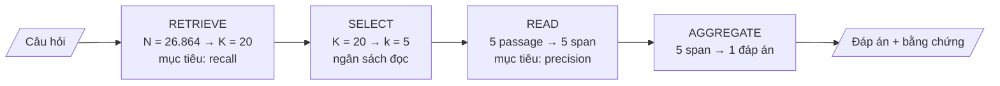
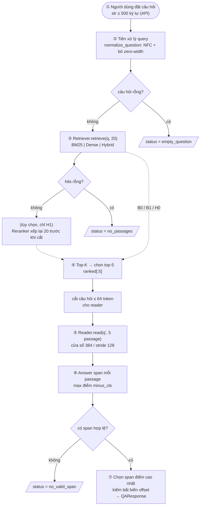
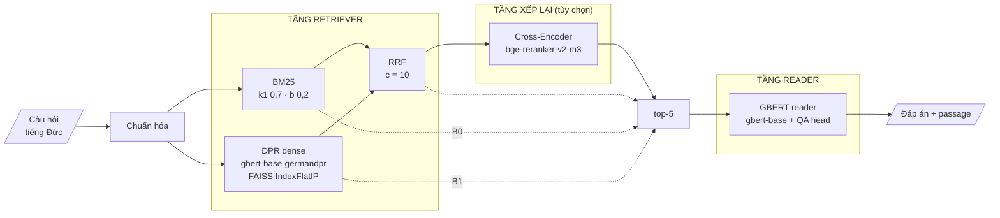
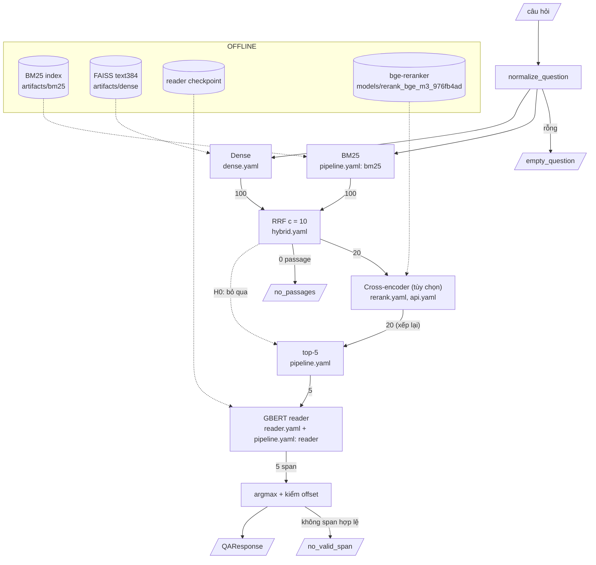

# BÀI 02 — RETRIEVER–READER ARCHITECTURE

> **Vị trí trong giáo trình**: bài 01 định nghĩa *bài toán*. Bài này mô tả *kiến trúc giải bài toán*: hai tầng Retriever và Reader nối với nhau như thế nào, dữ liệu gì chạy qua ranh giới giữa chúng, và vì sao project so sánh các retriever trong khi giữ reader cố định.
>
> **Ví dụ xuyên suốt**: „Wann wurde Hundefett in der Medizin verwendet?“ (Mỡ chó được dùng trong y học khi nào?). Bài này dùng **vết chạy thật** của câu hỏi này trong hai file kết quả của project: `reports/pipeline_dev_predictions.jsonl` (B0) và `reports/pipeline_dev_hybrid_predictions.jsonl` (H0).

---

## Mục lục

- [A. Learning Objectives](#a-learning-objectives)
- [B. Prerequisites](#b-prerequisites)
- [C. Theoretical Foundation](#c-theoretical-foundation)
- [D. Retriever — Cơ chế truy hồi](#d-retriever--cơ-chế-truy-hồi)
- [E. Reader — Cơ chế đọc và trích xuất câu trả lời](#e-reader--cơ-chế-đọc-và-trích-xuất-câu-trả-lời)
- [F. Toàn bộ Retriever–Reader Pipeline](#f-toàn-bộ-retrieverreader-pipeline)
- [G. Áp dụng trực tiếp vào dự án German QA](#g-áp-dụng-trực-tiếp-vào-dự-án-german-qa)
- [H. Implementation Mapping](#h-implementation-mapping)
- [I. Video và tài liệu học tập](#i-video-và-tài-liệu-học-tập)
- [J. Knowledge Check & Implementation Readiness](#j-knowledge-check--implementation-readiness)
- [Đáp án và lời giải](#đáp-án-và-lời-giải)
- [Tài liệu tham khảo bài 02](#tài-liệu-tham-khảo-bài-02)

---

## A. LEARNING OBJECTIVES

### A.1. Mục tiêu kiến thức

Sau bài này, bạn hiểu được:

1. **Vì sao** hệ thống phải tách thành hai tầng, bằng một mô hình chi phí có số liệu thật.
2. **Retriever** nhận gì, trả gì, tính điểm thế nào ở mức khái niệm, và vì sao nó không tự trả lời câu hỏi.
3. **Reader** nhận gì từ retriever (và *không* nhận gì), dự đoán start/end thế nào, chọn đáp án giữa nhiều passage ra sao.
4. **Bước chọn (Select)** giữa hai tầng: K = 20 so với k = 5, và loại lỗi *selection failure* mà nó sinh ra.
5. **Khác biệt** giữa pipeline baseline B0 và pipeline cải tiến H0/H1 của project, cùng trạng thái triển khai thật của từng phần.
6. **Lý do phương pháp luận** của việc đánh giá từng tầng riêng và giữ reader cố định khi so sánh retriever.

### A.2. Mục tiêu kỹ năng

Sau bài này, bạn làm được:

- Vẽ sơ đồ Retriever–Reader của project, ghi đúng tham số trên từng mũi tên.
- Đọc một dòng của `reports/pipeline_dev_*.jsonl` và giải thích từng trường: `retrieved`, `candidates`, `retrieval_score`, `reader_score`, `status`.
- Viết pseudocode và một bản cài đặt đồ chơi của pipeline với giao diện `retrieve(question, top_k)` và `read(question, passages)`.
- Chẩn đoán một câu trả lời sai: lỗi nằm ở retrieval, selection, chọn passage hay ranh giới span.

### A.3. Những gì bạn tự giải thích và triển khai được sau bài học

| Bạn giải thích được | Bạn triển khai được |
|---|---|
| Vì sao BM25 xếp đoạn về cây keo lên trên đoạn về chó trong ví dụ | Hàm `answer()` gọi retriever, cắt top-k, gọi reader, chọn span tốt nhất |
| Vì sao reader vẫn trả lời đúng dù gold chỉ đứng hạng 3 | Giao diện retriever có thể thay BM25 ↔ dense ↔ hybrid mà không sửa pipeline |
| Vì sao điểm BM25 9,94 và điểm dense 168,27 không cộng được | Cấu trúc dữ liệu `hits` và `spans` truyền giữa hai tầng |
| Vì sao H1 có Hit@5 cao hơn H0 mà EM thấp hơn | Bộ kiểm tra bất biến `passage_text[start:end] == answer` |

---

## B. PREREQUISITES

### B.1. Kiến thức cần có từ Bài 01

| Kiến thức | Mục trong bài 01 | Dùng ở bài này |
|---|---|---|
| Open-domain (nghĩa 2): không có đoạn văn cho trước | C.3.3 | Lý do phải có retriever |
| Extractive QA: đáp án là span `[start, end)` | C.3.4, D.1 | Đầu ra của reader |
| Chỉ mục ngược, posting list | C.2.2 | Retriever thưa |
| Công thức phân rã (2.2) | D.3, D.4 | Phân tích lỗi và giới hạn của hệ |
| Hợp đồng dữ liệu `QAResponse` | F.3 | Đầu ra của pipeline |

### B.2. Thuật ngữ cần ôn lại

| Thuật ngữ | Nhắc lại ngắn |
|---|---|
| Passage | Đơn vị được truy hồi; project có 26.864 passage |
| Gold passage `g` | Passage chứa đáp án theo qrels |
| Top-K / top-k | K phần tử đầu danh sách xếp hạng. Bài này dùng **K = 20** (truy hồi) và **k = 5** (đưa vào reader) |
| Span | Chuỗi con liên tục, xác định bằng offset ký tự `[start, end)` |
| Hit@k | Tỉ lệ câu hỏi có gold trong top-k (định nghĩa đầy đủ ở bài 12) |
| EM | Exact Match: 1 nếu đáp án dự đoán khớp hoàn toàn (sau chuẩn hóa) |

### B.3. Thuật ngữ mới trong bài

| Thuật ngữ | Nghĩa |
|---|---|
| **Retriever** (bộ truy hồi) | Thành phần chọn K passage ứng viên từ toàn bộ kho |
| **Reader** (bộ đọc) | Thành phần đọc câu hỏi + passage và trích span trả lời |
| **Candidate passages** (đoạn ứng viên) | Danh sách passage retriever trả về |
| **Relevance score** (điểm liên quan) | Số thực retriever gán cho cặp (câu hỏi, passage); chỉ có nghĩa **trong cùng một retriever** |
| **Passage selection** | Bước giữ k passage đầu để đưa vào reader |
| **Aggregation** (tổng hợp) | Bước chọn một đáp án duy nhất từ k span của k passage |
| **Evidence passage** (đoạn bằng chứng) | Passage chứa span được chọn, trả về cho người dùng kiểm tra |
| **Multi-stage ranking** | Xếp hạng nhiều tầng: tầng rẻ chọn nhiều, tầng đắt chọn ít |
| **Controlled comparison** | So sánh mà chỉ một yếu tố thay đổi |

---

## C. THEORETICAL FOUNDATION

Mỗi khái niệm dưới đây theo trình tự: **định nghĩa → bản chất → cơ chế → ví dụ → liên hệ dự án → lỗi thường gặp**.

### C.1. Question Answering (QA) — nhắc lại có trọng tâm

- **Định nghĩa** 📗 **[NỀN TẢNG]**: nhận câu hỏi ngôn ngữ tự nhiên, trả về chính thông tin cần tìm.
- **Bản chất**: QA miền mở là *hai bài toán chồng lên nhau*: tìm (IR) và đọc (MRC). Bài toán tìm chịu ràng buộc **quy mô** (26.864 passage), bài toán đọc chịu ràng buộc **độ chính xác** (đúng từng ký tự ranh giới span).
- **Liên hệ dự án** 📘 **[BÁO CÁO]**: kiến trúc của project tách đúng theo hai ràng buộc này (Ch.2.1.5, Ch.4.5.5).
- **Lỗi thường gặp**: gọi một hệ IR là "hệ QA" chỉ vì nó trả về đoạn văn liên quan. QA phải định vị được đáp án.

### C.2. Passage Retrieval

- **Định nghĩa** 📗 **[NỀN TẢNG]**: truy hồi ở mức đoạn văn thay vì cả tài liệu.
- **Bản chất**: đơn vị truy hồi phải **vừa với reader**. Một bài Wikipedia dài hàng chục nghìn ký tự không vừa cửa sổ 384 token; một câu đơn lẻ thì quá ngắn, mất ngữ cảnh.
- **Cơ chế**: kho được cắt thành passage ở giai đoạn offline. Mỗi passage có mã riêng và trỏ ngược về bài viết gốc (`document_id`).
- **Ví dụ** 📘 **[BÁO CÁO]**: corpus của project có 54.908 passage đầu vào, còn **26.864** sau khử trùng lặp, thuộc **21.591** document (`data/processed/data_quality_report.json`). Passage của ví dụ dài 991 ký tự.
- **Liên hệ dự án**: project dùng nguyên các passage do GermanQuAD/GermanDPR cung cấp, **không tự cắt lại** bài viết. Bài 03 trình bày chi tiết.
- **Lỗi thường gặp**: nhầm `document_id` với `passage_id`. Hai passage cùng bài viết (ví dụ hai đoạn „Haushund“) vẫn là hai passage khác nhau; chỉ một trong số đó là gold.

### C.3. Context, Passage, Document

| Khái niệm | Nghĩa trong project | Trường dữ liệu | Ví dụ |
|---|---|---|---|
| **Document** | Bài viết Wikipedia | `document_id`, `title` | `d_a948295c9577`, „Haushund“ |
| **Passage** | Một đoạn của bài viết; đơn vị truy hồi | `passage_id`, `original_text` | `p_c25e144a863973b9` |
| **Context** | Văn bản reader đọc cùng câu hỏi. Trong GermanQuAD, "context" là passage gắn với câu hỏi; trong reader, context của một **cửa sổ** chỉ là một phần passage | `example["context"]` trong `reader/inference.py` | 991 ký tự passage → 1 hoặc nhiều cửa sổ 384 token |

> ⚠️ Từ "context" mang hai nghĩa tùy chỗ: trong dữ liệu gốc nó là *passage*, trong reader nó là *phần passage nằm trong một cửa sổ*. Khi đọc mã, xem biến đang ở tầng nào.

### C.4. Query và Answer Span

- **Query**: câu hỏi sau chuẩn hóa. Project dùng **hai phiên bản** của cùng một câu hỏi 📘 **[BÁO CÁO]** (`pipeline.py`):
  - retriever nhận câu hỏi **đầy đủ** sau `normalize_question` (NFC, bỏ ký tự vô hình);
  - reader nhận câu hỏi **đã cắt** còn tối đa 64 token (`MAX_QUESTION_TOKENS`). Nếu bị cắt, `status = "question_truncated"`.
- **Answer span**: cặp offset ký tự `[start, end)` trên `original_text` của một passage. Ví dụ: `[576, 610)` trên `p_c25e144a863973b9`.
- **Lỗi thường gặp**: tính offset trên `retrieval_text` (đã chữ thường và gộp khoảng trắng). Offset trên hai chuỗi này **không** trùng nhau, nên đáp án sẽ bị cắt lệch.

### C.5. Retriever–Reader Architecture

#### C.5.1. Định nghĩa

📗 **[NỀN TẢNG]** Kiến trúc hai tầng nối tiếp do Chen et al. (2017) đề xuất trong DrQA: một **Document Retriever** chọn ra số ít tài liệu, một **Document Reader** tìm câu trả lời trong các tài liệu đó. Các hệ sau thay từng tầng bằng mô hình mạnh hơn: BERTserini thay reader bằng BERT (Yang et al., 2019), DPR thay retriever từ vựng bằng retriever học được (Karpukhin et al., 2020).

#### C.5.2. Bản chất vấn đề: xung đột giữa quy mô và độ chính xác

Một mô hình đọc hiểu tốt (BERT) đắt. Một phép so khớp rẻ (đếm từ chung) thì thô. Kiến trúc hai tầng giải xung đột bằng cách **cho mỗi tầng làm việc nó giỏi**:

| | Retriever | Reader |
|---|---|---|
| Phạm vi | Toàn kho (N = 26.864) | k = 5 passage |
| Mục tiêu | **Recall**: không bỏ sót gold | **Precision**: chọn đúng span |
| Chi phí/passage | Rất thấp (chỉ mục dựng sẵn) | Cao (forward 12 lớp Transformer) |
| Hiểu ngôn ngữ | Nông (từ) hoặc vừa (một vector) | Sâu (attention giữa mọi token câu hỏi và passage) |

#### C.5.3. Mô hình chi phí (công thức)

Gọi `t_R` là thời gian retriever cho cả kho, `t_r` là thời gian reader cho một passage:

$$
T_{\text{hai tầng}} = t_R + k \cdot t_r \qquad\text{so với}\qquad T_{\text{đọc hết}} = N \cdot t_r
$$

📘 **[BÁO CÁO]** (Bảng 4.13, dev): `t_R ≈ 0,7 ms` (BM25), `k · t_r ≈ 57,9 ms` với k = 5, tức `t_r ≈ 11,6 ms`.

$$
T_{\text{hai tầng}} \approx 0{,}7 + 57{,}9 = 58{,}6 \text{ ms}, \qquad T_{\text{đọc hết}} \approx 26.864 \times 11{,}6 \text{ ms} \approx 5{,}2 \text{ phút}
$$

Tỉ lệ ≈ 5.300 lần. (Báo cáo ghi rõ con số "đọc hết" là ước tính suy ra, chưa đo trực tiếp.)

#### C.5.4. Cơ chế ba bước: Retrieve → Select → Read

📘 **[BÁO CÁO]** Ch.4.5.5 tách bước **Select** ra khỏi Retrieve để thấy rõ một loại lỗi mà kiến trúc hai tầng thông thường che giấu.



#### C.5.5. Ưu điểm và hạn chế

📘 **[BÁO CÁO]** (Ch.2.1.6), bổ sung ví dụ:

| Ưu điểm | Ví dụ trong project |
|---|---|
| Cân bằng chi phí / độ chính xác | 58,6 ms so với ~5 phút |
| Mô-đun: thay từng tầng độc lập | B0 → B1 → H0 → H1 chỉ đổi retriever/reranker |
| Kiểm chứng được (với reader trích xuất) | Mọi đáp án có `passage_id` + offset |

| Hạn chế | Ví dụ trong project |
|---|---|
| Lỗi truy hồi không sửa được ở sau | 216/1.176 câu dev có gold ngoài top-20 (B0) |
| Hai tầng tối ưu theo tiêu chí khác nhau | H1: Hit@5 tăng, EM giảm (test) |
| Reader chỉ chọn một span trong một passage | Không tổng hợp được từ nhiều đoạn |

### C.6. Extractive QA trong kiến trúc hai tầng

Khi reader là extractive, tầng đọc có thêm một vai trò mà nhiều sơ đồ không vẽ ra: **reader cũng chọn passage**. Vì đáp án cuối là span có điểm cao nhất trên cả k passage, passage chứa span đó trở thành bằng chứng, bất kể retriever xếp nó ở hạng mấy.

📘 **[BÁO CÁO]** Ch.4.5.3 (dev, B0): passage được chọn là hạng 1 của BM25 ở **35,3%** câu, hạng 2: 22,4%, hạng 3: 16,7%, hạng 4: 14,8%, hạng 5: 10,8%. Tức **64,7%** số lần reader chọn passage không đứng đầu.

### C.7. Câu hỏi tự kiểm tra nhanh (phần C)

1. Nêu hai ràng buộc khiến QA miền mở phải tách hai tầng.
2. Vì sao "context" trong reader không đồng nghĩa với "passage"?
3. Câu hỏi đưa cho retriever và cho reader có giống nhau không?

*(Đáp án nằm ngay trong C.2–C.6.)*

---

## D. RETRIEVER — CƠ CHẾ TRUY HỒI

### D.1. Retriever là gì?

- **Định nghĩa** 📗 **[NỀN TẢNG]**: một hàm `retrieve(q, K)` trả về K passage có điểm liên quan cao nhất với câu hỏi `q` trong kho `C`.
- **Bản chất**: retriever là một **bộ lọc có xếp hạng**. Nó không cần hiểu câu hỏi hoàn toàn; nó chỉ cần đẩy gold vào nhóm đầu đủ thường xuyên.
- **Liên hệ dự án** 📘 **[BÁO CÁO]**: project có ba retriever cùng một giao diện: BM25 (bài 04), Dense DPR (bài 06–07), Hybrid RRF (bài 08).

### D.2. Input và output

| | Kiểu | Ví dụ thật |
|---|---|---|
| **Input** | `question: str`, `top_k: int` | `"Wann wurde Hundefett in der Medizin verwendet?"`, `20` |
| **Tài nguyên dựng sẵn** | chỉ mục (BM25: `artifacts/bm25/`; dense: `artifacts/dense/text384/`) | nạp một lần khi khởi động |
| **Output** | `list[dict]` sắp theo `rank` tăng dần | `[{"passage_id": "p_c6a0…", "score": 10.83, "rank": 1}, …]` |

Hybrid thêm các trường `sources` (hạng ở từng nhánh), `bm25_score`, `dense_score` (`retrieval/hybrid.py`).

### D.3. Cách tìm passage liên quan

📗 **[NỀN TẢNG]** Mọi retriever đều theo một khuôn:

$$
\text{score}(q, p) = f\big(\phi(q), \psi(p)\big), \qquad R_K(q) = \operatorname{top\text{-}K}_{p \in C}\ \text{score}(q, p)
$$

| Ký hiệu | Ý nghĩa | BM25 | Dense DPR |
|---|---|---|---|
| `φ(q)` | Biểu diễn câu hỏi | túi term sau tách từ | vector 768 chiều từ question encoder |
| `ψ(p)` | Biểu diễn passage (**tính trước**) | trọng số BM25 từng (term, passage) | vector 768 chiều từ ctx encoder |
| `f` | Hàm so khớp | tổng trọng số các term chung | tích vô hướng |
| top-K | Lấy K điểm cao nhất | duyệt posting list | FAISS `IndexFlatIP` |

Điểm mấu chốt cho tốc độ: **`ψ(p)` không phụ thuộc vào `q`**, nên tính một lần ở giai đoạn offline. Khi có câu hỏi, chỉ cần tính `φ(q)` và phép `f`. Cross-encoder (bài 09) phá vỡ tính chất này, và đó là lý do nó chỉ dùng được ở tầng xếp lại.

### D.4. Candidate passages, Top-K, ranking và relevance score

- **Candidate passages**: K passage retriever trả về. Mọi passage khác **biến mất** khỏi hệ thống với câu hỏi này.
- **Top-K retrieval**: sắp theo điểm giảm dần, lấy K đầu. Project dùng K = 20 cho pipeline; trong hybrid, mỗi nhánh lấy 100 trước khi hợp nhất về 20.
- **Ranking**: chỉ **thứ tự** là thông tin chắc chắn so sánh được giữa các câu hỏi và giữa các retriever. Hạng 1 nghĩa giống nhau ở mọi retriever.
- **Relevance score**: một số thực. Ba tính chất cần nhớ:
  1. **Chỉ so sánh được trong cùng một retriever, cùng một câu hỏi.** BM25 = 10,83 với câu này không "liên quan hơn" BM25 = 8 với câu khác theo nghĩa tuyệt đối.
  2. **Không phải xác suất.** BM25 không có cận trên; dot product của DPR là 168,27; RRF là 0,1678.
  3. **Thang đo khác nhau giữa các retriever.** Đây là lý do project hợp nhất bằng **hạng** (RRF) chứ không cộng điểm (bài 08).

### D.5. Ví dụ minh họa: một câu hỏi tiếng Đức, năm passage thật

📘 **[BÁO CÁO]** Vết chạy B0 (`reports/pipeline_dev_predictions.jsonl`, trường `retrieved`). Câu đầu của mỗi passage được trích từ `corpus.jsonl`.

| Hạng BM25 | Điểm | Bài viết (`title`) | Câu liên quan nhất trong passage | Bản dịch tiếng Việt |
|---|---|---|---|---|
| 1 | 10,83 | Vachellia_tortilis (một loài keo) | „Traditionell werden aus der Rinde Stricke und Tauwerk hergestellt und verschiedene Pflanzenteile als **Medizin verwendet**.“ | Theo truyền thống, vỏ cây được làm thừng, và nhiều bộ phận của cây được dùng làm thuốc. |
| 2 | 10,14 | Somatologie | „Die Somatologie umfasst in der **Medizin** alle therapeutischen Disziplinen abseits der Psychologie …“ | Somatologie trong y học bao gồm mọi chuyên ngành trị liệu ngoài tâm lý học … |
| **3** ⭐ | **9,94** | **Haushund** (chó nhà) | „Von **Hundefett** (…) nahm man vom Mittelalter bis in die Neuzeit an, dass es bei der Behandlung von Gelenkerkrankungen und bei Atemwegserkrankungen hilfreich sei, und verwendete es entsprechend.“ | Từ thời Trung cổ đến thời Cận đại, người ta cho rằng mỡ chó có ích trong điều trị bệnh khớp và bệnh đường hô hấp, và dùng nó như vậy. |
| 4 | 9,56 | Sprachtest | „In der **Medizin** führt man bei Kleinkindern einen Sprachtest durch …“ | Trong y học, người ta làm bài kiểm tra ngôn ngữ cho trẻ nhỏ … |
| 5 | 9,38 | Biorhythmus (Mantik) | „Chronobiologische Rhythmen, die in Biologie und **Medizin** beschrieben werden …“ | Các nhịp sinh học được mô tả trong sinh học và y học … |

**Vì sao gold chỉ đứng hạng 3?** Đếm term (đã lọc stopword) của câu hỏi `[hundefett, medizin, verwendet]` trong hai passage (đo bằng `retrieval/tokenizer.py` của project):

| Term | Vachellia_tortilis (hạng 1) | Haushund (gold, hạng 3) |
|---|---|---|
| `hundefett` | 0 | **1** |
| `medizin` | 2 | **0** |
| `verwendet` | **6** | 0 (passage viết `verwendete`) |

Gold khớp đúng **một** term, nhưng là term hiếm (IDF cao), nên vẫn đạt 9,94. Passage cây keo khớp hai term phổ biến hơn, lặp nhiều lần, nên đạt 10,83. Hai bài học cho các bài sau:
- **Lexical gap**: „verwendet“ ≠ „verwendete“; passage gold không chứa từ „Medizin“ (nó nói „Behandlung von Gelenkerkrankungen“). Bài 04.
- **Dense khắc phục một phần**: dense xếp gold **hạng 1** (dot = 168,27) vì so khớp nghĩa. Bài 07.

### D.6. Vì sao retriever không tự tạo câu trả lời cuối cùng?

1. **Đơn vị đầu ra sai cỡ**: retriever chấm điểm *cả passage*; đáp án là *một cụm 34 ký tự* trong passage 991 ký tự.
2. **Biểu diễn không đủ chi tiết**: `ψ(p)` được tính *trước khi biết câu hỏi*. Nó không thể biết câu hỏi „Wann“ (khi nào) cần cụm chỉ thời gian. Vị trí của đáp án là thông tin phụ thuộc câu hỏi, chỉ có được khi đọc câu hỏi và passage cùng lúc.
3. **Thứ tự không đáng tin ở hạng đầu**: trong ví dụ, hạng 1 của BM25 là passage về cây keo. Nếu "lấy câu đầu của hạng 1", hệ sẽ trả lời sai.
4. **Chi phí**: một mô hình đủ mạnh để định vị span không chạy được trên 26.864 passage mỗi câu hỏi (C.5.3).

### D.7. Lỗi thường gặp ở tầng retriever

| Lỗi | Hậu quả | Cách phát hiện |
|---|---|---|
| Không chuẩn hóa câu hỏi giống corpus (NFC) | BM25 tách „höchste“ thành „ho“ + „chste“ (📘 Ch.4.1.2) | So `tokenize(q)` trước/sau `normalize_question` |
| So sánh điểm giữa các retriever | Kết luận sai "dense tự tin hơn" vì 168 > 10 | Chỉ so hạng hoặc dùng RRF |
| `top_k` quá nhỏ ở retriever | Hit@K thấp, reader không có cơ hội | Đo Hit@K với nhiều K |
| Chỉ mục cũ không khớp corpus | Trả `passage_id` không tồn tại hoặc sai nội dung | Dấu vân tay SHA-1 (📘 `bm25_store.py`, manifest dense) |
| Trả về `[]` mà không xử lý | Reader nhận danh sách rỗng | Pipeline trả `status = "no_passages"` (4/2.203 câu test với B0) |

---

## E. READER — CƠ CHẾ ĐỌC VÀ TRÍCH XUẤT CÂU TRẢ LỜI

### E.1. Reader là gì?

- **Định nghĩa** 📗 **[NỀN TẢNG]**: mô hình đọc hiểu nhận `(q, p)` và trả về span trả lời trong `p` cùng một điểm.
- **Bản chất**: reader là **bộ định vị**. Nó không tìm kiếm; nó chỉ đọc những gì được đưa.
- **Liên hệ dự án** 📘 **[BÁO CÁO]**: reader là `deepset/gbert-base` + đầu QA, fine-tune trên GermanQuAD, checkpoint `models/reader_20261101T213758Z_96717e35` (epoch 2). Đây là **thành phần duy nhất** có trọng số được nhóm huấn luyện.

### E.2. Reader nhận gì từ retriever — và không nhận gì

📘 **[BÁO CÁO]** (`pipeline.py`, `reader/inference.py`):

| Reader **nhận** | Reader **không nhận** |
|---|---|
| Câu hỏi đã cắt ≤ 64 token | Điểm retriever (`score`) |
| Danh sách `[{"passage_id", "text"}]`, `text = original_text` | Hạng (`rank`) — chỉ ngầm qua thứ tự danh sách |
| | `retrieval_text` |

Hệ quả thiết kế quan trọng: **quyết định cuối cùng chỉ dựa vào điểm reader**. Điểm retriever chỉ được giữ lại để báo cáo trong `QAResponse.retrieval_score`. Thứ tự retriever chỉ có tác dụng ở hai chỗ: (1) passage nào lọt vào top-5, (2) phá hòa điểm (passage hạng cao hơn thắng).

> 📙 **[MỞ RỘNG]** Một số hệ kết hợp tuyến tính điểm retriever và điểm reader (ví dụ BERTserini, Yang et al., 2019). Project **không** làm vậy. Đây là một hướng cải tiến có thể thử; báo cáo không đề cập.

### E.3. Contextual understanding

📗 **[NỀN TẢNG]** Reader ghép câu hỏi và passage thành **một chuỗi** `[CLS] q [SEP] p [SEP]` và cho chạy qua 12 lớp self-attention. Mỗi token của passage "nhìn thấy" mọi token của câu hỏi ở mọi lớp. Vì vậy biểu diễn của token „vom“ trong passage *khác nhau* tùy câu hỏi là „Wann…“ hay „Wer…“. Đây là thứ retriever thiếu (D.6, lý do 2). Cơ chế attention được dạy ở bài 05.

### E.4. Start position, end position, answer span prediction

📘 **[BÁO CÁO]** công thức (2.13) và (2.14). Với vector ngữ cảnh `h_i` của token i:

$$
S(i) = \mathbf{w}_s^{\top}\mathbf{h}_i, \qquad E(j) = \mathbf{w}_e^{\top}\mathbf{h}_j
$$

$$
\text{score}(i, j) = S(i) + E(j) - \big(S(0) + E(0)\big) \qquad \text{(chế độ minus\_cls)}
$$

| Ký hiệu | Ý nghĩa |
|---|---|
| `h_i` | Vector 768 chiều của token i ở lớp cuối |
| `w_s`, `w_e` | Hai vector tham số của đầu QA (lớp tuyến tính 768 → 2) |
| `S(i)`, `E(j)` | Logit "token i là điểm bắt đầu", "token j là điểm kết thúc" |
| `S(0) + E(0)` | Điểm của token `[CLS]` = điểm "cửa sổ này không có đáp án" |

Ràng buộc hợp lệ (`reader/postprocess.py`): cả i và j nằm trong phần passage của cửa sổ; `j ≥ i`; `j − i + 1 ≤ 80`; chỉ xét `n_best = 20` giá trị lớn nhất của S và 20 của E.

### E.5. Cách xác định vị trí đáp án trong passage: bốn tầng "max"

Chọn đáp án là một chuỗi phép lấy max lồng nhau. Đây là cơ chế cốt lõi của bài:

$$
\hat{a} = \arg\max_{p \in R_5}\ \max_{w \in \text{win}(p)}\ \max_{(i,j) \in V(w)} \text{score}_w(i, j)
$$

| Tầng max | Phạm vi | Nơi cài đặt |
|---|---|---|
| (1) trong cửa sổ | mọi cặp `(i, j)` hợp lệ trong 20 × 20 ứng viên | `best_answers`, vòng `for si … for ej` |
| (2) giữa các cửa sổ của một passage | passage dài → nhiều cửa sổ 384 token, stride 128 | `best_answers`, vòng `for fi in windows[ei]` |
| (3) giữa các passage | 5 passage | `QAPipeline.answer`: `max(valid, key=score)` |
| (4) offset → chuỗi | token `(i, j)` → ký tự `[a, b)` qua offset mapping | `ex["context"][a:b]` |

Tầng (3) chỉ có ý nghĩa nếu điểm của các passage **so sánh được với nhau**. Softmax được tính riêng trong từng cửa sổ, nên logit thô không cùng thang. Trừ điểm `[CLS]` (minus_cls) là một cách hiệu chỉnh gần đúng 📘 **[BÁO CÁO]** (Ch.4.5.3, dẫn Wang et al., 2019). Bài 10 phân tích sâu.

### E.6. Ví dụ: reader đọc 5 passage thật

📘 **[BÁO CÁO]** Vết chạy B0, trường `candidates`:

| Hạng BM25 | Bài viết | Span tốt nhất reader tìm được (rút gọn) | `reader_score` |
|---|---|---|---|
| 1 | Vachellia_tortilis | „Traditionell werden aus der Rinde Stricke …“ | −1,80 |
| 2 | Somatologie | „Der Begriff wird heute auch in der Literatur …“ | −15,38 |
| **3** | **Haushund** | **„vom Mittelalter bis in die Neuzeit“** `[576, 610)` | **+26,81** |
| 4 | Sprachtest | „Häufig verwendet man zu diesem Zweck …“ | −9,98 |
| 5 | Biorhythmus | „Die von der Biorhythmik postulierten …“ | −11,69 |

Đọc kết quả:
- Bốn passage không chứa đáp án đều có điểm **âm**: theo `minus_cls`, mô hình tin "không có đáp án ở đây" hơn mọi span. Span reader trả về cho chúng chỉ là "span ít tệ nhất".
- Passage gold có điểm dương rất lớn (+26,81) → thắng ở tầng max (3).
- Reader **sửa** được thứ tự sai của BM25 (hạng 3 → được chọn), nhưng chỉ vì gold đã lọt vào top-5. Nếu gold ở hạng 6, không gì cứu được.

### E.7. Extractive vs Generative trong vai trò reader

| | Extractive reader (project) | Generative reader (📙 mở rộng) |
|---|---|---|
| Đầu ra | `(i, j)` → `original_text[a:b]` | Chuỗi token sinh ra |
| Một hay nhiều passage | Đọc **từng** passage riêng rồi lấy max | Có thể đọc nhiều passage cùng lúc (FiD, Izacard & Grave, 2021) |
| Bằng chứng | Có offset chính xác | Không có offset; phải đối chiếu |
| Chọn passage | Ngầm qua max điểm span | Ngầm qua cơ chế attention |
| Kích thước | GBERT-base ~110M tham số (109.338.626, 📘 Ch.4) | Thường lớn hơn nhiều |

### E.8. Lỗi thường gặp ở tầng reader

| Lỗi | Hậu quả | Cách phát hiện |
|---|---|---|
| Đưa `retrieval_text` (chữ thường) vào reader | Reader cased đọc sai; offset lệch so với `original_text` | Kiểm bất biến `passage_text[start:end] == answer` |
| Ghép đáp án từ token thay vì cắt bằng offset | Mất khoảng trắng, dấu „ “, `##` lọt vào | So đáp án với chuỗi gốc |
| Không cắt câu hỏi dài | Cửa sổ không đủ chỗ cho passage | `status = "question_truncated"` |
| So điểm raw giữa passage | Chọn passage sai do thang khác nhau | So `raw` với `minus_cls` (📘 dev: khác biệt không có ý nghĩa thống kê, `reports/paired_comparisons_dev.json`) |
| Coi `reader_score` là xác suất | Diễn giải sai cho người dùng | Tài liệu API ghi rõ "không phải xác suất" (📘 GĐ18) |

---

## F. TOÀN BỘ RETRIEVER–READER PIPELINE

### F.1. Sơ đồ bảy bước



### F.2. Giải thích từng node và từng luồng

| Node | Làm gì | Dữ liệu vào → ra | Mã nguồn |
|---|---|---|---|
| ① | Nhận câu hỏi | HTTP body / tham số hàm → `str` | `api/app.py`, `QAPipeline.answer` |
| ② | NFC, bỏ ký tự vô hình, strip | `str` → `str` | `data/text_utils.normalize_question` |
| ③ | Chấm điểm và xếp hạng toàn kho | `str`, `20` → `list[hit]` | `retrieval/bm25.py`, `dense.py`, `hybrid.py` |
| (rerank) | Chấm lại 20 cặp bằng cross-encoder | `list[hit+text]` → `list[hit + rank_before + rerank_score]` | `rerank/cross_encoder.py` |
| ④ | Cắt theo hạng | `list[hit]` (20) → `list[hit]` (5) | `ranked[:k_read]` |
| cắt câu hỏi | Giới hạn 64 token bằng offset của tokenizer | `str` → `str`, `bool` | `QAPipeline._cut_question` |
| ⑤ | Chia cửa sổ, chạy GBERT, lấy logit | 5 × `{passage_id, text}` → logits | `reader/inference.Reader.read` |
| ⑥ | Hậu xử lý: chọn span tốt nhất mỗi passage | logits → 5 × `{text, start, end, score}` | `reader/postprocess.best_answers` |
| ⑦ | Max giữa passage, kiểm bất biến, đóng gói | 5 span → `QAResponse` | `QAPipeline.answer` |

**Các luồng lỗi** (mũi tên ra `status`): pipeline **không ném ngoại lệ** cho tình huống dữ liệu bình thường; nó trả `QAResponse` rỗng có `status` tương ứng. Ngoại lệ chỉ dành cho lỗi lập trình (sai kiểu, `top_k < 1`, vi phạm bất biến offset).

### F.3. Input → Processing → Output: hai vết chạy thật

📘 **[BÁO CÁO]** Cùng một câu hỏi, cùng reader, khác retriever:

| Bước | B0 (BM25) | H0 (BM25 + Dense + RRF) |
|---|---|---|
| Input | „Wann wurde Hundefett in der Medizin verwendet?“ | giống |
| Retrieve | gold ở hạng **3**, điểm 9,94 | gold ở hạng **1**, điểm RRF 0,1678 (BM25 hạng 3, dense hạng 1) |
| Top-5 | Vachellia, Somatologie, **Haushund**, Sprachtest, Biorhythmus | **Haushund**, Vachellia, Somatologie, Haushund (đoạn „Ernährung“), Lebenserwartung |
| Read | 5 span, gold +26,81, còn lại âm | 5 span, gold +26,81, còn lại âm |
| Output | „vom Mittelalter bis in die Neuzeit“ `[576, 610)` | giống |
| `retrieval_time` | 0,63 ms | 35,9 ms (chạy cả hai nhánh) |
| `reader_time` | 40,4 ms | 42,0 ms |

Quan sát quan trọng: **hai cấu hình cho cùng đáp án** ở câu này. H0 xếp gold cao hơn nhưng với reader, chỉ cần gold *có mặt* trong top-5. Cải thiện hạng chỉ đổi thành cải thiện đáp án ở những câu mà B0 *để gold rơi khỏi top-5* hoặc nơi đoạn gây nhiễu đánh bại gold. Đây là lý do Hit@5 tăng mạnh hơn EM (bài 12).

Một chi tiết của RRF trong vết H0: passage hạng 3 (Somatologie, BM25 hạng 2) và hạng 4 (Haushund-Ernährung, dense hạng 2) **cùng điểm** 1/12 ≈ 0,0833. Luật phá hòa của `rrf.py`: hạng tốt nhất ở bất kỳ nhánh (đều bằng 2), rồi `passage_id` theo thứ tự chữ (`p_31a…` < `p_438…`). Kết quả luôn tất định.

### F.4. Bảng Input/Output của từng thành phần

| Thành phần | Input | Output | Cấu trúc dữ liệu output |
|---|---|---|---|
| `normalize_question` | `str` | `str` | — |
| BM25 `retrieve` | `str`, `k` | k hit | `{"passage_id", "score", "rank"}` |
| Dense `retrieve` | `str`, `k` | k hit | `{"passage_id", "score", "rank"}` (score = dot) |
| Hybrid `retrieve` | `str`, `k` | k hit | thêm `"sources": {"bm25": r, "dense": r}`, `"bm25_score"`, `"dense_score"` (None nếu vắng) |
| Reranker `rerank` | `str`, hits có `"text"` | hits xếp lại | thêm `"rank_before"`, `"rerank_score"`; `"rank"` mới |
| Reader `read` | `str`, `[{"passage_id", "text"}]` | span mỗi passage, **cùng thứ tự đầu vào** | `{"passage_id", "text", "start", "end", "score"}`; không có span hợp lệ → `start = -1`, `score = -inf` |
| `QAPipeline.answer` | `str`, tùy chọn `retrieval_top_k`, `reader_top_k`, `trace` | `QAResponse` | dataclass (`schemas.py`) |

---

## G. ÁP DỤNG TRỰC TIẾP VÀO DỰ ÁN GERMAN QA

### G.1. GermanQuAD đóng vai trò gì?

📘 **[BÁO CÁO]** (Ch.3, `data_quality_report.json`):

| Vai trò | Chi tiết |
|---|---|
| **Huấn luyện reader** | 10.301 câu train → 13.263 cửa sổ có nhãn start/end |
| **Chọn tham số** | 1.176 câu dev (tách từ GermanQuAD train, chia theo nhóm bằng Union-Find) |
| **Đánh giá cuối** | 2.203 câu test (GermanQuAD test, nhiều đáp án tham chiếu mỗi câu) |
| **Cung cấp passage cho corpus** | context của mọi câu GermanQuAD |
| **Qrels** | mỗi câu hỏi → passage gốc của nó |

### G.2. GermanDPR đóng vai trò gì?

📘 **[BÁO CÁO]**:

| Vai trò | Chi tiết |
|---|---|
| **Huấn luyện encoder DPR** (bởi deepset, không phải nhóm) | checkpoint `deepset/gbert-base-germandpr-{question,ctx}_encoder` |
| **Cung cấp passage cho corpus** | positive và hard negative của GermanDPR được đưa vào kho (`build_corpus.py`); sau khử trùng lặp còn 26.864 passage |
| **Không** làm câu hỏi đánh giá | `include_dpr_qa: false` (`configs/baseline.yaml`): câu hỏi GermanDPR không được thêm vào test |
| Nguồn **nhiễm bẩn** cần kiểm soát | mọi câu hỏi GermanDPR nằm trong GermanQuAD train (📘 Ch.3); passage của nhiều câu dev đã là `positive` của GermanDPR → encoder đã "thấy". Lý do có tập *dev-unseen* (234 câu) và *train-select* (1.989 câu) |

Mức nhiễm bẩn cụ thể (`reports/dense_leakage.json`): 942/1.176 câu dev nằm trong câu hỏi train của GermanDPR, và passage gold của 1.056/1.176 câu dev là `positive` trong GermanDPR train. Ở test, cả hai con số đều bằng 0.

Hệ quả cho kiến trúc: hard negative của GermanDPR làm kho **khó hơn** cho retriever, vì chúng là các passage cùng chủ đề nhưng không phải đoạn đúng. 23.850/26.864 passage chỉ đến từ GermanDPR. 📗 **[NỀN TẢNG]** Theo định nghĩa của DPR (Karpukhin et al., 2020; báo cáo Ch.2), hard negative là passage có điểm BM25 cao nhưng không chứa đáp án. ⚠️ **[THIẾU TRONG BÁO CÁO]** Báo cáo không nói GermanDPR đã chọn hard negative bằng phương pháp cụ thể nào. Bài 03, mục C.2, phân tích thêm.

### G.3. BM25, DPR, RRF, Reranker, GBERT nằm ở đâu?



### G.4. Baseline và pipeline cải tiến: phân biệt và trạng thái

| | **Baseline B0** | **Pipeline cải tiến H0** | **H1 (H0 + reranker)** |
|---|---|---|---|
| Chuỗi | BM25 top-20 → top-5 → GBERT | BM25 100 + Dense 100 → RRF (c = 10) → top-20 → top-5 → GBERT | … → RRF top-20 → **bge-reranker-v2-m3** → top-5 → GBERT |
| Bắt buộc / tùy chọn | — | **Mặc định** của API (`configs/api.yaml: default_retriever: hybrid`) | **Tùy chọn**: `reranker: null` mặc định; bật bằng cấu hình + cờ `rerank` |
| Trạng thái 📘 | Đã cài đặt, đánh giá dev + test | Đã cài đặt, chọn trên train-select, xác nhận một lần trên dev-unseen, đánh giá test **một lần** (Ch.5) | Như H0 |
| Test Hit@5 | 0,793 | 0,919 | 0,969 |
| Test EM (first_ref) | 0,222 | **0,261** | 0,250 |
| Test p50 latency | 63,8 ms | 141,9 ms | 743,6 ms |

> ⚠️ **Về trạng thái "đã triển khai"**: theo báo cáo Ch.5 và `results/final_test_matrix.json`, pipeline cải tiến **đã được cài đặt và đánh giá** trong script đánh giá, không chỉ là đề xuất. Những phần **chưa hoàn tất** 📘 (Ch.5.5.2, Ch.7): đối chiếu kết quả API với dòng lệnh (parity) cho hybrid và rerank; đo VRAM và độ trễ của H1 khi chạy trong dịch vụ; kiểm thử giao diện trên trình duyệt thật. Fine-tune DPR và reranker trên dữ liệu của nhóm **chưa làm**.

### G.5. Tại sao cần tách Retrieval Evaluation và Reader Evaluation?

📘 **[BÁO CÁO]** (Ch.2.1.7, Ch.4.6) — lý do có số liệu:

| Nếu chỉ có EM end-to-end | Khi có đánh giá từng tầng |
|---|---|
| B0 dev EM = 0,236. Lỗi ở đâu? Không biết. | Hit@5 = 0,638 → 36% câu reader không có cơ hội |
| | Gold context EM = 0,469 → reader đúng chưa tới một nửa ngay cả khi chỉ có đoạn đúng |
| | Phân rã 898 câu sai: retrieval 216 · selection 203 · wrong passage 253 · wrong span 226 |
| Cải tiến retriever không thấy rõ tác dụng | Test: H0 Hit@5 +0,127 nhưng EM chỉ +0,039 → phần lớn gold mới được cứu vẫn bị reader đọc sai |

Ba tầng đánh giá tương ứng ba đại lượng trong công thức (2.2):

| Tầng đánh giá | Đại lượng | Chỉ số |
|---|---|---|
| Retrieval | `P(g ∈ R_k)` | Hit@k, MRR@k |
| Reader (gold context) | ≈ năng lực đọc khi có đoạn đúng | EM, F1 khi cho sẵn gold |
| End-to-end | `P(A)` | EM, F1 |

### G.6. Vì sao giữ reader cố định khi so sánh các retriever?

📗 **[NỀN TẢNG]** + 📘 **[BÁO CÁO]** (Ch.5.1.2: "reader, top-5 và tham số đọc hiểu giữ nguyên").

**Lập luận hình thức.** Viết EM của cấu hình X là `EM(X) = g(R_X, M)` với `R_X` là retriever và `M` là reader. So hai cấu hình:

$$
\text{EM}(X) - \text{EM}(Y) = g(R_X, M) - g(R_Y, M)
$$

Khi `M` giống nhau, mọi chênh lệch thuộc về retriever (cộng nhiễu lấy mẫu, đo bằng paired bootstrap ở bài 12). Nếu đổi cả reader, `g(R_X, M_1) − g(R_Y, M_2)` trộn hai tác động và không tách được.

**Mức kiểm soát thực tế của từng so sánh** (📘 Ch.5.1.2):

| So sánh | Yếu tố thay đổi | Mức kiểm soát |
|---|---|---|
| H1 vs H0 | thêm reranker | **một** yếu tố |
| B1 vs B0 | BM25 → dense | một thành phần nhưng cả cơ chế |
| H0 vs B1 | thêm nhánh BM25 **và** phép hợp nhất | **hai** yếu tố → báo cáo dùng bảng bổ trợ để tách |

**Cái giá của việc giữ reader cố định**: reader được huấn luyện với passage gold, không với đoạn gây nhiễu của từng retriever. Một reader "hợp" với hybrid hơn có thể tồn tại. Kết luận "H0 tốt nhất" vì vậy đúng **với reader này**. 📙 **[MỞ RỘNG]** hướng huấn luyện reader với đoạn do retriever trả về (thay vì chỉ gold) không có trong project.

### G.7. Ví dụ minh họa: một câu mà cải tiến retriever đổi được đáp án

> ⚠️ **[THIẾU TRONG BÁO CÁO]** Báo cáo có số tổng hợp (paired CI) nhưng không in một ví dụ cụ thể "B0 sai, H0 đúng vì gold lọt vào top-5". Giáo trình không tự tạo ví dụ giả. Bài tập J.3.1 yêu cầu bạn tự tìm một câu như vậy từ hai file `reports/pipeline_dev_predictions.jsonl` và `reports/pipeline_dev_hybrid_predictions.jsonl`. Nên bổ sung một ví dụ như vậy vào Ch.5 của báo cáo.

### G.8. Nếu bỏ một tầng thì sao?

| Bỏ | Hệ quả |
|---|---|
| Retriever | Phải đọc 26.864 passage/câu hỏi (~5 phút) |
| Bước Select (đọc cả 20) | Chi phí reader ×4; EM tăng nhỏ: 10 so với 5 đoạn chỉ +0,017 [+0,004; +0,029] trên dev (📘 Bảng 4.10) |
| Reader (trả câu đầu của hạng 1) | Ví dụ D.5: trả lời bằng câu về cây keo |
| Reranker | H0: EM test cao hơn H1, nhanh hơn ~5 lần. Đó là lý do nó tùy chọn |

### G.9. Tham số cần đặc biệt chú ý

| Tham số | Giá trị | File | Ảnh hưởng |
|---|---|---|---|
| `retrieval_top_k` | 20 | `pipeline.yaml` | trần Hit@20; số passage đưa vào reranker |
| `reader_top_k` | 5 | `pipeline.yaml` | Hit@5 là chỉ số chọn chính; chi phí đọc |
| `bm25_top_k`, `dense_top_k` | 100, 100 | `hybrid.yaml` | độ sâu mỗi nhánh trước RRF |
| `fusion_top_k` | 20 | `hybrid.yaml` | phải khớp `retrieval_top_k` |
| `pool` | 20 | `rerank.yaml` | reranker xếp lại đúng 20 passage của H0 |
| `MAX_QUESTION_TOKENS` | 64 | `pipeline.py` | câu hỏi cho reader |
| `max_answer_tokens`, `score_mode` | 80, `minus_cls` | `pipeline.yaml` | ràng buộc span và thang điểm giữa passage |

---

## H. IMPLEMENTATION MAPPING

### H.1. Bảng ánh xạ thành phần

| Thành phần | Vai trò | Input | Output | Công nghệ / thư viện trong project |
|---|---|---|---|---|
| Query normalizer | Đưa câu hỏi về cùng dạng với corpus | `str` | `str` | `unicodedata` (NFC) — `data/text_utils.py` |
| Retriever (sparse) | Truy hồi theo từ | query + chỉ mục BM25 | top-K hits | **tự cài đặt** BM25 bằng NumPy (`retrieval/bm25.py`) |
| Retriever (dense) | Truy hồi theo nghĩa | query + vector passage | top-K hits | `transformers` (DPR encoders), `faiss-cpu` `IndexFlatIP` (`retrieval/dense.py`) |
| Ranking / fusion | Hợp nhất danh sách | 2 danh sách hạng | 1 danh sách hạng | RRF tự cài đặt (`retrieval/rrf.py`, `hybrid.py`) |
| Reranker (tùy chọn) | Xếp lại ứng viên | query + 20 passage | 20 passage xếp lại | `transformers` `AutoModelForSequenceClassification` (XLM-R) — `rerank/cross_encoder.py`; **không dùng** `sentence-transformers` |
| Reader | Trích span | question + passages | span mỗi passage | `transformers` (`deepset/gbert-base` + QA head), `torch` — `reader/` |
| Orchestrator | Nối các tầng | question | `QAResponse` | `pipeline.py` |
| Serving | Phục vụ HTTP | JSON request | JSON response | FastAPI (`api/`), React (`frontend/`) |

### H.2. Pseudocode Retriever–Reader

```text
# ---------- OFFLINE (một lần) ----------
corpus  ← LOAD("data/processed/corpus.jsonl")
R       ← BUILD_RETRIEVER(kind ∈ {bm25, dense, hybrid}, corpus)   # nạp/dựng chỉ mục, kiểm dấu vân tay
M       ← LOAD_READER("models/reader_20261101T213758Z_96717e35")
P       ← {p.passage_id: p.original_text for p in corpus}         # reader luôn đọc original_text

# ---------- ONLINE (mỗi câu hỏi) ----------
function ANSWER(question, K=20, k=5):
    q ← NORMALIZE(question)
    if q = "": return EMPTY("empty_question")
    hits ← R.retrieve(q, K)                       # [{passage_id, score, rank}] tăng dần theo rank
    if hits = []: return EMPTY("no_passages")
    if RERANKER is not None:
        hits ← RERANKER.rerank(q, [h ∪ {text: P[h.passage_id]} for h in hits])
    used ← hits[0:k]
    q_r, cut ← CUT_TOKENS(q, 64)
    spans ← M.read(q_r, [{passage_id: h.passage_id, text: P[h.passage_id]} for h in used])
    valid ← [(s, h) for (s, h) in zip(spans, used) if s.start ≥ 0]
    if valid = []: return EMPTY("no_valid_span")
    (s*, h*) ← FIRST_ARGMAX(valid, key = s.score)   # hòa điểm → phần tử đứng trước (hạng cao hơn)
    assert P[h*.passage_id][s*.start : s*.end] = s*.text
    return QAResponse(answer=s*.text, passage_id=h*.passage_id, answer_start=s*.start, answer_end=s*.end,
                      retrieval_score=h*.score, reader_score=s*.score,
                      status = "question_truncated" if cut else "ok", …)
```

### H.3. Cấu trúc dữ liệu truyền giữa Retriever và Reader

```python
# Retriever → pipeline (BM25; dense giống, chỉ khác ý nghĩa score)
hits = [
    {"passage_id": "p_c6a05646f114c9fe", "score": 10.833, "rank": 1},
    {"passage_id": "p_31a5dcafc734e293", "score": 10.140, "rank": 2},
    {"passage_id": "p_c25e144a863973b9", "score": 9.942,  "rank": 3},
    # … 17 dòng nữa
]

# Hybrid thêm nguồn gốc từng nhánh
{"passage_id": "p_c25e144a863973b9", "score": 0.16783, "rank": 1,
 "sources": {"bm25": 3, "dense": 1}, "bm25_score": 9.942, "dense_score": 168.272}

# Pipeline → Reader: chỉ mã và văn bản gốc, KHÔNG có score
passages = [{"passage_id": "p_c6a05646f114c9fe", "text": "Vachellia_tortilis\n\n== Nutzung ==\n…"}, …]

# Reader → pipeline: một span cho mỗi passage, đúng thứ tự đầu vào
spans = [
    {"passage_id": "p_c6a05646f114c9fe", "text": "Traditionell werden …", "start": 521, "end": 639, "score": -1.80},
    {"passage_id": "p_c25e144a863973b9", "text": "vom Mittelalter bis in die Neuzeit", "start": 576, "end": 610, "score": 26.81},
    # passage không có span hợp lệ: {"start": -1, "end": -1, "score": float("-inf"), "text": ""}
]
```

Giá trị lấy từ vết chạy thật (làm tròn).

### H.4. Code minh họa: pipeline đồ chơi với giao diện giống project

```python
import re

class ToyRetriever:
    """Giao diện giống BM25Retriever: retrieve(question, top_k) -> [{passage_id, score, rank}]."""
    def __init__(self, passages, stop):
        self.passages, self.stop = passages, stop
    def _terms(self, text):
        return [t for t in re.findall(r"\w+", text.lower()) if t not in self.stop]
    def retrieve(self, question, top_k=20):
        q = set(self._terms(question))
        scored = [(pid, sum(t in q for t in self._terms(txt))) for pid, txt in self.passages.items()]
        scored = sorted([x for x in scored if x[1] > 0], key=lambda x: (-x[1], x[0]))[:top_k]
        return [{"passage_id": p, "score": float(s), "rank": r + 1} for r, (p, s) in enumerate(scored)]

class ToyReader:
    """Giao diện giống Reader.read: một span tốt nhất cho MỖI passage, cùng thứ tự đầu vào.
    Thay mô hình bằng luật: câu hỏi 'Wann' → tìm cụm 'vom … bis …'."""
    PATTERN = re.compile(r"vom \w+ bis (?:in die )?\w+")
    def read(self, question, passages):
        out = []
        for p in passages:
            m = self.PATTERN.search(p["text"]) if question.startswith("Wann") else None
            out.append({"passage_id": p["passage_id"], "text": m.group(0), "start": m.start(), "end": m.end(), "score": 5.0}
                       if m else {"passage_id": p["passage_id"], "text": "", "start": -1, "end": -1, "score": float("-inf")})
        return out

def answer(question, retriever, reader, texts, K=20, k=5):
    hits = retriever.retrieve(question, K)
    if not hits:
        return {"status": "no_passages"}
    used = hits[:k]
    spans = reader.read(question, [{"passage_id": h["passage_id"], "text": texts[h["passage_id"]]} for h in used])
    valid = [(s, h) for s, h in zip(spans, used) if s["start"] >= 0]
    if not valid:
        return {"status": "no_valid_span"}
    s, h = max(valid, key=lambda sh: sh[0]["score"])          # max giữ phần tử đầu khi hòa
    assert texts[h["passage_id"]][s["start"]:s["end"]] == s["text"]
    return {"status": "ok", "answer": s["text"], "passage_id": h["passage_id"], "rank": h["rank"],
            "start": s["start"], "end": s["end"]}

texts = {
    "keo":  "Vachellia tortilis. Verschiedene Pflanzenteile werden als Medizin verwendet. Das Holz wird verwendet.",
    "hund": "Haushund. Von Hundefett nahm man vom Mittelalter bis in die Neuzeit an, dass es hilfreich sei.",
    "test": "Sprachtest. In der Medizin führt man bei Kleinkindern einen Sprachtest durch.",
}
STOP = {"wann", "wurde", "in", "der", "die", "das", "von", "man", "es", "bei"}
print(answer("Wann wurde Hundefett in der Medizin verwendet?", ToyRetriever(texts, STOP), ToyReader(), texts, k=2))
# {'status': 'ok', 'answer': 'vom Mittelalter bis in die Neuzeit', 'passage_id': 'hund', 'rank': 2, ...}
print(answer("Wann wurde Hundefett in der Medizin verwendet?", ToyRetriever(texts, STOP), ToyReader(), texts, k=1))
# {'status': 'no_valid_span'}  ← k = 1: gold bị cắt ở bước Select (selection failure)
```

Hai lần gọi cho thấy hai tình huống của bài: với k = 2 reader sửa thứ tự retriever; với k = 1 gold bị loại ở bước Select và hệ không còn cách nào trả lời.

### H.5. Gọi pipeline thật và đọc vết

```python
from germanqa.pipeline import build_pipeline

for kind in ("bm25", "hybrid"):                          # B0 rồi H0; reader giống hệt
    pipe = build_pipeline(retriever=kind)
    r = pipe.answer("Wann wurde Hundefett in der Medizin verwendet?", trace=True)
    print(kind, r.status, r.answer, r.passage_id)
    for c in r.trace["candidates"]:                      # 5 passage reader đã đọc
        print(f'  rank {c["rank"]:>2}  retr {c["retrieval_score"]:8.3f}  reader {c["reader_score"]:7.2f}  {c["answer"][:40]!r}')
```

> ⚠️ Chạy từ thư mục gốc project với `venv`; cần GPU cho tốc độ hợp lý. `build_pipeline` nạp lại reader mỗi lần gọi; trong mã thật nên dựng một lần. Nếu chỉ muốn đọc kết quả, mở trực tiếp `reports/pipeline_dev_predictions.jsonl`.

### H.6. Class, function, model cần tìm hiểu

| Nhóm | Tên | Ở đâu | Học sâu ở bài |
|---|---|---|---|
| Orchestrator | `QAPipeline`, `.answer`, `._cut_question`, `._empty` | `pipeline.py` | 02 |
| Factory | `build_retriever(kind, …)`, `build_pipeline(retriever, reranker)` | `pipeline.py` | 02 |
| Retriever | `BM25Retriever.retrieve`, `DenseRetriever.retrieve`, `HybridRetriever.retrieve`, `rrf()` | `retrieval/` | 04, 07, 08 |
| Reranker | `CrossEncoderReranker.rerank`, `build_reranker` | `rerank/` | 09 |
| Reader | `Reader.read`, `prepare_eval_features`, `best_answers` | `reader/` | 10 |
| Hợp đồng | `QAResponse`, `to_utf16_offset` | `schemas.py` | 01 |
| Thư viện HF | `AutoTokenizer(…, return_offsets_mapping=True, return_overflowing_tokens=True, stride=…)`, `AutoModelForQuestionAnswering` | `transformers` | 05, 10 |
| Thư viện FAISS | `faiss.IndexFlatIP`, `.add`, `.search` | `faiss` | 07 |
| Model | `deepset/gbert-base`; `deepset/gbert-base-germandpr-question_encoder`, `-ctx_encoder`; `BAAI/bge-reranker-v2-m3` | Hugging Face Hub | 05, 07, 09 |

### H.7. Lỗi triển khai thường gặp khi nối hai tầng

| # | Lỗi | Triệu chứng | Phòng tránh trong project |
|---|---|---|---|
| 1 | Reader đọc `retrieval_text` | Đáp án chữ thường, offset lệch | `passages` dict chỉ chứa `original_text` (`build_pipeline`) |
| 2 | Sắp xếp lại danh sách span mà mất thứ tự passage | Phá hòa sai, `zip(spans, used)` lệch cặp | `Reader.read` trả **đúng thứ tự đầu vào** |
| 3 | `retrieval_top_k < reader_top_k` | Reader nhận ít passage hơn dự kiến | Cấu hình 20 ≥ 5; API giới hạn `max_reader_top_k: 10` |
| 4 | Reranker nhận nhiều hơn pool đã đo | Độ trễ, VRAM vượt dự kiến | `max_rerank_pool: 20` (`api.yaml`) |
| 5 | Nạp mô hình mỗi request | Mỗi câu hỏi mất hàng giây | Nạp một lần khi khởi động (`api/loader.py`) |
| 6 | Chuẩn hóa query khác corpus | Truy hồi sai với ký tự có dấu | `normalize_question` (đã sửa bug NFC, ghi trong `results/15_freeze_change_log.md`) |
| 7 | Hòa điểm xử lý không tất định | Kết quả khác nhau giữa các lần chạy | `max()` giữ phần tử đầu; RRF phá hòa theo hạng rồi `passage_id` |
| 8 | Dùng điểm retriever làm "độ tin cậy" của đáp án | Hiển thị sai cho người dùng | Đáp án chọn theo điểm reader; cả hai điểm đều ghi rõ "không phải xác suất" |
| 9 | Chọn cấu hình bằng kết quả test | Số test lạc quan | Test-một-lần, sổ ledger (bài 12) |
| 10 | Offset Python vs JavaScript | Tô sáng lệch khi passage có emoji/ký tự ngoài BMP | `to_utf16_offset` |

### H.8. Cách kiểm tra từng bước

| Bước | Kiểm tra | Lệnh / cách làm |
|---|---|---|
| Retriever | hạng tăng dần 1..K, không trùng `passage_id` | `assert [h["rank"] for h in hits] == list(range(1, len(hits)+1))` |
| Retriever | gold có trong top-K? | so với `qrels_dev.json` |
| Select | đúng k phần tử, đúng thứ tự | `used == hits[:k]` |
| Reader | `len(spans) == len(used)`, `spans[i]["passage_id"] == used[i]["passage_id"]` | assert |
| Reader | span hợp lệ nằm trong passage | `0 <= start < end <= len(text)` |
| Aggregate | bất biến extractive | pipeline tự `raise` |
| Toàn hệ | tái lập | `experiment_id`, `corpus_version`, `model_version` trong mỗi `QAResponse` |

---

## I. VIDEO VÀ TÀI LIỆU HỌC TẬP

### I.1. Quy tắc và trạng thái kiểm chứng

Mọi URL dưới đây xuất hiện trong kết quả tìm kiếm web (giới hạn youtube.com) ngày 2026-11-14. Kết quả tìm kiếm **thường không hiển thị tên kênh**; khi không thấy, giáo trình ghi "chưa xác nhận". Tên video ghi theo đúng tiêu đề trong kết quả. Hãy mở video kiểm tra trước khi trích dẫn.

### I.2. Video đã tìm thấy

| # | Tên video | Kênh | URL | Hỗ trợ mục |
|---|---|---|---|---|
| 1 | Danqi Chen: From Reading Comprehension to Open-Domain Question Answering | chưa xác nhận | https://www.youtube.com/watch?v=1RN88O9C13U | C.5, D.6 |
| 2 | Stanford CS224N NLP with Deep Learning, Winter 2019, Lecture 10 (Question Answering) | chưa xác nhận (có khả năng là Stanford Online) | https://www.youtube.com/watch?v=SKctBms6RIs | C.1, C.5, E.4 |
| 3 | DPR: Dense Passage Retrieval for Open-Domain Question Answering | chưa xác nhận | https://www.youtube.com/watch?v=TbObc9s8Gzw | D.3 (dense) |
| 4 | Dense Passage Retrieval(DPR): End to End QA System | chưa xác nhận | https://www.youtube.com/watch?v=rvcyyJNjPU0 | F (pipeline có DPR) |
| 5 | Data processing for Question Answering | Hugging Face Course (theo mô tả video; tên kênh chưa hiển thị) | https://www.youtube.com/watch?v=qgaM0weJHpA | E.4, E.5 (cửa sổ, offset) |
| 6 | The Post processing step in Question Answering (PyTorch) | Hugging Face Course (theo tiêu đề và vị trí trong khóa; tên kênh chưa hiển thị) | https://www.youtube.com/watch?v=BNy08iIWVJM | E.5 (n_best, max_answer_length, offset → chuỗi) |
| 7 | 🤗 Tasks: Question Answering | Hugging Face | https://www.youtube.com/watch?v=ajPx5LwJD-I | C.6, E.7 |
| 8 | Extractive Q&A With Haystack and FastAPI in Python | chưa xác nhận | https://www.youtube.com/watch?v=2tdLYIKPafc | H.1 (retriever–reader + FastAPI) |

### I.3. Nội dung chính và đoạn cần tập trung

| # | Nội dung chính (theo mô tả/tiêu đề) | Tập trung vào |
|---|---|---|
| 1 | Từ đọc hiểu sang hỏi đáp miền mở, bởi tác giả chính của DrQA | Vì sao cần retriever; lỗi lan truyền giữa hai tầng |
| 2 | Bài giảng QA của CS224N: SQuAD, mô hình đọc hiểu, QA miền mở | Phần dự đoán start/end và phần open-domain; phần mô hình RNN trước BERT là 📙 mở rộng |
| 3 | Trình bày bài báo DPR | Dual encoder, in-batch negative; so với BM25 |
| 4 | DPR trong hệ QA end-to-end, theo mô tả tập trung phần 2 của bài báo | Cách retriever dense nối với reader |
| 5 | Tiền xử lý dữ liệu QA cho mô hình Transformers, có notebook Colab | `return_overflowing_tokens`, `stride`, `offset_mapping`: giống `reader/features.py` |
| 6 | Hậu xử lý QA: từ logits ra đáp án | Vòng lặp top-n start × top-n end, lọc span không hợp lệ: giống `postprocess.best_answers` |
| 7 | Tổng quan tác vụ QA trên Hugging Face | Phân biệt extractive / generative |
| 8 | Xây hệ extractive QA với Haystack (thư viện của deepset) và phục vụ qua FastAPI | Cách các framework đóng gói retriever–reader; so với cài đặt tự viết của project |

### I.4. Thứ tự xem đề xuất

```
⑦ (tổng quan, ngắn) → ① (kiến trúc) → ② (nền tảng QA) → ⑤ → ⑥ (reader: tiền xử lý & hậu xử lý)
                   → ③ → ④ (retriever dense, chuẩn bị cho bài 06–07) → ⑧ (tùy chọn, liên hệ API)
```

### I.5. Link tìm kiếm YouTube (không phải video đã xác minh)

Dùng khi muốn tìm thêm; đây là **link tìm kiếm**:

- Retriever–Reader: https://www.youtube.com/results?search_query=retriever+reader+open+domain+question+answering
- Open-domain QA: https://www.youtube.com/results?search_query=open-domain+question+answering+tutorial
- Extractive QA với Hugging Face: https://www.youtube.com/results?search_query=hugging+face+extractive+question+answering+start+end+logits
- DPR: https://www.youtube.com/results?search_query=dense+passage+retrieval+explained

### I.6. Tài liệu chính thức và bài báo

| Loại | Tài liệu | Dùng cho |
|---|---|---|
| Hugging Face (chính thức) | Course, Chương 7 — Question answering: https://huggingface.co/learn/nlp-course/chapter7/7 | E.4–E.5, H.6; mã tiền/hậu xử lý gần với project |
| Hugging Face (chính thức) | Transformers docs — Task guide Question answering: https://huggingface.co/docs/transformers/tasks/question_answering | `AutoModelForQuestionAnswering`, `offset_mapping` |
| Model card | https://huggingface.co/deepset/gbert-base | Reader backbone |
| Model card | https://huggingface.co/deepset/gbert-base-germandpr-question_encoder | Dense retriever |
| Bài báo | Chen et al. (2017) — DrQA | C.5 |
| Bài báo | Yang et al. (2019) — BERTserini | C.5, E.2 (kết hợp điểm) |
| Bài báo | Wang et al. (2019) — Multi-passage BERT | E.5 (so điểm giữa passage) |
| Bài báo | Karpukhin et al. (2020) — DPR | D.3 |
| Bài báo | Möller et al. (2021) — GermanQuAD & GermanDPR | G.1–G.2 |

---

## J. KNOWLEDGE CHECK & IMPLEMENTATION READINESS

### J.1. Câu hỏi kiểm tra kiến thức (10)

1. Retriever của project trả về cấu trúc dữ liệu gì? Kể ba trường bắt buộc.
2. K và k trong project bằng bao nhiêu? Mỗi giá trị nằm ở file cấu hình nào?
3. Reader nhận những trường nào từ pipeline? Nó có nhận điểm retriever không?
4. Kể năm giá trị `status` của `QAResponse`.
5. Trong H0, mỗi nhánh retriever trả về bao nhiêu passage trước khi hợp nhất? Sau RRF còn bao nhiêu?
6. Reranker nằm trước hay sau bước chọn top-5?
7. GermanDPR đóng góp gì cho corpus? Câu hỏi của GermanDPR có nằm trong tập test không?
8. Câu hỏi đưa vào reader bị giới hạn bao nhiêu token? Câu hỏi đưa vào retriever có bị giới hạn như vậy không?
9. Cấu hình nào là mặc định của API? Cấu hình nào là tùy chọn?
10. Thành phần nào trong pipeline được nhóm huấn luyện?

### J.2. Câu hỏi giải thích cơ chế (5)

11. Giải thích vì sao trong vết B0, passage „Vachellia_tortilis“ đứng trên passage gold. Dùng bảng đếm term ở D.5.
12. Giải thích bốn tầng "max" khi chọn đáp án (E.5). Tầng nào làm reader "chọn passage"?
13. Vì sao bốn passage không chứa đáp án trong E.6 có `reader_score` âm? Điều gì xảy ra nếu dùng `score_mode = "raw"`?
14. Vì sao retriever có thể tính trước `ψ(p)` còn reader thì không? Hệ quả về chi phí là gì?
15. Giải thích luật phá hòa trong RRF và trong bước tổng hợp của pipeline. Vì sao project cần kết quả tất định?

### J.3. Bài tập phân tích pipeline (3)

16. **Tìm ví dụ cải tiến thật.** Đọc hai file `reports/pipeline_dev_predictions.jsonl` (B0) và `reports/pipeline_dev_hybrid_predictions.jsonl` (H0). Tìm một câu hỏi mà B0 sai, H0 đúng, và gold *không* có trong top-5 của B0 nhưng *có* trong top-5 của H0. In câu hỏi, hạng gold ở hai cấu hình, hai đáp án. Viết thêm bản dịch tiếng Việt.
17. **Đếm loại thay đổi.** Với cùng hai file, đếm số câu theo bốn ô: (B0 đúng, H0 đúng), (B0 đúng, H0 sai), (B0 sai, H0 đúng), (B0 sai, H0 sai). Từ đó giải thích vì sao paired bootstrap (bài 12) phù hợp hơn so sánh hai con số EM riêng rẽ.
18. **Chẩn đoán H1.** Trên test, H1 có Hit@5 = 0,969 và EM = 0,250; H0 có 0,919 và 0,261. Dùng (2.2) tính `P(A | g ∈ R_5)` xấp xỉ cho mỗi cấu hình (giả sử số hạng "may mắn" ≈ 0). Diễn giải con số và đề xuất một phép đo để kiểm tra giả thuyết "reranker đưa đoạn gây nhiễu mạnh hơn vào top-5". (Chỉ dùng số đã công bố; không mở file test để thiết kế.)

### J.4. Bài tập mô tả bằng sơ đồ (1)

19. Vẽ (Mermaid hoặc giấy) sơ đồ pipeline **H1** từ câu hỏi đến `QAResponse`. Yêu cầu: (a) ghi số passage trên mỗi mũi tên; (b) ghi tên file cấu hình chứa tham số của mỗi khối; (c) đánh dấu khối nào offline, khối nào online; (d) vẽ ba nhánh `status` lỗi; (e) dùng nét đứt cho phần tùy chọn.

### J.5. Checklist sẵn sàng triển khai

> Trên website, các ô tick được. Trạng thái lưu trong `localStorage` của **trình duyệt đang dùng**: không đồng bộ giữa thiết bị hay trình duyệt, không ai khác thấy, mất khi xóa dữ liệu trang hoặc dùng cửa sổ ẩn danh. Trong file Markdown, sửa `[ ]` thành `[x]`.

**Hiểu kiến trúc**
- [ ] Giải thích trong 2 phút vì sao cần hai tầng, có dùng con số 58,6 ms và ~5 phút.
- [ ] Phân biệt Retrieve, Select, Read, Aggregate và nêu loại lỗi của từng bước.
- [ ] Phân biệt rõ B0, B1, H0, H1; nói đúng cái nào mặc định, cái nào tùy chọn, cái nào chưa hoàn tất.

**Hiểu dữ liệu đi qua ranh giới**
- [ ] Viết cấu trúc `hits` của BM25 và của hybrid.
- [ ] Viết cấu trúc `passages` đưa vào reader và `spans` reader trả về.
- [ ] Nói đúng reader **không** nhận gì (điểm, hạng, `retrieval_text`).

**Hiểu cơ chế chọn đáp án**
- [ ] Viết công thức minus_cls và bốn tầng max.
- [ ] Giải thích vết B0 của câu Hundefett: vì sao hạng 3 được chọn.

**Hiểu phương pháp đánh giá**
- [ ] Nối ba tầng đánh giá với ba đại lượng của (2.2).
- [ ] Giải thích vì sao giữ reader cố định, và cái giá của lựa chọn đó.

**Có thể cài đặt**
- [ ] Viết lại pipeline đồ chơi H.4 từ trí nhớ, giữ đúng giao diện `retrieve` / `read`.
- [ ] Thêm được một retriever mới vào pipeline đồ chơi mà không sửa hàm `answer`.
- [ ] Làm xong bài tập 16 hoặc 17 trên file kết quả thật.

**Đánh giá**: ≥ 12/14 mục → chuyển sang bài 03.

---

## ĐÁP ÁN VÀ LỜI GIẢI

### Câu 1
`list[dict]`, mỗi phần tử có `passage_id` (str), `score` (float), `rank` (int, bắt đầu từ 1), sắp theo `rank` tăng dần. Hybrid thêm `sources`, `bm25_score`, `dense_score`.

### Câu 2
K = `retrieval_top_k = 20`, k = `reader_top_k = 5`, cả hai trong `configs/pipeline.yaml`. Hybrid còn có `fusion_top_k = 20` trong `configs/hybrid.yaml` và phải khớp K.

### Câu 3
Câu hỏi đã cắt ≤ 64 token, và danh sách `{"passage_id", "text"}` với `text = original_text`. **Không** nhận điểm retriever; thứ tự danh sách chỉ dùng để phá hòa.

### Câu 4
`ok`, `question_truncated`, `empty_question`, `no_passages`, `no_valid_span`.

### Câu 5
100 mỗi nhánh (`bm25_top_k`, `dense_top_k`); sau RRF còn 20 (`fusion_top_k`). Reader đọc 5.

### Câu 6
**Trước.** Thứ tự trong mã: RRF giữ 20 → reranker xếp lại đúng 20 → chọn top-5 (📘 Ch.5.5.1). Nếu reranker nằm sau bước chọn, nó chỉ xáo thứ tự 5 passage đã chọn và không đổi được tập passage reader đọc.

### Câu 7
Positive và hard negative của GermanDPR được thêm vào corpus (sau khử trùng lặp). Câu hỏi GermanDPR **không** được thêm vào test (`include_dpr_qa: false`). Mọi câu hỏi GermanDPR vốn đã nằm trong GermanQuAD train.

### Câu 8
64 token (`MAX_QUESTION_TOKENS`). Retriever nhận câu hỏi đầy đủ sau chuẩn hóa; dense encoder có giới hạn riêng `question_max_length = 64` (`configs/dense.yaml`); BM25 không giới hạn.

### Câu 9
Mặc định: H0 (`default_retriever: hybrid`, `reranker: null`). Tùy chọn: H1, bật khi cấu hình `reranker: bge_m3` (hoặc `mmarco`) và request đặt cờ `rerank`.

### Câu 10
Chỉ reader (fine-tune `deepset/gbert-base` trên GermanQuAD, 3 epoch, giữ epoch 2). BM25 và RRF không có tham số học; DPR và reranker là checkpoint dựng sẵn.

### Câu 11
Điểm BM25 là tổng trên các term chung. Gold chỉ chứa `hundefett` (1 lần). Vachellia chứa `medizin` (2 lần) và `verwendet` (6 lần). `hundefett` hiếm nên IDF cao, nhưng một term không bù được hai term trung bình lặp nhiều lần (dù BM25 đã bão hòa tf với k1 = 0,7). Gold thiếu `verwendet` vì viết `verwendete`, và thiếu `medizin` vì diễn đạt bằng „Behandlung von Gelenkerkrankungen“. Đây là lexical gap. Tính chính xác từng số hạng: bài 04.

### Câu 12
(1) max cặp `(i, j)` trong một cửa sổ; (2) max giữa các cửa sổ của một passage; (3) max giữa 5 passage; (4) đổi token → ký tự bằng offset. Tầng (3) làm reader chọn passage: passage chứa span điểm cao nhất trở thành bằng chứng, bất kể hạng retriever.

### Câu 13
`minus_cls` trừ điểm `[CLS]` của cửa sổ. Reader được huấn luyện để gán điểm cao cho `[CLS]` khi cửa sổ không chứa đáp án (nhãn `(0, 0)`). Ở passage không liên quan, `S(0) + E(0)` lớn hơn mọi `S(i) + E(j)`, nên hiệu âm. Với `raw`, điểm không trừ `[CLS]`, nên một passage không liên quan có logit thô cao vẫn có thể thắng. Trên dev, 📘 `paired_comparisons_dev.json` cho thấy raw vs minus_cls khác biệt **không có ý nghĩa thống kê** (EM −0,003 [−0,018; +0,012]). Lựa chọn minus_cls vì vậy không dựa trên một cải thiện EM đã được chứng minh.

### Câu 14
`ψ(p)` của retriever không phụ thuộc câu hỏi, nên tính một lần cho 26.864 passage ở giai đoạn offline. Reader cần ghép `q` và `p` trong một chuỗi để attention chạy giữa chúng, nên phải chạy lại cho mỗi cặp `(q, p)`. Hệ quả: retriever ~1 ms cho cả kho (BM25), reader ~12 ms cho **một** passage. Đây là toàn bộ lý do của kiến trúc hai tầng.

### Câu 15
RRF: sắp theo điểm giảm dần; hòa thì passage có hạng tốt nhất ở bất kỳ nhánh nào đứng trước; vẫn hòa thì theo `passage_id`. Pipeline: `max()` của Python giữ phần tử **đầu tiên** đạt max, tức passage có hạng cao hơn. Cần tất định để (a) chạy lại cho cùng kết quả, kiểm được bằng manifest và SHA-1; (b) paired bootstrap so sánh từng câu giữa hai cấu hình, nên mọi dao động không do cấu hình sẽ làm nhiễu phép so sánh.

### Câu 16 — hướng dẫn giải
```python
import json
def load(p): return {r["question_id"]: r for r in map(json.loads, open(p, encoding="utf8"))}
qa = {r["question_id"]: r for r in map(json.loads, open("data/processed/qa_dev.jsonl", encoding="utf8"))}
b0 = load("reports/pipeline_dev_predictions.jsonl")
h0 = load("reports/pipeline_dev_hybrid_predictions.jsonl")
def gold_rank(r, gold, k=5):
    for c in r.get("candidates", [])[:k]:
        if c["passage_id"] == gold: return c["rank"]
    return None
for qid, ex in qa.items():
    gold, ref = ex["passage_id"], ex["answers"][0]["text"]
    a, b = b0.get(qid), h0.get(qid)
    if not a or not b: continue
    if a["answer"] != ref and b["answer"] == ref and gold_rank(a, gold) is None and gold_rank(b, gold):
        print(ex["question"], "| H0 hạng gold:", gold_rank(b, gold), "| B0:", a["answer"][:50], "| H0:", b["answer"]); break
```
Lưu ý: so khớp chuỗi thô ở đây là **xấp xỉ** EM (EM thật chuẩn hóa chữ thường, dấu câu, khoảng trắng: `reader/qa_metrics.py`). Khi viết vào báo cáo, dùng hàm EM của project. Đây là dev, được phép dùng cho phân tích.

### Câu 17 — hướng dẫn giải
Dùng lại `b0`, `h0`, `qa` ở câu 16, với hàm `exact_match` của `reader/qa_metrics.py`, đếm bốn ô. EM(H0) − EM(B0) = (ô B0 sai/H0 đúng − ô B0 đúng/H0 sai) / n. Hai ô "đổi kết quả" thường nhỏ hơn nhiều so với hai ô "giống nhau". Paired bootstrap lấy mẫu lại theo câu và tính hiệu trên **cùng** câu, nên phương sai chỉ đến từ hai ô đổi kết quả. So hai khoảng tin cậy riêng rẽ thì gộp cả phương sai do độ khó khác nhau giữa các câu, nên khoảng rộng hơn (📘 GĐ7: chênh dense − BM25 trên dev, độ rộng CI ghép cặp 0,049 so với không ghép cặp 0,073).

### Câu 18
Với số hạng may mắn ≈ 0: `P(A | g ∈ R_5) ≈ EM / Hit@5`.
- H0: 0,261 / 0,919 ≈ **0,284**
- H1: 0,250 / 0,969 ≈ **0,258**

Diễn giải: khi gold có mặt trong top-5, reader đúng ít hơn ở H1. Thêm 5 điểm Hit@5 nhưng mất ~2,6 điểm tỉ lệ đúng có điều kiện, kết quả ròng âm. Giả thuyết: reranker xếp lên top-5 những passage *rất liên quan* (cùng bài viết, cùng thực thể), vốn là đoạn gây nhiễu mạnh cho reader.

Phép đo đề xuất (chạy trên **dev/dev-unseen**, không trên test): với các câu gold nằm trong top-5 ở cả H0 và H1, so tỉ lệ *wrong passage*; đo thêm tỉ lệ passage trong top-5 cùng `document_id` với gold ở hai cấu hình. Nếu H1 có nhiều passage cùng bài hơn và nhiều *wrong passage* hơn, giả thuyết được ủng hộ. 📘 Ghi chú: dev-unseen n = 234 nhỏ, khoảng tin cậy sẽ rộng.

### Câu 19 — sơ đồ tham khảo

Tiêu chí chấm: đủ năm yêu cầu (a)–(e); số passage đúng 100/100 → 20 → 20 → 5 → 5 span; reranker nằm **trước** top-5; phần tùy chọn nét đứt.

---

## TÀI LIỆU THAM KHẢO BÀI 02

APA 7. Chỉ liệt kê tài liệu được dẫn trong bài.

- Chen, D., Fisch, A., Weston, J., & Bordes, A. (2017). Reading Wikipedia to answer open-domain questions. In *Proceedings of the 55th Annual Meeting of the ACL (Volume 1: Long Papers)* (pp. 1870–1879). https://doi.org/10.18653/v1/P17-1171
- Izacard, G., & Grave, E. (2021). Leveraging passage retrieval with generative models for open domain question answering. In *Proceedings of EACL 2021* (pp. 874–880). https://doi.org/10.18653/v1/2021.eacl-main.74
- Karpukhin, V., Oguz, B., Min, S., Lewis, P., Wu, L., Edunov, S., Chen, D., & Yih, W. (2020). Dense passage retrieval for open-domain question answering. In *Proceedings of EMNLP 2020* (pp. 6769–6781). https://doi.org/10.18653/v1/2020.emnlp-main.550
- Möller, T., Risch, J., & Pietsch, M. (2021). GermanQuAD and GermanDPR: Improving non-English question answering and passage retrieval. In *Proceedings of the 3rd Workshop on Machine Reading for Question Answering* (pp. 42–50). https://doi.org/10.18653/v1/2021.mrqa-1.4
- Wang, Z., Ng, P., Ma, X., Nallapati, R., & Xiang, B. (2019). Multi-passage BERT: A globally normalized BERT model for open-domain question answering. In *Proceedings of EMNLP-IJCNLP 2019* (pp. 5877–5881). https://doi.org/10.18653/v1/D19-1599
- Yang, W., Xie, Y., Lin, A., Li, X., Tan, L., Xiong, K., Li, M., & Lin, J. (2019). End-to-end open-domain question answering with BERTserini. In *Proceedings of NAACL 2019 (Demonstrations)* (pp. 72–77). https://doi.org/10.18653/v1/N19-4013

**Nguồn trong project**: `Bao_cao_Chuong_2_…docx` (2.1, 2.6), `Bao_cao_Chuong_4_…docx` (4.1, 4.5, Bảng 4.10, 4.13, 4.14), `Bao_cao_Chuong_5_…docx` (5.1.2, 5.5, Bảng 5.12–5.14), `src/germanqa/pipeline.py`, `retrieval/hybrid.py`, `retrieval/rrf.py`, `reader/inference.py`, `reader/postprocess.py`, `data/build_corpus.py`, `configs/*.yaml`, `data/processed/data_quality_report.json`, `reports/pipeline_dev_predictions.jsonl`, `reports/pipeline_dev_hybrid_predictions.jsonl`, `reports/paired_comparisons_dev.json`.
