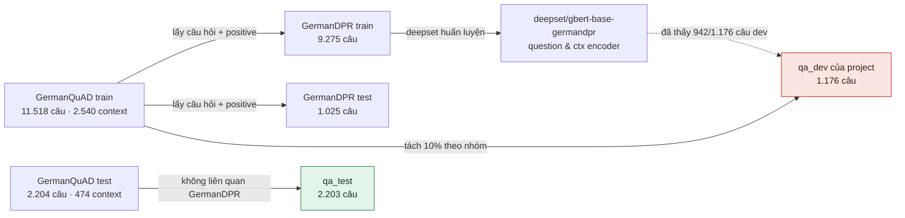
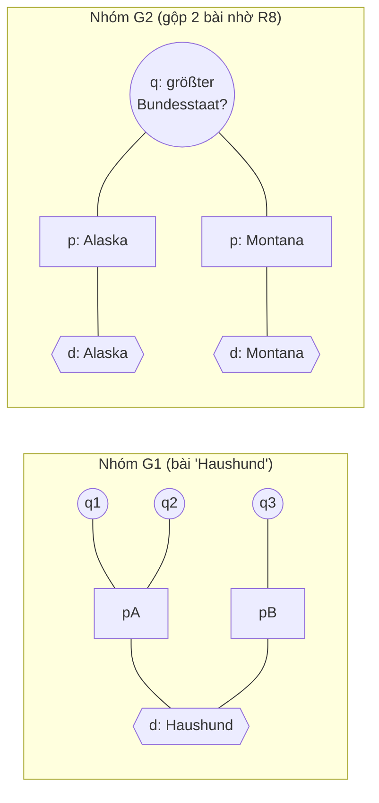
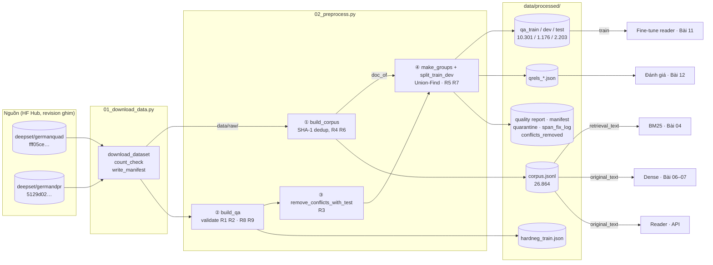
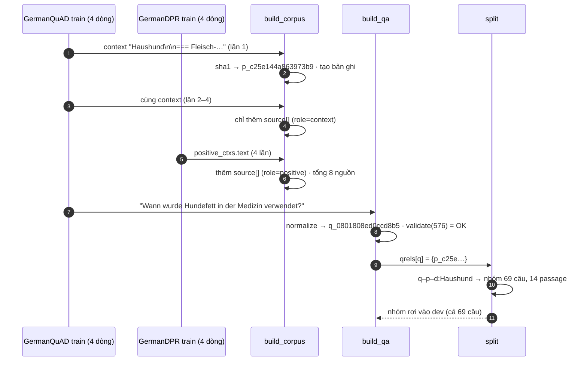

# BÀI 03 — GERMANQUAD, GERMANDPR VÀ TIỀN XỬ LÝ DỮ LIỆU

> **Vị trí trong giáo trình**: Bài 02 mô tả hai tầng của kiến trúc. Bài này mô tả **dữ liệu** chạy qua chúng: nó đến từ đâu, được biến đổi thế nào, và vì sao mỗi quyết định tiền xử lý lại ràng buộc các bài sau (BM25 đọc `retrieval_text`, reader đọc `original_text`, đánh giá dựa trên `qrels`, chọn cấu hình trên dev).
>
> **Ví dụ xuyên suốt**: passage `p_c25e144a863973b9` (bài „Haushund“). Đây là đoạn văn chứa đáp án của câu „Wann wurde Hundefett in der Medizin verwendet?“ đã dùng ở Bài 01–02. Bài này lần theo nó từ dữ liệu thô đến `corpus.jsonl`.
>
> **Nguồn số liệu**: báo cáo Chương 3 (`Bao_cao_Chuong_3_Du_lieu_va_tien_xu_ly.docx`) và các file `data/processed/data_quality_report.json`, `split_manifest.json`, `reports/dense_leakage.json`. Một số con số không có trong báo cáo mà được đo thêm cho bài học bằng script chỉ đọc. Các số đó được gắn nhãn 📙 **[MỞ RỘNG]**, kèm cách đo.

---

## Mục lục

- [A. Learning Objectives](#a-learning-objectives)
- [B. Prerequisite Knowledge](#b-prerequisite-knowledge)
- [C. Theoretical Foundation](#c-theoretical-foundation)
- [D. Mathematical Foundation](#d-mathematical-foundation)
- [E. Architecture & Working Mechanism](#e-architecture--working-mechanism)
- [F. Application in Our Project](#f-application-in-our-project)
- [G. Implementation Mapping](#g-implementation-mapping)
- [H. YouTube Learning Resources](#h-youtube-learning-resources)
- [I. Knowledge Check](#i-knowledge-check)
- [J. Implementation Readiness](#j-implementation-readiness)
- [Đáp án và lời giải](#đáp-án-và-lời-giải)
- [Tài liệu tham khảo bài 03](#tài-liệu-tham-khảo-bài-03)

---

## A. LEARNING OBJECTIVES

### A.1. Mục tiêu kiến thức

Sau bài học, bạn giải thích được:

1. Cấu trúc một mẫu của **GermanQuAD** và **GermanDPR**, và vì sao hai bộ này **không độc lập**.
2. Vai trò của từng bộ trong project: cái nào huấn luyện reader, cái nào cung cấp passage, cái nào **không** được dùng làm câu hỏi đánh giá.
3. **Chuẩn hóa Unicode** (NFC/NFD), ký tự zero-width, và vì sao chuẩn hóa lại phá vỡ offset.
4. Vì sao mỗi passage có **hai phiên bản văn bản**, `original_text` và `retrieval_text`.
5. **Kiểm tra span** và **gộp câu hỏi trùng** theo các quy tắc R1, R2 và R8.
6. **Khử trùng lặp** bằng mã băm, và vì sao phải làm *trước* khi chia tập.
7. **Data leakage** và cách **chia theo nhóm** bằng **Union-Find**.
8. **Qrels** là gì và project cài đặt nó ra sao.

### A.2. Mục tiêu kỹ năng

1. Đọc một bản ghi `corpus.jsonl`, `qa_*.jsonl`, `qrels_*.json` và nói được ý nghĩa của từng trường.
2. Tự tính ước lượng số cửa sổ reader cho một context khi biết độ dài theo token.
3. Tự tính xác suất va chạm của `passage_id` 64 bit.
4. Viết lại Union-Find và hàm chia theo nhóm từ trí nhớ (G.5).
5. Kiểm tra được dữ liệu đã xử lý có rò rỉ hay không (G.6).

### A.3. Những gì phải nhớ

| Con số | Ý nghĩa | Nguồn |
|---|---|---|
| 54.908 → 26.864 | lượt xuất hiện passage → passage duy nhất | `data_quality_report.json` |
| 21.591 | số document (bài viết) | như trên |
| 10.301 / 1.176 / 2.203 | câu hỏi train / dev / test | như trên |
| 376 nhóm, lớn nhất 221 | kết quả Union-Find trên 11.477 câu | như trên |
| 18.054 OK, 0 sửa, 0 cách ly | kiểm tra span GermanQuAD | như trên |
| 942/1.176 | câu dev có trong câu hỏi train của GermanDPR | `reports/dense_leakage.json` |
| `include_dpr_qa: false` | câu hỏi GermanDPR không vào QA | `configs/baseline.yaml` |
| seed 42, dev 10% | chia tập | `src/germanqa/config.py` |

### A.4. Thành phần pipeline dùng kiến thức này

| Thành phần | Đọc gì từ bài này |
|---|---|
| BM25 (Bài 04) | `retrieval_text` của 26.864 passage |
| Dense DPR (Bài 06–07) | `original_text`; và vấn đề nhiễm bẩn dev |
| Reader (Bài 10–11) | `qa_train.jsonl` (`answers[].start` trên `original_text`) |
| Đánh giá (Bài 12) | `qrels_*.json`, nhiều đáp án tham chiếu ở test |
| API (ngoài phạm vi lý thuyết, xem Roadmap) | `original_text`, `normalize_question`, offset UTF-16 |

---

## B. PREREQUISITE KNOWLEDGE

### B.1. Kiến thức cần biết trước

| Kiến thức | Mức | Ôn ở đâu |
|---|---|---|
| Passage, document, qrels, answer span | Hiểu | Bài 01 C.2–C.3; Bài 02 C.3–C.4 |
| Python `str` là dãy code point; slicing `s[a:b]` | Thành thạo | — |
| `dict`, `set`, JSON/JSONL | Thành thạo | Roadmap P0 |
| Mã băm (hash) là hàm một chiều, cùng đầu vào cho cùng đầu ra | Khái niệm | C.6 |
| Đồ thị, thành phần liên thông | Khái niệm | C.8 |
| Train / dev / test | Hiểu | Bài 01 |

### B.2. Thuật ngữ mới (giải thích lần đầu)

| Thuật ngữ | Giải thích |
|---|---|
| **Code point** | Số hiệu của một ký tự trong Unicode, viết U+XXXX. Ví dụ „ä“ là U+00E4. |
| **NFC / NFD** | Hai dạng chuẩn hóa Unicode. NFC dùng ký tự dựng sẵn (một code point). NFD tách ký tự thành chữ cơ sở và dấu kết hợp. |
| **Zero-width character** | Ký tự không có độ rộng hiển thị, ví dụ U+200B. Mắt không thấy, nhưng máy vẫn coi là một ký tự. |
| **Soft hyphen** (U+00AD) | Dấu gạch nối mềm, chỉ hiện ra khi trình duyệt ngắt dòng. |
| **NBSP** (U+00A0) | Khoảng trắng không ngắt dòng. |
| **BMP** | Basic Multilingual Plane, gồm các code point từ U+0000 đến U+FFFF. Ký tự ngoài BMP (ví dụ emoji) cần 2 đơn vị UTF-16. |
| **Offset** | Vị trí ký tự trong chuỗi. Span là cặp [start, end). |
| **Provenance** | Nguồn gốc của một bản ghi: đến từ bộ dữ liệu nào, split nào, vai trò gì. |
| **Deduplication** | Khử trùng lặp: gộp các bản ghi giống nhau. |
| **Exact / near-duplicate** | Trùng chính xác (từng byte) / gần trùng (chỉ khác chi tiết nhỏ). |
| **Data leakage** | Thông tin của dữ liệu đánh giá lọt vào quá trình huấn luyện hoặc chọn mô hình, làm kết quả lạc quan giả. |
| **Group split** | Chia tập theo nhóm: các mẫu có liên hệ luôn đi cùng nhau. |
| **Union-Find** (disjoint-set) | Cấu trúc dữ liệu gom phần tử vào các nhóm rời nhau. Có hai thao tác: `find` và `union`. |
| **Hard negative** | Passage gây nhiễu, giống đoạn đúng về chủ đề nhưng không phải đoạn đúng. |
| **Quarantine** | Cách ly: tách mẫu nghi lỗi ra một file riêng thay vì đoán cách sửa. |

### B.3. Mối liên hệ với bài trước

- Bài 01 định nghĩa extractive QA: đáp án là một span `[s, e)` trên passage. Bài này đảm bảo span đó **đúng** với văn bản mà reader sẽ đọc.
- Bài 02 nói reader nhận `text = original_text` còn BM25 tìm trên `retrieval_text`. Bài này giải thích **vì sao** phải tách hai phiên bản.
- Bài 02 G.2 nhắc đến nhiễm bẩn dev do GermanDPR. Bài này đo cụ thể mức nhiễm bẩn đó.

---

## C. THEORETICAL FOUNDATION

### C.1. GermanQuAD

📘 **[BÁO CÁO]** (Ch.3.1.1). GermanQuAD là bộ extractive QA gồm 13.722 câu hỏi trên Wikipedia tiếng Đức (Möller et al., 2021), giấy phép CC BY 4.0.

- **Train**: 11.518 câu, mỗi câu **một** đáp án.
- **Test**: 2.204 câu, gán nhãn bởi **ba người độc lập**, nên mỗi câu có 2–3 đáp án (tổng 6.536).
- Câu hỏi được viết sao cho **tự đủ nghĩa** (self-sufficient), tức hiểu được mà không cần nhìn passage. Điều này làm bộ dữ liệu phù hợp với QA miền mở.

**Một mẫu thô** (đọc từ `data/raw/germanquad`, train[0]):

```python
{"id": ...,
 "context": "Recht_der_Vereinigten_Staaten\n\n=== Amerikanisches Common Law ===\nObwohl die Vereinigten Staaten ...",
 "question": "Von welchem Gesetzt stammt das Amerikanische ab? ",
 "answers": {"text": ["britischen Common Laws"], "answer_start": [146]}}
```

Có ba điều cần chú ý:

1. Dòng đầu của `context` là **tên bài Wikipedia**, dạng có gạch dưới. Dataset card không nói điều này, nhưng project dùng nó để lấy `title` (hàm `extract_title`).
2. Câu hỏi thô có thể có **khoảng trắng thừa ở cuối** (dấu cách sau „ab?“) và cả **lỗi chính tả** của người gán nhãn („Gesetzt“). Tiền xử lý chỉ chuẩn hóa khoảng trắng, không sửa chính tả.
3. `answer_start` là vị trí **ký tự** trên `context` **gốc**.

Một mẫu test cho thấy ba người gán nhãn không hoàn toàn thống nhất:

```python
"question": "Was kann den Verschleiß des seillosen Aufzuges minimieren?",
"answers": {"text": ["elektromagnetischer Linearführungen",
                     " elektromagnetischer Linearführungen",   # có dấu cách đầu
                     "elektromagnetischer Linearführungen"],
            "answer_start": [1205, 1204, 1205]}
```
*(Câu hỏi: "Điều gì có thể giảm hao mòn của thang máy không cáp?" — Đáp án: "các ray dẫn hướng điện từ".)*

Hai đáp án giống nhau hoàn toàn (cùng chuỗi, cùng vị trí) được gộp lại. Đáp án có dấu cách đầu thì khác vị trí nên vẫn được giữ. Vì vậy 6.536 đáp án gốc còn **4.644** đáp án tham chiếu khác nhau (📘 Ch.3.3.4). Việc so sánh hai đáp án "giống nhau về nghĩa" thuộc về hàm chuẩn hóa đáp án khi đánh giá (Bài 12), không phải việc của tiền xử lý.

### C.2. GermanDPR

📘 **[BÁO CÁO]** (Ch.3.1.2). GermanDPR là bộ dữ liệu cho **passage retrieval**, **dựng từ GermanQuAD**. Mỗi câu hỏi có 1 positive và 3 hard negative lấy từ Wikipedia tiếng Đức, theo định dạng của DPR (Karpukhin et al., 2020).

**Một mẫu thô** (`data/raw/germandpr`, train[0]):

```python
{"question": "Wie viele christlichen Menschen in Deutschland glauben an einen Gott?",
 "answers": ["75 % der befragten Katholiken sowie 67 % der Protestanten glaubten an einen Gott (2005: 85 % und 79 %)"],
 "positive_ctxs":      {"title": ["Gott"], "text": ["Gott\n\n=== Demografie ===\n..."], "passage_id": [...]},
 "negative_ctxs":      {"title": [], "text": [], "passage_id": []},              # rỗng ở MỌI mẫu
 "hard_negative_ctxs": {"title": ["Christentum", "Noachidische_Gebote",
                                  "Figuren_und_Schauplätze_der_Scheibenwelt-Romane"], ...}}
```
*(Câu hỏi: "Bao nhiêu người Cơ Đốc giáo ở Đức tin vào Chúa?")*

So với GermanQuAD, mẫu này khác ở bốn điểm:

| Điểm khác | Hệ quả |
|---|---|
| `answers` là danh sách chuỗi, **không có vị trí** | Không dùng trực tiếp để huấn luyện reader được (R9 phải tìm lại vị trí) |
| Positive chính là context của GermanQuAD (bắt đầu bằng dòng tiêu đề „Gott“) | Hai bộ dữ liệu chia sẻ passage |
| `negative_ctxs` rỗng ở mọi mẫu | Project chỉ dùng `positive_ctxs` và `hard_negative_ctxs` |
| 3 hard negative cùng chủ đề (tôn giáo) | Làm kho truy hồi khó hơn |

Số liệu: train có 9.275 câu, test có 1.025 câu. Đếm được 27.811 hard negative ở train, trong khi card ghi 27.825, vì 6 câu chỉ có 1 hard negative và 2 câu chỉ có 2 (📘 Bảng 3.1).

> ⚠️ **[THIẾU TRONG BÁO CÁO]** Báo cáo không mô tả GermanDPR đã chọn hard negative bằng phương pháp nào. Định nghĩa chung của DPR là passage BM25 xếp cao nhưng không chứa đáp án (📗 Karpukhin et al., 2020; báo cáo Ch.2). Nếu cần khẳng định cho GermanDPR, phải đọc mục 3 của bài báo Möller et al. (2021) và trích dẫn trực tiếp.

### C.3. Hai bộ dữ liệu không độc lập

📘 **[BÁO CÁO]** (Bảng 3.2, đo trên revision đã ghim):

| Chỉ số | GermanDPR train (9.275) | GermanDPR test (1.025) |
|---|---|---|
| Câu hỏi có trong GermanQuAD **train** | 9.275 (100%) | 1.025 (100%) |
| Câu hỏi có trong GermanQuAD **test** | 0 | 0 |
| Positive đầu tiên là context GermanQuAD train | 100% | 100% |

Như vậy **cả train lẫn test của GermanDPR đều lấy từ GermanQuAD train**. Điều này có hai hệ quả:



1. **Có lợi**: GermanQuAD test không xuất hiện trong GermanDPR dưới dạng câu hỏi hay positive. Vì vậy test dùng được để đánh giá cuối cho cả reader lẫn dense retriever.
2. **Rủi ro**: dev tách từ GermanQuAD train, nên encoder DPR đã được huấn luyện trên chính các câu dev. Kết quả dense trên dev bị thổi phồng.

📘 **[BÁO CÁO]** (`reports/dense_leakage.json`): mức độ cụ thể như sau.

Mọi ô trong bảng dưới đây đếm **số câu hỏi**, không phải số passage.

| Tập | Câu hỏi | Câu có trong câu hỏi train GermanDPR | Câu có gold là positive của GermanDPR train | Câu có gold xuất hiện trong GermanDPR train với **vai trò bất kỳ** |
|---|---|---|---|---|
| train | 10.301 | 8.312 | 9.275 | 9.485 |
| dev | 1.176 | **942** | **1.056** | 1.068 |
| test | 2.203 | 0 | 0 | **186** |

Cột cuối đáng chú ý: **186 câu test có passage gold xuất hiện trong GermanDPR train**. Vai trò của các passage đó không phải positive, nên chỉ có thể là **hard negative**. 📙 Đo thêm trên `corpus.jsonl`: 186 câu này dùng chung **52 passage**, tức các context của GermanQuAD test có trong `source[]` một mục `germandpr / hard_negative` (94 lượt ở GermanDPR train, 6 lượt ở GermanDPR test). Như vậy encoder DPR đã được huấn luyện để *đẩy* chính các passage này *ra xa* một câu hỏi khác. Báo cáo ghi nhận hiện tượng tương tự ở `hardneg_train.json` (47 passage gold của test, 📘 Ch.3.5.2 mục 3). Tuy nhiên, ảnh hưởng lên kết quả dense trên test **chưa được đo**. ⚠️ **[THIẾU TRONG BÁO CÁO]**: con số 186 có trong `dense_leakage.json` nhưng chưa được phân tích trong văn bản báo cáo.

Đây là lý do có tập **dev-unseen** (234 câu dev không có trong câu hỏi train của GermanDPR, tức 1.176 − 942) và tập **train-select** (1.989 câu train cũng chưa bị encoder thấy). Bài 07–08 dùng hai tập này để chọn cấu hình dense.

### C.4. Unicode: code point, NFC và NFD

📗 **[NỀN TẢNG]** (Unicode Consortium, UAX #15). Máy tính so sánh chuỗi bằng cách so **dãy code point**, không so hình dạng hiển thị. Chữ „ö“ có hai cách viết hợp lệ:

| Dạng | Code point | Độ dài Python |
|---|---|---|
| NFC (dựng sẵn) | `U+00F6` | 1 |
| NFD (phân rã) | `U+006F` (o) + `U+0308` (dấu hai chấm kết hợp) | 2 |

Hai dạng trông giống hệt nhau, nhưng `"ö" == "ö"` lại cho `False` nếu một bên là NFC và một bên là NFD. `unicodedata.normalize("NFC", s)` đưa cả hai về `U+00F6`.

Hậu quả với BM25 của project (tokenizer `\w+`), ví dụ đã chạy thật (📘 Ch.4.1.2):

```python
>>> import re, unicodedata
>>> d = unicodedata.normalize("NFD", "höchste")
>>> len("höchste"), len(d)
(7, 8)
>>> re.findall(r"\w+", d.lower())
['ho', 'chste']          # U+0308 không thuộc \w → từ bị cắt đôi
```

Nếu câu hỏi người dùng gõ vào ở dạng NFD (ví dụ chuỗi lấy từ tên file trên macOS, vốn lưu ở dạng phân rã, hoặc từ một công cụ không chuẩn hóa; báo cáo không đo tần suất của trường hợp này), BM25 sẽ tìm hai term vô nghĩa „ho“ và „chste“ và không khớp được „höchste“ trong kho. **Chuẩn hóa câu hỏi lúc chạy** (`normalize_question` trong `pipeline.py`) ngăn được lỗi này.

📘 **[BÁO CÁO]** (Bảng 3.6): toàn bộ dữ liệu thô **đã ở dạng NFC**. Vì vậy NFC trong project chủ yếu là **lớp bảo vệ cho câu hỏi người dùng**, không phải bước sửa dữ liệu.

### C.5. Ký tự "khó thấy" trong kho

📘 **[BÁO CÁO]** (Bảng 3.6). Ví dụ thật lấy từ `corpus.jsonl` (📙 trích thêm cho bài học):

| Ký tự | Số passage | Ví dụ thật | Project xử lý? |
|---|---|---|---|
| Zero-width U+200B… | 4 | `p_4a573f53103e49a2`: `"grün-​gelben"` | Có: bỏ trong `retrieval_text` (dài 1276 → 1275) |
| Soft hyphen U+00AD | 95 | `p_00e66fa44085db28`: `"Computer\xadsimulation"` | **Không**: U+00AD không thuộc `\w`, nên BM25 tách thành „computer“ + „simulation“ |
| NBSP U+00A0 | 6.609 | đáp án `"bis zu 270\xa0Tagen"` | Có: `\s+` khớp U+00A0, nên bị gộp thành dấu cách trong `retrieval_text` |
| Ngoài BMP | 1 | `p_db93016e072c66e1`: emoji 🏣 (U+1F3E3) | Có, ở API: trả về cả offset UTF-16 |
| ä ö ü ß | 26.776/26.864 | — | Giữ nguyên |

Một điểm tinh tế với NBSP: trong `original_text` và trong đáp án, NBSP **vẫn còn**. Nếu reader trích span này, chuỗi trả về là `"bis zu 270\xa0Tagen"`, tức vẫn chứa NBSP. Phép so khớp EM phải chuẩn hóa khoảng trắng ở **cả hai phía** thì mới không bị trừ điểm oan (Bài 12).

### C.6. Hai phiên bản văn bản: original_text và retrieval_text

📘 **[BÁO CÁO]** (Ch.3.3.2). Passage `p_c25e144a863973b9` thật:

```text
original_text  (991 ký tự):  'Haushund\n\n=== Fleisch- und Arzneimittellieferant ===\nHundefl…'
retrieval_text (990 ký tự):  'haushund === fleisch- und arzneimittellieferant === hundefle…'
```

| | `original_text` | `retrieval_text` |
|---|---|---|
| Phép biến đổi | không có | bỏ zero-width → NFC → gộp `\s+` thành một dấu cách → cắt đầu cuối → `lower()` |
| Chữ hoa | giữ | mất |
| Xuống dòng | giữ | thành dấu cách |
| Offset của `answers.start` | **đúng** | **lệch** (sau vị trí 8, lệch 1 ký tự) |
| Ai đọc | Dense encoder, reader, cross-encoder, API | **chỉ BM25** |

Có ba lý do cho thiết kế này:

1. **Offset**: `answer_start` của GermanQuAD được tính trên văn bản gốc. Hai ký tự `\n\n` sau „Haushund“ bị gộp thành một dấu cách, nên mọi offset phía sau lệch đi 1. Đáp án Hundefett nằm ở [576, 610) trên `original_text`. Trên `retrieval_text`, cắt cùng vị trí đó sẽ ra một chuỗi khác.
2. **Mô hình cased**: GBERT, DPR và BGE đều phân biệt hoa thường. Trong tiếng Đức, mọi danh từ viết hoa, nên chữ hoa mang thông tin ngữ pháp. 📘 `configs/dense.yaml` ghi lại phép thử ở GĐ6: đưa văn bản chữ thường vào context encoder làm top-1 giảm từ 0,84 xuống 0,52.
3. **BM25 cần khớp từ**: „Hund“ ở đầu câu và „hund“ giữa câu phải là cùng một term.

**Bất biến** (📘 Bảng 3.8): `make_retrieval_text(original_text) == retrieval_text` đúng với cả 26.864/26.864 passage. Vì vậy `retrieval_text` là **dữ liệu dẫn xuất**: có thể xóa đi rồi tính lại, không bao giờ là nguồn sự thật.

### C.7. Kiểm tra span và gộp câu hỏi trùng

📘 **[BÁO CÁO]** Quy tắc được **ghi thành văn bản trước khi chạy** (`docs/preprocessing_rules.md`). Mục đích là để quyết định xử lý không bị kết quả thực nghiệm chi phối.

| Mã | Tình huống | Cách xử lý |
|---|---|---|
| R1 | Offset sai, đáp án xuất hiện đúng 1 lần | Sửa, ghi `span_fix_log.jsonl` |
| R2 | Đáp án xuất hiện nhiều lần hoặc không thấy | Cách ly vào `quarantine.jsonl`, **không đoán** |
| R3 | Mẫu train trùng câu hỏi hoặc passage với test | Loại khỏi **train**, không bao giờ loại khỏi test |
| R4 | Hai passage giống hệt | Gộp làm một, giữ mọi nguồn trong `source[]` |
| R5 | Train/dev | 90/10, chia theo nhóm liên thông |
| R6 | Passage GermanDPR | Đưa vào kho: positive và hard negative |
| R7 | Seed | 42 |
| R8 | Câu hỏi trùng trong cùng split | Cùng passage: gộp đáp án. Khác passage: chỉ hợp nhất vào qrels |
| R9 | Đáp án GermanDPR không có offset | Tìm trong positive; duy nhất thì lấy vị trí, mơ hồ thì `start = None` |

**Vì sao R2 không đoán?** Giả sử đáp án „1900“ xuất hiện hai lần trong context, và offset gốc sai. Nếu chọn lần xuất hiện đầu tiên, ta có 50% khả năng **dạy reader một nhãn sai**. Một mẫu sai trong train có hại hơn một mẫu bị thiếu. Kết quả thực tế: cả 18.054 đáp án GermanQuAD đều đạt trạng thái `OK`, nên R1 và R2 không phải kích hoạt lần nào. Cơ chế này vẫn cần, vì nó sẽ phát hiện lỗi nếu nguồn dữ liệu thay đổi.

**R8 với ví dụ thật** (📙 trích từ `qa_train.jsonl` cho bài học):

- *Cùng passage, gộp đáp án*: câu „Für wie lange können Reservisten der US-Army vom Präsidenten einberufen werden?“ *(Quân dự bị Lục quân Mỹ có thể bị Tổng thống triệu tập trong bao lâu?)* sau khi gộp có hai đáp án: `"bis zu 270 Tagen"` (start 1286) và một câu dài về „Partial Mobilization … bis zu 24 Monate“ (start 1477).
- *Khác passage, chỉ ghi qrels*: câu „Was ist der größte Bundesstaat der USA?“ *(Bang lớn nhất nước Mỹ là bang nào?)* xuất hiện trên hai passage, một của bài „Alaska“ và một của bài „Montana“. Bản ghi QA giữ passage đầu tiên, còn qrels có cả hai.

Số liệu: 27 lần gộp cùng passage, 15 lần khác passage. Train còn 11.477 câu (từ 11.518), test còn 2.203 câu (từ 2.204).

### C.8. Khử trùng lặp và provenance

📘 **[BÁO CÁO]** (Ch.3.4.1). Cùng một passage có thể xuất hiện nhiều lần: làm context cho nhiều câu GermanQuAD, làm positive của GermanDPR, hoặc làm hard negative của nhiều câu. `build_corpus` dùng **SHA-1 của `original_text`** làm khóa. Lần đầu gặp thì tạo bản ghi; các lần sau chỉ thêm một mục vào `source[]`.

Passage Hundefett có **8 nguồn**: 4 lần là `context` của GermanQuAD train (4 câu hỏi khác nhau dùng chung đoạn này) và 4 lần là `positive` của GermanDPR train. Passage có nhiều nguồn nhất có **36** nguồn (📙 đo thêm).

**Vì sao phải khử trùng *trước* khi chia tập?** Nếu cùng một đoạn văn mang hai mã khác nhau, một mã ở train và một mã ở test, thì phép kiểm tra "passage test có nằm trong train không" so sánh theo mã sẽ trả lời "không", dù thực tế là có. Đây chính là data leakage (Kaufman et al., 2012).

**Giới hạn: chỉ khử trùng chính xác.** Báo cáo ghi "mức độ near-duplicate chưa được đo" (📘 Ch.3.5.2 mục 6). 📙 **[MỞ RỘNG]** (đo thêm cho bài học): gom các passage theo `retrieval_text` giống hệt nhau thì được **20 cặp** passage có `passage_id` khác nhau nhưng chỉ khác nhau ở **khoảng trắng**, ví dụ:

```text
Sichuan  (531 ký tự): '…lionen ha Wald.\nEin Fünft…'
Sichuan  (532 ký tự): '…lionen ha Wald. \nEin Fünf…'     ← thêm 1 dấu cách trước \n
```

Đây chỉ là **cận dưới** của số near-duplicate, vì cách đo này chỉ bắt được khác biệt về khoảng trắng, chữ hoa và ký tự vô hình. Với BM25, hai bản này có điểm **bằng nhau tuyệt đối**, nên chúng chiếm hai chỗ trong top-K. Ảnh hưởng thực tế lên Hit@k chưa được đo.

### C.9. Data leakage và chia theo nhóm

📗 **[NỀN TẢNG]** Ba tập có ba vai trò: **train** cập nhật tham số, **dev** chọn siêu tham số và checkpoint, **test** báo cáo **một lần**. GermanQuAD chỉ có train và test, nên dev phải tách từ train.

**Cách ngây thơ** là chọn ngẫu nhiên 10% câu hỏi. Cách này thất bại vì mỗi context có trung bình 4,5 câu hỏi: các câu hỏi "anh em" của một câu dev gần như chắc chắn nằm ở train. Reader khi đó đã **đọc chính passage đó lúc huấn luyện**, nên dev chỉ còn đo khả năng ghi nhớ.

📙 **[MỞ RỘNG]** (đo thêm): chia ngẫu nhiên 11.477 câu bằng `random.Random(42)` thì **1.120/1.148 câu dev (97,6%)** có passage gold xuất hiện ở train (cách tính ở D.4).

**Chia theo nhóm**: dựng đồ thị *câu hỏi — passage — bài viết*, rồi coi mỗi thành phần liên thông là một khối không được tách rời.



q3 không chung passage với q1, nhưng chung **bài viết**, nên vẫn cùng nhóm. Nhóm G2 là trường hợp thật: câu hỏi R8 có hai passage gold ở hai bài viết khác nhau, nên cả bài „Alaska“ và bài „Montana“ bị gộp vào một nhóm, tổng cộng 65 câu.

📘 **[BÁO CÁO]** + 📙 **[MỞ RỘNG]** (đo thêm): 11.477 câu tạo thành **376 nhóm**. Trong đó 374 nhóm ứng với đúng 1 bài viết, và 2 nhóm ứng với 2 bài viết (Alaska + Montana; Tennessee + Todesstrafe_in_den_Vereinigten_Staaten). Như vậy **trên thực tế, nhóm ≈ bài viết**. Nhóm lớn nhất là bài „Schweiz“ với 221 câu. Nhóm Haushund có 69 câu trên 14 passage.

**Cái giá phải trả** (📘 Ch.3.4.3): dev chỉ có **46 bài viết** (46 nhóm), trong khi test có 233 bài. Các câu dev vì thế tương quan theo bài viết. Bootstrap giả định các câu độc lập, nên khoảng tin cậy trên dev có thể **hẹp hơn thực tế** (Bài 12).

**Một giới hạn khác của benchmark** (📘 Ch.3.2.5): 223 bài viết có mặt ở **cả** GermanQuAD train và test, và 2.129/2.203 câu test (96,6%) thuộc những bài viết đã gặp. Vậy test đo khả năng tổng quát hóa sang **đoạn văn mới của chủ đề đã gặp**, không phải sang chủ đề mới. Dataset card viết „each passage is from a different article“, nhưng điều đó không đúng ở mức bài viết.

### C.10. Union-Find

📗 **[NỀN TẢNG]** (Tarjan, 1975). Union-Find biểu diễn mỗi nhóm bằng một cây; gốc cây là "đại diện" của nhóm.

- `find(x)`: đi theo con trỏ `parent` lên đến gốc.
- `union(a, b)`: gắn gốc của cây chứa `a` vào gốc của cây chứa `b`.
- **Nén đường đi** (path compression): khi `find` đi qua một nút, cho nút đó trỏ thẳng lên gần gốc hơn. Nhờ vậy cây gần như phẳng.

Project dùng biến thể **path halving** (`parent[x] = parent[parent[x]]`, mỗi bước nhảy qua một mức). Project không dùng union by rank. Với 11.477 câu, khoảng 2.540 passage và 378 bài viết, chi phí này không đáng kể.

Các khóa trong đồ thị có **tiền tố** `q:`, `p:`, `d:`. Nhờ đó một `question_id` không thể vô tình trùng với một `passage_id`.

### C.11. Qrels

📗 **[NỀN TẢNG]** (Manning et al., 2008). Qrels (query relevance judgments) theo kiểu TREC là bảng `(query_id, doc_id, relevance)`, trong đó relevance có thể nhị phân hoặc nhiều mức.

📘 **[BÁO CÁO]** Project cài đặt đơn giản hơn: `{question_id: [passage_id, …]}`. Relevance là **nhị phân và ngầm định**: passage có trong danh sách là liên quan. Dev và test: mỗi câu có đúng 1 passage liên quan. Train: 15 câu có 2 passage (do R8).

```json
"q_0801808ed0ccd8b5": ["p_c25e144a863973b9"]
```

⚠️ Qrels chỉ đánh dấu passage **gốc** mà người gán nhãn đã đọc. Một passage khác trong kho có thể *cũng* chứa đáp án, nhưng vẫn bị tính là "không liên quan". Đây là giới hạn chung của qrels dựng từ dữ liệu QA, gọi là *false negative* trong đánh giá truy hồi. Bài 01 đã nói đến hiện tượng này qua số hạng "may mắn" `P(A | g ∉ R_5) = 7/426`: reader đúng mà không đọc gold.

### C.12. Ưu điểm, hạn chế, khi nào dùng

| Lựa chọn | Ưu điểm | Hạn chế |
|---|---|---|
| Hai phiên bản văn bản | Offset an toàn, mô hình cased giữ được chữ hoa | Hai nơi lưu gần trùng (kho to gấp khoảng 2) |
| SHA-1 làm khóa | Tất định, không cần ghi lại bảng ánh xạ | Chỉ bắt được trùng chính xác |
| Chia theo nhóm | Dev không rò passage hay bài viết | Dev ít chủ đề (46 bài); kích thước dev "nhảy" theo nhóm |
| Quy tắc ghi trước | Tránh điều chỉnh theo kết quả | Không bao quát được tình huống chưa nghĩ tới |
| Không đụng vào test | So sánh được với nghiên cứu khác | Không sửa được các vấn đề có sẵn của benchmark (trùng bài viết) |

---

## D. MATHEMATICAL FOUNDATION

### D.1. Đẳng thức đếm của corpus

📘 Số lượt xuất hiện passage:

$$
\underbrace{13.722}_{\text{context GermanQuAD}} + \underbrace{10.300}_{\text{positive GermanDPR}} + \underbrace{30.886}_{\text{hard negative GermanDPR}} = 54.908
$$

Sau khử trùng còn 26.864 passage, tức tỉ lệ nén khoảng 2,04 lần. 📙 Phân rã theo nguồn (đo thêm):

$$
\underbrace{23.850}_{\text{chỉ GermanDPR}} + \underbrace{2.539}_{\text{cả hai}} + \underbrace{475}_{\text{chỉ GermanQuAD}} = 26.864
$$

GermanQuAD có $2.540 + 474 = 3.014$ context khác nhau, và quả đúng $2.539 + 475 = 3.014$. Tách tiếp theo split:

| | Có trong GermanDPR | Không có trong GermanDPR | Tổng |
|---|---|---|---|
| Context GermanQuAD train | 2.487 (vai trò positive hoặc hard negative) | 53 | 2.540 |
| Context GermanQuAD test | 52 (**chỉ** vai trò hard negative) | 422 | 474 |
| Tổng | 2.539 | 475 | 3.014 |

Cách đọc bảng: 97,9% context train là passage của GermanDPR, khớp với kết luận ở C.3 rằng GermanDPR dựng từ GermanQuAD train. Context test thì không bao giờ là positive. Tuy vậy, 52 context test vẫn lọt vào GermanDPR với vai trò hard negative, và đây chính là nguồn gốc của con số 186 ở C.3. Câu 13 (I.3) yêu cầu bạn tự tái tạo bảng này.

### D.2. Độ lệch offset khi chuẩn hóa

Gọi $\phi$ là phép chuẩn hóa. Nếu $\phi$ gộp một đoạn khoảng trắng dài $m$ ký tự tại vị trí $i$ thành 1 dấu cách, thì mọi vị trí $j > i$ bị dời:

$$
j' = j - (m - 1)
$$

Với passage Haushund: tại $i = 8$ có `\n\n` ($m = 2$), nên mỗi vị trí sau đó lùi 1. Đáp án gốc ở $[576, 610)$ trên `original_text` ứng với $[575, 609)$ trên `retrieval_text`. Đây là lý do C.6 nói `retrieval_text` không bao giờ được dùng để cắt đáp án. Một cách sửa là lưu bảng ánh xạ vị trí; project chọn cách đơn giản hơn là không cắt trên `retrieval_text`.

UTF-16 cũng tương tự. Với $c$ là số ký tự ngoài BMP đứng trước vị trí $j$:

$$
j_{\text{UTF-16}} = j_{\text{code point}} + c
$$

Ví dụ: trong passage `p_db93016e072c66e1`, mọi vị trí sau emoji 🏣 có $c = 1$. Nếu giao diện React dùng vị trí Python, phần tô sáng sẽ lệch 1 ký tự. Hàm `to_utf16_offset` (`schemas.py`) tính $c$.

### D.3. Ước lượng số cửa sổ reader

📗 **[NỀN TẢNG]** + tham số 📘 (`max_length` $= 384$, `stride` $= 128$). Một cửa sổ BERT có dạng `[CLS] q [SEP] c [SEP]`, tức 3 token đặc biệt. Với câu hỏi dài $|q|$ token, phần context mỗi cửa sổ chứa được:

$$
C = 384 - |q| - 3
$$

Hai cửa sổ liên tiếp chồng nhau 128 token, nên mỗi cửa sổ mới chỉ thêm $C - 128$ token mới. Với context dài $L$ token:

$$
n(L) = \begin{cases} 1 & L \le C \\ 1 + \left\lceil \dfrac{L - C}{C - 128} \right\rceil & L > C \end{cases}
$$

**Ví dụ số** với $|q| = 12$ (trung vị câu hỏi train), nên $C = 369$:

| Context | $L$ (token) | $n(L)$ |
|---|---|---|
| Trung vị train | 237 | 1 |
| P95 train | 481 | $1 + \lceil 112/241 \rceil = 2$ |
| Lớn nhất train | 672 | $1 + \lceil 303/241 \rceil = 3$ |
| P95 test | 1.112 | $1 + \lceil 743/241 \rceil = 5$ |
| Lớn nhất test | 2.202 | $1 + \lceil 1.833/241 \rceil = 9$ |

Đối chiếu với số đo thật (📘 Ch.3.2.3): train tối đa 3 cửa sổ, test tối đa **10** cửa sổ. Công thức ra 9 vì câu hỏi của context dài nhất không nhất thiết dài đúng 12 token, và cách HF tách cửa sổ có thể lệch một chút ở biên. Công thức là **ước lượng**; muốn có số chính xác thì phải chạy chính tokenizer.

Con số "381 token" trong báo cáo là $C$ khi $|q| = 0$, tức $384 - 3$. Context dài hơn 381 token thì không bao giờ vừa một cửa sổ.

Hệ quả: test có 13,1% câu cần ≥ 5 cửa sổ, còn train không có câu nào như vậy. Reader phải so điểm giữa nhiều cửa sổ hơn hẳn lúc huấn luyện. Đây là lý do `minus_cls` quan trọng (Bài 02 E.5, Bài 10).

Tỉ lệ token trên từ: $264{,}8 / 166{,}8 \approx 1{,}59$ (📘 Bảng 3.5). Nếu ước lượng độ dài bằng số từ, bạn sẽ đánh giá thấp độ dài thật khoảng 37%.

### D.4. Rò rỉ khi chia ngẫu nhiên

📙 **[MỞ RỘNG]** Gọi $m(q)$ là số câu hỏi dùng chung passage với $q$, kể cả $q$. Nếu chọn dev ngẫu nhiên với tỉ lệ $\rho = 0{,}1$, xác suất mọi "anh em" của $q$ cũng rơi vào dev xấp xỉ $\rho^{m-1}$. Xác suất passage của $q$ **có mặt ở train** là:

$$
P(\text{rò} \mid q) \approx 1 - \rho^{\,m(q) - 1}
$$

| $m$ | $P(\text{rò})$ |
|---|---|
| 1 | 0 (không có anh em nào) |
| 2 | 0,90 |
| 3 | 0,99 |
| 5 | 0,9999 |

Lấy trung bình trên 11.477 câu theo phân bố $m$ thật (134 câu có $m = 1$, 774 câu có $m = 2$, 1.338 câu có $m = 3$, …) cho **98,0%**. Mô phỏng thật với seed 42 cho **97,6%** (1.120/1.148). Hai con số khớp nhau, và cho thấy chia ngẫu nhiên gần như **chắc chắn** làm hỏng dev.

### D.5. Kích thước dev khi chia theo nhóm

Mục tiêu: $\text{round}(11.477 \times 0{,}1) = \text{round}(1.147{,}7) = 1.148$.

Thuật toán thêm từng nhóm vào dev **khi dev còn dưới mục tiêu** (`if len(dev) < target`). Nhóm cuối cùng được thêm vào làm dev vượt mục tiêu:

$$
|\text{dev}| = 1.176 = 1.148 + 28
$$

Độ vượt luôn nhỏ hơn kích thước nhóm cuối cùng. Với nhóm lớn nhất 221 câu, trường hợp xấu nhất dev có thể vượt tới 220 câu, tức khoảng 11,9% thay vì 10%. Seed khác sẽ cho kích thước dev khác.

### D.6. Xác suất va chạm của mã băm

📗 **[NỀN TẢNG]** (bài toán ngày sinh). Với $n$ phần tử và mã $b$ bit phân bố đều, xác suất có ít nhất một va chạm:

$$
P_{\text{va chạm}} \approx \frac{n^2}{2^{\,b+1}}
$$

- `passage_id` = 16 ký tự hex = **64 bit**, $n = 26.864$:
  $P \approx \dfrac{7{,}22 \times 10^{8}}{3{,}69 \times 10^{19}} \approx 2 \times 10^{-11}$.
- `document_id` = 12 ký tự hex = **48 bit**, $n = 21.591$:
  $P \approx \dfrac{4{,}66 \times 10^{8}}{5{,}63 \times 10^{14}} \approx 8 \times 10^{-7}$.

Cả hai đều rất nhỏ, và project vẫn có `assert len(set(ids)) == len(ids)` trong `build_corpus` để chắc chắn. Nếu kho lớn lên cỡ toàn bộ Wikipedia tiếng Đức (vài triệu đoạn, $n \approx 5 \times 10^6$), $P$ của 64 bit vào khoảng $7 \times 10^{-7}$, vẫn an toàn. Với 48 bit thì đã tới khoảng $0{,}04$, nên `document_id` sẽ cần dài hơn.

---

## E. ARCHITECTURE & WORKING MECHANISM

### E.1. Luồng dữ liệu tổng thể



### E.2. Input → Processing → Output của từng bước

| Bước | Input | Processing | Output |
|---|---|---|---|
| Tải | repo id + revision SHA | `load_dataset(…, revision=…)`, `save_to_disk`, đếm và so số mẫu | `data/raw/*`, `reports/step1_manifest.json`, `step1_count_check.csv` |
| ① Corpus | context GermanQuAD, positive và hard negative GermanDPR | `make_dedup_key` (SHA-1) → gộp; `make_retrieval_text`; `extract_title` / `clean_title`; `make_document_id` | 26.864 bản ghi 6 trường |
| ② QA | câu hỏi và đáp án thô | `normalize_text(question)`, `make_question_id`, `validate` từng đáp án, `_add_row` (R8), hard negative theo câu | `pools`, `qrels`, `hardneg`, `quarantine`, `fixlog` |
| ③ Xung đột | train pool, test pool, qrels test | loại câu train trùng `question_id` hoặc passage gold với test | train đã lọc (0 câu bị loại) |
| ④ Chia | train đã lọc, qrels, `doc_of` | Union-Find q–p–d → nhóm → sắp theo qid nhỏ nhất → xáo (seed 42) → lấp dev đến 10% | train 10.301, dev 1.176 |
| Ghi | mọi thứ ở trên | JSONL sắp theo id, `sort_keys=True`, SHA-1 từng file | 8 file dữ liệu + báo cáo chất lượng + manifest |

### E.3. Hành trình của passage Hundefett



Kết quả: câu hỏi Hundefett nằm ở **dev**, cùng 68 câu khác về bài Haushund. Không câu nào của bài này nằm ở train. Tuy vậy passage của nó là `positive` của GermanDPR train, nên **encoder DPR đã thấy nó** (C.3). Đây là một ví dụ cụ thể cho thấy chia theo nhóm bảo vệ được **reader** nhưng không bảo vệ được **dense retriever**, vì retriever này do người khác huấn luyện.

---

## F. APPLICATION IN OUR PROJECT

### F.1. Thành phần này nằm ở đâu?

Đây là giai đoạn **GĐ1–GĐ2**, chạy **offline** một lần. Mọi giai đoạn sau đọc `data/processed/`. Không có bước tiền xử lý dữ liệu nào chạy lúc phục vụ, ngoại trừ `normalize_question` cho câu hỏi người dùng.

### F.2. Vì sao nhóm cần nó?

| Quyết định | Nếu không làm |
|---|---|
| NFC cho câu hỏi | Câu NFD từ người dùng khiến BM25 cắt „höchste“ thành „ho“ + „chste“ |
| Hai phiên bản văn bản | Hoặc reader nhận chữ thường (top-1 dense giảm từ 0,84 xuống 0,52), hoặc offset lệch |
| Khử trùng trước khi chia | Kiểm tra rò rỉ theo mã sẽ bỏ sót |
| Chia theo nhóm | 97,6% câu dev rò passage (D.4) |
| `include_dpr_qa: false` | 1.025 câu GermanDPR test, vốn thuộc GermanQuAD train, sẽ bị thêm vào test |
| Không đụng vào test | Mất khả năng so sánh với các nghiên cứu khác |

### F.3. Đầu vào và đầu ra thực tế

**Một bản ghi corpus** (rút gọn):

```json
{"passage_id": "p_c25e144a863973b9",
 "document_id": "d_a948295c9577",
 "title": "Haushund",
 "original_text": "Haushund\n\n=== Fleisch- und Arzneimittellieferant ===\nHundefleisch …",
 "retrieval_text": "haushund === fleisch- und arzneimittellieferant === hundefleisch …",
 "source": [{"dataset": "germanquad", "split": "train", "role": "context",  "source_id": "…", "title": "Haushund"},
            … ×4,
            {"dataset": "germandpr",  "split": "train", "role": "positive", "source_id": "row…", "title": "Haushund"},
            … ×4]}
```

**Một bản ghi QA** (dev):

```json
{"question_id": "q_0801808ed0ccd8b5",
 "question": "Wann wurde Hundefett in der Medizin verwendet?",
 "passage_id": "p_c25e144a863973b9",
 "answers": [{"start": 576, "text": "vom Mittelalter bis in die Neuzeit"}],
 "origin": "germanquad"}
```

**Một bản ghi test** có nhiều đáp án:

```json
{"question": "Wann fuhr die erste elektrische Straßenbahn in Mexiko-Stadt?",
 "answers": [{"start": 231, "text": "am 15. Januar 1900"},
             {"start": 233, "text": " 15. Januar 1900"}]}
```
*(Câu hỏi: "Chuyến tàu điện đầu tiên ở Thành phố Mexico chạy khi nào?" — Đáp án: "vào ngày 15 tháng 1 năm 1900".)*

📙 Phân bố số đáp án ở test (đo thêm): 493 câu có 1 đáp án, 980 câu có 2, 729 câu có 3, và 1 câu có 4 (do gộp R8). Các câu có 1 đáp án là những câu mà cả ba người gán nhãn đều chọn cùng một span.

### F.4. Đầu ra đi đâu?

| File | Ai đọc |
|---|---|
| `corpus.jsonl` | `bm25_store` (Bài 04), `dense/index` (Bài 07), `pipeline.build_pipeline` (lấy `original_text` theo id) |
| `qa_train.jsonl` | `reader/features.py` → 13.263 cửa sổ (Bài 10–11) |
| `qa_dev.jsonl`, `qrels_dev.json` | Grid BM25, chọn checkpoint reader, chọn cấu hình pipeline |
| `qa_test.jsonl`, `qrels_test.json` | Chạy đúng **một lần** cho bảng kết quả cuối (Bài 12) |
| `hardneg_train.json` | **Chưa dùng**. Dành cho fine-tune DPR sau này. Lưu ý chứa 47 passage gold của test |
| `split_manifest.json` | Kiểm tra tái lập (SHA-1 của 8 file) |

### F.5. Nếu thay đổi một quyết định thì sao?

| Thay đổi | Hệ quả dự kiến |
|---|---|
| `include_dpr_qa: true` | Test bị nhiễm 1.025 câu đã có trong GermanQuAD train. **Không dùng** |
| Bỏ GermanDPR khỏi kho | Kho chỉ còn khoảng 3.014 passage. Hit@k tăng mạnh nhưng không còn thực tế. Không so được với cấu hình hiện tại |
| Chia ngẫu nhiên | Dev rò rỉ, chọn sai checkpoint (overfit) |
| Thêm bỏ U+00AD vào `make_retrieval_text` | Sửa được 95 passage. Phải dựng lại chỉ mục BM25 và chọn lại `k1`, `b` trên dev |
| Lấy title làm term BM25 sau khi thay `_` bằng dấu cách | 16.137 passage (60,1%) có tiêu đề chứa `_`. Có thể cải thiện BM25; đây là đề xuất, **chưa thử** |

### F.6. Tham số cần chú ý

| Tham số | Giá trị | File |
|---|---|---|
| `SEED` | 42 | `src/germanqa/config.py` |
| `DEV_RATIO` | 0,10 | `src/germanqa/config.py` |
| `include_dpr_qa` | `false` | `configs/baseline.yaml` |
| `TITLE_MAX_CHARS` | 80 | `data/text_utils.py` |
| Độ dài `passage_id` | 16 hex (64 bit) | `passage_id_from_key` |
| Độ dài `document_id` | 12 hex (48 bit) | `make_document_id` |
| Revision | `fff05ce…`, `5129d02…` | `reports/step1_manifest.json` |

---

## G. IMPLEMENTATION MAPPING

### G.1. Thư viện

| Thư viện | Dùng cho |
|---|---|
| `datasets` (Hugging Face) | `load_dataset(repo, revision=…)`, `save_to_disk`, `load_from_disk` |
| `huggingface_hub` | `HfApi().dataset_info(repo).sha` để lấy revision |
| `unicodedata` (chuẩn) | `normalize("NFC", …)` |
| `re` (chuẩn) | `\s+`, ký tự zero-width |
| `hashlib` (chuẩn) | SHA-1 cho `passage_id`, `question_id`, `document_id`, mã băm file |
| `random` (chuẩn) | `random.Random(42).shuffle` (đối tượng riêng, không đụng trạng thái toàn cục) |

Project **không dùng** `pandas` hay `sklearn.model_selection.GroupShuffleSplit` cho bước này. Union-Find được tự viết.

### G.2. Class và function quan trọng

| File | Hàm | Việc |
|---|---|---|
| `data/download.py` | `download_dataset`, `get_revision`, `count_check`, `write_manifest` | Tải theo revision, đối chiếu số mẫu |
| `data/text_utils.py` | `normalize_text`, `normalize_question`, `make_retrieval_text`, `make_dedup_key`, `passage_id_from_key`, `make_question_id`, `extract_title`, `clean_title`, `make_document_id` | Mọi phép biến đổi chuỗi và sinh ID |
| `data/validate_spans.py` | `find_all`, `validate` | Trả về trạng thái `OK`, `FIXED`, `LOCATED` hoặc `QUARANTINE_*` |
| `data/build_corpus.py` | `build_corpus`, `_add` | Khử trùng và provenance |
| `data/build_qa.py` | `build_qa`, `_add_row`, `_merge_answers` | Pool QA, qrels, hard negative |
| `data/split.py` | `UnionFind`, `make_groups`, `remove_conflicts_with_test`, `split_train_dev` | R3, R5 |
| `scripts/02_preprocess.py` | `main` | Ghép các bước, ghi file và báo cáo |
| `schemas.py` | `to_utf16_offset` | Offset cho giao diện |

### G.3. Pseudocode

```text
PREPROCESS(raw):
    corpus ← {}                                    # key = sha1(original_text)
    for mỗi (text, title, nguồn) trong context_QuAD ∪ positive_DPR ∪ hardneg_DPR:
        k ← sha1(text)
        nếu k ∉ corpus: corpus[k] ← {pid = "p_"+k[:16], text, lower_norm(text), title, doc_id(title)}
        corpus[k].source.append(nguồn)

    for mỗi dòng QuAD (split ∈ {train, test}):
        q ← normalize(question); qid ← "q_"+sha1(lower(q))[:16]
        answers ← [a | validate(context, a) ∈ {OK, FIXED}]     # R1, R2
        nếu answers rỗng: quarantine; tiếp
        add_row(pool[split], qrels[split], qid, pid(context), answers)   # R8

    train ← train − {r | r.qid ∈ test hoặc r.pid ∈ gold(test)}  # R3
    nhóm  ← UnionFind(q — p — d)                               # R5
    keys  ← sort(nhóm, theo min qid); shuffle(seed=42)
    dev   ← lấp từng nhóm đến khi |dev| ≥ round(0,1·|train|)
    ghi file, ghi sha1, ghi báo cáo
```

### G.4. Cấu trúc dữ liệu

```python
corpus:  list[dict]       # 6 trường, sắp theo passage_id
pools:   {"train": {qid: row}, "test": {qid: row}}
qrels:   {"train": {qid: set[pid]}, "test": {qid: set[pid]}}   # ghi ra JSON thành list đã sắp
hardneg: {qid: [pid, ...]}                                       # thứ tự giữ như GermanDPR
doc_of:  {pid: document_id}                                      # đầu vào của make_groups
groups:  {qid: gốc Union-Find}                                   # chuỗi dạng "p:…" hoặc "d:…"
```

### G.5. Code minh họa cơ chế cốt lõi

Đoạn code tự chứa dưới đây làm lại ba bước chính trên dữ liệu đồ chơi, với cùng quy tắc như project. Kết quả bên dưới là kết quả chạy thật.

```python
import hashlib, random, re, unicodedata

ZW = re.compile("[​‌‍⁠]")
WS = re.compile(r"\s+")

def norm(t):                      # = normalize_text
    return WS.sub(" ", unicodedata.normalize("NFC", t)).strip()

def retrieval_text(orig):         # = make_retrieval_text
    return norm(ZW.sub("", orig)).lower()

def pid(orig):                    # = passage_id_from_key(make_dedup_key(...))
    return "p_" + hashlib.sha1(orig.encode("utf-8")).hexdigest()[:16]

# 1) ba "nguồn" passage, có trùng lặp và có ký tự vô hình
raw = [("Hund", "Haushund\n\nHundefett galt als Heilmittel."),
       ("Hund", "Haushund\n\nHundefett galt als Heilmittel."),      # trùng chính xác
       ("Hund", "Haushund\n\nHunde​fett galt als Heilmittel."), # khác 1 ký tự vô hình
       ("Katze", "Hauskatze\n\nKatzen schlafen viel.")]
corpus = {}
for title, text in raw:
    corpus.setdefault(pid(text), {"title": title, "original_text": text,
                                  "retrieval_text": retrieval_text(text), "n_src": 0})["n_src"] += 1
for p, r in corpus.items():
    print(p, r["n_src"], len(r["original_text"]), len(r["retrieval_text"]), repr(r["retrieval_text"][:24]))

# 2) Union-Find gom câu hỏi -> passage -> bài viết
parent = {}
def find(x):
    parent.setdefault(x, x)
    while parent[x] != x:
        parent[x] = parent[parent[x]]
        x = parent[x]
    return x
def union(a, b): parent[find(a)] = find(b)

qa = [("q1", "pA", "dHund"), ("q2", "pA", "dHund"), ("q3", "pB", "dHund"), ("q4", "pC", "dKatze")]
for q, p, d in qa:
    union("q:" + q, "p:" + p); union("p:" + p, "d:" + d)
groups = {}
for q, _, _ in qa:
    groups.setdefault(find("q:" + q), []).append(q)
print(sorted(groups.values()))

# 3) chia theo nhóm, seed cố định
keys = sorted(groups, key=lambda g: min(groups[g])); random.Random(42).shuffle(keys)
target, dev, train = round(len(qa) * 0.25), [], []
for g in keys:
    (dev if len(dev) < target else train).extend(groups[g])
print("train", sorted(train), "dev", sorted(dev))
```

Kết quả:

```text
p_5b9cb4c7952dd6fe 2 40 39 'haushund hundefett galt '
p_26362f79767a517f 1 41 39 'haushund hundefett galt '
p_2f1ef1096ed5854b 1 32 31 'hauskatze katzen schlafe'
[['q1', 'q2', 'q3'], ['q4']]
train ['q1', 'q2', 'q3'] dev ['q4']
```

Cách đọc kết quả:

- Dòng 1: hai bản trùng chính xác được gộp (`n_src = 2`). Độ dài giảm 40 → 39 vì `\n\n` thành một dấu cách.
- Dòng 2: bản có U+200B nhận một `passage_id` **khác**, nhưng `retrieval_text` lại **giống hệt** dòng 1. Đây chính là near-duplicate mà khử trùng chính xác bỏ sót (C.8).
- Union-Find gom q3 vào cùng nhóm với q1, q2 qua bài `dHund`, dù q3 không chung passage với chúng.
- Mục tiêu dev là 1 câu (25% của 4). Nhóm `[q4]` được xáo lên đầu nên vào dev. Nếu nhóm `[q1, q2, q3]` đứng đầu, dev sẽ có 3 câu, tức vượt mục tiêu (D.5).

### G.6. Kiểm tra kết quả từng bước

| Kiểm tra | Cách làm | Kết quả mong đợi |
|---|---|---|
| Bộ test dữ liệu | `pytest tests/test_phase2_acceptance.py tests/test_split.py tests/test_build_qa.py tests/test_text_utils.py tests/test_validate_spans.py` | **31 passed** (đã chạy lại 2026-11-14, 0,79 s) |
| Tái lập phép chia | chạy lại `make_groups` + `split_train_dev` trên train ∪ dev | ra đúng 1.176 câu dev như file (📙 đã kiểm: `True`) |
| Offset | `p["original_text"][a["start"]:a["start"]+len(a["text"])] == a["text"]` cho mọi đáp án | 0 lỗi |
| Bất biến `retrieval_text` | `make_retrieval_text(o) == r` | 26.864/26.864 |
| Không rò | giao các tập theo `question_id`, passage gold, `document_id` (train–dev) | tất cả rỗng |
| Tái lập file | so SHA-1 với `split_manifest.json` | trùng khớp |

```python
# kiểm tra rò rỉ train–dev theo bài viết (chạy từ gốc project)
import sys; sys.path.insert(0, "src")
from germanqa.data.io_utils import read_jsonl
P = "data/processed/"
doc = {r["passage_id"]: r["document_id"] for r in read_jsonl(P + "corpus.jsonl")}
d_tr = {doc[r["passage_id"]] for r in read_jsonl(P + "qa_train.jsonl")}
d_dv = {doc[r["passage_id"]] for r in read_jsonl(P + "qa_dev.jsonl")}
print(len(d_dv), len(d_tr & d_dv))     # 46 0
```

### G.7. Lỗi triển khai thường gặp

| Lỗi | Triệu chứng | Phòng tránh |
|---|---|---|
| Cắt đáp án trên `retrieval_text` | Đáp án lệch vài ký tự, EM = 0 dù chọn đúng span | Chỉ cắt trên `original_text` |
| Chuẩn hóa `original_text` "cho sạch" | Mọi `answers.start` lệch | `original_text` là bất biến (`test_original_text_khong_bi_sua`) |
| `lower()` câu hỏi trước khi đưa vào reader | Reader cased mất thông tin danh từ | `normalize_question` không đổi hoa thường |
| Chia tập trước khi khử trùng | Rò rỉ không phát hiện được | Thứ tự: corpus → QA → R3 → nhóm |
| Dùng `random.shuffle` toàn cục | Kết quả đổi khi có code khác gọi `random` | `random.Random(seed)` riêng |
| Duyệt `set` hay `dict` không sắp | Thứ tự khác giữa các lần chạy, SHA-1 file đổi | `sorted(...)`, `sort_keys=True` |
| Ghi JSON với `ensure_ascii=True` | „ä“ thành `ä`, file khó đọc (vẫn đúng) | `ensure_ascii=False` |
| Mở file không chỉ định `encoding` trên Windows | `UnicodeDecodeError` hoặc lỗi mã hóa (cp1252) | luôn có `encoding="utf-8"` |
| Bật `include_dpr_qa` | Test bị nhiễm | Giữ `false` |
| Dùng `hardneg_train.json` để fine-tune DPR mà không lọc | Rò 47 passage gold của test | Lọc theo `qrels_test` trước |

📙 Quan sát khi đọc mã: docstring của `validate` trong `validate_spans.py` bị lặp ba dòng `OK / FIXED / LOCATED`. Lỗi này chỉ ảnh hưởng tài liệu, không ảnh hưởng hành vi.

---

## H. YOUTUBE LEARNING RESOURCES

> Mọi URL dưới đây xuất hiện trong kết quả tìm kiếm web (giới hạn youtube.com) ngày 2026-11-14. Kết quả tìm kiếm thường **không hiển thị tên kênh**; khi đó giáo trình ghi "chưa xác nhận". Tên video ghi theo đúng tiêu đề trong kết quả. Hãy mở video kiểm tra trước khi trích dẫn.

### H.1. Video đã tìm thấy

| # | Tên video | Kênh | URL | Hỗ trợ mục |
|---|---|---|---|---|
| 1 | Special Character Normalization With NFD, NFC, NFKD, NFKC | chưa xác nhận | https://www.youtube.com/watch?v=ttLD4DiMpiQ | C.4 |
| 2 | UTF-8, Explained Simply | chưa xác nhận | https://www.youtube.com/watch?v=vpSkBV5vydg | B.2, D.2 (code point, byte) |
| 3 | Disjoint Set Union (Union-Find) | chưa xác nhận | https://www.youtube.com/watch?v=BqL0IGp7Bdg | C.10 |
| 4 | Disjoint Sets using union by rank and path compression Graph Algorithm | chưa xác nhận | https://www.youtube.com/watch?v=ID00PMy0-vE | C.10 (nén đường đi) |
| 5 | Introduction to Hugging Face Datasets (Loading Data) | chưa xác nhận | https://www.youtube.com/watch?v=CH1YYJJwzaE | G.1 |
| 6 | Saving and reloading a dataset | Hugging Face Course (theo mô tả; tên kênh chưa hiển thị) | https://www.youtube.com/watch?v=blF9uxYcKHo | G.1 (`save_to_disk`, `load_from_disk`) |
| 7 | Data processing for Question Answering | Hugging Face Course (theo mô tả; tên kênh chưa hiển thị) | https://www.youtube.com/watch?v=qgaM0weJHpA | D.3 (cửa sổ, offset) |

### H.2. Nội dung chính và đoạn cần tập trung

| # | Nội dung (theo tiêu đề và mô tả) | Tập trung vào |
|---|---|---|
| 1 | Bốn dạng chuẩn hóa Unicode | NFC và NFD. NFKC/NFKD là 📙 mở rộng, project không dùng |
| 2 | UTF-8 và code point | Phân biệt ký tự, code point, byte; liên hệ UTF-16 ở D.2 |
| 3 | Cấu trúc Union-Find | `find`, `union`, biểu diễn bằng mảng `parent` |
| 4 | Union by rank + path compression | So với path halving của project |
| 5 | Nạp dataset bằng 🤗 Datasets | `DatasetDict`, split, features |
| 6 | Lưu và nạp lại dataset | Giống `data/raw/` của project |
| 7 | Tiền xử lý QA cho Transformers | `stride`, `return_overflowing_tokens`, `offset_mapping`; tổng quan trước Bài 10 |

### H.3. Thứ tự xem đề xuất

```
② (code point) → ① (NFC/NFD) → ⑤ → ⑥ (Datasets) → ③ → ④ (Union-Find) → ⑦ (chuẩn bị Bài 10)
```

### H.4. Link tìm kiếm YouTube (không phải video đã xác minh)

Các link dưới đây là **link tìm kiếm**, không phải video cụ thể:

- Data leakage: https://www.youtube.com/results?search_query=data+leakage+machine+learning+train+test+split
- Group split: https://www.youtube.com/results?search_query=group+k+fold+cross+validation+leakage
- SQuAD dataset: https://www.youtube.com/results?search_query=SQuAD+dataset+explained+answer_start
- Hash và bài toán ngày sinh: https://www.youtube.com/results?search_query=birthday+paradox+hash+collision
- TREC qrels: https://www.youtube.com/results?search_query=TREC+qrels+relevance+judgments+evaluation

### H.5. Tài liệu chính thức và bài báo

| Loại | Tài liệu | Dùng cho |
|---|---|---|
| Dataset card | https://huggingface.co/datasets/deepset/germanquad | C.1 |
| Dataset card | https://huggingface.co/datasets/deepset/germandpr | C.2 |
| Hugging Face (chính thức) | Datasets docs — Load: https://huggingface.co/docs/datasets/loading | G.1, revision |
| Hugging Face (chính thức) | Course, Chương 5 (🤗 Datasets): https://huggingface.co/learn/nlp-course/chapter5/1 | G.1 |
| Hugging Face (chính thức) | Course, Chương 6.3 — Fast tokenizers' special powers (offset mapping): https://huggingface.co/learn/nlp-course/chapter6/3 | D.2, D.3 |
| Chuẩn | Unicode UAX #15 — Normalization Forms: https://unicode.org/reports/tr15/ | C.4 |
| Python docs | `unicodedata.normalize`: https://docs.python.org/3/library/unicodedata.html | C.4 |
| Bài báo | Möller et al. (2021) — GermanQuAD & GermanDPR | C.1–C.3 |
| Bài báo | Kaufman et al. (2012) — Leakage in data mining | C.9 |
| Bài báo | Tarjan (1975) — Union-Find | C.10 |

---

## I. KNOWLEDGE CHECK

### I.1. Câu hỏi kiến thức cơ bản (5)

1. Kể sáu trường của một bản ghi `corpus.jsonl`. Trường nào là dữ liệu dẫn xuất, tức có thể tính lại từ trường khác?
2. GermanQuAD train và test khác nhau thế nào về số đáp án trên mỗi câu hỏi? Vì sao?
3. `include_dpr_qa` mặc định bằng bao nhiêu, nằm ở file nào? Nếu bật thì tập nào bị ảnh hưởng?
4. Qrels của project có dạng gì? Relevance là nhị phân hay nhiều mức?
5. Seed và tỉ lệ dev được định nghĩa ở đâu? Vì sao chỉ ở **một** nơi?

### I.2. Câu hỏi giải thích cơ chế (5)

6. Giải thích vì sao reader **không** đọc `retrieval_text`. Nêu hai lý do, mỗi lý do có một bằng chứng từ project.
7. Giải thích quy tắc R2. Vì sao "cách ly" tốt hơn "chọn lần xuất hiện đầu tiên"?
8. Giải thích vì sao q3 trong sơ đồ C.9 cùng nhóm với q1 dù không chung passage. Nếu `make_groups` chỉ nối q–p mà không nối p–d thì điều gì bị mất?
9. Vì sao dev có 1.176 câu chứ không phải 1.148? Kích thước dev có thể vượt mục tiêu tối đa bao nhiêu?
10. Vì sao chia theo nhóm bảo vệ được reader nhưng **không** bảo vệ được dense retriever khỏi nhiễm bẩn dev?

### I.3. Câu hỏi phân tích tình huống (3)

11. Một thành viên đề xuất: "Dữ liệu đã ở dạng NFC hết rồi, bỏ bước NFC đi cho nhanh." Bạn trả lời thế nào?
12. Người dùng nhập vào web câu „Wo leben die meisten Baptisten?“ có chứa một zero-width space dán từ trang web. Lần theo câu hỏi này qua `normalize_question` → BM25 → reader. Có gì bị ảnh hưởng không?
13. Viết code tái tạo bảng 2×2 ở D.1 từ `corpus.jsonl` (dựa vào `source[]`). Giải thích: (a) vì sao không có context test nào đóng vai trò positive; (b) 52 context test có mặt trong GermanDPR bằng con đường nào; (c) 52 passage này liên quan gì đến con số 186 câu ở C.3.

### I.4. Bài tập vận dụng (2)

14. **Tính tay.** Một câu hỏi dài 20 token, context dài 900 token. Dùng D.3 tính số cửa sổ. Làm lại với `stride = 64`. Nhận xét về đánh đổi giữa chi phí và khả năng đáp án bị cắt ở biên cửa sổ.
15. **Viết code.** Viết hàm `check_leakage(train_rows, dev_rows, doc_of)` trả về số `question_id`, `passage_id` và `document_id` trùng giữa hai tập. Chạy trên `data/processed/`. Kết quả mong đợi là `(0, 0, 0)`.

### I.5. Bài tập liên hệ pipeline của nhóm (1)

16. **Ảnh hưởng của near-duplicate lên BM25.** Từ `corpus.jsonl`, tìm 20 cặp passage có `retrieval_text` giống hệt (C.8). Với mỗi cặp, xét các câu dev và test có gold là một trong hai passage, rồi kiểm tra trong `reports/pipeline_dev_predictions.jsonl` xem bản sao kia có chiếm một chỗ trong top-5 hay không. Viết 3–5 câu kết luận: có nên thêm khử trùng theo `retrieval_text` không? Nếu thêm thì bản nào được giữ, và việc đó ảnh hưởng gì đến `qrels`? (Chỉ đọc file dev. Không mở kết quả test để ra quyết định.)

---

## J. IMPLEMENTATION READINESS

> Trên website, các ô tick được. Trạng thái lưu trong `localStorage` của **trình duyệt đang dùng**: không đồng bộ giữa thiết bị hay trình duyệt, không ai khác thấy, mất khi xóa dữ liệu trang hoặc dùng cửa sổ ẩn danh. Trong file Markdown, sửa `[ ]` thành `[x]`.

### J.1. Giải thích được khái niệm

- [ ] Giải thích quan hệ giữa GermanDPR và GermanQuAD bằng ba con số: 100%, 942/1.176, và 186 câu (52 passage).
- [ ] Giải thích NFC/NFD bằng ví dụ „höchste“ → „ho“ + „chste“.
- [ ] Giải thích data leakage và vì sao chia ngẫu nhiên làm rò 97,6% dev.

### J.2. Hiểu sơ đồ hoạt động

- [ ] Vẽ lại sơ đồ E.1 với bốn bước ① đến ④ và thứ tự của chúng.
- [ ] Kể lại hành trình của passage Hundefett (E.3): 8 nguồn, nhóm 69 câu, rơi vào dev.

### J.3. Giải thích công thức

- [ ] Tính được số cửa sổ $n(L)$ cho một context bất kỳ.
- [ ] Tính được xác suất va chạm của `passage_id` và giải thích vì sao vẫn có `assert`.

### J.4. Biết dữ liệu vào và ra

- [ ] Viết được từ trí nhớ cấu trúc bản ghi corpus, QA và qrels.
- [ ] Nói đúng thành phần nào đọc `original_text`, thành phần nào đọc `retrieval_text`.

### J.5. Hiểu vai trò trong pipeline

- [ ] Giải thích vì sao test không bao giờ bị sửa (R3 chỉ loại ở train).
- [ ] Nêu được ít nhất ba vấn đề dữ liệu còn tồn tại và ảnh hưởng của chúng tới việc diễn giải kết quả.

### J.6. Mô tả cách cài đặt

- [ ] Viết lại Union-Find và `split_train_dev` từ trí nhớ (G.5).
- [ ] Chạy 31 test dữ liệu và kiểm tra rò rỉ theo bài viết (G.6).
- [ ] Làm xong bài tập 15 hoặc 16.

**Đánh giá**: đạt ≥ 12/14 mục thì chuyển sang Bài 04 (BM25).

---

## ĐÁP ÁN VÀ LỜI GIẢI

### Câu 1
`passage_id`, `original_text`, `retrieval_text`, `title`, `document_id`, `source`. Dữ liệu dẫn xuất gồm:

- `retrieval_text` = `make_retrieval_text(original_text)`, đúng với 26.864/26.864 passage.
- `passage_id`, tính từ SHA-1 của `original_text`.
- `document_id`, tính từ `title`.

Chỉ `original_text`, `title` và `source` là thông tin gốc.

### Câu 2
Train có đúng 1 đáp án mỗi câu, vì được gán nhãn một lần. Test có 2–3 đáp án (6.536 tổng), vì ba người gán nhãn độc lập. Sau khi gộp các đáp án trùng cả chuỗi lẫn vị trí, test còn 4.644 đáp án tham chiếu. Khi tính EM, dự đoán được so với **mọi** tham chiếu và lấy giá trị cao nhất (Bài 12).

### Câu 3
`false`, trong `configs/baseline.yaml`. Nếu bật, 1.025 câu GermanDPR test được thêm vào **test** của project. Các câu này vốn thuộc GermanQuAD train, nên tập test bị nhiễm. Ngoài ra, đáp án GermanDPR không có offset (R9), nên một số đáp án sẽ có `start = None`.

### Câu 4
`{question_id: [passage_id, …]}`. Relevance nhị phân và ngầm định. Dev và test có 1 passage mỗi câu; train có 15 câu với 2 passage.

### Câu 5
`SEED = 42` và `DEV_RATIO = 0.10` nằm trong `src/germanqa/config.py`. Chỉ định nghĩa ở một nơi để mọi script dùng cùng giá trị. Nếu hai nơi định nghĩa khác nhau, dev của bước này có thể khác dev của bước kia mà không ai phát hiện. File `configs/baseline.yaml` có ghi chú nhắc điều này.

### Câu 6
(1) **Offset**: `answer_start` được tính trên văn bản gốc. `retrieval_text` gộp khoảng trắng, nên vị trí bị dời; với passage Haushund, mọi vị trí sau ký tự thứ 8 lệch 1. (2) **Mô hình cased**: tiếng Đức viết hoa danh từ. Phép thử ở GĐ6 (`configs/dense.yaml`) cho thấy đưa chữ thường vào context encoder làm top-1 giảm từ 0,84 xuống 0,52. Reader GBERT cũng là mô hình cased.

### Câu 7
Khi đáp án xuất hiện nhiều lần mà offset sai, không có thông tin nào cho biết người gán nhãn chọn lần nào. Đoán sai nghĩa là đưa một **nhãn sai** vào train: reader bị phạt khi chọn đúng chỗ và được thưởng khi chọn sai chỗ. Bỏ một mẫu chỉ làm giảm nhẹ lượng dữ liệu, còn một nhãn sai thì làm hỏng tín hiệu học. Ngoài ra, file cách ly cho phép người kiểm tra lại bằng tay.

### Câu 8
q3 nối với pB, pB nối với d1, d1 nối với pA, pA nối với q1. Union-Find gộp theo tính bắc cầu. Nếu bỏ cạnh p–d, nhóm chỉ ngăn **trùng passage**. Khi đó train có thể chứa passage khác của cùng bài „Haushund“, và reader đã học từ vựng và kiến thức của bài đó trước khi gặp câu dev. Rò rỉ ở mức chủ đề vẫn còn. Project gom đến cấp bài viết để chặn cả loại này. Kết quả: 0 bài viết trùng giữa train và dev.

### Câu 9
Mục tiêu là `round(11.477 × 0,1) = 1.148`. Vòng lặp thêm *cả nhóm* khi `len(dev) < 1.148`. Nhóm cuối cùng làm dev vượt mục tiêu 28 câu. Độ vượt tối đa nhỏ hơn kích thước nhóm lớn nhất, tức tối đa 220 câu (nhóm Schweiz có 221 câu).

### Câu 10
Chia theo nhóm chỉ kiểm soát dữ liệu **mà nhóm dùng để huấn luyện**, tức train của reader. Encoder DPR do deepset huấn luyện trên GermanDPR, và GermanDPR lấy câu hỏi từ toàn bộ GermanQuAD train, kể cả phần mà project tách ra làm dev. Không có cách chia nào trong project sửa được điều đã xảy ra từ trước. Cách khắc phục là **chọn tập đánh giá khác**: dev-unseen (234 câu) và train-select (1.989 câu), dùng ở Bài 07–08.

### Câu 11
Đúng là **dữ liệu kho** đã ở dạng NFC (Bảng 3.6). Nhưng NFC còn được áp cho **câu hỏi người dùng lúc chạy** (`normalize_question`). Câu hỏi lấy từ một nguồn không chuẩn hóa (ví dụ tên file trên macOS) có thể ở dạng NFD, và khi đó BM25 cắt „höchste“ thành „ho“ + „chste“. Chi phí của NFC trên một câu hỏi rất nhỏ (cỡ micro giây). Bỏ bước này để tiết kiệm là không đáng. Nếu sau này có thêm nguồn dữ liệu mới, NFC trên kho cũng thành cần thiết.

### Câu 12
`normalize_question` bỏ U+200B, rồi NFC và gộp khoảng trắng. Câu hỏi trở lại đúng như bản gốc, nên cả BM25 và reader đều không bị ảnh hưởng. Nếu không có bước bỏ zero-width, tokenizer `\w+` của BM25 sẽ cắt từ tại U+200B (ký tự này không thuộc `\w`). Ví dụ „Bap​tisten“ thành „bap“ + „tisten“, và mất khớp với „baptisten“. `question_id` cũng không đổi, nhờ đó cache và log khớp được với dữ liệu.

### Câu 13
```python
import collections
cnt = collections.Counter()
for r in corpus:                                  # corpus = read_jsonl(".../corpus.jsonl")
    s = {(x["dataset"], x["split"]) for x in r["source"]}
    quad = "train" if ("germanquad", "train") in s else "test" if ("germanquad", "test") in s else None
    if quad:
        cnt[(quad, any(x["dataset"] == "germandpr" for x in r["source"]))] += 1
print(cnt)   # {('train', True): 2487, ('test', False): 422, ('train', False): 53, ('test', True): 52}
```
Không có passage nào thuộc cả `germanquad/train` lẫn `germanquad/test`. Điều này khớp với kết quả R3 (0 xung đột).

(a) Positive của GermanDPR luôn là context của câu hỏi gốc, và mọi câu hỏi GermanDPR đều lấy từ GermanQuAD **train** (C.3). Vì vậy context test không thể là positive.

(b) Hard negative được lấy từ một bản dump đầy đủ của Wikipedia tiếng Đức (📘 Ch.3.1.2). Bản dump này chứa cả những đoạn văn mà GermanQuAD sau đó dùng làm context test. 52 context test bị chọn làm hard negative cho một câu hỏi khác (94 lượt ở GermanDPR train, 6 lượt ở GermanDPR test). Vì SHA-1 trùng nên chúng được gộp vào cùng một bản ghi corpus.

(c) Mỗi context test có trung bình khoảng 4,6 câu hỏi (Bảng 3.4). 186 câu test dùng chung 52 passage đó, khoảng 3,6 câu mỗi passage. Con số 186 trong `dense_leakage.json` đếm **câu hỏi**, còn 52 đếm **passage**.

### Câu 14
$C = 384 - 20 - 3 = 361$.

- `stride = 128`: $n = 1 + \lceil (900 - 361) / (361 - 128) \rceil = 1 + \lceil 539/233 \rceil = 1 + 3 = 4$.
- `stride = 64`: $n = 1 + \lceil 539/297 \rceil = 1 + 2 = 3$.

Stride nhỏ hơn thì ít cửa sổ hơn (rẻ hơn), nhưng phần chồng lấn chỉ còn 64 token. Đáp án dài hơn 64 token có nguy cơ không nằm trọn trong cửa sổ nào. Dữ liệu train có P95 đáp án là 52 token và P99 là 95 token, nên một phần nhỏ đáp án sẽ có nguy cơ bị cắt. Đó là lý do chọn 128.

### Câu 15
```python
def check_leakage(train_rows, dev_rows, doc_of):
    q = {r["question_id"] for r in train_rows} & {r["question_id"] for r in dev_rows}
    p = {r["passage_id"] for r in train_rows} & {r["passage_id"] for r in dev_rows}
    d = {doc_of[r["passage_id"]] for r in train_rows} & {doc_of[r["passage_id"]] for r in dev_rows}
    return len(q), len(p), len(d)
# → (0, 0, 0)
```
Chú ý: nếu dùng `passage_id` trong qrels thay vì `passage_id` của bản ghi QA, phải lấy hợp của mọi passage trong danh sách (15 câu train có 2 passage).

### Câu 16
Không có đáp án cố định; kết quả phụ thuộc vào phép đo của bạn. Gợi ý cách lập luận:

- Nếu một passage gold có bản sao, BM25 cho hai bản cùng điểm, nên bản sao chiếm hạng ngay sát gold.
- Nếu reader chọn bản sao, đáp án vẫn đúng chữ (EM không đổi). Nhưng `Hit@k` theo qrels không tính bản sao là đúng, và một chỗ trong top-5 bị lãng phí.
- Nếu thêm khử trùng theo `retrieval_text`, nên giữ một bản (ví dụ bản có `passage_id` nhỏ hơn, để tất định) và **ánh xạ qrels** sang bản được giữ. Khi đó phải chạy lại GĐ2, dựng lại hai chỉ mục và đánh giá lại trên dev.
- Đây là thay đổi dữ liệu, nên theo quy tắc của project phải ghi thành quy tắc mới (R10) **trước khi** chạy.

---

## Tài liệu tham khảo bài 03

- deepset. (n.d.-a). *deepset/germanquad* [Dataset card]. Hugging Face. Retrieved November 14, 2026, from https://huggingface.co/datasets/deepset/germanquad
- deepset. (n.d.-b). *deepset/germandpr* [Dataset card]. Hugging Face. Retrieved November 14, 2026, from https://huggingface.co/datasets/deepset/germandpr
- Karpukhin, V., Oguz, B., Min, S., Lewis, P., Wu, L., Edunov, S., Chen, D., & Yih, W. (2020). Dense passage retrieval for open-domain question answering. *EMNLP 2020*, 6769–6781. https://doi.org/10.18653/v1/2020.emnlp-main.550
- Kaufman, S., Rosset, S., Perlich, C., & Stitelman, O. (2012). Leakage in data mining: Formulation, detection, and avoidance. *ACM TKDD, 6*(4), 1–21. https://doi.org/10.1145/2382577.2382579
- Manning, C. D., Raghavan, P., & Schütze, H. (2008). *Introduction to information retrieval*. Cambridge University Press. https://doi.org/10.1017/CBO9780511809071
- Möller, T., Risch, J., & Pietsch, M. (2021). GermanQuAD and GermanDPR: Improving non-English question answering and passage retrieval. *MRQA Workshop 2021*, 42–50. https://doi.org/10.18653/v1/2021.mrqa-1.4
- Rajpurkar, P., Zhang, J., Lopyrev, K., & Liang, P. (2016). SQuAD: 100,000+ questions for machine comprehension of text. *EMNLP 2016*, 2383–2392. https://doi.org/10.18653/v1/D16-1264
- Tarjan, R. E. (1975). Efficiency of a good but not linear set union algorithm. *Journal of the ACM, 22*(2), 215–225. https://doi.org/10.1145/321879.321884
- Unicode Consortium. (n.d.). *Unicode Standard Annex #15: Unicode normalization forms*. Retrieved November 14, 2026, from https://unicode.org/reports/tr15/
- Wolf, T., et al. (2020). Transformers: State-of-the-art natural language processing. *EMNLP 2020: System Demonstrations*, 38–45. https://doi.org/10.18653/v1/2020.emnlp-demos.6
