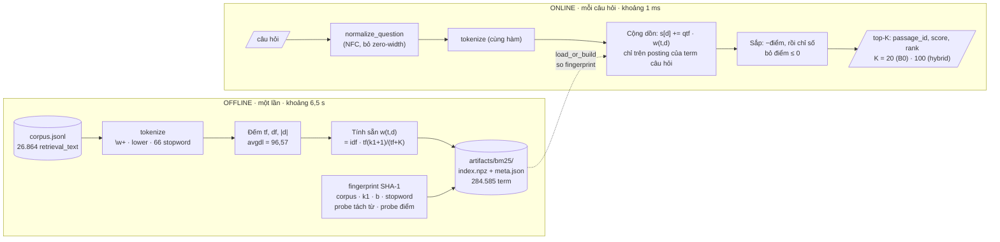
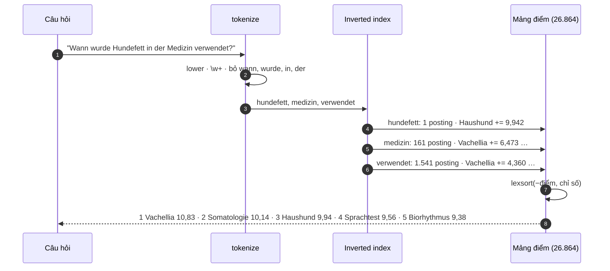

# BÀI 04 — BM25: TRUY HỒI THƯA THEO TỪ VỰNG

> **Vị trí trong giáo trình**: Bài 03 tạo ra `retrieval_text` của 26.864 passage. Bài này dựng trên đó bộ truy hồi đầu tiên của project: **BM25 tự cài đặt**. BM25 là retriever của baseline B0 và là một nhánh của hybrid H0 và H1. Sau bài này, bạn phải tự tính tay được điểm BM25 của một passage thật và giải thích được vì sao passage đúng của câu Hundefett chỉ đứng hạng 3.
>
> **Ví dụ xuyên suốt**: „Wann wurde Hundefett in der Medizin verwendet?“. Bài 02 D.5 đã đếm term cho ví dụ này. Bài này tính **đầy đủ** idf, tf, chuẩn hóa độ dài và điểm. Các con số đều đã được tính lại tay và **khớp đến 4 chữ số thập phân** với chỉ mục thật trong `artifacts/bm25/`.
>
> **Nguồn số liệu**: báo cáo mục 2.2 và 4.2, `results/bm25_20261031T203636Z_feb3f3b7.json` (lưới 40 cấu hình), `results/11b_bm25_store.json`, `reports/bm25_dev_analysis.json`. Các phép đo thêm cho bài học được gắn nhãn 📙 **[MỞ RỘNG]**.

---

## Mục lục

- [A. Learning Objectives](#a-learning-objectives)
- [B. Prerequisite Knowledge](#b-prerequisite-knowledge)
- [C. Theoretical Foundation](#c-theoretical-foundation)
- [D. Mathematical Foundation](#d-mathematical-foundation)
- [E. Architecture & Working Mechanism](#e-architecture--working-mechanism)
- [F. Application in Our Project](#f-application-in-our-project)
- [G. Implementation Mapping](#g-implementation-mapping)
- [H. YouTube Learning Resources](#h-youtube-learning-resources)
- [I. Knowledge Check](#i-knowledge-check)
- [J. Implementation Readiness](#j-implementation-readiness)
- [Đáp án và lời giải](#đáp-án-và-lời-giải)
- [Tài liệu tham khảo bài 04](#tài-liệu-tham-khảo-bài-04)

---

## A. LEARNING OBJECTIVES

### A.1. Mục tiêu kiến thức

Sau bài học, bạn giải thích được:

1. Mô hình **túi từ** (bag-of-words) và **chỉ mục ngược** (inverted index).
2. **TF**, **IDF** và **TF-IDF**, cùng hai nhược điểm của TF-IDF mà BM25 sửa.
3. Công thức **BM25 Okapi** và biến thể **IDF không âm** (kiểu Lucene) mà project dùng.
4. Ý nghĩa của **k1** (độ bão hòa của tf) và **b** (chuẩn hóa độ dài).
5. Vai trò của **tokenizer** và **stopword** với tiếng Đức, và những gì tokenizer của project **không** làm (stemming, tách từ ghép).
6. Vì sao BM25 có **lexical gap**, và lexical gap đó trông như thế nào trên ví dụ thật.

### A.2. Mục tiêu kỹ năng

1. Tính tay điểm BM25 của một passage khi biết N, df, tf, |d| và avgdl.
2. Đọc lưới dò `k1`, `b` trên dev và giải thích lựa chọn `k1 = 0,7`, `b = 0,2`, có stopword.
3. Viết lại BM25 bằng khoảng 30 dòng Python và kiểm tra kết quả bằng corpus mẫu của project (G.5).
4. Nạp chỉ mục đã lưu và giải thích **dấu vân tay** (fingerprint) bảo vệ điều gì.

### A.3. Những gì phải nhớ

| Con số | Ý nghĩa | Nguồn |
|---|---|---|
| `k1 = 0,7`, `b = 0,2`, có stopword | cấu hình B0 | `configs/pipeline.yaml` |
| 66 stopword | danh sách cố định | `retrieval/tokenizer.py` |
| 284.585 term, 2.111.536 posting | kích thước chỉ mục | `artifacts/bm25/meta.json`; 📙 đếm `index.npz` |
| avgdl = 96,57 term | độ dài trung bình sau khi lọc stopword | 📙 đo lại; khớp báo cáo Ch.3 (96,6) |
| Dev: Hit@5 0,638, Hit@20 0,814, MRR@10 0,452 | chất lượng trên dev | `results/bm25_*.json` |
| Test: Hit@5 0,793, Hit@20 0,887 | chất lượng trên test | như trên |
| Dựng 6,5 s, nạp 0,47 s, truy vấn ≈ 0,7–0,8 ms | chi phí | `results/11b_bm25_store.json`, báo cáo 4.2 |
| 219/1.176 câu dev không có gold trong top-20 | trần của B0 | `reports/bm25_dev_analysis.json` |

### A.4. Thành phần pipeline dùng kiến thức này

| Thành phần | BM25 đóng vai trò gì |
|---|---|
| B0 | Retriever duy nhất, trả 20 passage |
| B1 (dense) | Không dùng BM25 |
| H0, H1 (hybrid) | Một trong hai nhánh, trả **100** passage cho RRF (Bài 08) |
| API | Nạp `artifacts/bm25/` lúc khởi động (`strict` khi chạy trong dịch vụ) |

---

## B. PREREQUISITE KNOWLEDGE

### B.1. Kiến thức cần biết trước

| Kiến thức | Mức | Ôn ở đâu |
|---|---|---|
| Passage, query, top-K, ranking | Hiểu | Bài 01 C.2; Bài 02 D |
| `retrieval_text`: chữ thường, NFC, gộp khoảng trắng | Hiểu | Bài 03 C.6 |
| Hit@k, MRR@k | Hiểu | Bài 01 D.2 |
| Logarit tự nhiên, phân số | Thành thạo | — |
| `collections.Counter`, `numpy` cơ bản | Thành thạo | — |
| Biểu thức chính quy `\w+` | Biết | Bài 03 C.4–C.5 |

### B.2. Thuật ngữ mới

| Thuật ngữ | Giải thích |
|---|---|
| **Term** | Đơn vị so khớp của BM25, tức một chuỗi do tokenizer sinh ra. Trong project, term là một chuỗi `\w+` viết thường. |
| **Bag-of-words** | Biểu diễn văn bản bằng số lần xuất hiện của từng term, bỏ qua thứ tự. |
| **Inverted index** | Ánh xạ term → danh sách passage chứa term đó (posting list). |
| **Posting** | Một cặp (passage, thông tin của term trong passage đó). Project lưu (chỉ số passage, trọng số đã tính sẵn). |
| **tf(t, d)** | Số lần term t xuất hiện trong passage d. |
| **df(t)** | Số passage chứa t ít nhất một lần. |
| **IDF** | Độ hiếm của term: df càng nhỏ thì IDF càng lớn. |
| **avgdl** | Độ dài trung bình của passage, đo bằng số term. |
| **Saturation** | Độ bão hòa: tf tăng thì đóng góp tăng chậm dần và có trần. |
| **Length normalization** | Chuẩn hóa độ dài: passage dài bị giảm điểm. |
| **Stopword** | Từ rất phổ biến, ít mang nội dung, ví dụ der, die, und, wann. |
| **Stemming / lemmatization** | Đưa các dạng của từ về gốc chung („verwendet“, „verwendete“, „Verwendung“ → „verwend“). |
| **Decompounding** | Tách từ ghép, ví dụ „Hundefett“ → „Hund“ + „Fett“. |
| **Lexical gap** | Câu hỏi và passage diễn đạt cùng ý bằng các term khác nhau, nên BM25 không khớp được. |
| **Sparse retrieval** | Truy hồi thưa: vector cỡ từ vựng (284.585 chiều), gần như toàn số 0. |

### B.3. Mối liên hệ với bài trước

- Bài 02 D.5 đưa ra **kết quả**: Vachellia_tortilis 10,83 > Haushund 9,94. Bài này giải thích **cơ chế** sinh ra hai con số đó.
- Bài 03 đảm bảo `retrieval_text` là chữ thường và NFC. Nhờ đó, phía passage của BM25 không cần chuẩn hóa thêm. Phía câu hỏi thì vẫn phải qua `normalize_question` rồi `lower()` (G.7).

---

## C. THEORETICAL FOUNDATION

### C.1. Bag-of-words và chỉ mục ngược

📗 **[NỀN TẢNG]** (Manning et al., 2008, ch. 1–2, 6). Với bag-of-words, passage „Köln hat einen Dom und viele Kirchen“ chỉ còn là tập term có đếm: `{köln: 1, hat: 1, einen: 1, dom: 1, und: 1, viele: 1, kirchen: 1}`. Thứ tự từ bị bỏ, nên „Hund beißt Mann“ và „Mann beißt Hund“ có cùng biểu diễn.

Nếu viết mỗi passage thành một vector 284.585 chiều, phần lớn các thành phần bằng 0: trung bình một passage chỉ có khoảng 78,6 term khác nhau (📙 2.111.536 posting / 26.864 passage). Vì vậy không lưu ma trận đầy đủ mà lưu **chỉ mục ngược**:

```text
hundefett → [(Haushund-passage, w=9,94)]                       df = 1
medizin   → [(…), (…), …]                                      df = 161
verwendet → [(…), …]                                           df = 1.541
```

Khi có câu hỏi, chỉ cần duyệt các posting list của term trong câu hỏi. Câu Hundefett chạm tới tối đa $1 + 161 + 1.541 = 1.703$ posting, thay vì quét cả 26.864 passage.

### C.2. TF, IDF và TF-IDF

📘 **[BÁO CÁO]** (Ch.2.2.2):

- **TF**: một term lặp lại nhiều lần trong passage thường phản ánh nội dung chính của passage.
- **IDF** (Sparck Jones, 1972): term hiếm có giá trị phân biệt cao. „hundefett“ chỉ xuất hiện ở 1 passage, nên khi một passage chứa nó, đó là bằng chứng mạnh. „verwendet“ xuất hiện ở 1.541 passage, nên bằng chứng yếu hơn nhiều.

TF-IDF cộng $\text{tf} \times \text{idf}$ trên các term của câu hỏi. Cách này có **hai nhược điểm**:

1. **Tuyến tính theo tf**: lặp 6 lần thì được 6 lần điểm. Passage Vachellia chứa „verwendet“ 6 lần (Bài 02 D.5). Với TF-IDF thuần, riêng term này đã cho $6 \times 2{,}858 = 17{,}15$, gần gấp đôi điểm của „hundefett“ ở passage đúng.
2. **Không tính độ dài**: passage dài tự nhiên có tf cao hơn.

### C.3. BM25 Okapi

📘 **[BÁO CÁO]** (Ch.2.2.3, Ch.4.2.1; Robertson & Zaragoza, 2009). BM25 thuộc **khung xác suất về độ liên quan** (Probabilistic Relevance Framework). Có thể hiểu nó là TF-IDF với hai sửa đổi:

- **Bão hòa tf**: đóng góp của tf có trần là $k_1 + 1$.
- **Chuẩn hóa độ dài**: tf được so với độ dài passage, theo mức điều khiển bởi $b$.

Công thức đầy đủ ở D.2. Ý trực giác: *có* term hiếm là quan trọng nhất; *lặp lại* term chỉ thêm một ít; passage *dài hơn trung bình* bị trừ một chút.

📗 **[NỀN TẢNG]** Hai giá trị mặc định thường gặp trong tài liệu là $k_1 \in [1{,}2; 2{,}0]$ và $b = 0{,}75$. Báo cáo dùng $k_1 = 1{,}5$, $b = 0{,}75$ làm điểm xuất phát (`configs/baseline.yaml`). Không có giá trị tối ưu chung; phải dò trên dev.

### C.4. Tokenizer: nơi BM25 thắng hay thua

📘 **[BÁO CÁO]** (Ch.4.2.2). Tokenizer của project cực kỳ đơn giản:

```python
_TOKEN = re.compile(r"\w+", re.UNICODE)
def tokenize(text, stopwords=None):
    tokens = _TOKEN.findall(text.lower())
    if stopwords: tokens = [t for t in tokens if t not in stopwords]
    return tokens
```

Kết quả thật (📙 chạy cho bài học):

| Đầu vào | Term sinh ra | Nhận xét |
|---|---|---|
| „Wann wurde Hundefett in der Medizin verwendet?“ (có stopword) | `hundefett`, `medizin`, `verwendet` | 4 stopword bị bỏ: wann, wurde, in, der |
| Cùng câu, không lọc stopword | `wann wurde hundefett in der medizin verwendet` | 7 term |
| „Flagge_Äquatorialguineas\n\n=== Gestaltung ===“ | `flagge_äquatorialguineas`, `gestaltung` | `_` thuộc `\w`, nên cả tiêu đề thành **một** term |
| „Computer­simulation“ | `computer`, `simulation` | Soft hyphen tách từ ghép (Bài 03 C.5) |
| „Größe, Straße“ | `größe`, `straße` | Umlaut và ß được giữ |

Tokenizer **không** làm ba việc sau, và mỗi việc thiếu đều gây ra lexical gap:

| Không làm | Ví dụ mất khớp | Bằng chứng trong project |
|---|---|---|
| Stemming / lemmatization | câu hỏi `verwendet` ≠ passage `verwendete`, `verwendung` | passage gold của câu Hundefett (D.4) |
| Tách từ ghép | `temperatur` ≠ `temperaturabhängig` | 📘 Ch.4.2.2 |
| Tách tiêu đề có `_` | `flagge_äquatorialguineas` không bao giờ khớp `flagge` | 📘 Ch.4.7.2: 16.175 passage (60,2%) có ít nhất một term như vậy |

📘 Phép đo thăm dò trong báo cáo (Ch.4.7.2), trên 234 câu dev-unseen: tỉ lệ câu có một term của câu hỏi "cùng gốc hoặc là thành phần ghép" với một term của passage gold, mà không khớp chính xác, tăng dần theo độ khó:

| Hạng của gold | Tỉ lệ |
|---|---|
| hạng 1 | 40% (36/90) |
| hạng 2–20 | 70% (74/106) |
| ngoài top-20 | 87% (33/38) |

Báo cáo nói rõ đây là tương quan với tiêu chí lỏng, **chưa** chứng minh nguyên nhân.

### C.5. Stopword

📘 **[BÁO CÁO]** (Ch.2.2.5, Ch.4.2.2). Danh sách gồm 66 từ: mạo từ, giới từ, trợ động từ, đại từ và **từ để hỏi** (`wann wer was wo wie warum welche…`).

Vì sao cần lọc stopword khi IDF đã tự hạ trọng số các từ phổ biến? Vì IDF của project là biến thể **không âm**, nên „der“ vẫn có trọng số dương. Với hàng chục term như vậy trong câu hỏi, những đóng góp nhỏ cộng dồn lại thành nhiễu đáng kể. Thực nghiệm trên dev xác nhận: ở cùng `k1 = 1,5`, `b = 0,75`, bật stopword làm MRR@10 tăng 0,017 (0,391 → 0,408).

Ví dụ thật (📙 chạy cho bài học): với câu Hundefett ở `k1 = 0,7`, `b = 0,2` mà **không** lọc stopword, hạng 1 là passage „Evidenzbasierte_Medizin“ (13,91), và gold tụt từ hạng 3 xuống hạng 4.

📗 **[NỀN TẢNG]** Bỏ từ để hỏi có một cái giá: „wann“ gợi ý đáp án là thời gian, „wo“ gợi ý địa điểm. BM25 không dùng được tín hiệu đó, vì passage không chứa chữ „wann“. Reader (Bài 10) mới là nơi khai thác loại tín hiệu này.

### C.6. Ưu điểm, hạn chế, khi nào dùng

| | |
|---|---|
| **Ưu điểm** | Không cần huấn luyện; chỉ 2 tham số; chạy trên CPU khoảng 1 ms; giải thích được từng điểm; rất mạnh với tên riêng, số và thuật ngữ hiếm; bền khi đổi miền dữ liệu (📘 Thakur et al., 2021, BEIR) |
| **Hạn chế** | Lexical gap (đồng nghĩa, biến cách, từ ghép); bỏ qua thứ tự từ; không hiểu ngữ nghĩa ("ai", "khi nào"); phụ thuộc tokenizer |
| **Dùng khi** | Làm baseline; làm nhánh từ vựng của hybrid; khi không có GPU; khi câu hỏi chứa thực thể hiếm |

Câu Hundefett thể hiện cả hai mặt. Mặt mạnh: term hiếm „hundefett“ (df = 1) đưa passage đúng vào top-3. Mặt yếu: thiếu stemming khiến „verwendet“ không khớp „verwendete“, nên passage đúng không lên được hạng 1.

---

## D. MATHEMATICAL FOUNDATION

### D.1. TF-IDF

$$
\text{idf}_{\text{cổ điển}}(t) = \log\frac{N}{\text{df}(t)}, \qquad
\text{TF-IDF}(q, d) = \sum_{t \in q} \text{tf}(t, d) \cdot \text{idf}(t)
$$

### D.2. Công thức BM25 của project

📘 **[BÁO CÁO]** (công thức 4.1 và 4.2; trùng với docstring của `retrieval/bm25.py`):

$$
\text{score}(q, d) = \sum_{t \in q} \text{qtf}(t) \cdot \text{idf}(t) \cdot \frac{\text{tf}(t,d)\,(k_1 + 1)}{\text{tf}(t,d) + k_1\left(1 - b + b \cdot \dfrac{|d|}{\text{avgdl}}\right)}
$$

$$
\text{idf}(t) = \ln\!\left(1 + \frac{N - \text{df}(t) + 0{,}5}{\text{df}(t) + 0{,}5}\right)
$$

Trong đó:

- $\text{qtf}(t)$: số lần t xuất hiện trong câu hỏi, thường bằng 1.
- $N = 26.864$: số passage.
- $|d|$: số term của d **sau khi lọc stopword**.
- $\text{avgdl} = 96{,}567$.

Biến thể IDF "+1 trong log" là dạng của Lucene. Nó **luôn dương**, kể cả khi df > N/2. Dạng gốc $\ln\frac{N - \text{df} + 0{,}5}{\text{df} + 0{,}5}$ cho IDF âm khi df > N/2, và khi đó một term phổ biến sẽ **trừ** điểm.

Các giá trị biên của IDF với $N = 26.864$:

| df | idf |
|---|---|
| 1 | $\ln(1 + 26.863{,}5/1{,}5) = \ln 17.910 = 9{,}793$ |
| 161 | 5,114 |
| 1.541 | 2,858 |
| 13.432 ($= N/2$) | $\ln(1 + 1) = 0{,}693$ |
| 26.864 ($= N$) | $\ln(1 + 0{,}5/26.864{,}5) \approx 0{,}00002$ |

### D.3. Hai núm vặn: k1 và b

Đặt $\ell = |d| / \text{avgdl}$ (độ dài tương đối) và gọi phần đóng góp của tf là:

$$
g(\text{tf}, \ell) = \frac{\text{tf}\,(k_1+1)}{\text{tf} + k_1(1 - b + b\,\ell)}
$$

**Bão hòa** (với $\ell = 1$): $g = \text{tf}(k_1+1)/(\text{tf}+k_1)$. Khi tf → ∞, $g \to k_1 + 1$.

📘 Bảng 2.3 của báo cáo:

| $k_1$ | tf = 1 | tf = 2 | tf = 5 | tf = 10 | trần |
|---|---|---|---|---|---|
| 0,7 (project) | 1,000 | 1,259 | 1,491 | 1,589 | 1,7 |
| 1,5 | 1,000 | 1,429 | 1,923 | 2,174 | 2,5 |
| 0 | 1 | 1 | 1 | 1 | 1 (chỉ tính có hay không) |

**Chuẩn hóa độ dài** (với tf = 1). 📘 Bảng 2.4:

| Cấu hình | $\ell = 0{,}5$ | $\ell = 1$ | $\ell = 2$ |
|---|---|---|---|
| $k_1 = 1{,}5$; $b = 0{,}75$ | 1,290 | 1,000 | 0,690 |
| $k_1 = 0{,}7$; $b = 0{,}2$ (project) | 1,043 | 1,000 | 0,924 |
| $b = 0$ | 1,000 | 1,000 | 1,000 |

Cấu hình của project **gần như nhị phân** ($k_1$ nhỏ) và **gần như không phạt độ dài** ($b$ nhỏ). Diễn giải (📘 Ch.4.2.1): trên kho này, việc passage "có term" quan trọng hơn việc "lặp term". Passage Wikipedia dài vẫn thường chứa đáp án, nên không nên phạt chúng nặng.

### D.4. Tính tay: vì sao Vachellia thắng Haushund

📙 **[MỞ RỘNG]**. Các số sau tính lại tay từ `corpus.jsonl`, rồi so với `artifacts/bm25/`: **khớp hoàn toàn**.

**Bước 1. Tách câu hỏi**: `hundefett`, `medizin`, `verwendet`.

**Bước 2. IDF**:

| Term | df | idf |
|---|---|---|
| hundefett | 1 | 9,7931 |
| medizin | 161 | 5,1141 |
| verwendet | 1.541 | 2,8581 |

**Bước 3. Chuẩn hóa độ dài** ($k_1 = 0{,}7$, $b = 0{,}2$, avgdl = 96,567):

| Passage | $\lvert d \rvert$ | $\ell$ | $K = k_1(1 - b + b\ell)$ |
|---|---|---|---|
| Haushund (gold) | 79 | 0,818 | $0{,}7 \times (0{,}8 + 0{,}1636) = 0{,}6745$ |
| Vachellia_tortilis | 87 | 0,901 | $0{,}7 \times (0{,}8 + 0{,}1802) = 0{,}6861$ |

**Bước 4. Đóng góp từng term**, theo $w = \text{idf} \cdot \text{tf}(k_1+1)/(\text{tf}+K)$:

| Term | Haushund: tf → w | Vachellia: tf → w |
|---|---|---|
| hundefett | 1 → $9{,}7931 \times 1{,}7/1{,}6745 = \mathbf{9{,}9421}$ | 0 → 0 |
| medizin | 0 → 0 | 2 → $5{,}1141 \times 3{,}4/2{,}6861 = 6{,}4732$ |
| verwendet | 0 → 0 (passage viết „verwendete“, „verwendung“) | 6 → $2{,}8581 \times 10{,}2/6{,}6861 = 4{,}3601$ |
| **Tổng** | **9,9421** | **10,8333** |

Vachellia thắng vì có **hai** term khớp, dù cả hai đều phổ biến hơn nhiều so với „hundefett“. Haushund chỉ có **một** term khớp, dù đó là term hiếm nhất có thể.

**Bước 5. Thử thay đổi** (📙 chạy thật trên toàn kho):

| Cấu hình | Hạng của gold | Hạng 1 |
|---|---|---|
| $k_1 = 1{,}5$, $b = 0{,}75$, không stopword (mặc định) | 14 | Vachellia_tortilis |
| $k_1 = 1{,}5$, $b = 0{,}75$, có stopword | 7 | Vachellia_tortilis |
| $k_1 = 0{,}7$, $b = 0{,}2$, không stopword | 4 | Evidenzbasierte_Medizin |
| **$k_1 = 0{,}7$, $b = 0{,}2$, có stopword (B0)** | **3** | Vachellia_tortilis |
| $k_1 = 0$, $b = 0{,}2$, có stopword (nhị phân) | **1** | Haushund |

Với $k_1 = 0$, mỗi term chỉ đóng góp đúng bằng idf, nên Haushund được 9,79 và Vachellia được $5{,}11 + 2{,}86 = 7{,}97$. **Cảnh báo**: đây chỉ là **một** câu hỏi. Lưới dò trên dev không có $k_1 = 0$, và **không được** chọn tham số từ một ví dụ. Ví dụ này chỉ cho thấy cơ chế bão hòa mạnh đến đâu.

**Thí nghiệm tưởng tượng** (📙 tính xấp xỉ, giữ nguyên df): nếu có stemming để „verwendete“ khớp „verwendet“ với tf = 1, Haushund được thêm khoảng $2{,}858 \times 1{,}7/1{,}6745 \approx 2{,}90$, tổng khoảng 12,84, vượt Vachellia. Đây là động cơ cho đề xuất "thêm stemming hoặc decompounding" ở mục cải tiến. Đề xuất đó **chưa** được triển khai.

### D.5. Độ phức tạp

- **Dựng chỉ mục**: tỉ lệ với tổng số token trong kho. Thực tế: 6,5 s cho 26.864 passage (📘 `11b_bm25_store.json`).
- **Truy vấn**: phần cộng điểm tỉ lệ với tổng df của các term trong câu hỏi (1.703 phép cộng cho ví dụ trên). Tuy vậy, `top_k` của project sắp xếp **toàn bộ** mảng điểm bằng `np.lexsort`, tức $O(N \log N)$ với $N = 26.864$. Với kho cỡ này vẫn chỉ khoảng 1 ms; với kho hàng triệu passage thì nên dùng `np.argpartition` hoặc heap. 📙 **[MỞ RỘNG]**: đây là nhận xét khi đọc code, chưa đo.
- **Bộ nhớ**: 2.111.536 posting × (8 byte chỉ số + 8 byte trọng số) ≈ 33,8 MB, cộng chuỗi term. Về dung lượng trên đĩa: `index.npz` nặng 39.614.704 byte và `meta.json` nặng 591.606 byte (`meta.json` lớn vì chứa danh sách 26.864 `passage_id`). Tổng hai tệp là 40,2 MB, đúng bằng con số trong báo cáo. Con số 38,3 trong `11b_bm25_store.json` là cùng tổng đó tính bằng MiB (40,2 × 10⁶ / 2²⁰ ≈ 38,3).

### D.6. Hit@k từ phân bố hạng

📘 `reports/bm25_dev_analysis.json`. Phân bố hạng của gold trên dev:

| Hạng | Số câu |
|---|---|
| 1 | 379 |
| 2–5 | 371 |
| 6–10 | 134 |
| 11–20 | 73 |
| không có trong top-20 | 219 |

Từ đó tính được:

$$
\text{Hit@1} = \frac{379}{1.176} = 0{,}322, \quad \text{Hit@5} = \frac{379 + 371}{1.176} = \frac{750}{1.176} = 0{,}638, \quad \text{Hit@20} = \frac{957}{1.176} = 0{,}814
$$

Con số 750 chính là số câu có gold trong top-5 đã dùng ở Bài 01 D.4: $P(A \mid g \in R_5) = 271/750$.

Trong 219 câu không có gold trong top-20, có **24 câu không có term nội dung nào** chung với passage gold. Với 24 câu này, không một cải tiến nào thuần từ vựng (chỉnh tham số, stopword) có thể cứu được (📘 Ch.4.7.2).

---

## E. ARCHITECTURE & WORKING MECHANISM

### E.1. Offline và online



### E.2. Input → Processing → Output

| Giai đoạn | Input | Processing | Output |
|---|---|---|---|
| Dựng | `retrieval_text` của 26.864 passage, `k1`, `b`, cờ stopword | tokenize → Counter → df → idf → trọng số từng posting | `weights = {term: (mảng chỉ số passage, mảng trọng số)}` |
| Lưu | chỉ mục trong bộ nhớ, fingerprint | ghép posting thành 4 mảng (`terms`, `offsets`, `doc_idx`, `weights`), ghi `npz` không dùng pickle, SHA-1 của tệp | `index.npz`, `meta.json` |
| Nạp | thư mục, fingerprint mong đợi | so fingerprint và SHA-1 của tệp → cắt mảng theo `offsets` | `BM25Retriever` (0,47 s) |
| Truy vấn | câu hỏi, `top_k` | tokenize → cộng trọng số → `lexsort` → bỏ điểm ≤ 0 | `[{"passage_id", "score", "rank"}]` |

### E.3. Dấu vân tay (fingerprint) bảo vệ điều gì?

📘 **[BÁO CÁO]** (Ch.4.2.3; `bm25_store.py`). Chỉ mục đã lưu chỉ đúng khi **mọi** yếu tố ảnh hưởng đến kết quả không đổi. Fingerprint là SHA-1 của:

| Thành phần | Bắt được thay đổi nào |
|---|---|
| `corpus_sha1` | Chạy lại tiền xử lý (Bài 03) |
| `k1`, `b`, `use_stopwords` | Sửa cấu hình |
| `stopwords_sha1` | Thêm hoặc bớt một stopword |
| `tokenization_probe_sha1` (4 câu mẫu có umlaut, ß, số, dấu câu) | Sửa regex của tokenizer |
| `scoring_probe_sha1` (4 passage mẫu, 1 câu hỏi) | Sửa công thức idf, tf hoặc chuẩn hóa |

Khi phát hiện lệch, có hai chế độ: chế độ mặc định dựng lại rồi ghi đè; chế độ `strict=True` (dùng cho dịch vụ và Docker) dừng với lỗi. Kiểm chứng: dựng lại chỉ mục và so với chỉ mục đã nạp cho top-100 **giống hệt** trên 2.223 câu của tập chọn (📘 `11b_bm25_store.json`: `questions_with_any_difference = 0`).

### E.4. Ví dụ chạy đầy đủ



---

## F. APPLICATION IN OUR PROJECT

### F.1. Thành phần này nằm ở đâu?

Đây là giai đoạn **GĐ3**: dò tham số trên dev (`scripts/03_bm25_eval.py`). Giai đoạn **GĐ11.2** thêm việc lưu chỉ mục và fingerprint (`bm25_store.py`). Trong pipeline, BM25 được dựng qua `build_retriever("bm25", …)` (`pipeline.py`), đọc tham số từ `configs/pipeline.yaml`.

### F.2. Chọn tham số trên dev

📘 **[BÁO CÁO]** (Ch.4.2.5). Lưới gồm $k_1 \in \{0{,}5; 0{,}7; 0{,}9; 1{,}2; 1{,}5\}$ và $b \in \{0{,}2; 0{,}35; 0{,}5; 0{,}75\}$, nhân hai lựa chọn stopword, tổng cộng **40** cấu hình. Tiêu chí là MRR@10, hòa thì xét Recall@20.

MRR@10 trên dev, có stopword (📘 trích từ `dev_trials`):

| $k_1$ \ $b$ | 0,2 | 0,35 | 0,5 | 0,75 |
|---|---|---|---|---|
| 0,5 | 0,4521 | 0,4491 | 0,4437 | 0,4353 |
| **0,7** | **0,4522** | 0,4468 | 0,4396 | 0,4286 |
| 0,9 | 0,4498 | 0,4444 | 0,4381 | 0,4267 |
| 1,2 | 0,4452 | 0,4402 | 0,4348 | 0,4163 |
| 1,5 | 0,4381 | 0,4325 | 0,4273 | 0,4083 |

MRR@10 trên dev, không stopword:

| $k_1$ \ $b$ | 0,2 | 0,35 | 0,5 | 0,75 |
|---|---|---|---|---|
| 0,5 | 0,4315 | **0,4332** | 0,4279 | 0,4173 |
| 0,7 | 0,4303 | 0,4270 | 0,4240 | 0,4131 |
| 1,5 | 0,4155 | 0,4105 | 0,4079 | 0,3906 |

*(Bảng không stopword rút gọn còn 3 hàng; đủ 5 hàng có trong file kết quả.)*

Đọc lưới như sau:

1. **b nhỏ luôn tốt hơn**: trong mỗi hàng, MRR giảm dần từ trái sang phải. Đây là xu hướng rõ nhất của lưới.
2. **k1 nhỏ tốt hơn**: MRR giảm dần từ trên xuống, nhất quán với ví dụ ở D.4.
3. **Stopword giúp ở mọi ô**.
4. **Ô được chọn thắng sát nút**: (0,7; 0,2) = 0,4522 so với (0,5; 0,2) = 0,4521, chênh **0,0001**. ⚠️ Mức chênh này không có ý nghĩa thống kê. Báo cáo cũng cảnh báo rằng chênh lệch 0,02–0,04 giữa các ô "chưa được kiểm định" (📘 Ch.4.2.5).
5. **Biên của lưới**: ô tốt nhất nằm ở **cạnh** lưới ($b = 0{,}2$ là giá trị nhỏ nhất đã thử). 📙 **[MỞ RỘNG]** Như vậy có thể $b < 0{,}2$ còn tốt hơn; lưới chưa thử vùng này. Nếu muốn dò thêm, phải dò trên dev, **không** dùng test.

Kết quả cuối:

| | Hit@1 | Hit@5 | Hit@10 | Hit@20 | MRR@10 |
|---|---|---|---|---|---|
| Dev, mặc định (1,5; 0,75; không stopword) | 0,265 | 0,578 | 0,707 | 0,794 | 0,391 |
| **Dev, B0** (0,7; 0,2; có stopword) | 0,322 | 0,638 | 0,752 | 0,814 | 0,452 |
| **Test, B0** (chạy một lần) | 0,605 | 0,793 | 0,849 | 0,887 | 0,686 |

### F.3. Dev thấp hơn test rất nhiều: vì sao?

📘 **[BÁO CÁO]** (Ch.4.6.5): Hit@1 trên dev là 0,322, trên test là 0,605. Báo cáo ghi rõ **nguyên nhân chưa được xác định**. Đây là những gì báo cáo đã kiểm tra:

| Giả thuyết | Kết quả |
|---|---|
| Dev có nhiều passage cạnh tranh cùng bài hơn | **Bác bỏ**: trung bình 12,3 passage cùng bài ở dev, 14,6 ở test |
| Dev tập trung vào ít chủ đề (46 bài, khoảng 25,6 câu mỗi bài) so với test (233 bài, khoảng 9,5 câu mỗi bài) | Đo được khác biệt, nhưng **chưa** chứng minh là nguyên nhân |
| Cách soạn câu hỏi train và test của GermanQuAD khác nhau | Chưa kiểm chứng |

Bài học rút ra: **không so số dev với số test**. Mọi so sánh giữa các cấu hình phải làm **trong cùng một tập**. Bài 03 C.9 đã nêu lý do cấu trúc: dev được chia theo nhóm bài viết.

### F.4. Tầng BM25 là trần của B0

Từ D.6, 219 câu dev (18,6%) không có gold trong top-20, nên reader không bao giờ thấy gold của những câu này. Chỉ 3/219 câu vẫn đúng nhờ may mắn: chuỗi đáp án tình cờ có trong một passage khác (Bài 01, đáp án câu 16, đã đính chính). Bước Select còn cắt từ 20 xuống 5, nên tổng cộng 426 câu (36,2%) không có gold trong 5 passage mà reader đọc. Đây là động cơ cho dense retrieval (Bài 06–07) và hybrid (Bài 08).

### F.5. Nếu thay đổi thì sao?

| Thay đổi | Hệ quả dự kiến | Trạng thái |
|---|---|---|
| Thêm stemming tiếng Đức (ví dụ Snowball) | Khớp `verwendet` với `verwendete`; có thể gộp nhầm từ khác nghĩa | Đề xuất, **chưa thử** |
| Tách từ ghép | Khớp `temperatur` với `temperaturabhängig` | Đề xuất, chưa thử |
| Thay `_` bằng dấu cách khi tách từ | Term trong tiêu đề khớp được với câu hỏi; 60% passage bị ảnh hưởng | 📘 báo cáo gọi đây là "lỗi cài đặt có thể sửa, chưa được sửa" |
| Bỏ U+00AD trong `retrieval_text` | Sửa 95 passage | Chưa thử |
| Mọi thay đổi ở trên | Fingerprint đổi, chỉ mục được dựng lại, **phải dò lại `k1`, `b` trên dev**, và B0 không còn là B0 cũ | — |

---

## G. IMPLEMENTATION MAPPING

### G.1. Thư viện

| Thư viện | Dùng cho |
|---|---|
| `re` | Tokenizer `\w+` |
| `collections.Counter` | tf trong passage và qtf trong câu hỏi |
| `numpy` | Mảng posting, cộng điểm, `lexsort`, `savez` |
| `math.log` | IDF |
| `hashlib`, `json` | Fingerprint |

Project **không dùng** `rank_bm25`, Pyserini hay Elasticsearch. Vì tự viết, nhóm kiểm soát được từng chi tiết: biến thể IDF, quy tắc phá hòa, định dạng lưu.

### G.2. Class và function

| File | Thành phần | Việc |
|---|---|---|
| `retrieval/tokenizer.py` | `tokenize`, `GERMAN_STOPWORDS` | Tách term |
| `retrieval/bm25.py` | `BM25.fit`, `.scores`, `.top_k`, `.from_parts` | Chỉ mục và tính điểm |
| | `BM25Retriever.retrieve`, `.from_index` | Giao diện `retrieve(question, top_k)` dùng chung với dense |
| `retrieval/bm25_store.py` | `compute_fingerprint`, `save_index`, `load_index`, `load_or_build` | Lưu, nạp, kiểm tra |
| `scripts/03_bm25_eval.py` | `run_split`, `main` | Lưới 40 cấu hình trên dev; test chỉ chạy khi có `--test` và qua `guard_or_exit` |
| `evaluation/retrieval_metrics.py` | `evaluate_run`, `latency_summary` | Hit, Recall, MRR @k |
| `pipeline.py` | `build_retriever("bm25")` | Đọc `configs/pipeline.yaml` |

### G.3. Pseudocode

```text
FIT(passages, k1, b, stop):
    toks[i] ← tokenize(retrieval_text_i, stop)
    avgdl   ← mean(|toks[i]|)
    for term t: postings[t] ← [(i, tf(t, i)) | t ∈ toks[i]]
    for term t:
        idf ← ln(1 + (N − df + 0,5)/(df + 0,5))
        w[t] ← [(i, idf · tf·(k1+1) / (tf + k1·(1 − b + b·|d_i|/avgdl)))]

RETRIEVE(question, K):
    s ← zeros(N)
    for (t, qtf) in Counter(tokenize(question, stop)):
        for (i, w) in w[t]: s[i] += qtf · w
    order ← sort theo (−s, i)
    return [(id_i, s_i, rank) | i ∈ order[:K], s_i > 0]
```

### G.4. Cấu trúc dữ liệu

```python
BM25.weights : dict[str, tuple[np.ndarray[int64], np.ndarray[float64]]]   # term -> (chỉ số passage, trọng số)
BM25.doc_ids : list[str]                                                  # chỉ số -> passage_id (đã sắp theo id)
# index.npz: terms (bytes, nối bằng '\n'), offsets (len = n_terms + 1), doc_idx, weights
# posting của term thứ i = doc_idx[offsets[i]:offsets[i+1]]
retrieve(...) -> [{"passage_id": "p_c6a05646f114c9fe", "score": 10.8333, "rank": 1}, ...]
```

Quyết định đáng chú ý: **trọng số được tính sẵn** cho từng posting, kể cả idf và chuẩn hóa độ dài. Hệ quả:

- Truy vấn chỉ còn phép cộng.
- Đổi `k1` hoặc `b` phải **dựng lại** chỉ mục. Đó là lý do `k1`, `b` nằm trong fingerprint.

### G.5. Code minh họa: BM25 trong 30 dòng

Đoạn code dưới đây chạy trên **corpus mẫu cố định của project** (`PROBE_DOCS` trong `bm25_store.py`). Kết quả được so với `BM25` thật của project.

```python
import math, re
from collections import Counter

def tokenize(text, stop=frozenset()):
    return [t for t in re.findall(r"\w+", text.lower()) if t not in stop]

class TinyBM25:
    def __init__(self, docs, k1=0.7, b=0.2):
        self.ids = [d for d, _ in docs]
        toks = [tokenize(t) for _, t in docs]
        self.N, self.k1, self.b = len(toks), k1, b
        self.len = [len(t) for t in toks]
        self.avgdl = sum(self.len) / self.N
        self.tf = [Counter(t) for t in toks]
        self.df = Counter(term for t in toks for term in set(t))

    def idf(self, t):
        n = self.df[t]
        return math.log(1 + (self.N - n + 0.5) / (n + 0.5))

    def score(self, query, i):
        s = 0.0
        for t, qtf in Counter(tokenize(query)).items():
            f = self.tf[i][t]
            if f:
                norm = self.k1 * (1 - self.b + self.b * self.len[i] / self.avgdl)
                s += qtf * self.idf(t) * f * (self.k1 + 1) / (f + norm)
        return s

DOCS = (("p1", "der Rhein fließt durch Köln und Bonn"),
        ("p2", "Bonn war die Hauptstadt der Bundesrepublik"),
        ("p3", "Köln hat einen Dom und viele Kirchen"),
        ("p4", "die Hauptstadt von Österreich ist Wien"))
bm = TinyBM25(DOCS)
q = "Hauptstadt Bonn Köln Dom"
print("avgdl", bm.avgdl, {t: round(bm.idf(t), 4) for t in tokenize(q)})
print([(d, round(bm.score(q, i), 4)) for i, d in enumerate(bm.ids)])
```

Kết quả chạy thật:

```text
avgdl 6.5 {'hauptstadt': 0.6931, 'bonn': 0.6931, 'köln': 0.6931, 'dom': 1.204}
[('p1', 1.3776), ('p2', 1.3951), ('p3', 1.8852), ('p4', 0.6976)]
```

`BM25(0.7, 0.2).fit(...)` của project cho đúng `[1.3776, 1.3951, 1.8852, 0.6976]` và xếp hạng p3 > p2 > p1 > p4.

**Tính tay p3** để kiểm tra: $|d| = 7$, $\ell = 7/6{,}5 = 1{,}0769$.

- $K = 0{,}7 \times (0{,}8 + 0{,}2 \times 1{,}0769) = 0{,}7108$.
- Hệ số tf = 1: $1{,}7/1{,}7108 = 0{,}9937$.
- köln: $0{,}6931 \times 0{,}9937 = 0{,}6888$. dom: $1{,}2040 \times 0{,}9937 = 1{,}1964$.
- Tổng: $1{,}8852$. ✓

Có hai điều nên để ý:

1. idf của `bonn` (df = 2 trên N = 4) đúng bằng $\ln 2$, vì $\text{df} = N/2$ (D.2).
2. p2 hơn p1 (1,3951 so với 1,3776), dù cả hai đều khớp 2 term có cùng idf. Lý do: p2 ngắn hơn (6 term so với 7), nên được chuẩn hóa độ dài có lợi hơn một chút.

### G.6. Kiểm tra từng bước

| Kiểm tra | Cách làm | Kỳ vọng |
|---|---|---|
| Công thức | So `TinyBM25` với `BM25` trên `PROBE_DOCS` | Bằng nhau đến 1e-12 (`scoring_probe_sha1`) |
| Chỉ mục đã lưu | `load_or_build(...)` trả `info["source"] == "loaded"` | `fingerprint_ok` |
| Trọng số một posting | Tính tay như D.4 cho một passage bất kỳ | Bằng `weights[term][1][j]` |
| Truy vấn rỗng | `retrieve("der die das", 20)` khi có stopword | `[]`, vì mọi term bị bỏ (C.5) |
| Tất định | Chạy `retrieve` hai lần | Danh sách giống hệt, kể cả thứ tự khi hòa |
| Chất lượng | `scripts/03_bm25_eval.py` | Dev MRR@10 = 0,4522 |

```python
# nạp chỉ mục thật và thử câu ví dụ (chạy từ gốc project)
import sys, json; sys.path.insert(0, "src")
from germanqa.retrieval.bm25_store import load_index
fp = json.load(open("artifacts/bm25/meta.json", encoding="utf-8"))["fingerprint"]
r = load_index("artifacts/bm25", fp)
for h in r.retrieve("Wann wurde Hundefett in der Medizin verwendet?", 5):
    print(h["rank"], h["passage_id"], round(h["score"], 4))
# 1 p_c6a05646f114c9fe 10.8333
# 2 p_31a5dcafc734e293 10.1401
# 3 p_c25e144a863973b9 9.9421
# 4 p_6e136fcfa3d9aeb6 9.5626
# 5 p_f743a675d1181918 9.3787
```

Lưu ý: `load_index` so fingerprint lưu trong `meta.json` với chính nó, nên ở đây chỉ kiểm tra SHA-1 của `index.npz`. Muốn kiểm tra đúng nghĩa, dùng `compute_fingerprint(...)` từ corpus và cấu hình hiện tại, như `load_or_build` làm.

### G.7. Lỗi triển khai thường gặp

| Lỗi | Triệu chứng | Phòng tránh |
|---|---|---|
| Tokenizer của câu hỏi khác tokenizer của passage | Hit@k sụt mà không rõ lý do | Dùng **một** hàm `tokenize` cho cả hai phía; probe trong fingerprint |
| Quên `normalize_question` | Câu NFD bị cắt thành „ho“ + „chste“ | `pipeline.answer` gọi `normalize_question` trước tiên |
| Dùng `log(N/df)` hoặc IDF gốc | Điểm âm, hoặc term phổ biến làm giảm điểm | Biến thể "+1" của Lucene |
| Tính avgdl trên token **trước** khi lọc stopword nhưng tính $\lvert d \rvert$ **sau** khi lọc | $\ell$ bị lệch có hệ thống | Cả hai cùng trên danh sách đã lọc |
| Phá hòa bằng thứ tự `dict` hoặc `set` | Kết quả khác nhau giữa các lần chạy | `lexsort((index, −score))` |
| Trả về passage có điểm 0 | Top-K chứa passage không liên quan | `if s[i] <= 0: break` |
| Đổi `k1`, `b` mà dùng chỉ mục cũ | Kết quả không khớp cấu hình | Fingerprint; `strict=True` trong dịch vụ |
| Dò tham số trên test | Kết quả test lạc quan giả | `guard_or_exit` chặn `--test` |
| Lưu bằng `pickle` | Rủi ro thực thi mã khi nạp tệp lạ | `np.savez` + `allow_pickle=False` |

---

## H. YOUTUBE LEARNING RESOURCES

> Mọi URL dưới đây xuất hiện trong kết quả tìm kiếm web (giới hạn youtube.com) ngày 2026-11-14. Kết quả tìm kiếm thường **không hiển thị tên kênh**; khi đó giáo trình ghi "chưa xác nhận". Tên video ghi theo đúng tiêu đề trong kết quả. Hãy mở video kiểm tra trước khi trích dẫn.
>
> ⚠️ Trong hai lần tìm kiếm, **không tìm thấy** video nào có tiêu đề cho thấy nó giảng riêng công thức BM25. Phần BM25 vì vậy dùng tài liệu đọc (H.5) và link tìm kiếm (H.4).

### H.1. Video đã tìm thấy

| # | Tên video | Kênh | URL | Hỗ trợ mục |
|---|---|---|---|---|
| 1 | Information Retrieval » Indexing » Inverted Index (16) | chưa xác nhận (theo mô tả là chuỗi bài giảng IR của nhóm Webis; tiếng Đức) | https://www.youtube.com/watch?v=LNAKxgqbaok | C.1 |
| 2 | Information Retrieval » Indexing » Query Processing I (017) | chưa xác nhận (cùng chuỗi trên) | https://www.youtube.com/watch?v=BXvQNYYfEJw | E.1 (duyệt posting) |
| 3 | Term Frequency - Inverse Document Frequency (TF-IDF) | chưa xác nhận | https://www.youtube.com/watch?v=O9aAwvk6SNI | C.2, D.1 |
| 4 | TF-IDF Explained: Document Similarity Search in NLP with Python Code | chưa xác nhận | https://www.youtube.com/watch?v=JfMEUkCNfsc | C.2 |
| 5 | Tantivy Full-Text Search in Python: Build Fast Local BM25 Indexes | chưa xác nhận | https://www.youtube.com/watch?v=KHI-POYk_Gg | G (so với cài đặt tự viết) |
| 6 | BM25 is So Yesterday: Modern Techniques for Better Search Relevance in Solr - Grant Ingersoll | chưa xác nhận (người trình bày ghi trong tiêu đề) | https://www.youtube.com/watch?v=nA8dqw03m48 | C.6 (hạn chế của BM25; 📙 mở rộng) |
| 7 | Elasticsearch Hybrid Search: BM25 + kNN via Rescore | chưa xác nhận | https://www.youtube.com/watch?v=WrsthoGZ2ss | Chuẩn bị Bài 08 |

### H.2. Nội dung chính và đoạn cần tập trung

| # | Nội dung (theo tiêu đề và mô tả) | Tập trung vào |
|---|---|---|
| 1 | Cấu trúc chỉ mục ngược, có slide | Vocabulary + posting list. Phần nén chỉ mục là 📙 mở rộng |
| 2 | Xử lý truy vấn trên chỉ mục ngược | Duyệt theo term (term-at-a-time), giống `BM25.scores` |
| 3 | TF-IDF cơ bản | So với D.1; để ý video có thể dùng biến thể IDF khác |
| 4 | TF-IDF kèm code Python | Tách code thành tf, df, idf giống G.5 |
| 5 | BM25 bằng thư viện Tantivy | Thư viện làm sẵn những gì mà project tự viết |
| 6 | Bài nói về các kỹ thuật vượt BM25 (video cũ, khoảng 9 năm) | Hạn chế của truy hồi từ vựng |
| 7 | Kết hợp BM25 với kNN vector | Ý tưởng hybrid. Project dùng RRF, không dùng rescore |

### H.3. Thứ tự xem đề xuất

```
③ (TF-IDF) → ① → ② (inverted index, query processing) → tự làm G.5 → ⑤ (thư viện) → ⑥ → ⑦ (chuẩn bị Bài 06–08)
```

### H.4. Link tìm kiếm YouTube (không phải video đã xác minh)

Các link dưới đây là **link tìm kiếm**, không phải video cụ thể:

- BM25: https://www.youtube.com/results?search_query=BM25+ranking+function+explained
- Okapi BM25 k1 b: https://www.youtube.com/results?search_query=okapi+bm25+k1+b+parameters
- Probabilistic relevance framework: https://www.youtube.com/results?search_query=probabilistic+relevance+framework+robertson
- Stemming tiếng Đức: https://www.youtube.com/results?search_query=german+stemming+snowball+decompounding
- Stanford CS276 / IR: https://www.youtube.com/results?search_query=stanford+information+retrieval+lecture+tf-idf

### H.5. Tài liệu đọc chính thức

| Loại | Tài liệu | Dùng cho |
|---|---|---|
| Sách (miễn phí trực tuyến) | Manning, Raghavan & Schütze (2008), *Introduction to IR*, ch. 1 (inverted index), ch. 6 (tf-idf), ch. 11.4 (Okapi BM25): https://nlp.stanford.edu/IR-book/ | C.1–C.3, D |
| Bài tổng quan | Robertson & Zaragoza (2009), *The Probabilistic Relevance Framework: BM25 and Beyond* | C.3, D.2–D.3 |
| Bài báo | Sparck Jones (1972), IDF | C.2 |
| Bài báo | Thakur et al. (2021), BEIR | C.6 |
| Tài liệu Lucene | `BM25Similarity` (biến thể IDF "+1"): https://lucene.apache.org/core/ | D.2 |

---

## I. KNOWLEDGE CHECK

### I.1. Câu hỏi kiến thức cơ bản (5)

1. Viết công thức IDF mà project dùng. Vì sao không dùng $\ln(N/\text{df})$?
2. Ba tham số của B0 là gì, và nằm ở file cấu hình nào?
3. Câu „Wann wurde Hundefett in der Medizin verwendet?“ sau khi tách từ có stopword còn những term nào?
4. Chỉ mục BM25 được lưu ở đâu, gồm những tệp nào? Vì sao không dùng `pickle`?
5. Trong hybrid, BM25 trả về bao nhiêu passage? Trong B0 là bao nhiêu?

### I.2. Câu hỏi giải thích cơ chế (5)

6. Giải thích bằng công thức vì sao $k_1 = 0$ biến BM25 thành mô hình "có hay không".
7. Với $b = 0{,}2$, một passage dài gấp đôi trung bình mất bao nhiêu phần trăm đóng góp của tf = 1 so với passage có độ dài trung bình? Với $b = 0{,}75$ thì sao?
8. Vì sao phải dựng lại chỉ mục khi đổi `k1` hoặc `b`, nhưng không phải dựng lại khi đổi `top_k`?
9. Fingerprint có `scoring_probe_sha1`. Thành phần này bắt được loại thay đổi nào mà `corpus_sha1` và `k1`, `b` không bắt được?
10. Vì sao lọc stopword vẫn giúp, dù IDF đã hạ trọng số của từ phổ biến?

### I.3. Câu hỏi phân tích tình huống (3)

11. Một thành viên thấy $k_1 = 0$ đưa gold câu Hundefett lên hạng 1 (D.4) và đề xuất đổi cấu hình B0. Bạn phản hồi thế nào?
12. Sau khi sửa tokenizer để tách `_`, Hit@5 trên dev tăng từ 0,638 lên 0,66. Liệt kê **mọi** việc phải làm lại trước khi dám nói "cải tiến BM25 có hiệu quả".
13. Người dùng hỏi: „Wer war der erste Bundeskanzler?“. Tách từ có stopword cho ra những term nào? Dự đoán BM25 gặp khó khăn gì, và reader có bù được không?

### I.4. Bài tập vận dụng (2)

14. **Tính tay.** Dùng `PROBE_DOCS` ở G.5 với $k_1 = 1{,}5$, $b = 0{,}75$. Tính điểm của p3 và p2 cho câu hỏi „Hauptstadt Bonn Köln Dom“. Thứ tự xếp hạng có đổi không?
15. **Viết code.** Mở rộng `TinyBM25` thêm hàm `explain(query, i)`, trả về bảng (term, tf, df, idf, K, w) như D.4. Chạy trên chỉ mục thật cho Haushund và Vachellia, rồi so với bảng D.4.

### I.5. Bài tập liên hệ pipeline của nhóm (1)

16. **Định lượng lexical gap do thiếu stemming.** Với 219 câu dev có gold ngoài top-20 (lấy từ `reports/pipeline_dev_predictions.jsonl` hoặc tự chạy BM25), đếm số câu có ít nhất một term của câu hỏi (sau khi lọc stopword) **không** có trong passage gold, nhưng passage gold có một term cùng 6 ký tự đầu. So với nhóm câu có gold ở hạng 1. Viết 3–5 câu kết luận và nêu rõ đây là phép đo tương quan. Chỉ dùng dev.

---

## J. IMPLEMENTATION READINESS

> Trên website, các ô tick được. Trạng thái lưu trong `localStorage` của **trình duyệt đang dùng**: không đồng bộ giữa thiết bị hay trình duyệt, không ai khác thấy, mất khi xóa dữ liệu trang hoặc dùng cửa sổ ẩn danh. Trong file Markdown, sửa `[ ]` thành `[x]`.

### J.1. Giải thích được thuật toán

- [ ] Giải thích chỉ mục ngược và vì sao truy vấn chỉ chạm tới khoảng 1.700 posting cho câu Hundefett.
- [ ] Giải thích hai sửa đổi của BM25 so với TF-IDF.

### J.2. Hiểu sơ đồ hoạt động

- [ ] Vẽ lại sơ đồ E.1, tách rõ offline và online.
- [ ] Liệt kê năm thành phần của fingerprint và loại thay đổi mỗi thành phần bắt được.

### J.3. Giải thích được công thức

- [ ] Viết công thức BM25 và IDF từ trí nhớ.
- [ ] Tính tay bảng D.4 (Haushund 9,9421; Vachellia 10,8333).
- [ ] Đọc được bảng bão hòa và chuẩn hóa độ dài ở D.3.

### J.4. Biết dữ liệu vào và ra

- [ ] Nói đúng: BM25 đọc `retrieval_text`, trả `{passage_id, score, rank}`, chỉ trả điểm > 0.
- [ ] Giải thích vì sao không so số dev với số test (F.3).

### J.5. Hiểu vai trò trong pipeline

- [ ] Giải thích vì sao BM25 là trần của B0 (219 câu, 24 câu không có term chung).
- [ ] Đọc lưới F.2 và nêu ba xu hướng, cùng hai điểm cần thận trọng.

### J.6. Mô tả cách cài đặt

- [ ] Viết lại `TinyBM25` (G.5) và cho ra đúng 4 điểm của corpus mẫu.
- [ ] Nạp `artifacts/bm25/` và in ra đúng top-5 của câu Hundefett (G.6).

**Đánh giá**: đạt ≥ 12/14 mục thì chuyển sang Bài 05.

---

## ĐÁP ÁN VÀ LỜI GIẢI

### Câu 1
$\text{idf}(t) = \ln\!\left(1 + \frac{N - \text{df} + 0{,}5}{\text{df} + 0{,}5}\right)$. Dạng $\ln(N/\text{df})$ là của TF-IDF cổ điển, không thuộc khung xác suất của BM25. Dạng gốc của Robertson, $\ln\frac{N - \text{df} + 0{,}5}{\text{df} + 0{,}5}$, cho giá trị âm khi df > N/2, khiến term phổ biến làm **giảm** điểm. Biến thể "+1" của Lucene luôn dương.

### Câu 2
`k1 = 0.7`, `b = 0.2`, `use_stopwords = true`, trong `configs/pipeline.yaml` (mục `bm25`). Lưới dò nằm trong `configs/baseline.yaml`.

### Câu 3
`hundefett`, `medizin`, `verwendet`. Các từ `wann`, `wurde`, `in`, `der` bị loại vì là stopword.

### Câu 4
`artifacts/bm25/index.npz` (bốn mảng `terms`, `offsets`, `doc_idx`, `weights`) và `meta.json` (fingerprint, tham số, `doc_ids`, SHA-1 của tệp npz). Không dùng `pickle` vì nạp một tệp pickle lạ có thể thực thi mã tùy ý. `np.load(..., allow_pickle=False)` chỉ đọc mảng số.

### Câu 5
Hybrid: 100 passage mỗi nhánh (`configs/hybrid.yaml`). B0: 20 passage (`retrieval_top_k`).

### Câu 6
Với $k_1 = 0$: $g = \text{tf} \cdot 1 / (\text{tf} + 0) = 1$ với mọi tf ≥ 1, và chuẩn hóa độ dài cũng bị nhân với 0 nên mất tác dụng. Mỗi term khớp chỉ đóng góp đúng $\text{idf}(t)$, nên điểm là tổng idf của các term câu hỏi **có mặt** trong passage.

### Câu 7
Với tf = 1 và $\ell = 2$: $g = (k_1+1)/(1 + k_1(1 - b + 2b)) = (k_1+1)/(1 + k_1(1+b))$.

- $k_1 = 0{,}7$, $b = 0{,}2$: $1{,}7/1{,}84 = 0{,}924$, tức mất 7,6%.
- $k_1 = 1{,}5$, $b = 0{,}75$: $2{,}5/3{,}625 = 0{,}690$, tức mất 31%.

Khớp với Bảng 2.4.

### Câu 8
Trọng số mỗi posting được **tính sẵn** và chứa `k1`, `b`, idf, avgdl (G.4). Đổi `k1` hoặc `b` làm mọi trọng số sai. `top_k` chỉ quyết định cắt bao nhiêu phần tử sau khi sắp, nên không đụng tới trọng số.

### Câu 9
`scoring_probe_sha1` bắt được việc **sửa công thức** trong `BM25.fit`: đổi biến thể IDF, quên `+1`, nhầm `avgdl`, đổi chỗ `k1` và `b`. Code đổi nhưng corpus và tham số giữ nguyên, nên các thành phần khác của fingerprint không đổi. Chỉ việc tính lại điểm trên corpus mẫu mới phát hiện được.

### Câu 10
IDF của project không âm, nên „der“ (xuất hiện gần khắp nơi) vẫn đóng góp một trọng số dương nhỏ. Câu hỏi tiếng Đức có nhiều từ chức năng, và tổng các đóng góp nhỏ này ưu tiên các passage có nhiều từ chức năng, tức thường là passage dài, không phải passage liên quan. Ví dụ thật: không lọc stopword thì „Evidenzbasierte_Medizin“ lên hạng 1 cho câu Hundefett. Trên dev, bật stopword tăng MRR@10 ở mọi ô của lưới.

### Câu 11
Không đổi, vì ba lý do:

1. Một câu hỏi không phải bằng chứng. Tham số phải chọn trên toàn dev (1.176 câu).
2. Lưới dò hiện tại cho thấy $k_1$ nhỏ tốt hơn, nhưng $k_1 = 0{,}5$ và $0{,}7$ gần như hòa. Muốn thử $k_1 = 0$ thì thêm vào lưới, chạy trên dev, và ghi trước tiêu chí chọn.
3. B0 là baseline đã đóng băng và đã chạy test. Đổi nó thì phải đặt tên cấu hình mới. Không được sửa B0 hồi tố.

Thực tế với $k_1 = 0$, lặp term không còn giá trị. Điều này có thể hại các câu mà passage đúng nhắc thực thể nhiều lần.

### Câu 12
Các việc phải làm lại:

- Ghi lại thay đổi thành quy tắc **trước khi** đo.
- Fingerprint đổi (`tokenization_probe_sha1`), nên chỉ mục được dựng lại.
- **Dò lại `k1`, `b`, stopword** trên dev, vì tối ưu cũ không còn đúng.
- So với B0 bằng **paired bootstrap** trên cùng 1.176 câu dev, báo khoảng tin cậy (Bài 12). Mức tăng 0,022 có thể nằm trong nhiễu.
- Kiểm tra trên **dev-unseen** hoặc **train-select**, nếu muốn kết hợp với hybrid.
- Chạy lại toàn pipeline (reader cố định) để đo EM, vì Hit@5 tăng chưa chắc làm EM tăng (Bài 02 G.5).
- Ghi kết quả test **một lần** với cấu hình đã chốt, dưới tên cấu hình mới.

### Câu 13
„wer“, „war“, „der“ là stopword. Còn lại `erste` và `bundeskanzler`. Có hai khó khăn:

1. `erste` rất phổ biến, nên idf thấp.
2. Đáp án (một tên người) không có trong câu hỏi, nên BM25 chỉ dựa vào `bundeskanzler`. Nhiều passage nói về các thủ tướng khác nhau đều chứa term này.

BM25 có thể đưa vào top-K nhiều passage cùng chủ đề. Reader có thể bù được **nếu** passage đúng nằm trong top-5, vì reader hiểu „erste“ (thứ tự) và „wer“ (hỏi người). Reader không bù được nếu Select đã cắt passage đúng. Đây là câu tự luyện; đừng tra kết quả để "điều chỉnh" lời giải.

### Câu 14
$k_1 = 1{,}5$, $b = 0{,}75$, avgdl = 6,5, idf như cũ (0,6931 cho df = 2; 1,2040 cho df = 1).

- **p3** ($|d| = 7$, $\ell = 1{,}0769$): $K = 1{,}5 \times (0{,}25 + 0{,}75 \times 1{,}0769) = 1{,}5 \times 1{,}0577 = 1{,}5865$. Hệ số tf = 1: $2{,}5/2{,}5865 = 0{,}9666$. Điểm $= (0{,}6931 + 1{,}2040) \times 0{,}9666 \approx 1{,}8336$ (code cho 1,8336).
- **p2** ($|d| = 6$, $\ell = 0{,}9231$): $K = 1{,}5 \times (0{,}25 + 0{,}6923) = 1{,}4135$. Hệ số: $2{,}5/2{,}4135 = 1{,}0358$. Điểm $= 2 \times 0{,}6931 \times 1{,}0358 \approx 1{,}4360$ (code cho 1,4360).

Thứ tự không đổi (p3 > p2), nhưng khoảng cách hẹp lại, vì $b$ lớn hơn nên p3 dài hơn bị phạt nhiều hơn. Kiểm tra bằng `TinyBM25(DOCS, k1=1.5, b=0.75)`.

### Câu 15
```python
def explain(self, query, i):
    K = self.k1 * (1 - self.b + self.b * self.len[i] / self.avgdl)
    rows = []
    for t, qtf in Counter(tokenize(query)).items():
        f = self.tf[i][t]
        w = qtf * self.idf(t) * f * (self.k1 + 1) / (f + K) if f else 0.0
        rows.append((t, f, self.df[t], round(self.idf(t), 4), round(K, 4), round(w, 4)))
    return rows
```
Muốn chạy trên kho thật: dựng `TinyBM25` từ `retrieval_text` của 26.864 passage (nhớ lọc **66 stopword** cả ở passage lẫn câu hỏi, và tính avgdl sau khi lọc). Kết quả phải ra $K = 0{,}6745$ (Haushund) và $0{,}6861$ (Vachellia), cùng các trọng số như D.4.

### Câu 16
Không có đáp án cố định. Gợi ý:

- Dùng `tokenize(..., GERMAN_STOPWORDS)` cho câu hỏi.
- Coi "cùng gốc" là cùng 6 ký tự đầu, với term dài ít nhất 6 ký tự.
- So hai nhóm (ngoài top-20 và hạng 1) bằng tỉ lệ kèm số câu.

Kết quả nên cùng xu hướng với phép đo thăm dò trong báo cáo (40% → 70% → 87% trên dev-unseen). Phép đo của bạn dùng toàn bộ dev, nên con số sẽ khác. Kết luận phải nói rõ:

1. Đây là tương quan, không phải nhân quả.
2. Tiêu chí "6 ký tự đầu" vừa bắt nhầm (`haupt` trong `hauptstadt` và `hauptsache`) vừa bỏ sót (từ ghép có gốc ở cuối, như `fett` trong `hundefett`).
3. Muốn chứng minh nhân quả, phải bật stemming thật rồi so trên dev bằng paired bootstrap.

---

## Tài liệu tham khảo bài 04

- Manning, C. D., Raghavan, P., & Schütze, H. (2008). *Introduction to information retrieval*. Cambridge University Press. https://doi.org/10.1017/CBO9780511809071
- Robertson, S., & Zaragoza, H. (2009). The probabilistic relevance framework: BM25 and beyond. *Foundations and Trends in Information Retrieval, 3*(4), 333–389. https://doi.org/10.1561/1500000019
- Sparck Jones, K. (1972). A statistical interpretation of term specificity and its application in retrieval. *Journal of Documentation, 28*(1), 11–21. https://doi.org/10.1108/eb026526
- Thakur, N., Reimers, N., Rücklé, A., Srivastava, A., & Gurevych, I. (2021). BEIR: A heterogeneous benchmark for zero-shot evaluation of information retrieval models. *NeurIPS Datasets and Benchmarks Track*. https://arxiv.org/abs/2104.08663
- Karpukhin, V., Oguz, B., Min, S., Lewis, P., Wu, L., Edunov, S., Chen, D., & Yih, W. (2020). Dense passage retrieval for open-domain question answering. *EMNLP 2020*, 6769–6781. https://doi.org/10.18653/v1/2020.emnlp-main.550
