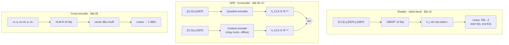
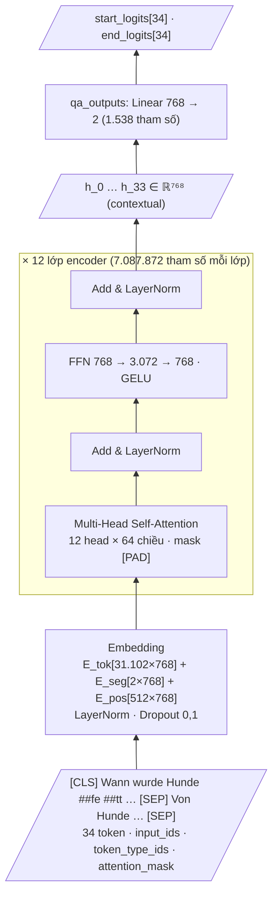
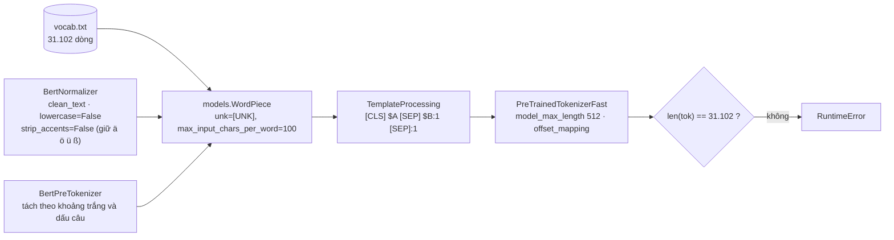

# BÀI 05 — TRANSFORMER VÀ BERT: NỀN TẢNG CHUNG CỦA BA MÔ HÌNH

> **Vị trí trong giáo trình**: Bài 04 là BM25, một bộ truy hồi **không học**. Từ bài này trở đi, mọi thành phần còn lại của pipeline đều là **Transformer encoder**:
> - reader GBERT (Bài 10–11),
> - hai encoder DPR (Bài 06–07),
> - cross-encoder BGE (Bài 09).
>
> Bài này dạy phần **dùng chung** của cả ba: tokenizer WordPiece, embedding, self-attention, khối encoder, pre-training và fine-tuning. Phần riêng của từng mô hình (cách đọc đầu ra) chỉ được giới thiệu ở F.2. Các bài sau phân tích kỹ từng phần riêng đó.
>
> **Ví dụ xuyên suốt**: cặp câu hỏi và context rút gọn chứa đáp án Hundefett. Bài dùng câu này để xem token, token ID, segment, offset, attention và logit **thật** của checkpoint reader `models/reader_20261101T213758Z_96717e35`, chạy ngày 2026-11-14.
>
> **Nguồn số liệu**: báo cáo mục 2.6 (Bảng 2.8), các tệp `config.json` của ba mô hình, `src/germanqa/tokenization.py`, `reader/model_io.py`. Các phép chạy thêm cho bài học được gắn nhãn 📙 **[MỞ RỘNG]**.

---

## Mục lục

- [A. Learning Objectives](#a-learning-objectives)
- [B. Prerequisite Knowledge](#b-prerequisite-knowledge)
- [C. Theoretical Foundation](#c-theoretical-foundation)
- [D. Mathematical Foundation](#d-mathematical-foundation)
- [E. Architecture & Working Mechanism](#e-architecture--working-mechanism)
- [F. Application in Our Project](#f-application-in-our-project)
- [G. Implementation Mapping](#g-implementation-mapping)
- [H. YouTube Learning Resources](#h-youtube-learning-resources)
- [I. Knowledge Check](#i-knowledge-check)
- [J. Implementation Readiness](#j-implementation-readiness)
- [Đáp án và lời giải](#đáp-án-và-lời-giải)
- [Tài liệu tham khảo bài 05](#tài-liệu-tham-khảo-bài-05)

---

## A. LEARNING OBJECTIVES

### A.1. Mục tiêu kiến thức

Sau bài học, bạn giải thích được:

1. Vì sao cần **subword tokenization** (WordPiece), và vì sao tokenizer của project phải **phân biệt hoa thường** (cased).
2. Ba loại **embedding** của BERT: token, segment, position.
3. **Scaled dot-product attention**: Q, K, V, phép chia cho $\sqrt{d_k}$, softmax, và attention mask.
4. **Multi-head attention**, **feed-forward network**, **residual connection** và **LayerNorm** trong một lớp encoder.
5. **Pre-training** (MLM, NSP) và **fine-tuning** khác nhau thế nào. Vì sao project chỉ fine-tune reader.
6. Vì sao **cùng một kiến trúc** BERT lại dùng được cho ba việc khác nhau: reader, bi-encoder DPR, cross-encoder.
7. Các giới hạn của Transformer: **512 vị trí**, chi phí **$O(n^2)$** theo độ dài, và vì sao attention không phải lời giải thích.

### A.2. Mục tiêu kỹ năng

1. Tách từ bằng tokenizer của project và đọc được `input_ids`, `token_type_ids`, `attention_mask`, `offset_mapping`.
2. Tính tay một phép self-attention 3 token (D.3) và kiểm tra bằng numpy (G.5).
3. Đếm tay số tham số của GBERT-base, ra đúng **109.338.626** (D.6).
4. Lấy được hidden state và attention của một lớp bất kỳ từ checkpoint thật (G.6).

### A.3. Những gì phải nhớ

| Thông số | GBERT reader | DPR encoder (mỗi cái) | BGE reranker |
|---|---|---|---|
| Kiến trúc | BERT | BERT (`DPRQuestionEncoder` / `DPRContextEncoder`) | XLM-RoBERTa |
| Số lớp L | 12 | 12 | 24 |
| Kích thước ẩn H | 768 | 768 | 1.024 |
| Số head | 12 | 12 | 16 |
| FFN | 3.072 | 3.072 | 4.096 |
| Từ vựng | 31.102 (WordPiece, cased) | 31.102 | 250.002 (SentencePiece) |
| Vị trí tối đa | 512 | 512 | 8.194 (project dùng 512) |
| Số tham số | **109.338.626** (gồm đầu QA) | cỡ 110M | khoảng 568M (📘 Ch.5) |
| Nguồn | `models/reader_…/config.json` | HF cache `deepset/gbert-base-germandpr-*` | `models/rerank_bge_m3_976fb4ad/config.json` |

### A.4. Thành phần pipeline dùng kiến thức này

| Thành phần | Dùng phần nào của bài |
|---|---|
| Reader (Bài 10–11) | Toàn bộ, cộng thêm đầu start/end; offset mapping |
| DPR (Bài 06–07) | Encoder; lấy vector `[CLS]` |
| Cross-encoder (Bài 09) | Encoder với cặp (câu hỏi, passage); lấy 1 điểm |
| BM25 (Bài 04) | **Không** dùng. Tokenizer của BM25 khác hẳn WordPiece |

---

## B. PREREQUISITE KNOWLEDGE

### B.1. Kiến thức cần biết trước

| Kiến thức | Mức | Ghi chú |
|---|---|---|
| Vector, ma trận, nhân ma trận, chuyển vị | Thành thạo | Mọi công thức ở D |
| Tích vô hướng, cosine similarity | Hiểu | Cũng dùng lại ở Bài 06 |
| Hàm `exp`, softmax | Hiểu | D.3 |
| Mạng nơ-ron: lớp tuyến tính, hàm kích hoạt | Khái niệm | GELU trong FFN |
| PyTorch tensor `(batch, seq, hidden)` | Biết | G.6 |
| Offset ký tự, `original_text` | Hiểu | Bài 03 C.6, D.2 |

### B.2. Thuật ngữ mới

| Thuật ngữ | Giải thích |
|---|---|
| **Token / subword** | Đơn vị đầu vào của mô hình, là một từ hoặc một mảnh từ. |
| **WordPiece** | Thuật toán tách subword của BERT. Mảnh không đứng đầu từ có tiền tố `##`. |
| **Vocabulary** | Bảng ánh xạ token → ID. GBERT có 31.102 mục (`vocab.txt`). |
| **Special tokens** | `[CLS]` đầu chuỗi, `[SEP]` ngăn cách và kết thúc, `[PAD]` lấp chỗ trống, `[UNK]` token lạ, `[MASK]` che khi pre-training. |
| **Embedding** | Vector học được tương ứng với một ID. |
| **Segment / token type** | 0 cho câu thứ nhất, 1 cho câu thứ hai. |
| **Attention mask** | 1 ở token thật, 0 ở `[PAD]`, để không token nào "nhìn" vào `[PAD]`. |
| **Q, K, V** | Query, key, value: ba phép chiếu tuyến tính của biểu diễn token. |
| **Head** | Một phép attention độc lập. Multi-head gồm nhiều phép chạy song song. |
| **Hidden state** | Vector biểu diễn của một token ở đầu ra một lớp. |
| **Contextual embedding** | Vector của một token phụ thuộc vào cả câu. Cùng chữ „Schloss“ (lâu đài / ổ khóa) sẽ có vector khác nhau ở hai câu khác nhau. |
| **Pre-training / fine-tuning** | Học chung trên văn bản không nhãn, sau đó học tiếp cho một nhiệm vụ có nhãn. |
| **MLM / NSP** | Masked Language Modeling (đoán token bị che) / Next Sentence Prediction (câu B có theo sau câu A không). |
| **Logit** | Điểm chưa qua softmax. |

### B.3. Mối liên hệ với bài trước

- Bài 03 D.3 đã tính số **cửa sổ** dựa trên số **token WordPiece**. Bài này giải thích token đó từ đâu ra.
- Bài 04 C.4: BM25 tách „Hundefett“ thành **một** term `hundefett`. GBERT tách thành **ba** mảnh `Hunde ##fe ##tt`. Hai tokenizer khác nhau phục vụ hai mục đích khác nhau.
- Bài 02 E.4–E.5 đã dùng start/end logit và `minus_cls`. Bài này giải thích các logit đó được sinh ra như thế nào.

---

## C. THEORETICAL FOUNDATION

### C.1. Từ từ điển cố định đến subword

📗 **[NỀN TẢNG]** Mô hình nơ-ron chỉ nhận số. Có ba cách cắt văn bản thành đơn vị:

| Cách cắt | Ưu điểm | Nhược điểm với tiếng Đức |
|---|---|---|
| Theo từ | Mỗi đơn vị có nghĩa | Từ vựng vô hạn: từ ghép mới liên tục, „Fußballweltmeisterschaft“ không có trong từ điển và thành `[UNK]` |
| Theo ký tự | Không bao giờ có token lạ | Chuỗi rất dài, mỗi ký tự ít nghĩa |
| **Subword** | Từ thường gặp giữ nguyên, từ hiếm được tách thành mảnh có nghĩa | Một từ có thể thành nhiều token |

📙 **[MỞ RỘNG]** Kết quả thật của tokenizer reader (`get_tokenizer(...).tokenize`):

| Từ | Token |
|---|---|
| Medizin, verwendet, Mittelalter, Neuzeit, Straße, höchste, Schloss | **1 token** (giữ nguyên) |
| Haushund | `Haus` `##hund` |
| Hundefett | `Hunde` `##fe` `##tt` |
| Fußballweltmeisterschaft | `Fußball` `##welt` `##meisterschaft` |
| Bundesverfassungsgericht | `Bundesver` `##fassungs` `##gericht` |
| **hundefett** (viết thường) | `hu` `##nde` `##fe` `##tt` |

Có hai điểm cần nhận ra:

1. WordPiece **tự tách từ ghép** một phần: `Fußball` + `welt` + `meisterschaft`. Đây là thứ BM25 của project không có (Bài 04 C.4). Tuy vậy, cách tách không nhất thiết theo ranh giới ngữ nghĩa: `Hundefett` thành `Hunde` + `fe` + `tt` chứ không phải `Hunde` + `fett`.
2. **Viết thường làm vỡ token**: „hundefett“ thành 4 mảnh vô nghĩa, vì từ vựng cased học „Hunde“ với chữ H hoa. Đây là bằng chứng cụ thể cho quyết định ở Bài 03 C.6: mô hình nơ-ron phải đọc `original_text`, không đọc `retrieval_text`.

### C.2. Đầu vào của BERT

📘 **[BÁO CÁO]** (Ch.2.6.2, 2.6.4–2.6.5). Cặp (câu hỏi, context) được ghép thành `[CLS] q [SEP] c [SEP]`. Kết quả thật (📙 chạy cho bài học), với context rút gọn „Von Hundefett nahm man vom Mittelalter bis in die Neuzeit an, dass es heilende Wirkung habe.“:

| i | token | id | segment | offset |
|---|---|---|---|---|
| 0 | `[CLS]` | 102 | 0 | (0, 0) |
| 1 | Wann | 8759 | 0 | (0, 4) |
| 2 | wurde | 325 | 0 | (5, 10) |
| 3–5 | Hunde ##fe ##tt | 11008 604 560 | 0 | (11,16) (16,18) (18,20) |
| 6–10 | in der Medizin verwendet ? | 153 125 6070 3038 1992 | 0 | … |
| 11 | `[SEP]` | 103 | 0 | (0, 0) |
| 12 | Von | 1170 | 1 | (0, 3) |
| 13–15 | Hunde ##fe ##tt | 11008 604 560 | 1 | (4,9) (9,11) (11,13) |
| 16–17 | nahm man | 2563 545 | 1 | … |
| **18** | **vom** | 507 | 1 | **(23, 26)** |
| 19–22 | Mittelalter bis in die | 10133 378 153 128 | 1 | … |
| **23** | **Neuzeit** | 27847 | 1 | **(50, 57)** |
| 24–32 | an , dass es heil ##ende Wirkung habe . | … | 1 | … |
| 33 | `[SEP]` | 103 | 1 | (0, 0) |

Tổng cộng 34 token. Các điểm cần đọc ra từ bảng:

- **Offset tính riêng trên từng chuỗi**: „Hunde“ có offset (11, 16) trong câu hỏi và (4, 9) trong context. Cùng ID 11008, khác offset.
- **Segment** là cách duy nhất để mô hình biết token nào thuộc câu hỏi, token nào thuộc context.
- Token đặc biệt có offset (0, 0). Code hậu xử lý dùng điều này cùng `sequence_ids` để loại chúng khỏi tập ứng viên đáp án (Bài 10).
- Embedding đầu vào của token i là $E_{\text{tok}}[\text{id}_i] + E_{\text{seg}}[\text{seg}_i] + E_{\text{pos}}[i]$.

### C.3. Self-attention: mỗi token "hỏi" mọi token khác

📘 **[BÁO CÁO]** (Ch.2.6.1; Vaswani et al., 2017). Mỗi token tạo ba vector:

- **query** $q_i$: "tôi đang tìm gì?"
- **key** $k_j$: "tôi chứa gì?"
- **value** $v_j$: "nếu được chọn, tôi đóng góp gì?"

Độ "khớp" giữa i và j là $q_i \cdot k_j$. Softmax biến các độ khớp đó thành trọng số cộng lại bằng 1. Biểu diễn mới của i là trung bình có trọng số của các $v_j$. Công thức ở D.3.

Khác với RNN, mọi cặp token được nối **trực tiếp** trong một bước. Token „Neuzeit“ ở cuối context "nhìn" thẳng được „Wann“ ở đầu câu hỏi, không phải truyền thông tin qua 20 bước.

**Multi-head**: 12 head, mỗi head làm việc trong không gian $768/12 = 64$ chiều với ma trận chiếu riêng. Các head có thể học các loại quan hệ khác nhau, ví dụ cú pháp, đồng tham chiếu hay vị trí kề nhau. Đầu ra của 12 head được ghép lại thành 768 chiều rồi chiếu qua $W^O$.

📙 **[MỞ RỘNG]** Attention thật của reader, lấy trung bình 12 head, cho cặp câu ở C.2 (chạy với `attn_implementation="eager"`):

| Lớp | Token | 5 token được chú ý nhiều nhất (trọng số) |
|---|---|---|
| 1 | Wann | wurde .082 · Wann .080 · Hunde .063 · ? .057 · [SEP] .051 |
| 1 | Medizin | Medizin .110 · verwendet .063 · [SEP] .061 · ? .050 · Hunde .049 |
| 12 | Wann | **[SEP] (cuối) .183** · Wann .158 · **. .150** · wurde .078 · verwendet .062 |
| 12 | Medizin | **[SEP] (cuối) .279** · **. .222** · Medizin .088 · der .054 · verwendet .051 |

Cách đọc bảng: ở lớp 1, attention chủ yếu hướng về **các token lân cận**. Ở lớp 12, phần lớn trọng số dồn vào `[SEP]` và dấu chấm. 📗 **[NỀN TẢNG]** Hiện tượng này đã được Clark et al. (2019) mô tả. Họ giải thích rằng `[SEP]` thường đóng vai trò "không làm gì" (no-op): khi một head không cần lấy thông tin, nó dồn trọng số vào đó. ⚠️ **Không** được đọc bảng trên thành "mô hình trả lời dựa vào dấu chấm". Trọng số attention **không** phải là lời giải thích cho dự đoán (Jain & Wallace, 2019). Bảng này chỉ cho thấy cơ chế đang chạy.

### C.4. Một lớp encoder

📘 **[BÁO CÁO]** (Ch.2.6.1, Hình 2.7). Mỗi lớp có hai khối con, mỗi khối có residual và LayerNorm (kiểu **post-LN** của BERT gốc):

```text
h  = LayerNorm(x + MultiHeadAttention(x))
x' = LayerNorm(h + FFN(h))           FFN(h) = W2 · GELU(W1 · h + b1) + b2,  768 → 3.072 → 768
```

- **Residual** ($x + f(x)$): giúp gradient đi qua được 12 lớp, và cho phép một lớp "không làm gì" nếu điều đó có lợi.
- **LayerNorm**: chuẩn hóa từng vector token về trung bình 0, phương sai 1, rồi co giãn bằng hai tham số học được. Giữ cho các giá trị ổn định khi đi qua nhiều lớp.
- **FFN**: áp **riêng cho từng token**, không trộn thông tin giữa các token. Chiếm khoảng 2/3 số tham số của một lớp (D.6).

Sau 12 lớp, mỗi token có một vector 768 chiều **phụ thuộc vào toàn bộ chuỗi**.

### C.5. Biểu diễn ngữ cảnh: bằng chứng thật

📙 **[MỞ RỘNG]** Lấy vector của „Schloss“ (1 token) ở **lớp đầu vào** và ở **lớp 12** của reader, trong bốn câu:

1. „Das **Schloss** Neuschwanstein liegt in Bayern.“ — lâu đài
2. „Der König wohnte in einem prächtigen **Schloss**.“ — lâu đài
3. „Ich habe den Schlüssel im **Schloss** der Tür vergessen.“ — ổ khóa
4. „Das **Schloss** an meinem Fahrrad ist kaputt.“ — ổ khóa

Cosine similarity giữa các vector:

| | Lớp đầu vào: (1,2) · (1,4) · (3,4) | Lớp 12: (1,2) · (1,4) · (3,4) |
|---|---|---|
| Cosine | 0,877 · **1,000** · 0,903 | 0,643 · 0,597 · **0,709** |

Cách đọc bảng:

- **Lớp đầu vào** chỉ gồm token, segment và vị trí. Câu 1 và câu 4 đều có „Schloss“ ở vị trí 2, nên vector **giống hệt** (cosine 1,000), dù nghĩa khác nhau. Lớp này chưa có ngữ cảnh.
- **Lớp 12**: cặp ổ khóa (3,4) giống nhau hơn cặp khác nghĩa (1,4), tức 0,709 so với 0,597. Mô hình đã trộn ngữ cảnh vào vector.
- ⚠️ Mức tách nghĩa ở đây **không mạnh**: cặp lâu đài (1,2) chỉ được 0,643. Lý do có thể là checkpoint này đã được **fine-tune cho QA**, nên biểu diễn được tối ưu cho việc tìm span chứ không cho việc phân biệt nghĩa từ. Chỉ có 4 câu, nên đây là minh họa, không phải phép đo.

### C.6. Pre-training và fine-tuning

📘 **[BÁO CÁO]** (Ch.2.6.2; Devlin et al., 2019). BERT gốc được pre-train bằng hai nhiệm vụ:

- **MLM**: che ngẫu nhiên khoảng 15% token, rồi đoán lại token bị che từ **cả hai phía**. Vì vậy BERT là mô hình **hai chiều** (bidirectional).
- **NSP**: đoán câu B có thực sự theo sau câu A hay không. Nhiệm vụ này huấn luyện token `[CLS]` và segment embedding.

Sau pre-training, ta thêm một lớp đầu ra nhỏ rồi **fine-tune toàn bộ** mô hình trên dữ liệu có nhãn.

📘 GBERT (Chan et al., 2020) là BERT được pre-train trên dữ liệu tiếng Đức, có từ vựng riêng và phân biệt hoa thường. ⚠️ **[THIẾU TRONG BÁO CÁO]** Báo cáo không nêu chi tiết dữ liệu pre-training của GBERT, cũng không nói GBERT có dùng NSP hay whole-word masking không. Nếu cần các chi tiết này, đọc trực tiếp Chan et al. (2020). Đừng suy ra từ BERT gốc.

**Trong project** (📘 roadmap §10): chỉ **reader** được fine-tune, cụ thể là `deepset/gbert-base` cộng đầu QA trên GermanQuAD, 3 epoch, giữ epoch 2. Hai encoder DPR và reranker được dùng **nguyên** checkpoint có sẵn.

### C.7. Ba cách đọc đầu ra từ cùng một encoder



| | Reader | DPR | Cross-encoder |
|---|---|---|---|
| Đầu vào | cặp (q, p) | q riêng, p riêng | cặp (q, p) |
| Đầu ra dùng | **mọi** token | một vector `[CLS]` | một điểm |
| Câu hỏi và passage "nhìn nhau"? | Có, qua attention | **Không**: chỉ gặp nhau ở phép dot | Có |
| Tính trước passage được không? | Không | **Có** (FAISS) | Không |
| Chi phí mỗi câu hỏi | 5 passage × số cửa sổ | 1 lần encode câu hỏi + tìm kiếm | 20 cặp (H1) |

Đây là lý do kiến trúc gồm "retriever nhanh rồi reranker hoặc reader chậm" (Bài 02): chỉ bi-encoder mới tính trước được phía passage.

### C.8. Giới hạn

| Giới hạn | Nguyên nhân | Hệ quả trong project |
|---|---|---|
| Tối đa 512 vị trí | Position embedding học được, chỉ có 512 hàng | Cửa sổ trượt 384/128 cho reader; DPR cắt ở 384 token |
| Chi phí $O(n^2)$ | Mọi cặp token đều có điểm attention | $384^2 = 147.456$ điểm cho mỗi head mỗi lớp |
| Không có đầu "từ chối" | Reader luôn trả một span | Cần `minus_cls` và tầng Aggregate (Bài 02 E.5) |
| Không giải thích được | Attention ≠ lời giải thích | Không dùng attention để giải thích lỗi trong báo cáo |
| Cased | Từ vựng học có chữ hoa | Không được đưa `retrieval_text` vào mô hình |

---

## D. MATHEMATICAL FOUNDATION

### D.1. Embedding đầu vào

$$
x_i = E_{\text{tok}}[\text{id}_i] + E_{\text{seg}}[s_i] + E_{\text{pos}}[i], \qquad x_i \in \mathbb{R}^{768}
$$

Kích thước các bảng: $E_{\text{tok}} \in \mathbb{R}^{31.102 \times 768}$, $E_{\text{seg}} \in \mathbb{R}^{2 \times 768}$, $E_{\text{pos}} \in \mathbb{R}^{512 \times 768}$. Sau phép cộng là LayerNorm và dropout 0,1.

### D.2. Phép chiếu Q, K, V

$$
Q = XW^Q,\quad K = XW^K,\quad V = XW^V,\qquad W^{Q}, W^{K}, W^{V} \in \mathbb{R}^{768 \times 768}
$$

Với 12 head, mỗi head lấy 64 cột: $Q^{(h)} \in \mathbb{R}^{n \times 64}$.

### D.3. Scaled dot-product attention

📘 (công thức 2.12 của báo cáo):

$$
\text{Attention}(Q, K, V) = \text{softmax}\!\left(\frac{QK^\top}{\sqrt{d_k}} + M\right) V
$$

Trong đó $M_{ij} = 0$ nếu token j là token thật, và $M_{ij} = -\infty$ (trong thực tế là một số âm rất lớn) nếu j là `[PAD]`.

**Vì sao chia cho $\sqrt{d_k}$?** Nếu các thành phần của q và k độc lập, có trung bình 0 và phương sai 1, thì $q \cdot k$ có phương sai bằng $d_k$. Với $d_k = 64$, độ lệch chuẩn là 8. Các điểm có thể lệch nhau hàng chục đơn vị, làm softmax gần như one-hot và gradient gần 0. Chia cho $\sqrt{64} = 8$ đưa phương sai về 1.

**Ví dụ tính tay** với $n = 3$ token, $d_k = 2$, để $Q = K$:

$$
Q = K = \begin{pmatrix}1 & 0\\ 0 & 1\\ 1 & 1\end{pmatrix},\quad
V = \begin{pmatrix}1 & 0\\ 0 & 2\\ 1 & 1\end{pmatrix}
$$

**Bước 1.** $QK^\top$ có hàng 1 là $(1, 0, 1)$, hàng 2 là $(0, 1, 1)$, hàng 3 là $(1, 1, 2)$. Chia cho $\sqrt 2 = 1{,}414$.

**Bước 2.** Softmax hàng 1: $(0{,}707;\ 0;\ 0{,}707)$, nên $e^{\cdot} = (2{,}028;\ 1;\ 2{,}028)$, tổng 5,056, cho $A_1 = (0{,}401;\ 0{,}198;\ 0{,}401)$.

**Bước 3.** Hàng 3: $(0{,}707;\ 0{,}707;\ 1{,}414)$, nên $e^{\cdot} = (2{,}028;\ 2{,}028;\ 4{,}113)$, tổng 8,169, cho $A_3 = (0{,}248;\ 0{,}248;\ 0{,}503)$. Token 3 "nhìn" chính nó nhiều nhất, vì nó có tích vô hướng lớn nhất với chính nó.

**Bước 4.** Đầu ra của token 1: $0{,}401 \cdot (1,0) + 0{,}198 \cdot (0,2) + 0{,}401 \cdot (1,1) = (0{,}802;\ 0{,}797)$.

**Có mask**: coi token 3 là `[PAD]`, mask = (1, 1, 0). Hàng 1 còn lại $(0{,}707;\ 0)$, cho $A_1 = (0{,}670;\ 0{,}330;\ 0)$. Token 3 nhận trọng số **đúng bằng 0**.

Tất cả các số trên được kiểm tra bằng code ở G.5.

### D.4. Multi-head

$$
\text{MHA}(X) = \big[\text{head}_1; \dots; \text{head}_{12}\big]\, W^O,\qquad
\text{head}_h = \text{Attention}(XW^Q_h, XW^K_h, XW^V_h)
$$

Kích thước: $W^Q_h \in \mathbb{R}^{768 \times 64}$ và $W^O \in \mathbb{R}^{768 \times 768}$. Tổng số tham số của MHA **không phụ thuộc** vào số head, vì 12 × 64 = 768.

### D.5. LayerNorm và FFN

$$
\text{LN}(x) = \gamma \odot \frac{x - \mu}{\sqrt{\sigma^2 + \varepsilon}} + \beta, \qquad \varepsilon = 10^{-12}\ \text{(config)}
$$

$$
\text{FFN}(h) = W_2\,\text{GELU}(W_1 h + b_1) + b_2,\qquad W_1 \in \mathbb{R}^{3.072 \times 768},\ W_2 \in \mathbb{R}^{768 \times 3.072}
$$

### D.6. Đếm tham số GBERT-base

📙 **[MỞ RỘNG]** Tính tay, rồi đối chiếu với `state_dict` thật (trùng **từng tham số**):

| Khối | Công thức | Số tham số |
|---|---|---|
| Embedding | $(31.102 + 512 + 2) \times 768 + 2 \times 768$ (LN) | **24.282.624** |
| Một lớp: Q, K, V, O | $4 \times (768^2 + 768)$ | 2.362.368 |
| Một lớp: LN sau attention | $2 \times 768$ | 1.536 |
| Một lớp: FFN | $(768 \times 3.072 + 3.072) + (3.072 \times 768 + 768)$ | 4.722.432 |
| Một lớp: LN sau FFN | $2 \times 768$ | 1.536 |
| **Một lớp** | | **7.087.872** |
| 12 lớp | $12 \times 7.087.872$ | 85.054.464 |
| Đầu QA | $768 \times 2 + 2$ | **1.538** |
| **Tổng** | | **109.338.626** ✓ |

Ba điều rút ra từ bảng:

1. **22%** tham số nằm ở embedding, và phần lớn số đó là bảng token (23,9M). Từ vựng lớn thì tốn tham số. Đó là lý do reranker XLM-R với 250.002 token có riêng bảng embedding khoảng 256M tham số.
2. Trong mỗi lớp, FFN chiếm $4{,}72/7{,}09 \approx 67\%$.
3. Đầu QA chỉ có **1.538** tham số, tức 0,0014% mô hình. "Dạy BERT làm QA" về bản chất là điều chỉnh **toàn bộ** 109M tham số để hai vector 768 chiều đọc được start và end. `BertForQuestionAnswering` **không có** pooler: `state_dict` không chứa khóa `pooler`.

Về bộ nhớ: 109,3M tham số × 4 byte (float32) ≈ 437 MB. Tệp `model.safetensors` của reader nặng 437.377.848 byte, khớp với ước lượng. fp16 khi suy luận giảm một nửa.

### D.7. Chi phí theo độ dài

Với chuỗi n token, mỗi lớp tốn:

- Attention: $O(n^2 \cdot H)$ cho $QK^\top$ và $AV$.
- Chiếu và FFN: $O(n \cdot H^2)$.

| n | $n^2$ (điểm attention, mỗi head mỗi lớp) | Tổng trên 12 head × 12 lớp |
|---|---|---|
| 64 (câu hỏi DPR) | 4.096 | 589.824 |
| 384 (cửa sổ reader, passage DPR) | 147.456 | 21,2M |
| 512 (giới hạn) | 262.144 | 37,7M |

Từ 384 lên 512 token, số điểm attention tăng gấp $(512/384)^2 = 1{,}78$ lần. Đây là một lý do project giữ cửa sổ 384. Với $n \le 512$, phần $O(nH^2)$ vẫn chiếm ưu thế ($n < H = 768$), nên tổng chi phí thực tế tăng gần tuyến tính theo n.

### D.8. Từ hidden state đến start/end (xem trước Bài 10)

📘 (công thức 2.13):

$$
S(i) = w_s^\top h_i,\quad E(i) = w_e^\top h_i,\quad P_{\text{start}}(i) = \frac{e^{S(i)}}{\sum_j e^{S(j)}}
$$

📙 Logit thật của reader cho cặp câu ở C.2:

| | Hạng 1 | Hạng 2 | Hạng 3 |
|---|---|---|---|
| Start $S$ | **vom** (i = 18) 5,13 | `[CLS]` 4,65 | Mittelalter 3,05 |
| End $E$ | **Neuzeit** (i = 23) 5,82 | `[CLS]` 5,73 | Mittelalter 2,47 |

Từ bảng này:

- Span tốt nhất là (18, 23). Offset (23, 26) và (50, 57) trên context rút gọn cho chuỗi „vom Mittelalter bis in die Neuzeit“, đúng đáp án gold.
- $P_{\text{start}}(\text{vom}) = 0{,}555$. Mô hình khá chắc, nhưng không tuyệt đối.
- `[CLS]` đứng **hạng 2 ở cả hai phía**. Điểm span là $5{,}13 + 5{,}82 = 10{,}95$, điểm `[CLS]` là $4{,}65 + 5{,}73 = 10{,}38$, nên `minus_cls` $= +0{,}57$. Trên context rút gọn này, mô hình chỉ hơi nghiêng về "có đáp án". Trên passage thật đầy đủ (Bài 02 E.6), điểm là +26,81. Lý do là ở đây context đã bị cắt ngắn và thiếu ngữ cảnh gốc. Ví dụ này nhắc rằng logit **phụ thuộc mạnh vào ngữ cảnh**.

---

## E. ARCHITECTURE & WORKING MECHANISM

### E.1. Toàn bộ GBERT reader



### E.2. Input → Processing → Output

| Bước | Input | Processing | Output (kích thước) |
|---|---|---|---|
| Tokenize | chuỗi q, chuỗi c | BertNormalizer (không lowercase, không bỏ dấu) → BertPreTokenizer → WordPiece → `[CLS] q [SEP] c [SEP]` | `input_ids`, `token_type_ids`, `attention_mask`, `offset_mapping`: (1, 34) |
| Embedding | 3 dãy ID | tra 3 bảng, cộng, LN | (1, 34, 768) |
| 12 lớp | (1, 34, 768) | MHA → Add & LN → FFN → Add & LN | (1, 34, 768); attention mỗi lớp (1, 12, 34, 34) |
| Đầu QA | (1, 34, 768) | Linear 768 → 2 | `start_logits`, `end_logits`: (1, 34) |
| Hậu xử lý | logit + offset | top n_best start và end, lọc span hợp lệ, `minus_cls`, cắt `original_text` | chuỗi đáp án và [start, end) ký tự (Bài 10) |

### E.3. Tokenizer của project được dựng thế nào

📘 **[BÁO CÁO]** `src/germanqa/tokenization.py` **không** gọi `AutoTokenizer.from_pretrained`. Docstring của tệp giải thích lý do: ở transformers 5.17–5.22, `BertTokenizerFast(vocab_file=...)` âm thầm bỏ qua từ vựng, khiến mọi từ thành `[UNK]`. Project vì vậy dựng tokenizer trực tiếp từ thư viện `tokenizers`:



Bài học thực tế: **luôn kiểm tra kích thước từ vựng sau khi nạp tokenizer**. Đây chính là phép kiểm tra cuối cùng trong sơ đồ.

---

## F. APPLICATION IN OUR PROJECT

### F.1. Thành phần này nằm ở đâu?

Không có một "module Transformer" riêng. Phần chung được dùng qua ba điểm nạp mô hình:

| Mô hình | Nạp ở | Lớp Hugging Face |
|---|---|---|
| Reader | `reader/model_io.get_model` | `BertForQuestionAnswering`. `config.json` của `deepset/gbert-base` không có `model_type`, nên project chỉ định lớp trực tiếp |
| DPR | `retrieval/dense.py` (`DPREncoder`, nạp lười từng encoder) | `DPRQuestionEncoder`, `DPRContextEncoder` |
| Reranker | `rerank/cross_encoder.py` (`CrossEncoderReranker`) | `AutoModelForSequenceClassification`, tự chọn `XLMRobertaForSequenceClassification` theo `config.json` |

### F.2. Vì sao nhóm cần hiểu bài này?

| Quyết định trong project | Kiến thức cần |
|---|---|
| Reader đọc `original_text` | C.1: viết thường làm vỡ token |
| Cửa sổ 384, stride 128, cắt câu hỏi ở 64 token | C.8, D.7: giới hạn 512 và chi phí $O(n^2)$ |
| DPR dùng dot product, **không** chuẩn hóa vector | C.7: encoder được huấn luyện với dot (Bài 06) |
| Reranker chỉ dùng cho 20 passage (H1) | C.7: cross-encoder không tính trước được |
| fp16 khi suy luận và huấn luyện | D.6: giảm bộ nhớ một nửa trên GPU 4 GB |
| `minus_cls` | D.8: `[CLS]` mang ý nghĩa "không có đáp án" |

### F.3. Đầu vào và đầu ra thực tế

Xem C.2 (34 token thật) và D.8 (logit thật). Trong pipeline thật, mỗi passage có thể sinh nhiều cửa sổ. Mỗi cửa sổ có kích thước tối đa (1, 384), và batch suy luận là 32 cửa sổ (`reader.yaml: eval_batch_size`).

### F.4. Nếu thay thành phần khác thì sao?

| Thay đổi | Hệ quả |
|---|---|
| Dùng BERT đa ngôn ngữ (mBERT) thay GBERT | Từ vựng chia cho hơn 100 ngôn ngữ, nên từ tiếng Đức bị tách vụn hơn. 📘 Ch.2.6.3 nêu lý do chọn mô hình đơn ngữ; báo cáo **chưa** thử nghiệm so sánh |
| GBERT-large (24 lớp, 1.024 chiều) | Khoảng 3 lần tham số, cần nhiều VRAM hơn mức GPU 4 GB của nhóm cho phép khi fine-tune. Chưa thử |
| Tokenizer lowercase | Hỏng: không khớp từ vựng cased (C.1) |
| Cửa sổ 512 | Ít cửa sổ hơn, mỗi cửa sổ đắt hơn 1,78 lần về attention. Chưa thử cho reader. Dense đã thử 256 và 384 (Bài 07) |

### F.5. Tham số cần chú ý

| Tham số | Giá trị | File |
|---|---|---|
| `model_name` | `deepset/gbert-base` | `configs/reader.yaml` |
| `max_length`, `stride` | 384, 128 | `configs/reader.yaml` |
| Cắt câu hỏi | 64 token (`MAX_QUESTION_TOKENS`) | `pipeline.py` |
| `do_lower_case` | `False` | `tokenization.py` |
| `strip_accents` | `False` | `tokenization.py` |
| `hidden_dropout_prob`, `attention_probs_dropout_prob` | 0,1 | `config.json` |
| `layer_norm_eps` | 1e-12 | `config.json` |

---

## G. IMPLEMENTATION MAPPING

### G.1. Thư viện

| Thư viện | Dùng cho |
|---|---|
| `tokenizers` | WordPiece, normalizer, pre-tokenizer, template |
| `transformers` | `PreTrainedTokenizerFast`, `BertForQuestionAnswering`, `AutoModelForQuestionAnswering`, DPR, XLM-R |
| `huggingface_hub` | `hf_hub_download` từng tệp (`config.json`, `vocab.txt`, `model.safetensors`) |
| `torch` | Tensor, `no_grad`, fp16 |

### G.2. Class và function quan trọng

| File | Thành phần | Việc |
|---|---|---|
| `tokenization.py` | `load_bert_tokenizer(vocab_path, do_lower_case=False)` | Dựng tokenizer và kiểm tra `len == 31.102` |
| `reader/model_io.py` | `resolve_dir`, `get_tokenizer`, `get_model` | Tìm thư mục cục bộ hoặc tải về; chọn lớp mô hình |
| transformers | `BertModel.forward(..., output_hidden_states, output_attentions)` | Lấy 13 hidden state (embedding + 12 lớp) và 12 ma trận attention |
| transformers | `model.bert`, `model.qa_outputs` | Encoder và đầu QA tách riêng |

### G.3. Pseudocode một lượt forward

```text
FORWARD(input_ids, token_type_ids, attention_mask):
    x ← LN(E_tok[input_ids] + E_seg[token_type_ids] + E_pos[0..n−1])
    M ← 0 nếu mask = 1, −∞ nếu mask = 0
    for l in 1..12:
        for h in 1..12:
            Q, K, V ← x·W^Q_h, x·W^K_h, x·W^V_h            # (n, 64)
            head_h ← softmax(Q·Kᵀ / 8 + M) · V
        x ← LN(x + concat(head_1..12) · W^O)
        x ← LN(x + W2 · GELU(W1·x + b1) + b2)
    S, E ← x · w_s, x · w_e                                 # (n,), (n,)
    return S, E
```

### G.4. Cấu trúc dữ liệu

```python
enc = tok(question, context, return_offsets_mapping=True)
enc["input_ids"]       # list[int], len 34      [102, 8759, 325, 11008, ...]
enc["token_type_ids"]  # list[int]               [0]*12 + [1]*22
enc["attention_mask"]  # list[int]               [1]*34   (có padding thì là 0)
enc["offset_mapping"]  # list[tuple[int,int]]    [(0,0), (0,4), (5,10), ...]
out = model(**tensors, output_hidden_states=True, output_attentions=True)
out.hidden_states      # tuple 13 × (1, 34, 768)   [0] = embedding, [12] = lớp cuối
out.attentions         # tuple 12 × (1, 12, 34, 34)  mỗi hàng cộng lại = 1
out.start_logits       # (1, 34)
```

### G.5. Code minh họa: attention và đếm tham số bằng numpy

```python
import numpy as np

def softmax(x, axis=-1):
    x = x - x.max(axis=axis, keepdims=True)          # ổn định số học
    e = np.exp(x)
    return e / e.sum(axis=axis, keepdims=True)

def attention(Q, K, V, mask=None):
    d_k = Q.shape[-1]
    scores = Q @ K.T / np.sqrt(d_k)                  # (n, n)
    if mask is not None:                             # mask = 0 ở vị trí [PAD]
        scores = np.where(mask[None, :] == 1, scores, -1e9)
    A = softmax(scores)                              # mỗi hàng cộng lại = 1
    return A @ V, A

Q = K = np.array([[1., 0.], [0., 1.], [1., 1.]])
V = np.array([[1., 0.], [0., 2.], [1., 1.]])
out, A = attention(Q, K, V)
print(np.round(A, 3)); print(np.round(out, 3))
out_m, A_m = attention(Q, K, V, mask=np.array([1, 1, 0]))   # token 3 là [PAD]
print(np.round(A_m, 3))

def bert_params(V=31102, P=512, T=2, H=768, I=3072, L=12, qa=True):
    emb = (V + P + T) * H + 2 * H                    # 3 bảng embedding + LayerNorm
    layer = 4 * (H * H + H) + 2 * H + (H * I + I) + (I * H + H) + 2 * H
    return emb, layer, emb + L * layer + (2 * H + 2 if qa else 0)
print(bert_params())
```

Kết quả chạy thật:

```text
[[0.401 0.198 0.401]
 [0.198 0.401 0.401]
 [0.248 0.248 0.503]]
[[0.802 0.797]
 [0.599 1.203]
 [0.752 1.   ]]
[[0.67 0.33 0.  ]
 [0.33 0.67 0.  ]
 [0.5  0.5  0.  ]]
(24282624, 7087872, 109338626)
```

Mọi số khớp với phép tính tay ở D.3 và D.6. `sum(p.numel() for p in model.parameters())` trên checkpoint reader cũng cho đúng **109338626**.

Chú ý dòng `x - x.max(...)` trong `softmax`: trừ đi giá trị lớn nhất **không đổi** kết quả của softmax, nhưng tránh tràn số khi logit lớn. Đây cũng là lý do mask dùng `-1e9` thay vì `-inf` (`-inf - (-inf)` cho ra NaN).

### G.6. Code: nhìn vào bên trong checkpoint thật

```python
# chạy từ gốc project; CPU là đủ
import sys, torch; sys.path.insert(0, "src")
from transformers import BertForQuestionAnswering
from germanqa.reader.model_io import get_tokenizer
M = "models/reader_20261101T213758Z_96717e35"
tok = get_tokenizer(M)
model = BertForQuestionAnswering.from_pretrained(M, attn_implementation="eager").eval()
q = "Wann wurde Hundefett in der Medizin verwendet?"
c = "Von Hundefett nahm man vom Mittelalter bis in die Neuzeit an, dass es heilende Wirkung habe."
e = tok(q, c, return_tensors="pt")
with torch.no_grad():
    out = model(**e, output_attentions=True, output_hidden_states=True)
toks = tok.convert_ids_to_tokens(e["input_ids"][0])
print(len(out.hidden_states), out.attentions[0].shape)            # 13 torch.Size([1, 12, 34, 34])
s, t = out.start_logits[0].argmax().item(), out.end_logits[0].argmax().item()
print(s, toks[s], t, toks[t])                                       # 18 vom 23 Neuzeit
```

Lưu ý: chế độ attention mặc định (`sdpa`) **không** trả về ma trận attention. Phải nạp với `attn_implementation="eager"`. Chế độ này chậm hơn, nên chỉ dùng khi phân tích, không dùng khi phục vụ.

### G.7. Lỗi thường gặp

| Lỗi | Triệu chứng | Phòng tránh |
|---|---|---|
| Tokenizer nạp thiếu từ vựng | Mọi token thành `[UNK]`, reader trả lời bừa | Kiểm tra `len(tok) == 31102` (`tokenization.py`) |
| Đưa văn bản chữ thường vào mô hình | Token vỡ vụn (`hu ##nde ##fe ##tt`), chất lượng giảm (dense top-1 từ 0,84 còn 0,52) | Chỉ đưa `original_text` |
| Bật `strip_accents` | „Straße“, „für“ mất dấu, không khớp từ vựng | `strip_accents=False` |
| Quên `token_type_ids` khi ghép cặp | Mô hình không phân biệt được câu hỏi và context | Gọi `tok(q, c)` để template tự gán |
| Quên `attention_mask` khi padding | Kết quả đổi theo kích thước batch | Luôn truyền đủ ba tensor |
| Vượt 512 vị trí | `IndexError` ở position embedding | Cửa sổ trượt; `truncation="only_second"` |
| So logit giữa các cửa sổ mà không hiệu chỉnh | Chọn sai đáp án giữa các passage | `minus_cls` (Bài 02, Bài 10) |
| Dùng `sdpa` khi cần attention | `out.attentions` rỗng | `attn_implementation="eager"` |
| Tính gradient khi suy luận | Tốn VRAM, chậm | `torch.no_grad()` và `model.eval()` (tắt dropout) |

---

## H. YOUTUBE LEARNING RESOURCES

> Mọi URL dưới đây xuất hiện trong kết quả tìm kiếm web (giới hạn youtube.com) ngày 2026-11-14. Kết quả tìm kiếm thường **không hiển thị tên kênh**; khi đó giáo trình ghi "chưa xác nhận". Tên video ghi theo đúng tiêu đề trong kết quả. Hãy mở video kiểm tra trước khi trích dẫn.

### H.1. Video đã tìm thấy

| # | Tên video | Kênh | URL | Hỗ trợ mục |
|---|---|---|---|---|
| 1 | Attention in transformers, visually explained | chưa xác nhận (kết quả tìm kiếm gợi ý là 3Blue1Brown, thuộc chuỗi Deep Learning; tên kênh không hiển thị trực tiếp) | https://www.youtube.com/watch?v=eMlx5fFNoYc | C.3, D.3 |
| 2 | Stanford CS224N NLP with Deep Learning (bài giảng Transformers) | chưa xác nhận (mô tả ghi giảng viên John Hewitt và Christopher Manning) | https://www.youtube.com/watch?v=ptuGllU5SQQ | C.3, C.4 |
| 3 | Stanford CS224N NLP with Deep Learning (bài giảng pretraining, subword) | chưa xác nhận (theo mô tả: ôn lại Transformer, subword modeling, pretraining) | https://www.youtube.com/watch?v=m0AxXZsel_U | C.1, C.6 |
| 4 | BERT: Pre-training of Deep Bidirectional Transformers for Language Understanding (Paper Explained) | chưa xác nhận | https://www.youtube.com/watch?v=j9toSIRf4RI | C.6 |
| 5 | Masked Language Modeling (MLM) in BERT pretraining explained | chưa xác nhận | https://www.youtube.com/watch?v=fmnFOzmdUBE | C.6 |
| 6 | Subword-based tokenizers | Hugging Face Course (theo mô tả; tên kênh chưa hiển thị) | https://www.youtube.com/watch?v=zHvTiHr506c | C.1 |
| 7 | WordPiece Tokenization | chưa xác nhận | https://www.youtube.com/watch?v=qpv6ms_t_1A | C.1 |
| 8 | Tokenizers Overview | Hugging Face Course (theo mô tả; tên kênh chưa hiển thị) | https://www.youtube.com/watch?v=VFp38yj8h3A | E.3 |

### H.2. Nội dung chính và đoạn cần tập trung

| # | Nội dung (theo tiêu đề và mô tả) | Tập trung vào |
|---|---|---|
| 1 | Hình ảnh hóa attention | Q, K, V và vì sao dùng softmax. Video nói về mô hình sinh văn bản (GPT, có mask nhân quả); BERT **không** có mask nhân quả |
| 2 | Từ RNN sang Transformer, kiến trúc và biến thể | Self-attention, multi-head, residual, LN, position |
| 3 | Subword và pretraining | MLM; vì sao encoder hai chiều |
| 4 | Đọc bài báo BERT | Đầu vào ba embedding; fine-tune cho SQuAD (giống reader) |
| 5 | MLM | Tỉ lệ che, quy tắc 80/10/10 (📗 Devlin et al.) |
| 6 | Tokenizer subword | So sánh word, char, subword |
| 7 | Thuật toán WordPiece | Cách học và cách áp từ vựng; `##` |
| 8 | Tổng quan pipeline tokenizer | normalizer → pre-tokenizer → model → post-processor, giống E.3 |

### H.3. Thứ tự xem đề xuất

```
⑥ → ⑦ (subword) → ① (attention trực quan) → ② (CS224N Transformer) → ③ → ④ → ⑤ (BERT, pretraining) → ⑧ (đối chiếu E.3)
```

### H.4. Link tìm kiếm YouTube (không phải video đã xác minh)

Các link dưới đây là **link tìm kiếm**, không phải video cụ thể:

- Attention Is All You Need: https://www.youtube.com/results?search_query=attention+is+all+you+need+paper+explained
- Layer normalization residual: https://www.youtube.com/results?search_query=layer+normalization+residual+connection+transformer
- GBERT German BERT: https://www.youtube.com/results?search_query=German+BERT+gbert+deepset
- What does BERT look at: https://www.youtube.com/results?search_query=what+does+BERT+look+at+attention+analysis
- Bi-encoder vs cross-encoder: https://www.youtube.com/results?search_query=bi-encoder+vs+cross-encoder

### H.5. Tài liệu chính thức

| Loại | Tài liệu | Dùng cho |
|---|---|---|
| Hugging Face (chính thức) | Course, Chương 1 (Transformer models) và Chương 6 (tokenizers, WordPiece): https://huggingface.co/learn/nlp-course/chapter6/6 | C.1, E.3 |
| Hugging Face (chính thức) | Transformers docs — BERT: https://huggingface.co/docs/transformers/model_doc/bert | F.1, G.2 |
| Hugging Face (chính thức) | Tokenizers docs — pipeline: https://huggingface.co/docs/tokenizers/pipeline | E.3 |
| Model card | https://huggingface.co/deepset/gbert-base | C.6 |
| Bài báo | Vaswani et al. (2017); Devlin et al. (2019); Chan et al. (2020); Clark et al. (2019); Jain & Wallace (2019) | C.3–C.6 |

---

## I. KNOWLEDGE CHECK

### I.1. Câu hỏi kiến thức cơ bản (5)

1. Kể năm token đặc biệt của GBERT và vai trò của từng token.
2. Ba embedding nào được cộng lại ở đầu vào? Kích thước của mỗi bảng là bao nhiêu?
3. GBERT-base có bao nhiêu lớp, bao nhiêu head, mỗi head bao nhiêu chiều?
4. Trong project, mô hình Transformer nào được fine-tune? Mô hình nào dùng nguyên checkpoint?
5. Vì sao `strip_accents=False` và `lowercase=False` trong tokenizer?

### I.2. Câu hỏi giải thích cơ chế (5)

6. Giải thích vai trò của phép chia cho $\sqrt{d_k}$. Điều gì xảy ra với softmax và gradient nếu bỏ phép chia này?
7. Ở C.5, vì sao câu 1 và câu 4 cho cosine **1,000** ở lớp đầu vào? Điều đó nói gì về lớp embedding?
8. Vì sao `[CLS]` lại có logit start và end cao (hạng 2 ở D.8)? Liên hệ với nhãn huấn luyện ở Bài 03 C.7 và Bài 02 E.5.
9. Bi-encoder và cross-encoder khác nhau ở đâu về luồng thông tin? Vì sao chỉ bi-encoder tính trước được passage?
10. Vì sao số tham số của MHA không đổi khi đổi số head, miễn là H chia hết cho số head?

### I.3. Câu hỏi phân tích tình huống (3)

11. Một thành viên muốn giải thích lỗi của reader bằng heatmap attention lớp 12, và thấy "mô hình nhìn vào dấu chấm". Bạn phản hồi thế nào?
12. Sau khi nâng cấp `transformers`, EM của reader tụt về gần 0 mà không có lỗi nào được báo. Kiểm tra gì đầu tiên, và vì sao?
13. Nhóm muốn đổi reader sang một mô hình 24 lớp, H = 1.024 để tăng EM. Ước lượng số tham số và bộ nhớ (float32, fp16). Liệt kê những gì phải chạy lại theo quy tắc của project.

### I.4. Bài tập vận dụng (2)

14. **Tính tay.** Lặp lại D.3 với $V' = \begin{pmatrix}2 & 0\\ 0 & 0\\ 0 & 2\end{pmatrix}$, giữ nguyên Q và K. Tính đầu ra của token 1 và token 3. Kiểm tra lại bằng hàm `attention` ở G.5.
15. **Viết code.** Viết hàm `count_tokens(texts)` dùng `get_tokenizer` để đếm số token WordPiece của 100 câu hỏi dev đầu tiên. So trung bình với con số 12,2 token (Bảng 3.5, train). Tìm câu có tỉ lệ token trên từ cao nhất và giải thích.

### I.5. Bài tập liên hệ pipeline của nhóm (1)

16. **Theo dấu một token qua 12 lớp.** Dùng code ở G.6 với passage Hundefett **đầy đủ** (`original_text` của `p_c25e144a863973b9`, cắt theo cửa sổ 384). Với token „vom“ của đáp án, in ra (a) logit start ở đầu ra; (b) cosine giữa hidden state của „vom“ ở lớp $l$ và ở lớp 12, với $l = 0..12$. Vẽ đồ thị (b) và nhận xét: biểu diễn "ổn định" từ lớp nào? So logit start với số trên context rút gọn ở D.8, và giải thích sự khác nhau.

---

## J. IMPLEMENTATION READINESS

> Trên website, các ô tick được. Trạng thái lưu trong `localStorage` của **trình duyệt đang dùng**: không đồng bộ giữa thiết bị hay trình duyệt, không ai khác thấy, mất khi xóa dữ liệu trang hoặc dùng cửa sổ ẩn danh. Trong file Markdown, sửa `[ ]` thành `[x]`.

### J.1. Giải thích được khái niệm

- [ ] Giải thích vì sao cần subword, kèm ví dụ `Fußball ##welt ##meisterschaft` và `hu ##nde ##fe ##tt`.
- [ ] Giải thích contextual embedding bằng ví dụ „Schloss“ (C.5), và giới hạn của ví dụ đó.

### J.2. Hiểu sơ đồ hoạt động

- [ ] Vẽ lại E.1 từ trí nhớ, ghi kích thước tensor ở mỗi bước.
- [ ] Vẽ C.7 và giải thích ba cách đọc đầu ra encoder.

### J.3. Giải thích được công thức

- [ ] Viết công thức attention có mask, và tính tay D.3.
- [ ] Đếm tay được 109.338.626 tham số.
- [ ] Giải thích $O(n^2)$ và con số 1,78 lần khi tăng từ 384 lên 512.

### J.4. Biết dữ liệu vào và ra

- [ ] Đọc được bảng 34 token ở C.2: id, segment, offset.
- [ ] Kể được kích thước của `hidden_states`, `attentions`, `start_logits`.

### J.5. Hiểu vai trò trong pipeline

- [ ] Nói đúng mô hình nào được fine-tune, mô hình nào không, và lý do.
- [ ] Nối mỗi quyết định ở F.2 với kiến thức tương ứng.

### J.6. Mô tả cách cài đặt

- [ ] Chạy G.5 và G.6, ra đúng kết quả.
- [ ] Giải thích vì sao `tokenization.py` kiểm tra kích thước từ vựng.

**Đánh giá**: đạt ≥ 12/14 mục thì chuyển sang Bài 06.

---

## ĐÁP ÁN VÀ LỜI GIẢI

### Câu 1
- `[CLS]`: đầu chuỗi. Vector của nó được dùng làm biểu diễn cả chuỗi (DPR), và trong QA nó là nhãn "không có đáp án".
- `[SEP]`: ngăn câu hỏi với context, và đánh dấu cuối chuỗi.
- `[PAD]`: lấp cho đủ độ dài batch, bị mask.
- `[UNK]`: token không có trong từ vựng.
- `[MASK]`: token bị che khi pre-training MLM.

### Câu 2
Token embedding $31.102 \times 768$, segment embedding $2 \times 768$, position embedding $512 \times 768$. Ba vector được cộng lại, rồi qua LayerNorm và dropout.

### Câu 3
12 lớp, 12 head, mỗi head $768/12 = 64$ chiều.

### Câu 4
Chỉ reader (`deepset/gbert-base` cộng đầu QA) được fine-tune trên GermanQuAD. Hai encoder DPR (`deepset/gbert-base-germandpr-*`) và reranker `BAAI/bge-reranker-v2-m3` được dùng nguyên checkpoint.

### Câu 5
GBERT là mô hình cased, và từ vựng giữ dấu. Lowercase làm token vỡ vụn (`hundefett` thành 4 mảnh). `strip_accents` biến „ä“ thành „a“, tạo ra chuỗi không có trong từ vựng hoặc trùng với từ khác. Cả hai làm lệch phân phối so với lúc pre-training.

### Câu 6
Không chia thì $q \cdot k$ có độ lệch chuẩn khoảng $\sqrt{64} = 8$. Các điểm lệch nhau lớn, nên softmax gần như one-hot (một token chiếm gần hết trọng số). Khi đó đạo hàm của softmax gần 0 ở mọi nơi, và mô hình học rất chậm hoặc không ổn định. Chia cho $\sqrt{d_k}$ đưa phương sai về khoảng 1.

### Câu 7
Ở lớp đầu vào, vector chỉ gồm $E_{\text{tok}}[\text{Schloss}] + E_{\text{seg}}[0] + E_{\text{pos}}[2]$, rồi qua LayerNorm. Câu 1 và câu 4 có cùng token, cùng segment, cùng vị trí 2, nên vector giống hệt nhau. Lớp embedding **không** có ngữ cảnh: nó không biết các từ xung quanh. Ngữ cảnh chỉ xuất hiện sau khi qua các lớp attention.

### Câu 8
Khi huấn luyện, cửa sổ không chứa trọn đáp án có nhãn start = end = 0, tức token `[CLS]`. Có 2.382/13.263 cửa sổ train (18,0%) mang nhãn này (📘 Ch.4). Mô hình vì vậy học đẩy logit của `[CLS]` lên khi "không chắc có đáp án". Trên context rút gọn ở D.8, mô hình chỉ hơi nghiêng về có đáp án (+0,57). `minus_cls` dùng chính khoảng cách này làm điểm so sánh giữa các cửa sổ.

### Câu 9
Bi-encoder mã hóa câu hỏi và passage **riêng**; chúng chỉ gặp nhau ở phép dot giữa hai vector. Vector passage không phụ thuộc câu hỏi, nên tính trước được cho 26.864 passage rồi lưu vào FAISS. Cross-encoder đưa **cả cặp** vào một encoder, và attention trộn token câu hỏi với token passage ở mọi lớp. Biểu diễn của passage vì vậy phụ thuộc câu hỏi, nên phải tính lại với mỗi câu hỏi mới.

### Câu 10
Mỗi head dùng $W^Q_h \in \mathbb{R}^{H \times H/h}$. Có h head, nên tổng số cột là $h \cdot H/h = H$. Tổng tham số của Q, K, V vẫn là $3H^2$, và $W^O$ vẫn là $H^2$. Đổi số head chỉ thay đổi cách **chia** không gian, không thay đổi số tham số.

### Câu 11
Có ba lý do để không dùng heatmap đó:

1. Clark et al. (2019) cho thấy nhiều head ở các lớp sâu dồn trọng số vào `[SEP]` và dấu câu như một thao tác "không làm gì". Hiện tượng này không có nghĩa là thông tin quyết định nằm ở đó.
2. Jain & Wallace (2019) cho thấy trọng số attention có thể thay đổi nhiều mà dự đoán vẫn giữ nguyên. Vậy attention không phải lời giải thích.
3. Một lớp và trung bình 12 head bỏ qua mọi phép biến đổi khác (FFN, residual).

Muốn giải thích lỗi, nên dùng các phân tích có kiểm soát mà project đã có: phân rã lỗi theo tầng, so sánh có và không có gold, phân loại lỗi wrong span hay wrong passage (Bài 12).

### Câu 12
Kiểm tra **tokenizer** trước tiên: `len(tok) == 31102`, và `tok.tokenize("Hundefett")` phải ra `['Hunde', '##fe', '##tt']` chứ không phải `[UNK]`. Docstring của `tokenization.py` ghi lại chính sự cố này: ở transformers 5.17–5.22, `BertTokenizerFast(vocab_file=...)` âm thầm bỏ qua từ vựng. Sau đó mới kiểm tra lớp mô hình được nạp (`BertForQuestionAnswering`) và cảnh báo "weights not initialized" cho `qa_outputs`.

### Câu 13
Với từ vựng 31.102, $H = 1.024$, $I = 4.096$, $L = 24$, dùng `bert_params(H=1024, I=4096, L=24)` ở G.5:

- Embedding: $(31.102 + 512 + 2) \times 1.024 + 2.048 \approx 32{,}4\text{M}$.
- Mỗi lớp: $4(1.024^2 + 1.024) + 2 \times 1.024 + 2 \times 1.024 \times 4.096 + 4.096 + 1.024 + 2 \times 1.024 \approx 12{,}6\text{M}$, nhân 24 lớp được khoảng 302M.
- Tổng: khoảng **335M** tham số.
- Bộ nhớ trọng số: khoảng 1,34 GB (float32), khoảng 0,67 GB (fp16).

Khi fine-tune với AdamW, bộ nhớ còn phải chứa gradient và hai moment, tức khoảng 4 lần trọng số ở float32, cộng thêm activation. Mức này vượt GPU 4 GB.

Theo quy tắc của project, phải làm lại:

- Ghi trước giả thuyết và tiêu chí chọn.
- Fine-tune trên train, chọn checkpoint trên dev.
- Chạy lại đánh giá trên gold context (để tách lỗi reader).
- Chạy lại mọi cấu hình B0, B1, H0, H1 với reader mới. Đổi reader làm mọi so sánh cũ mất hiệu lực (Bài 02 G.6).
- Test chạy **một lần** với cấu hình đã chốt.
- Đo lại độ trễ và VRAM của dịch vụ.

### Câu 14
$A$ giữ nguyên như D.3.

- Token 1: $0{,}401 \cdot (2,0) + 0{,}198 \cdot (0,0) + 0{,}401 \cdot (0,2) = (0{,}802;\ 0{,}802)$.
- Token 3: $0{,}248 \cdot (2,0) + 0{,}248 \cdot (0,0) + 0{,}503 \cdot (0,2) \approx (0{,}496;\ 1{,}006)$.

Kiểm tra: `attention(Q, K, np.array([[2.,0.],[0.,0.],[0.,2.]]))[0]`. Code cho token 3 là $(0{,}497;\ 1{,}007)$; chênh ở chữ số cuối là do A đã được làm tròn ở bước tính tay.

### Câu 15
```python
import sys; sys.path.insert(0, "src")
from germanqa.reader.model_io import get_tokenizer
from germanqa.data.io_utils import read_jsonl
tok = get_tokenizer("models/reader_20261101T213758Z_96717e35")
qs = [r["question"] for r in read_jsonl("data/processed/qa_dev.jsonl")[:100]]
n = [len(tok.tokenize(q)) for q in qs]
print(sum(n) / len(n))
ratio = max(qs, key=lambda q: len(tok.tokenize(q)) / max(1, len(q.split())))
print(ratio, tok.tokenize(ratio))
```
Trung bình nên ở quanh 12 token (Bảng 3.5: train 12,2, test 11,9). Dev chỉ gồm 46 bài viết, nên có thể lệch. Câu có tỉ lệ token trên từ cao thường chứa từ ghép dài, tên riêng hiếm, số hoặc ký hiệu. Các thành phần này bị WordPiece tách thành nhiều mảnh.

### Câu 16
Không có đáp án cố định. Cần chú ý ba điểm:

- Phải dựng cửa sổ giống reader: dùng `truncation="only_second"`, `max_length=384`, `stride=128`, và cắt câu hỏi ở 64 token. Tìm cửa sổ chứa offset 576 của „vom“.
- Cosine với lớp 12 thường tăng dần theo $l$. Hãy báo đúng đường cong đo được, đừng ép cho khớp kỳ vọng.
- Logit start của „vom“ trên passage đầy đủ thường **khác** con số 5,13 ở D.8, vì context dài hơn và có ngữ cảnh gốc. Bài 02 E.6 cho điểm `minus_cls` của passage này là +26,81, nên logit có lẽ lớn hơn nhiều. Hãy đo, và giải thích bằng C.3: các token xung quanh thay đổi thì hidden state của „vom“ thay đổi theo.

---

## Tài liệu tham khảo bài 05

- Chan, B., Schweter, S., & Möller, T. (2020). German's next language model. *COLING 2020*, 6788–6796. https://doi.org/10.18653/v1/2020.coling-main.598
- Clark, K., Khandelwal, U., Levy, O., & Manning, C. D. (2019). What does BERT look at? An analysis of BERT's attention. *BlackboxNLP 2019*, 276–286. https://doi.org/10.18653/v1/W19-4828
- Devlin, J., Chang, M.-W., Lee, K., & Toutanova, K. (2019). BERT: Pre-training of deep bidirectional transformers for language understanding. *NAACL-HLT 2019*, 4171–4186. https://doi.org/10.18653/v1/N19-1423
- Jain, S., & Wallace, B. C. (2019). Attention is not explanation. *NAACL-HLT 2019*, 3543–3556. https://doi.org/10.18653/v1/N19-1357
- Vaswani, A., Shazeer, N., Parmar, N., Uszkoreit, J., Jones, L., Gomez, A. N., Kaiser, Ł., & Polosukhin, I. (2017). Attention is all you need. *NeurIPS 30*, 5998–6008. https://arxiv.org/abs/1706.03762
- Wolf, T., et al. (2020). Transformers: State-of-the-art natural language processing. *EMNLP 2020: System Demonstrations*, 38–45. https://doi.org/10.18653/v1/2020.emnlp-demos.6
- Ba, J. L., Kiros, J. R., & Hinton, G. E. (2016). Layer normalization. arXiv. https://arxiv.org/abs/1607.06450
- Hendrycks, D., & Gimpel, K. (2016). Gaussian error linear units (GELUs). arXiv. https://arxiv.org/abs/1606.08415
