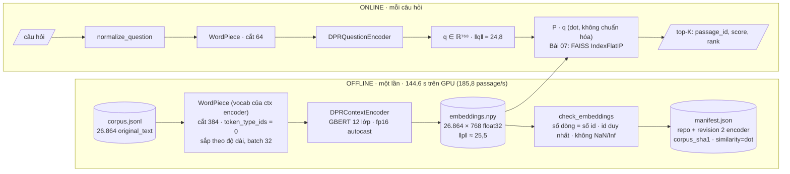

# BÀI 06 — EMBEDDING VÀ DENSE RETRIEVAL: BIỂU DIỄN VECTOR VÀ ĐỘ TƯƠNG ĐỒNG

> **Vị trí trong giáo trình**: Bài 04 so khớp theo **từ**. Bài 05 cho thấy Transformer biến một chuỗi thành **vector** phụ thuộc ngữ cảnh. Bài này ghép hai ý đó lại: biểu diễn câu hỏi và passage thành **một vector mỗi chuỗi**, rồi truy hồi bằng **độ tương đồng vector**.
>
> Bài này dạy:
> - embedding câu và đoạn,
> - dot product và cosine,
> - kiến trúc bi-encoder,
> - huấn luyện tương phản với in-batch negative và hard negative,
> - định dạng đầu vào của encoder DPR trong project.
>
> Bài 07 tiếp theo dạy **FAISS**, cách dựng chỉ mục `text384` và kết quả B1 so với BM25.
>
> **Ví dụ xuyên suốt**: câu Hundefett, cùng hai câu **dev-unseen** có **khoảng cách từ vựng** thật mà BM25 không thể vượt qua.
>
> **Nguồn số liệu**: báo cáo mục 2.3 và 4.4; `configs/dense.yaml`; `reports/dense_format_probe.json`, `dense_index_check_text384.json`, `dense_leakage.json`; `artifacts/dense/text384/manifest.json`. Các phép đo thêm cho bài học được gắn nhãn 📙 **[MỞ RỘNG]**. Các phép đo này chạy ngày 2026-11-14: mã hóa 1.176 câu dev bằng question encoder thật trên CPU (fp32), rồi so với `embeddings.npy` của `text384`. Chỉ dùng dev, **không** mở test.

---

## Mục lục

- [A. Learning Objectives](#a-learning-objectives)
- [B. Prerequisite Knowledge](#b-prerequisite-knowledge)
- [C. Theoretical Foundation](#c-theoretical-foundation)
- [D. Mathematical Foundation](#d-mathematical-foundation)
- [E. Architecture & Working Mechanism](#e-architecture--working-mechanism)
- [F. Application in Our Project](#f-application-in-our-project)
- [G. Implementation Mapping](#g-implementation-mapping)
- [H. YouTube Learning Resources](#h-youtube-learning-resources)
- [I. Knowledge Check](#i-knowledge-check)
- [J. Implementation Readiness](#j-implementation-readiness)
- [Đáp án và lời giải](#đáp-án-và-lời-giải)
- [Tài liệu tham khảo bài 06](#tài-liệu-tham-khảo-bài-06)

---

## A. LEARNING OBJECTIVES

### A.1. Mục tiêu kiến thức

Sau bài học, bạn giải thích được:

1. **Dense vector** khác **sparse vector** của BM25 ở những điểm nào, và vì sao dense vector vượt qua được **lexical gap**.
2. **Dot product** và **cosine similarity** khác nhau thế nào, khi nào hai độ đo xếp hạng giống nhau, và vì sao project **phải** dùng dot.
3. Kiến trúc **bi-encoder (dual encoder)** của DPR: hai encoder, lấy vector `[CLS]`, tính trước vector passage.
4. **Huấn luyện tương phản**: hàm mất mát negative log-likelihood, **in-batch negative**, **hard negative**, và vai trò của nhiệt độ τ.
5. Vì sao **định dạng đầu vào** (chữ hoa, tiêu đề, `token_type_ids`) có thể làm top-1 dao động từ 0,18 đến 0,85.
6. Vì sao kết quả dense trên dev bị **thổi phồng**, và mức thổi phồng đo được.

### A.2. Mục tiêu kỹ năng

1. Mã hóa một câu hỏi bằng `DPREncoder`, rồi tính dot và cosine với vector passage đã lưu.
2. Tính tay hàm mất mát tương phản cho một batch nhỏ (D.4).
3. Chứng minh rằng khi mọi vector có cùng độ dài thì dot và cosine xếp hạng như nhau, và giải thích trường hợp chúng khác nhau.
4. Kiểm tra một cấu hình định dạng đầu vào bằng một phép thử nhỏ (giống `dense_format_probe`).

### A.3. Những gì phải nhớ

| Con số | Ý nghĩa | Nguồn |
|---|---|---|
| d = 768 | số chiều vector | `manifest.json` |
| `similarity: dot`, `normalized: false` | không chuẩn hóa vector | `configs/dense.yaml`, `manifest.json` |
| Độ dài vector passage: 25,07–25,84 (trung bình 25,48) | gần như hằng số | `dense_index_check_text384.json` |
| Độ dài vector câu hỏi: 24,54–25,09 (trung bình 24,79) | gần như hằng số | 📙 đo trên 1.176 câu dev |
| `passage_field: original_text`, `passage_input: text`, `token_type_ids` toàn 0 | định dạng đầu vào | `dense.yaml`, `dense.py` |
| `passage_max_length` 384, `question_max_length` 64 | giới hạn độ dài | `dense.yaml` |
| 2.923/26.864 passage (10,9%) bị cắt ở 384 | mất thông tin cuối passage | `manifest.json` |
| 942/1.176 câu dev đã nằm trong dữ liệu huấn luyện của encoder | dev bị nhiễm bẩn | `dense_leakage.json` |

### A.4. Thành phần pipeline dùng kiến thức này

| Thành phần | Dùng gì |
|---|---|
| B1 (dense thay BM25) | Toàn bộ bài này, cộng FAISS ở Bài 07 |
| H0, H1 | Nhánh dense trả 100 passage cho RRF (Bài 08) |
| API | `DPREncoder` nạp question encoder lúc phục vụ (chỉ encoder này) |

---

## B. PREREQUISITE KNOWLEDGE

### B.1. Kiến thức cần biết trước

| Kiến thức | Mức | Ôn ở đâu |
|---|---|---|
| Vector `[CLS]` và encoder BERT | Hiểu | Bài 05 C.7 |
| Softmax, cross-entropy, log | Hiểu | Bài 05 D.3, D.8 |
| Tích vô hướng, độ dài vector, góc | Thành thạo | — |
| BM25 và lexical gap | Hiểu | Bài 04 C.4, D.4 |
| Rò rỉ dữ liệu GermanDPR → dev | Hiểu | Bài 03 C.3 |
| `numpy`: `@`, `np.linalg.norm`, `argsort` | Thành thạo | — |

### B.2. Thuật ngữ mới

| Thuật ngữ | Giải thích |
|---|---|
| **Dense vector / embedding** | Vector số thực có số chiều nhỏ và cố định (768), hầu hết thành phần khác 0, do mô hình học ra. |
| **Embedding space** | Không gian vector. "Gần nhau" trong không gian này nghĩa là "liên quan". |
| **Bi-encoder / dual encoder** | Mã hóa câu hỏi và passage **riêng** rồi so vector. DPR dùng **hai** encoder có trọng số khác nhau. |
| **Dot product (inner product)** | $u \cdot v = \sum_i u_i v_i$, phụ thuộc cả hướng lẫn độ dài. |
| **Cosine similarity** | $\cos(u, v) = \frac{u \cdot v}{\lVert u\rVert\,\lVert v\rVert}$, chỉ phụ thuộc hướng, nằm trong $[-1, 1]$. |
| **L2 normalization** | Chia vector cho độ dài của nó, đưa độ dài về 1. |
| **Contrastive learning** | Học bằng cách kéo cặp đúng lại gần và đẩy cặp sai ra xa. |
| **Positive / negative** | Passage đúng / passage sai của một câu hỏi. |
| **In-batch negative** | Dùng positive của **các câu khác trong cùng batch** làm negative, không tốn thêm chi phí mã hóa. |
| **Hard negative** | Negative **khó**: rất giống câu hỏi nhưng không phải passage đúng. |
| **Temperature τ** | Hệ số chia logit trước softmax. τ nhỏ làm phân phối nhọn hơn. |
| **MIPS** | Maximum Inner Product Search: tìm vector có dot lớn nhất (Bài 07). |
| **Truncation** | Cắt phần đầu vào vượt quá `max_length`. |

### B.3. Mối liên hệ với bài trước

- Bài 05 C.7 nói DPR lấy vector `[CLS]`. Bài này giải thích **vì sao** chỉ một vector lại dùng được để xếp hạng, và cái giá phải trả: thông tin bị nén.
- Bài 04 D.4: BM25 xếp Vachellia (10,83) trên passage đúng Haushund (9,94). Bài này cho thấy dense xếp Haushund **hạng 1** với dot 168,23, và đẩy Vachellia xuống **hạng 9.877**.
- Bài 03 C.3: encoder đã thấy 942/1.176 câu dev. Bài này **đo** ảnh hưởng của việc đó lên điểm số.

---

## C. THEORETICAL FOUNDATION

### C.1. Từ vector thưa đến vector dày

📘 **[BÁO CÁO]** (Ch.2.3.1, 4.4.1).

| | BM25 (sparse) | DPR (dense) |
|---|---|---|
| Số chiều | 284.585 (một chiều cho mỗi term) | 768 |
| Số thành phần khác 0 | khoảng 79 mỗi passage | cả 768 |
| Mỗi chiều có nghĩa là | "term t xuất hiện bao nhiêu" (đọc được) | không đọc được trực tiếp |
| Học từ dữ liệu? | Không | Có (deepset huấn luyện trên GermanDPR) |
| Khớp được | chuỗi giống hệt | nghĩa gần nhau |

**Vì sao vector dày vượt qua được lexical gap?** Encoder được huấn luyện để câu hỏi và passage đúng của nó cho ra hai vector gần nhau, **dù** chúng dùng từ khác nhau. 📙 Ví dụ thật từ dev-unseen, tức câu hỏi không có trong câu hỏi train của GermanDPR. Kiểm tra thêm `source[]`: passage đúng của câu này chỉ là positive của GermanDPR **test**, không phải train. 📘 Báo cáo (Ch.5.2.1) ghi rằng encoder được huấn luyện trên GermanDPR train. Như vậy encoder chưa thấy câu hỏi này, và cũng chưa thấy cặp (câu hỏi, passage) này làm positive.

> „Was versuchte das Absinken des Meeresniveaus während der Eiszeiten?“
> *(Câu hỏi có lẽ gõ nhầm „verursachte“ thành „versuchte“; ý là: "Điều gì gây ra việc mực nước biển hạ thấp trong các kỷ băng hà?")*
>
> Đoạn đúng (bài „Gletscher“): „…Durch das massive Binden von Wasser in Form von Eis auf Landflächen **sank** in den **Kaltzeiten**…“

Sau khi lọc stopword, câu hỏi và đoạn đúng **không có term nội dung nào chung**: „Absinken“ khác „sank“, „Eiszeiten“ khác „Kaltzeiten“, „Meeresniveaus“ không xuất hiện. BM25 cho đoạn đúng điểm 0, nên **không bao giờ** trả về nó (Bài 04: chỉ trả passage có điểm > 0). Dense xếp đoạn đúng **hạng 2** (dot 191,55), chỉ sau một đoạn về „Antarktika“ (194,61).

Đây chính là khả năng mà Bài 04 C.6 nói BM25 không có.

### C.2. Bi-encoder: hai encoder, một phép so

📘 **[BÁO CÁO]** (Ch.2.3.2; Karpukhin et al., 2020).

- **Question encoder** $E_Q$ và **context encoder** $E_P$ đều là GBERT-base, **cùng kiến trúc, khác trọng số**.
- Mỗi encoder trả về vector `[CLS]` ở lớp cuối (`pooler_output` của lớp DPR trong Hugging Face). Khi nạp, cảnh báo `pooler.dense … UNEXPECTED` xuất hiện: pooler của BERT có trong checkpoint nhưng lớp DPR **không dùng**. 📙 Quan sát khi chạy.
- Điểm liên quan là $\text{sim}(q, p) = E_Q(q)^\top E_P(p)$.

**Vì sao cần hai encoder khác nhau?** Câu hỏi ngắn (trung vị khoảng 12 token) và có dạng nghi vấn. Passage dài (trung bình 236 token) và có dạng trần thuật. Hai encoder riêng cho phép mỗi bên học cách biểu diễn phù hợp với loại văn bản của nó. 📗 **[NỀN TẢNG]** Có những hệ thống dùng chung một encoder cho cả hai (siamese). DPR gốc dùng hai encoder.

**Cái lợi quyết định**: $E_P(p)$ không phụ thuộc câu hỏi, nên mã hóa 26.864 passage **một lần** (144,6 s trên GPU), lưu lại, rồi mỗi câu hỏi chỉ cần chạy $E_Q$ một lần.

**Cái giá**: toàn bộ passage bị nén vào 768 số, và câu hỏi không "nhìn" được từng token của passage. 📘 Luan et al. (2021) chỉ ra khả năng biểu diễn của bi-encoder giảm khi văn bản dài ra, và nó dễ bỏ lỡ chi tiết cần khớp chính xác như tên riêng, con số hay term hiếm.

### C.3. Dot hay cosine?

📘 **[BÁO CÁO]** (Ch.2.3.3): "độ đo dùng khi tìm kiếm phải khớp với độ đo đã dùng khi huấn luyện". DPR được huấn luyện bằng dot, nên project dùng dot và **không chuẩn hóa** vector (`similarity: dot`, `normalized: false`).

**Khi nào hai độ đo cho cùng thứ hạng?** Với một câu hỏi cố định, $\lVert q \rVert$ là hằng số, nên không ảnh hưởng thứ hạng. Thứ hạng theo dot và theo cosine chỉ khác nhau qua $\lVert p \rVert$. Nếu mọi passage có cùng độ dài thì hai thứ hạng **trùng nhau**.

Trong project, độ dài vector passage nằm trong khoảng 25,07 đến 25,84, tức chênh tối đa khoảng 3%. 📙 **[MỞ RỘNG]** Đo trên 1.176 câu dev:

| | Dot (project) | Cosine | Chênh |
|---|---|---|---|
| Hit@1 | 0,4898 | 0,4855 | −0,0043 |
| Hit@5 | 0,8163 | 0,8155 | −0,0008 |
| Hit@20 | 0,9532 | 0,9558 | +0,0026 |
| Top-1 giống nhau | 1.128/1.176 câu (95,9%) | | |
| Top-20 giống hệt, kể cả thứ tự | **chỉ 32/1.176 câu** | | |

Bảng này cho thấy hai điều trái ngược nhau:

1. **Ở mức chỉ số, hai độ đo gần như tương đương.** Các chênh lệch dưới 0,5 điểm, nhỏ hơn nhiễu thống kê của 1.176 câu.
2. **Ở mức danh sách, chúng không giống nhau.** Thứ tự trong top-20 khác nhau ở 97% số câu, vì nhiều passage có điểm rất sát nhau và chênh 3% độ dài đủ để đổi chỗ.

Bài học: "gần như nhau" không có nghĩa là "như nhau". Trong project, mọi bước sau (RRF, reranker) đọc **thứ hạng**, nên phải dùng đúng độ đo đã ghi trong manifest. `check_manifest_compat` kiểm tra khóa `similarity` vì lý do này.

📙 Độ lớn của điểm: cosine giữa câu Hundefett và passage đúng chỉ là **0,267**, nhưng dot là 168,23 (≈ 0,267 × 24,70 × 25,5). Giá trị cosine tuyệt đối thấp không có nghĩa là "không liên quan". Chỉ **thứ hạng tương đối** mới có nghĩa. Không được đặt ngưỡng kiểu "cosine > 0,5 thì liên quan" cho mô hình này.

### C.4. Huấn luyện tương phản

📘 **[BÁO CÁO]** (Ch.2.3.4). Mỗi mẫu huấn luyện gồm một câu hỏi $q$, một positive $p^+$ và n negative $p^-_1, \dots, p^-_n$. Hàm mất mát là log-likelihood âm của positive (công thức ở D.4). Hàm này **kéo** $q$ lại gần $p^+$ và **đẩy** $q$ ra xa các $p^-$.

Hai nguồn negative (Karpukhin et al., 2020):

| Loại | Lấy từ đâu | Ưu điểm | Nhược điểm |
|---|---|---|---|
| **In-batch** | positive của B − 1 câu khác trong batch | Miễn phí: các vector đã được tính sẵn | Thường **dễ**, vì là các chủ đề không liên quan |
| **Hard negative** | passage BM25 xếp cao nhưng không chứa đáp án (DPR gốc); trong GermanDPR là `hard_negative_ctxs` | Dạy ranh giới tinh | Có thể là **false negative**: thực ra cũng chứa đáp án |

📙 **[MỞ RỘNG]** Nhìn vào các con số thật cho thấy vì sao hard negative quan trọng. Lấy 4 câu dev-unseen thuộc 4 bài khác nhau (Zeugen_Jehovas, St._Helena, Schwarze, Gletscher). Ma trận dot giữa câu hỏi i và positive j là:

```text
            p_Jehova  p_Helena  p_Schwarze  p_Gletscher
q_Jehova    182,85     79,80     118,87      75,26
q_Helena     60,75    175,78      84,43      92,16
q_Schwarze   98,03    106,22     226,05     125,75
q_Gletscher  36,89     90,24     111,57     144,58
```

Đường chéo (cặp đúng) lớn hơn mọi ô khác cùng hàng từ **19 đến 100 đơn vị**. Với τ = 1 như DPR gốc, softmax cho positive xác suất gần như bằng 1, nên mất mát xấp xỉ 0. Các in-batch negative này **đã quá dễ** với một encoder đã huấn luyện xong. Chúng gần như không còn tạo ra gradient.

Còn với câu Gletscher ở C.1, xét các đối thủ thật trong toàn kho: Antarktika 194,61; Antarktis 188,72; một đoạn Antarktika khác 187,31. Positive chỉ được 191,55. Nếu dùng 3 đoạn này làm hard negative, xác suất của positive chỉ còn **0,045** và mất mát là **3,11**. Đây là những negative mà mô hình **cần** học để phân biệt.

### C.5. Định dạng đầu vào quyết định chất lượng

📘 **[BÁO CÁO]** (Ch.4.4.3; `reports/dense_format_probe.json`). Phép thử trên 300 cặp (câu hỏi, positive) của GermanDPR, đo tỉ lệ positive đứng hạng 1 trong số các passage của cặp:

| Định dạng đưa vào context encoder | top-1 | top-5 |
|---|---|---|
| chỉ title, 256 token | 0,18 | 0,33 |
| cặp (title, text), `token_type_ids` 0/1 do tokenizer tự gán, 256 | 0,49 | 0,70 |
| chỉ text **viết thường**, 256 | 0,52 | 0,81 |
| cặp (title, text), `token_type_ids` toàn 0, 256 | 0,82 | 0,97 |
| **chỉ text, 256** | **0,84** | 0,98 |
| chỉ text, 512 | 0,85 | 0,97 |

Ba bài học từ bảng này:

1. **Chữ thường làm top-1 giảm từ 0,84 xuống 0,52.** Encoder là mô hình cased (Bài 05 C.1), nên `passage_field` phải là `original_text`.
2. **`token_type_ids` sai làm top-1 giảm từ 0,82 xuống 0,49.** Encoder được huấn luyện với segment **toàn 0**. Khi tokenizer tự gán 1 cho phần text, mô hình gặp một đầu vào nó chưa từng thấy. `dense.py` vì vậy luôn ghi đè `token_type_ids` thành 0. Đây là ví dụ cho nguyên tắc: **đầu vào lúc suy luận phải giống hệt đầu vào lúc huấn luyện**, kể cả những chi tiết không hiện ra trên văn bản.
3. **Tiêu đề đã có ở dòng đầu của text** (Bài 03 C.1), nên `passage_input: text` đủ dùng và tốt nhất.

⚠️ Phép thử này chạy trên **GermanDPR train**, tức dữ liệu encoder đã thấy. Phép thử chỉ đáng tin để **so sánh các định dạng với nhau**, không dùng để ước lượng chất lượng tuyệt đối.

### C.6. Dense trên dev bị thổi phồng bao nhiêu?

📘 **[BÁO CÁO]** (Ch.4.4.7; `dense_leakage.json`): 942/1.176 câu dev có trong câu hỏi train của GermanDPR, và 1.056 passage gold của dev là positive trong dữ liệu đó. 📙 **[MỞ RỘNG]** Tách dev theo tập `results/dev_unseen_question_ids.json` (234 câu):

| | Hit@1 | Hit@5 | Hit@20 | Trung vị của (điểm gold − điểm cao nhất không phải gold) |
|---|---|---|---|---|
| 942 câu "đã thấy" | 0,505 | 0,829 | 0,960 | **+0,09** |
| 234 câu dev-unseen | 0,427 | 0,765 | 0,927 | **−2,87** |

Khoảng cách (margin) là phép đo dễ hiểu nhất:

- Với câu đã thấy, trung vị margin dương: gold thường đứng hạng 1.
- Với câu chưa thấy, trung vị margin âm gần 3 đơn vị: gold thường bị một passage khác vượt.

⚠️ "Dev-unseen" chỉ bảo đảm **câu hỏi** chưa được thấy. 📘 Bảng 5.3 của báo cáo cho biết trong 234 câu dev-unseen, có **114 câu (48,7%)** mà passage đúng vẫn từng là positive trong GermanDPR train, 12 câu mà passage đúng chỉ từng là negative, và 108 câu mà passage đúng chưa từng xuất hiện. Vì vậy dev-unseen ít thiên lệch hơn dev nhưng **vẫn lạc quan** cho dense.

⚠️ Hai nhóm không cùng độ khó. Trên dev-unseen, BM25 cũng khác: Hit@5 là 0,645 so với 0,638 trên toàn dev (📘 Bảng 4.9). Vì vậy chênh lệch này **không thể** quy hết cho rò rỉ. Kết luận an toàn, giống báo cáo: **dev không đủ để khẳng định dense tốt hơn BM25**. Test mới là nơi trả lời câu hỏi đó (Bài 07, Bài 12).

### C.7. Hạn chế và khi nào dùng

| | |
|---|---|
| **Ưu điểm** | Khớp theo nghĩa (C.1); một vector cho mỗi passage; tính trước được; tìm kiếm nhanh |
| **Hạn chế** | Cần dữ liệu huấn luyện; nén thông tin; cắt ở 384 token (10,9% passage); điểm tuyệt đối khó diễn giải (C.3); nhạy với định dạng đầu vào (C.5); dễ bị rò rỉ dữ liệu khi đánh giá (C.6); cần GPU để mã hóa kho |
| **Dùng khi** | Câu hỏi diễn đạt khác văn bản; có checkpoint cùng ngôn ngữ và miền; kết hợp với BM25 để bù term hiếm (Bài 08) |

---

## D. MATHEMATICAL FOUNDATION

### D.1. Dot, cosine và độ dài

$$
\text{dot}(q, p) = q^\top p = \lVert q\rVert \, \lVert p\rVert \cos\theta
$$

$$
\cos(q, p) = \frac{q^\top p}{\lVert q\rVert \, \lVert p\rVert}, \qquad \lVert p \rVert = \sqrt{\textstyle\sum_i p_i^2}
$$

**Mệnh đề.** Với câu hỏi $q$ cố định, nếu $\lVert p_i \rVert = c$ với mọi i, thì thứ hạng theo dot và theo cosine trùng nhau.

**Chứng minh.** $\text{dot}(q, p_i) = (\lVert q \rVert \cdot c) \cdot \cos(q, p_i)$, mà $\lVert q \rVert \cdot c > 0$ là hằng số không phụ thuộc i. Nhân với một hằng số dương không đổi thứ tự. ∎

**Khi độ dài khác nhau** (ví dụ ở G.5): với $q = (1, 1)$, $p_0 = (0{,}9;\ 1{,}1)$ và $p_1 = (3;\ 0{,}5)$:

- dot: $p_1 = 3{,}5 > p_0 = 2{,}0$
- cosine: $p_0 = 0{,}995 > p_1 = 0{,}814$

Passage "dài" $p_1$ thắng theo dot dù lệch hướng. Nếu một mô hình được huấn luyện bằng dot, nó có thể dùng **độ dài** để mã hóa thông tin (ví dụ "passage này giàu thông tin"). Chuẩn hóa vector khi tìm kiếm sẽ xóa mất thông tin đó.

### D.2. Độ lớn điểm trong project

Với $\lVert q \rVert \approx 24{,}8$ và $\lVert p \rVert \approx 25{,}5$:

$$
\text{dot} \approx 632 \cdot \cos\theta
$$

📙 Câu Hundefett: $\lVert q \rVert = 24{,}70$. Với passage đúng, $\cos = 0{,}2672$ nên dot = 168,23. Với Vachellia, $\cos = 0{,}1061$ nên dot = 66,98. Chênh **0,16 về cosine** thành chênh **101 về dot**. Điều này quan trọng ở D.4: dot lớn làm softmax rất nhọn.

### D.3. Chi phí tìm kiếm chính xác

$$
\text{score} = P\,q,\qquad P \in \mathbb{R}^{N \times d},\ N = 26.864,\ d = 768
$$

Phép này tốn $N \cdot d = 20{,}6$ triệu phép nhân-cộng cho mỗi câu hỏi (📘 Ch.4.4.4). Lưu ma trận P ở float32 cần $26.864 \times 768 \times 4$ byte = **82,5 MB** (`embeddings.npy` nặng 82.526.336 byte). So với một lượt chạy GBERT để mã hóa câu hỏi, phép nhân này rất rẻ (Bài 07).

### D.4. Hàm mất mát tương phản

📘 (công thức 2.9 của báo cáo; Karpukhin et al., 2020):

$$
\mathcal{L}(q, p^+, p^-_{1..n}) = -\log \frac{e^{\,\text{sim}(q, p^+)/\tau}}{e^{\,\text{sim}(q, p^+)/\tau} + \sum_{j=1}^{n} e^{\,\text{sim}(q, p^-_j)/\tau}}
$$

DPR gốc dùng $\text{sim} = \text{dot}$ và $\tau = 1$, tức không có nhiệt độ.

Bản chất của hàm này là **cross-entropy** trên một bài toán phân loại $(n+1)$ lớp: "trong các ứng viên, đâu là positive?".

**Với in-batch negative**, cho batch B câu, đặt $S = Q P^{+\top} \in \mathbb{R}^{B \times B}$. Khi đó:

$$
\mathcal{L}_{\text{batch}} = \frac{1}{B}\sum_{i=1}^{B} -\log \text{softmax}(S_{i,:}/\tau)_i
$$

Đường chéo là positive, các ô ngoài đường chéo là negative.

**Ví dụ tính tay với số thật** (📙 câu Gletscher, xem C.4). Hàng điểm là (positive 191,55; ba hard negative 194,61; 188,72; 187,31). Trừ giá trị lớn nhất 194,61 để ổn định số học, được $(-3{,}06;\ 0;\ -5{,}89;\ -7{,}30)$. Khi đó:

$$
e^{\cdot} = (0{,}0469;\ 1;\ 0{,}0028;\ 0{,}0007),\quad \Sigma = 1{,}0504
$$

$$
P(p^+) = 0{,}0469/1{,}0504 = 0{,}0446,\qquad \mathcal{L} = -\ln 0{,}0446 = 3{,}11
$$

**Ảnh hưởng của τ** (📙 trên ma trận 4×4 của C.4):

| τ | Mất mát từng câu | Trung bình |
|---|---|---|
| 1 | 0; 0; 0; 0 | ≈ 0 |
| 10 | 0,0017; 0,0004; 0,0001; 0,0404 | 0,0106 |
| 30 | 0,164; 0,123; 0,066; 0,421 | 0,194 |

τ lớn làm phân phối "mềm" hơn, nên ngay cả các negative dễ vẫn tạo ra gradient. 📗 **[NỀN TẢNG]** Nhiều mô hình embedding sau DPR dùng cosine với τ nhỏ, khoảng 0,01–0,05. Phép chia cho τ khi đó bù lại việc cosine bị giới hạn trong [−1, 1]. Đây là cách khác để đạt cùng mục tiêu: dot với τ = 1 có thang điểm tự do; cosine với τ nhỏ có thang điểm bị chặn rồi được phóng đại lên.

### D.5. Vì sao hard negative cho nhiều gradient hơn

Đạo hàm của $\mathcal{L}$ theo điểm của một negative $s_j$ là:

$$
\frac{\partial \mathcal{L}}{\partial s_j} = \frac{1}{\tau}\, P(p^-_j \mid q)
$$

Gradient đẩy một negative ra xa **tỉ lệ với xác suất mô hình đang gán cho nó**.

- Negative dễ có $P \approx 0$, nên gần như không có gradient.
- Hard negative có $P$ đáng kể. Ở ví dụ Gletscher, Antarktika có $P = 1/1{,}0504 = 0{,}95$, nên nhận gần như toàn bộ "lực đẩy".

Đó là lý do GermanDPR có `hard_negative_ctxs`, và lý do `hardneg_train.json` được giữ lại cho việc fine-tune DPR sau này. Việc fine-tune này **chưa** được thực hiện; Bài 03 C.3 đã cảnh báo cần lọc 47 passage gold của test trước khi dùng tệp đó.

---

## E. ARCHITECTURE & WORKING MECHANISM

### E.1. Bi-encoder trong project



### E.2. Input → Processing → Output

| Bước | Input | Processing | Output |
|---|---|---|---|
| Mã hóa passage | `original_text` × 26.864 | tokenize (cắt 384), `token_type_ids` = 0, forward, lấy `pooler_output` | ma trận (26.864, 768); thống kê cắt: 2.923 passage bị cắt |
| Kiểm tra và lưu | ma trận, danh sách id | `check_embeddings`; ghi `.npy`, `passage_ids.json`, `index.faiss`, `manifest.json` | `artifacts/dense/text384/` |
| Mã hóa câu hỏi | chuỗi câu hỏi | normalize, tokenize (cắt 64), forward | vector (768,) |
| Chấm điểm | q, P | $Pq$ | 26.864 điểm dot |
| Xếp hạng | điểm | top-K | `[{passage_id, score, rank}]`, cùng giao diện với BM25 |

### E.3. Một câu hỏi, hai bộ truy hồi

📙 **[MỞ RỘNG]** Câu Hundefett (dev, thuộc nhóm "đã thấy"):

| Hạng | BM25 (Bài 04) | Dense (dot) |
|---|---|---|
| 1 | Vachellia_tortilis 10,83 | **Haushund (gold) 168,23** |
| 2 | Somatologie 10,14 | Haushund (passage khác) 153,67 |
| 3 | **Haushund (gold) 9,94** | Lebenserwartung 144,74 |
| 4 | Sprachtest 9,56 | Haushund (passage khác) 139,61 |
| 5 | Biorhythmus 9,38 | Ernährung_des_Menschen 137,62 |

Hai passage BM25 xếp đầu bị dense đẩy rất xa: **Vachellia xuống hạng 9.877** (dot 66,98), **Somatologie xuống hạng 1.623** (dot 87,68). Dense hiểu câu hỏi nói về **chó** và **thức ăn hoặc dược liệu từ động vật**, chứ không chỉ về "y học" và "được dùng". Nhưng dense cũng gom **3 passage cùng bài Haushund** vào top-5. Các passage cùng chủ đề là đối thủ khó nhất của nó.

⚠️ Passage đúng này là positive trong dữ liệu huấn luyện của encoder (Bài 03 E.3), nên hạng 1 ở đây **không** phải bằng chứng sạch. Ví dụ Gletscher ở C.1 (dev-unseen) mới là bằng chứng sạch cho khả năng khớp theo nghĩa.

---

## F. APPLICATION IN OUR PROJECT

### F.1. Thành phần này nằm ở đâu?

| Việc | File / hàm | Cấu hình |
|---|---|---|
| Nạp encoder (lười, từng cái một) | `retrieval/dense.py: DPREncoder.ctx`, `.question`, `snapshot_dir` | `dense.yaml: ctx_encoder`, `question_encoder` |
| Mã hóa | `DPREncoder._embed`, `encode_questions`, `encode_passages` | `passage_max_length`, `question_max_length`, `encode_batch_size`, `fp16` |
| Kiểm tra, lưu, nạp | `check_embeddings`, `save_artifacts`, `load_artifacts`, `check_manifest_compat` | `artifact_dir` |
| Truy hồi | `DenseRetriever.retrieve`, `retrieve_many` | `top_k` |
| Script mã hóa kho | `scripts/GD6/06b_encode_corpus.py` | — |

Các encoder được nạp **lười** (lazy): mã hóa kho chỉ nạp context encoder, phục vụ chỉ nạp question encoder. Nhờ vậy GPU 4 GB không phải giữ cả hai mô hình (📘 Ch.4.4.2).

### F.2. Vì sao nhóm cần hiểu bài này?

| Quyết định | Lý do (mục trong bài) |
|---|---|
| `similarity: dot`, không chuẩn hóa | C.3, D.1 |
| `passage_field: original_text` | C.5 (0,84 so với 0,52) |
| `token_type_ids` = 0 | C.5 (0,82 so với 0,49) |
| `passage_input: text` | C.5; tiêu đề đã ở dòng đầu |
| Manifest ghi revision của **cả hai** encoder | Đổi một encoder thì vector cũ vô nghĩa với encoder mới |
| Chọn cấu hình dense trên dev-unseen hoặc train-select | C.6 |
| Không tự fine-tune DPR | 📘 Phạm vi đề tài; `hardneg_train.json` để dành |

### F.3. Đầu vào và đầu ra thực tế

```python
q = enc.encode_questions(["Wann wurde Hundefett in der Medizin verwendet?"])   # (1, 768), ‖q‖ = 24,70
retriever.retrieve("Wann wurde Hundefett in der Medizin verwendet?", 5)
# [{'passage_id': 'p_c25e144a863973b9', 'score': 168.2, 'rank': 1}, ...]
```

Điểm trong vết pipeline (Bài 02, chạy trên GPU fp16) là 168,27. Phép đo của bài này (CPU fp32) cho 168,23. Chênh 0,04 là do độ chính xác số học. 📘 `dense_index_check_text384.json` đo trên 300 passage: fp16 và fp32 có cosine trung bình 0,9999998, và cho cùng top-1 và cùng tập top-5.

### F.4. Nếu thay đổi thì sao?

| Thay đổi | Hệ quả |
|---|---|
| Chuẩn hóa vector rồi dùng cosine | Hit@k gần như không đổi trên dev (C.3), nhưng thứ tự top-20 đổi ở 97% câu, nên RRF và reranker nhận đầu vào khác. Phải ghi vào manifest và đánh giá lại |
| Đổi sang encoder đa ngôn ngữ (ví dụ họ E5 hay BGE-M3) | Phải mã hóa lại kho, và **có thể** tránh được rò rỉ GermanDPR. Chưa thử làm retriever trong project |
| Fine-tune DPR trên GermanQuAD train với `hardneg_train.json` | Lọc 47 passage gold của test trước; chọn checkpoint trên dev-unseen. 📘 Nằm trong danh sách việc chưa làm |
| Tăng `passage_max_length` lên 512 | Ít passage bị cắt hơn, mã hóa chậm hơn. Bài 07 có kết quả 256, 384 và 512 |

### F.5. Tham số cần chú ý

| Tham số | Giá trị | File |
|---|---|---|
| `ctx_encoder` / `question_encoder` | `deepset/gbert-base-germandpr-{ctx,question}_encoder` | `dense.yaml` |
| revision | `5c13387b…` (ctx), `c5b8d88c…` (question) | `manifest.json` |
| `passage_field` / `passage_input` | `original_text` / `text` | `dense.yaml` |
| `passage_max_length` / `question_max_length` | 384 / 64 | `dense.yaml` |
| `similarity` | `dot` | `dense.yaml` |
| `fp16` | `true` (autocast trên GPU, lưu float32) | `dense.yaml` |
| `artifact_dir` | `artifacts/dense/text384` | `dense.yaml` |

---

## G. IMPLEMENTATION MAPPING

### G.1. Thư viện

| Thư viện | Dùng cho |
|---|---|
| `transformers` | `DPRQuestionEncoder`, `DPRContextEncoder` (`pooler_output` = vector `[CLS]`) |
| `huggingface_hub` | `hf_hub_download(..., local_files_only=True)`: ưu tiên cache, không cần mạng |
| `torch` | `no_grad`, `autocast(float16)` |
| `numpy` | ma trận vector, `@`, chuẩn |
| `faiss` | `IndexFlatIP` (Bài 07) |

Project **không** dùng `sentence-transformers` (roadmap §10). Tokenizer của encoder được dựng bằng `load_bert_tokenizer` (Bài 05 E.3).

### G.2. Pseudocode

```text
ENCODE_PASSAGES(texts, L=384, B=32):
    lens  ← độ dài token THẬT (không cắt)            # để thống kê bị cắt và để sắp batch
    order ← argsort(−lens)                             # passage dài trước: ít padding
    for batch in chunks(order, B):
        enc ← tokenize(batch, truncation, max_length=L, padding)
        enc.token_type_ids ← 0                        # giống lúc huấn luyện
        with no_grad, autocast(fp16): v ← E_P(enc).pooler_output
        out[batch] ← float32(v)
    return out, {n_truncated = Σ[lens > L], ...}

RETRIEVE(question, K):
    q ← E_Q(tokenize(normalize(question), max_length=64))
    s ← P · q
    return top-K theo s
```

### G.3. Cấu trúc dữ liệu

```python
embeddings.npy     # np.float32, shape (26864, 768); hàng i ↔ passage_ids[i]
passage_ids.json   # list[str], đúng thứ tự corpus (ids_match_corpus_order: true)
manifest.json      # {"similarity": "dot", "normalized": false, "passage_field": "original_text",
                   #  "ctx_encoder": {"repo", "revision"}, "question_encoder": {...},
                   #  "corpus_sha1", "truncation": {"n_truncated": 2923, ...}, "fp16": true, ...}
```

### G.4. Code: tự kiểm tra dot và cosine trên kho thật

```python
# chạy từ gốc project; question encoder chạy được trên CPU (khoảng 14 s cho 1.176 câu)
import sys, numpy as np; sys.path.insert(0, "src")
from germanqa.retrieval.dense import DPREncoder
from germanqa.data.io_utils import read_json
A = "artifacts/dense/text384"
P = np.load(A + "/embeddings.npy"); ids = read_json(A + "/passage_ids.json")
enc = DPREncoder("deepset/gbert-base-germandpr-ctx_encoder",
                 "deepset/gbert-base-germandpr-question_encoder", device="cpu", fp16=False)
q = enc.encode_questions(["Wann wurde Hundefett in der Medizin verwendet?"])[0]
dot = P @ q
cos = dot / np.linalg.norm(P, axis=1) / np.linalg.norm(q)
g = ids.index("p_c25e144a863973b9")
print(round(float(np.linalg.norm(q)), 2), round(float(dot[g]), 2), round(float(cos[g]), 4))   # 24.7 168.23 0.2672
print(int((dot > dot[g]).sum()) + 1, int((cos > cos[g]).sum()) + 1)                              # 1 1
```

### G.5. Code minh họa: khi nào dot khác cosine, và hàm mất mát in-batch

```python
import numpy as np

def dot_rank(q, P):
    return np.argsort(-(P @ q), kind="stable")

def cos_rank(q, P):
    Pn = P / np.linalg.norm(P, axis=1, keepdims=True)
    return np.argsort(-(Pn @ (q / np.linalg.norm(q))), kind="stable")

q = np.array([1.0, 1.0])
P = np.array([[0.9, 1.1],      # p0: gần như cùng hướng với q, độ dài 1,42
              [3.0, 0.5],      # p1: lệch hướng nhưng DÀI (3,04)
              [0.2, 1.0]])     # p2: lệch hướng, ngắn
print("dot", P @ q, dot_rank(q, P))
print("cos", np.round(P @ q / np.linalg.norm(P, axis=1) / np.linalg.norm(q), 3), cos_rank(q, P))

def in_batch_loss(Q, Pp, tau=1.0, hard=None):
    """Q: (B, d) câu hỏi, Pp: (B, d) positive; hàng i của Pp là positive của câu i,
    mọi hàng khác là negative. hard: (B, d) thêm một hard negative cho mỗi câu."""
    S = Q @ Pp.T                                   # (B, B)
    if hard is not None:
        S = np.concatenate([S, (Q * hard).sum(1, keepdims=True)], axis=1)   # (B, B+1)
    S = S / tau
    S = S - S.max(axis=1, keepdims=True)
    logp = S - np.log(np.exp(S).sum(axis=1, keepdims=True))
    return -logp[np.arange(len(Q)), np.arange(len(Q))].mean()

rng = np.random.default_rng(0)
Q = rng.normal(size=(4, 8)); Pp = Q + 0.5 * rng.normal(size=(4, 8))   # positive = câu hỏi + nhiễu
H = Pp + 0.3 * rng.normal(size=(4, 8))                                 # hard negative = rất giống positive
print("loss in-batch", round(in_batch_loss(Q, Pp), 4), "| + hard", round(in_batch_loss(Q, Pp, hard=H), 4))
```

Kết quả chạy thật:

```text
dot [2.  3.5 1.2] [1 0 2]
cos [0.995 0.814 0.832] [0 2 1]
loss in-batch 0.065 | + hard 0.6455
```

Cách đọc kết quả:

- Theo dot, $p_1$ (vector dài) đứng đầu. Theo cosine, $p_0$ (cùng hướng với câu hỏi) đứng đầu, và $p_1$ còn xuống **hạng cuối**.
- Thêm một hard negative làm mất mát tăng gần **10 lần**, từ 0,065 lên 0,646, dù vẫn là cùng các câu hỏi và positive. Gradient chỉ "có việc để làm" khi có negative khó (D.5).

### G.6. Kiểm tra từng bước

| Kiểm tra | Cách làm | Kỳ vọng |
|---|---|---|
| Vector hợp lệ | `check_embeddings` | Số dòng = số id = 26.864, id duy nhất, không NaN/Inf |
| Thứ tự | `passage_ids.json` so với `corpus.jsonl` | `ids_match_corpus_order: true` |
| Đúng encoder | `check_manifest_compat(manifest, cfg, revisions)` | Không lỗi |
| Đúng kho | `load_artifacts(dir, corpus_path)` so `corpus_sha1` | Không lỗi |
| fp16 không làm hỏng | Mã hóa 300 passage bằng fp16 và fp32 | cosine ≈ 1, cùng top-1 (📘 đã đo) |
| Độ dài vector | `np.linalg.norm(P, axis=1)` | ≈ 25,5 và hẹp; nếu dải rộng thì dot và cosine sẽ khác nhau rõ |
| Định dạng | Phép thử 300 cặp (C.5) | top-1 ≈ 0,84 với `text` |

### G.7. Lỗi thường gặp

| Lỗi | Triệu chứng | Phòng tránh |
|---|---|---|
| Đưa `retrieval_text` (chữ thường) vào encoder | top-1 giảm từ 0,84 xuống 0,52 | `passage_field: original_text` |
| Để tokenizer tự gán `token_type_ids` 0/1 | top-1 giảm từ 0,82 xuống 0,49 | Ghi đè thành 0 (`dense.py`) |
| Dùng nhầm question encoder để mã hóa passage (hoặc ngược lại) | Kết quả kém mà không báo lỗi | Hai thuộc tính `.ctx` và `.question` riêng; manifest ghi repo |
| Chuẩn hóa vector "cho chắc" | Thứ hạng thay đổi, không khớp lúc đánh giá | `similarity: dot`, `check_manifest_compat` |
| Đổi kho nhưng giữ `embeddings.npy` cũ | `passage_ids` lệch, kết quả sai | So `corpus_sha1` khi nạp |
| Không sắp batch theo độ dài | Padding nhiều, mã hóa chậm | `argsort(−lengths)` |
| Chỉ báo dev cho dense | Thổi phồng do rò rỉ | Báo kèm dev-unseen; chọn trên train-select (Bài 08) |
| Đặt ngưỡng cosine cố định | Loại cả passage đúng (cos 0,27) | Chỉ dùng thứ hạng |

---

## H. YOUTUBE LEARNING RESOURCES

> Mọi URL dưới đây xuất hiện trong kết quả tìm kiếm web (giới hạn youtube.com) ngày 2026-11-14. Kết quả tìm kiếm thường **không hiển thị tên kênh**; khi đó giáo trình ghi "chưa xác nhận". Tên video ghi theo đúng tiêu đề trong kết quả. Hãy mở video kiểm tra trước khi trích dẫn.
>
> ⚠️ Ba lần tìm kiếm riêng cho bài này (contrastive / InfoNCE, bi-encoder và cross-encoder, embedding và cosine) **không** trả về video YouTube nào, chỉ ra bài báo. Các video dưới đây là những video đã tìm thấy ở Bài 02 và Bài 05 mà có nội dung liên quan.

### H.1. Video đã tìm thấy

| # | Tên video | Kênh | URL | Hỗ trợ mục |
|---|---|---|---|---|
| 1 | DPR: Dense Passage Retrieval for Open-Domain Question Answering | chưa xác nhận | https://www.youtube.com/watch?v=TbObc9s8Gzw | C.2, C.4, D.4 |
| 2 | Dense Passage Retrieval(DPR): End to End QA System | chưa xác nhận | https://www.youtube.com/watch?v=rvcyyJNjPU0 | E.1 |
| 3 | Attention in transformers, visually explained | chưa xác nhận (kết quả tìm kiếm gợi ý 3Blue1Brown) | https://www.youtube.com/watch?v=eMlx5fFNoYc | C.3 (phần về không gian vector và dot product) |
| 4 | Stanford CS224N NLP with Deep Learning (bài giảng pretraining) | chưa xác nhận | https://www.youtube.com/watch?v=m0AxXZsel_U | C.1 (biểu diễn) |

### H.2. Nội dung chính và đoạn cần tập trung

| # | Nội dung (theo tiêu đề và mô tả) | Tập trung vào |
|---|---|---|
| 1 | Trình bày bài báo DPR | Dual encoder; in-batch negative; vì sao dùng dot; so với BM25 |
| 2 | DPR trong hệ QA end-to-end | Offline (mã hóa kho) và online (mã hóa câu hỏi) |
| 3 | Hình ảnh hóa attention | Phần "dot product đo độ khớp giữa hai vector" là trực giác cho C.3 |
| 4 | Pretraining | Vì sao vector `[CLS]` mang nghĩa sau khi pre-train |

### H.3. Thứ tự xem đề xuất

```
③ (trực giác dot product) → ① (DPR) → làm G.4 và G.5 → ② (end-to-end, chuẩn bị Bài 07)
```

### H.4. Link tìm kiếm YouTube (không phải video đã xác minh)

Các link dưới đây là **link tìm kiếm**, không phải video cụ thể:

- Dense retrieval: https://www.youtube.com/results?search_query=dense+passage+retrieval+explained
- Contrastive / InfoNCE: https://www.youtube.com/results?search_query=contrastive+loss+in-batch+negatives+infonce
- Bi-encoder vs cross-encoder: https://www.youtube.com/results?search_query=bi-encoder+vs+cross-encoder
- Cosine vs dot product: https://www.youtube.com/results?search_query=cosine+similarity+vs+dot+product+embeddings
- Hard negative mining: https://www.youtube.com/results?search_query=hard+negative+mining+dense+retrieval

### H.5. Tài liệu chính thức và bài báo

| Loại | Tài liệu | Dùng cho |
|---|---|---|
| Hugging Face (chính thức) | Transformers docs — DPR: https://huggingface.co/docs/transformers/model_doc/dpr | F.1, G.1 |
| Model card | https://huggingface.co/deepset/gbert-base-germandpr-question_encoder | F.5 |
| Model card | https://huggingface.co/deepset/gbert-base-germandpr-ctx_encoder | F.5 |
| Bài báo | Karpukhin et al. (2020) — DPR | C.2, C.4, D.4 |
| Bài báo | Luan et al. (2021) — Sparse, dense, and attentional representations | C.2 (giới hạn của một vector) |
| Bài báo | Möller et al. (2021) — GermanDPR | C.4 |
| Bài báo | Lewis, Stenetorp & Riedel (2021) — Test–train overlap | C.6 |
| Bài báo | van den Oord, Li & Vinyals (2018) — CPC / InfoNCE | D.4 (📙 nguồn gốc của dạng loss) |

---

## I. KNOWLEDGE CHECK

### I.1. Câu hỏi kiến thức cơ bản (5)

1. DPR dùng bao nhiêu encoder? Vector đầu ra lấy từ đâu, và có bao nhiêu chiều?
2. Project dùng dot hay cosine? Ghi ở những tệp nào?
3. Hai giới hạn độ dài của dense là bao nhiêu? Bao nhiêu passage bị cắt ở 384 token?
4. In-batch negative là gì? Vì sao gọi là "miễn phí"?
5. Vì sao `passage_input` là `text` chứ không phải `title_text`?

### I.2. Câu hỏi giải thích cơ chế (5)

6. Chứng minh rằng khi mọi vector passage có cùng độ dài thì dot và cosine xếp hạng giống nhau. Vì sao độ dài của $q$ không ảnh hưởng?
7. Giải thích vì sao đặt `token_type_ids` toàn 0 lại làm top-1 tăng từ 0,49 lên 0,82.
8. Từ D.5, giải thích vì sao in-batch negative gần như không đóng góp gradient với encoder đã huấn luyện xong.
9. Vì sao cosine 0,267 lại là passage hạng 1? Điều gì sai trong ý tưởng "đặt ngưỡng cosine 0,5"?
10. Vì sao bi-encoder dễ bỏ lỡ tên riêng và con số hiếm hơn BM25?

### I.3. Câu hỏi phân tích tình huống (3)

11. Một thành viên đề xuất: "Hit@5 của dot và cosine gần như bằng nhau, vậy chuẩn hóa vector cho gọn, khỏi phải nhớ." Bạn trả lời thế nào?
12. Dense đạt Hit@5 = 0,816 trên dev, BM25 đạt 0,638. Bạn viết gì trong báo cáo, và **không** được viết gì?
13. Câu „Welches Amt führt das Kanadische Militär an?“ có passage đúng thuộc bài „Kanadische_Streitkräfte“. Sau khi lọc stopword, câu hỏi và passage không có term chung nào, nhưng dense xếp passage đúng hạng 1. Giải thích phía BM25 bằng kiến thức Bài 04, và vì sao ví dụ này **không** chứng minh sức mạnh của dense. (Gợi ý: câu này có thuộc dev-unseen không?)

### I.4. Bài tập vận dụng (2)

14. **Tính tay.** Với hàng điểm (positive 182,85; negative 79,80; 118,87; 75,26) ở C.4, tính mất mát với τ = 30. So với bảng D.4 (0,164).
15. **Viết code.** Dùng G.4, mã hóa 234 câu dev-unseen. Tính Hit@5 theo dot và theo cosine trên đúng tập này. Báo cả số câu có top-5 khác nhau (dưới dạng tập hợp).

### I.5. Bài tập liên hệ pipeline của nhóm (1)

16. **Đo tác hại của việc cắt 384 token.** Với mỗi câu dev, tính vị trí token của đáp án trong passage gold bằng tokenizer của ctx encoder. Chia hai nhóm: đáp án nằm trong 384 token đầu, hoặc nằm ngoài. So Hit@5 của dense giữa hai nhóm, báo số câu mỗi nhóm. Liên hệ với con số 11,9% ở mức 256 token (📘 Ch.4.4.3), và dự đoán ảnh hưởng của việc tăng lên 512 (đối chiếu Bài 07).

---

## J. IMPLEMENTATION READINESS

> Trên website, các ô tick được. Trạng thái lưu trong `localStorage` của **trình duyệt đang dùng**: không đồng bộ giữa thiết bị hay trình duyệt, không ai khác thấy, mất khi xóa dữ liệu trang hoặc dùng cửa sổ ẩn danh. Trong file Markdown, sửa `[ ]` thành `[x]`.

### J.1. Giải thích được khái niệm

- [ ] Giải thích sparse và dense bằng bảng C.1, kèm ví dụ Gletscher.
- [ ] Giải thích vì sao bi-encoder tính trước được vector passage, và cái giá của việc đó.

### J.2. Hiểu sơ đồ hoạt động

- [ ] Vẽ lại E.1, ghi đúng kích thước và các giới hạn 384/64.
- [ ] Giải thích bảng so sánh E.3 (BM25 và dense cho câu Hundefett), và vì sao nó không phải bằng chứng sạch.

### J.3. Giải thích được công thức

- [ ] Viết công thức dot và cosine, và chứng minh mệnh đề D.1.
- [ ] Viết hàm mất mát tương phản và tính tay ví dụ Gletscher (0,0446; 3,11).
- [ ] Giải thích $\partial\mathcal{L}/\partial s_j \propto P(p_j^-)$.

### J.4. Biết dữ liệu vào và ra

- [ ] Kể bốn tệp của `artifacts/dense/text384/` và vai trò của từng tệp.
- [ ] Nêu ba lựa chọn định dạng đầu vào cùng con số top-1 tương ứng (C.5).

### J.5. Hiểu vai trò trong pipeline

- [ ] Giải thích vì sao kết quả dense trên dev bị thổi phồng, kèm số đo (942 câu; margin +0,09 so với −2,87).
- [ ] Nêu ba điều cần làm lại nếu đổi encoder.

### J.6. Mô tả cách cài đặt

- [ ] Chạy G.4 và ra đúng 168,23 và 0,2672.
- [ ] Chạy G.5 và giải thích vì sao thêm hard negative làm mất mát tăng 10 lần.

**Đánh giá**: đạt ≥ 12/14 mục thì chuyển sang Bài 07 (DPR + FAISS).

---

## ĐÁP ÁN VÀ LỜI GIẢI

### Câu 1
Hai encoder: `DPRQuestionEncoder` và `DPRContextEncoder`. Cả hai đều là GBERT-base, cùng kiến trúc nhưng khác trọng số. Đầu ra là `pooler_output` của lớp DPR, tức vector `[CLS]` ở lớp cuối (lớp này không dùng pooler của BERT), có 768 chiều.

### Câu 2
Dot, không chuẩn hóa. Ghi ở `configs/dense.yaml` (`similarity: dot`) và `manifest.json` (`"similarity": "dot"`, `"normalized": false`). Chỉ mục FAISS là `IndexFlatIP` (inner product).

### Câu 3
`passage_max_length` = 384, `question_max_length` = 64. Có 2.923/26.864 passage (10,9%) bị cắt ở 384 token (`manifest.json: truncation`).

### Câu 4
Với một câu hỏi trong batch, positive của các câu khác trong cùng batch được dùng làm negative. Gọi là "miễn phí" vì vector của các positive đó **đã** được tính để làm positive cho câu của chúng. Chỉ cần thêm một phép nhân ma trận $B \times B$, không cần chạy encoder thêm lần nào.

### Câu 5
Dòng đầu của `original_text` đã là tiêu đề bài (Bài 03 C.1). Phép thử 300 cặp cho `text` 0,84, còn `title_text` (với segment toàn 0) cho 0,82. Hai cách gần như bằng nhau, và `text` đơn giản hơn. Nếu không sửa segment, `title_text` chỉ đạt 0,49.

### Câu 6
$\text{dot}(q, p_i) = \lVert q \rVert \, \lVert p_i \rVert \cos\theta_i$. Với $\lVert p_i \rVert = c$ thì $\text{dot} = (\lVert q \rVert c)\cos\theta_i$. Nhân tử $\lVert q \rVert c$ dương và như nhau với mọi i, nên không đổi thứ tự. $\lVert q \rVert$ không ảnh hưởng vì với **một** câu hỏi, đó là cùng một hằng số cho mọi passage. Thứ hạng là so sánh giữa các passage **của cùng câu hỏi**.

### Câu 7
Encoder được deepset huấn luyện với `token_type_ids` toàn 0. Segment embedding cho giá trị 1 vì vậy hầu như không được cập nhật trong quá trình đó, và mang một vector mà mô hình không "quen". Khi tokenizer tự gán 1 cho phần text, mọi token của passage bị cộng thêm vector lạ này (Bài 05 D.1). Biểu diễn bị lệch khỏi phân phối lúc huấn luyện, và vector `[CLS]` không còn khớp với không gian câu hỏi.

### Câu 8
$\partial \mathcal{L}/\partial s_j = P(p^-_j \mid q)/\tau$. Với encoder đã huấn luyện, positive vượt các in-batch negative từ 19 đến 100 đơn vị dot (C.4). Với τ = 1, $P(p^-_j) \approx e^{-19} \approx 6 \times 10^{-9}$ hoặc nhỏ hơn, nên gradient gần như bằng 0. Mô hình chỉ còn học được từ những negative mà nó đang nhầm, tức các hard negative.

### Câu 9
Cosine 0,267 tương ứng với dot 168,23, cao nhất trong 26.864 passage. Các passage khác còn có cosine thấp hơn. Cosine tuyệt đối của mô hình này thấp vì không gian vector không được huấn luyện để passage liên quan có cosine gần 1. Mục tiêu huấn luyện chỉ là positive **cao hơn** negative (D.4). Ngưỡng 0,5 sẽ loại **mọi** passage, kể cả passage đúng. Chỉ thứ hạng tương đối mới có nghĩa.

### Câu 10
Toàn bộ passage bị nén vào 768 số. Một tên riêng hiếm hoặc một con số xuất hiện một lần trong passage 236 token chỉ đóng góp rất ít vào vector `[CLS]`. Câu hỏi cũng không thể "nhìn" trực tiếp token đó, vì hai bên chỉ gặp nhau qua phép dot. BM25 thì ngược lại: term hiếm có IDF rất cao (`hundefett` có idf 9,79), nên một lần khớp là đủ đẩy passage lên top (📘 Luan et al., 2021).

### Câu 11
Không đồng ý, vì bốn lý do:

1. Hit@k gần bằng nhau, nhưng thứ tự top-20 khác nhau ở 97% câu (C.3). RRF (Bài 08) đọc **thứ hạng** của 100 passage, nên kết quả hybrid sẽ khác.
2. Độ đo phải khớp với lúc huấn luyện (Ch.2.3.3). Chuẩn hóa là thay đổi mô hình, không phải "làm gọn".
3. Chỉ mục FAISS và manifest phải đổi theo (`similarity`, `normalized`). `check_manifest_compat` sẽ từ chối chỉ mục cũ.
4. Theo quy tắc của project, mọi thay đổi như vậy phải được đánh giá lại trên dev-unseen hoặc train-select trước khi dùng.

### Câu 12
**Có thể viết**: "Trên dev, dense đạt Hit@5 0,816 so với 0,638 của BM25. Tuy nhiên, 942/1.176 câu dev nằm trong dữ liệu huấn luyện của encoder, nên mức chênh này có thể bị thổi phồng. Trên dev-unseen (234 câu), khoảng cách nhỏ hơn đáng kể." Kèm khoảng tin cậy, và chỉ ra rằng test mới là phép kiểm tra sạch.

**Không được viết**: "Dense tốt hơn BM25 khoảng 18 điểm Hit@5", hay chọn cấu hình dense dựa trên dev đầy đủ.

### Câu 13
Phía BM25: passage đúng có tiêu đề „Kanadische_Streitkräfte“. Tokenizer `\w+` coi `_` là ký tự chữ, nên tiêu đề thành **một** term `kanadische_streitkräfte` (Bài 04 C.4). Term „kanadische“ của câu hỏi không khớp với nó. Các term khác (amt, führt, militär) không có trong passage theo đúng dạng đó. Vì vậy điểm BM25 của passage đúng bằng 0, và BM25 không bao giờ trả về nó.

Ví dụ này không chứng minh sức mạnh của dense vì câu này **không** thuộc dev-unseen. Nó nằm trong câu hỏi huấn luyện của GermanDPR, nên encoder có thể đã "nhớ" cặp này. Ví dụ Gletscher (thuộc dev-unseen) mới là bằng chứng sạch. Ví dụ Kanadische thì là bằng chứng tốt cho **lỗi tokenizer của BM25**.

### Câu 14
Chia cho 30: (6,095; 2,660; 3,962; 2,509). Trừ 6,095: (0; −3,435; −2,133; −3,586). Lấy mũ: (1; 0,0322; 0,1185; 0,0277), tổng 1,1784.

$P = 1/1{,}1784 = 0{,}8486$, $\mathcal{L} = -\ln 0{,}8486 = 0{,}164$. Khớp với bảng D.4.

### Câu 15
```python
u = set(read_json("results/dev_unseen_question_ids.json"))
rows = [r for r in read_jsonl("data/processed/qa_dev.jsonl") if r["question_id"] in u]
Q = enc.encode_questions([r["question"] for r in rows])
S = Q @ P.T
Sc = S / np.linalg.norm(Q, axis=1)[:, None] / np.linalg.norm(P, axis=1)[None, :]
pos = {p: i for i, p in enumerate(ids)}
g = [pos[read_json("data/processed/qrels_dev.json")[r["question_id"]][0]] for r in rows]
t5d, t5c = np.argsort(-S, 1)[:, :5], np.argsort(-Sc, 1)[:, :5]
print(np.mean([g[i] in t5d[i] for i in range(len(rows))]), np.mean([g[i] in t5c[i] for i in range(len(rows))]),
      sum(set(t5d[i]) != set(t5c[i]) for i in range(len(rows))))
```
Hit@5 theo dot nên ra khoảng **0,765** (C.6). Con số theo cosine sẽ rất gần. Hãy báo đúng số đo được.

### Câu 16
Không có đáp án cố định. Ba gợi ý:

- Dùng `tok(passage, return_offsets_mapping=True)` để tìm token đầu tiên có offset ≥ `start` của đáp án. Nhớ cộng 1 cho `[CLS]`.
- Nhóm "ngoài 384" sẽ nhỏ, cỡ vài chục câu. Báo kèm khoảng tin cậy, và đừng kết luận mạnh.
- Kỳ vọng là Hit@5 thấp hơn ở nhóm "ngoài 384", vì vector không chứa phần có đáp án. Nhưng câu hỏi vẫn có thể khớp chủ đề chung của passage, nên Hit có thể không về 0.

---

## Tài liệu tham khảo bài 06

- Karpukhin, V., Oguz, B., Min, S., Lewis, P., Wu, L., Edunov, S., Chen, D., & Yih, W. (2020). Dense passage retrieval for open-domain question answering. *EMNLP 2020*, 6769–6781. https://doi.org/10.18653/v1/2020.emnlp-main.550
- Lewis, P., Stenetorp, P., & Riedel, S. (2021). Question and answer test-train overlap in open-domain question answering datasets. *EACL 2021*, 1000–1008. https://doi.org/10.18653/v1/2021.eacl-main.86
- Luan, Y., Eisenstein, J., Toutanova, K., & Collins, M. (2021). Sparse, dense, and attentional representations for text retrieval. *TACL, 9*, 329–345. https://doi.org/10.1162/tacl_a_00369
- Möller, T., Risch, J., & Pietsch, M. (2021). GermanQuAD and GermanDPR: Improving non-English question answering and passage retrieval. *MRQA Workshop 2021*, 42–50. https://doi.org/10.18653/v1/2021.mrqa-1.4
- Thakur, N., Reimers, N., Rücklé, A., Srivastava, A., & Gurevych, I. (2021). BEIR: A heterogeneous benchmark for zero-shot evaluation of information retrieval models. *NeurIPS Datasets and Benchmarks Track*. https://arxiv.org/abs/2104.08663
- van den Oord, A., Li, Y., & Vinyals, O. (2018). Representation learning with contrastive predictive coding. arXiv. https://arxiv.org/abs/1807.03748
