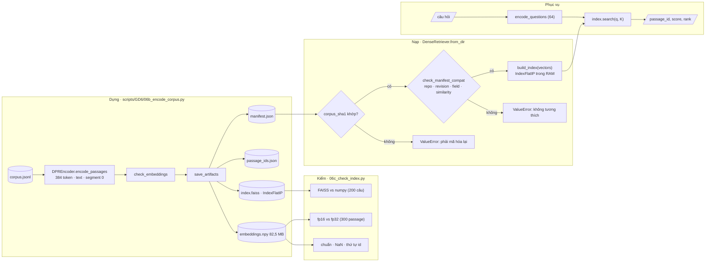
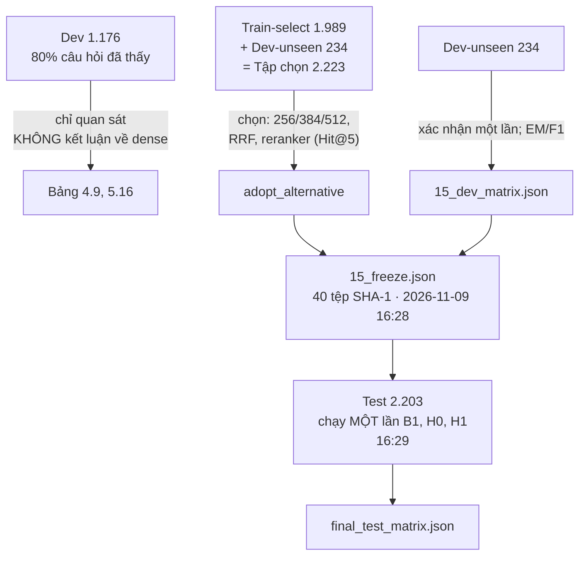

# BÀI 07 — DPR VÀ FAISS: CHỈ MỤC VECTOR, ĐỘ DÀI PASSAGE VÀ KẾT QUẢ B1

> **Vị trí trong giáo trình**: Bài 06 dạy cách biến câu hỏi và passage thành vector, và vì sao dùng dot. Bài này dạy phần **hệ thống** của dense retrieval trong project:
> - FAISS và chỉ mục `IndexFlatIP`, so với các chỉ mục xấp xỉ (IVF, HNSW, PQ);
> - cách dựng, kiểm tra và nạp `artifacts/dense/text384`;
> - quyết định 256, 384 hay 512 token;
> - giao thức đánh giá khi encoder đã thấy dữ liệu (dev, dev-unseen, train-select, test);
> - kết quả **B1 trên test**.
>
> **Ví dụ xuyên suốt**: 1.176 câu dev đã mã hóa ở Bài 06. Bài này dùng chúng để đo tốc độ và recall của FAISS trên đúng 26.864 vector thật.
>
> **Nguồn số liệu**: báo cáo mục 2.3.5, 4.4.4, 5.1, 5.2, 5.6; `results/12a_*`, `12b_analysis.json`, `12d_resources_*.json`, `12g_512_vs_384.json`, `final_test_matrix.json`; `reports/dense_index_check_text384.json`. Phép đo IVF và HNSW là 📙 **[MỞ RỘNG]**: chạy ngày 2026-11-14 trên CPU, 1 luồng, FAISS 1.15.1, bằng 1.176 vector câu hỏi dev. Project **không** dùng các chỉ mục này.

---

## Mục lục

- [A. Learning Objectives](#a-learning-objectives)
- [B. Prerequisite Knowledge](#b-prerequisite-knowledge)
- [C. Theoretical Foundation](#c-theoretical-foundation)
- [D. Mathematical Foundation](#d-mathematical-foundation)
- [E. Architecture & Working Mechanism](#e-architecture--working-mechanism)
- [F. Application in Our Project](#f-application-in-our-project)
- [G. Implementation Mapping](#g-implementation-mapping)
- [H. YouTube Learning Resources](#h-youtube-learning-resources)
- [I. Knowledge Check](#i-knowledge-check)
- [J. Implementation Readiness](#j-implementation-readiness)
- [Đáp án và lời giải](#đáp-án-và-lời-giải)
- [Tài liệu tham khảo bài 07](#tài-liệu-tham-khảo-bài-07)

---

## A. LEARNING OBJECTIVES

### A.1. Mục tiêu kiến thức

Sau bài học, bạn giải thích được:

1. Bài toán **MIPS** (maximum inner product search), và **tìm kiếm chính xác** khác **tìm kiếm xấp xỉ** (ANN) thế nào.
2. `IndexFlatIP` làm gì, và vì sao project chọn nó cho 26.864 vector.
3. Nguyên lý của **IVF**, **HNSW**, **PQ**, và đánh đổi giữa **recall**, **độ trễ** và **bộ nhớ**.
4. Vì sao kết quả FAISS và numpy **có thể khác nhau ở thứ tự** mà không phải lỗi.
5. Quy trình chọn `passage_max_length` = 384, và vì sao 512 lại **kém hơn**.
6. Vì sao B1 thắng BM25 trên dev nhưng **thua** trên test, và điều đó dạy gì về **nhiễm bẩn benchmark**.

### A.2. Mục tiêu kỹ năng

1. Nạp `index.faiss`, tìm kiếm, và đối chiếu với `Q @ P.T`.
2. Dựng một chỉ mục IVF hoặc HNSW và đo recall@20 so với chỉ mục flat (G.5, G.6).
3. Đọc một phép so sánh ghép cặp có khoảng tin cậy, và áp được quy tắc `adopt_alternative`.
4. Kiểm tra manifest để biết một chỉ mục có dùng được với cấu hình hiện tại không.

### A.3. Những gì phải nhớ

| Con số | Ý nghĩa | Nguồn |
|---|---|---|
| `IndexFlatIP`, 26.864 × 768, 82,5 MB | chỉ mục chính xác theo dot | `dense_index_check_text384.json` |
| Mã hóa kho 144,6 s (GPU, fp16) | dựng chỉ mục offline | `manifest.json` |
| Mã hóa câu hỏi 23,9 ms (GPU) / 35,1 ms (CPU) | online | `12d_resources_*.json` |
| Tìm kiếm 6,1 ms (GPU build) / 7,4 ms (CPU) mỗi câu | online | như trên |
| 384 token: Hit@5 0,8156 trên tập chọn; 256: 0,8007; 512: 0,7706 | chọn 384 | `12a`, `12b`, `12g` |
| B1 test: Hit@5 0,709, so với B0 0,793 | dense đứng một mình **thua** BM25 trên test | `final_test_matrix.json` |
| Chênh Hit@5 B1 − B0: +0,179 (dev) → +0,120 (dev-unseen) → **−0,084** (test) | dấu hiệu nhiễm bẩn | 📘 Bảng 5.16 |

### A.4. Thành phần pipeline dùng kiến thức này

| Cấu hình | Dùng dense thế nào |
|---|---|
| B1 | Dense thay BM25, top-20 rồi top-5 vào reader |
| H0, H1 | Dense top-100 vào RRF (Bài 08) |
| API | Nạp `text384` khi khởi động; kiểm manifest |

---

## B. PREREQUISITE KNOWLEDGE

### B.1. Kiến thức cần biết trước

| Kiến thức | Mức | Ôn ở đâu |
|---|---|---|
| Bi-encoder, dot, độ dài vector | Hiểu | Bài 06 C.2–C.3, D.1–D.3 |
| Hit@k, MRR@k | Hiểu | Bài 01 D.2; Bài 04 D.6 |
| Rò rỉ GermanDPR và dev-unseen | Hiểu | Bài 03 C.3; Bài 06 C.6 |
| Cắt passage ở `max_length` | Hiểu | Bài 05 C.8; Bài 06 A.3 |
| K-means (gom cụm) | Khái niệm | C.3 |
| Bootstrap ghép cặp | Khái niệm | Bài 12 (C.7 tóm tắt) |

### B.2. Thuật ngữ mới

| Thuật ngữ | Giải thích |
|---|---|
| **FAISS** | Thư viện tìm kiếm vector của Meta AI (Johnson et al., 2021). Có bản CPU và GPU. |
| **MIPS** | Tìm k vector có tích vô hướng lớn nhất với vector truy vấn. |
| **Exact search** | Tính điểm với **mọi** vector. Kết quả đúng tuyệt đối theo độ đo. |
| **ANN** | Approximate Nearest Neighbor: chỉ xét một phần vector, nhanh hơn nhưng có thể bỏ sót. |
| **Recall@k (của ANN)** | Tỉ lệ k kết quả của chỉ mục exact mà ANN cũng tìm được. **Khác** với Hit@k của truy hồi. |
| **IVF** | Inverted File: gom vector thành `nlist` cụm, và khi tìm chỉ dò `nprobe` cụm gần nhất. |
| **HNSW** | Hierarchical Navigable Small World: tìm kiếm trên đồ thị lân cận nhiều tầng. Tham số `M`, `efSearch`. |
| **PQ** | Product Quantization: nén vector thành mã ngắn để tiết kiệm bộ nhớ. |
| **Manifest** | Tệp mô tả cách chỉ mục được tạo ra: encoder, revision, corpus, định dạng. |
| **Selection set (tập chọn)** | 2.223 câu (1.989 train-select + 234 dev-unseen) mà encoder chưa thấy câu hỏi, dùng để chọn cấu hình. |
| **`adopt_alternative`** | Quy tắc ghi trước để nhận một cấu hình mới thay cho cấu hình mặc định. |
| **Benchmark contamination** | Mô hình đã thấy dữ liệu đánh giá trong lúc huấn luyện. |

### B.3. Mối liên hệ với bài trước

- Bài 06 dừng ở "điểm = $Pq$". Bài này trả lời các câu hỏi: tính $Pq$ thế nào cho nhanh, lưu ra sao, và khi nào phải chấp nhận tính xấp xỉ.
- Bài 06 C.6 đo dense bị thổi phồng trên dev. Bài này cho thấy kết cục trên **test**.

---

## C. THEORETICAL FOUNDATION

### C.1. Bài toán: tìm k vector có dot lớn nhất

📘 **[BÁO CÁO]** (Ch.2.3.5). Sau khi có $P \in \mathbb{R}^{N \times d}$ và $q \in \mathbb{R}^d$, truy hồi trở thành:

$$
\text{top-}k\ \{\, i : q^\top p_i \,\}
$$

Đây là bài toán **MIPS**. Cách thẳng nhất là tính cả N điểm rồi lấy k điểm lớn nhất. Cách này tốn $O(N \cdot d)$ cho mỗi câu hỏi.

### C.2. IndexFlatIP: lựa chọn của project

📘 **[BÁO CÁO]** (Ch.2.3.7, 4.4.4). `IndexFlatIP` gồm hai phần trong tên:

- **Flat**: lưu nguyên vector, không nén, không gom cụm.
- **IP**: inner product, tức dot.

Đây là **tìm kiếm chính xác**. Project chọn nó vì ba lý do:

1. **Kho nhỏ**: 26.864 × 768, tức 20,6 triệu phép nhân-cộng mỗi câu hỏi. Mỗi câu chỉ tốn 6–7 ms, nhỏ hơn thời gian mã hóa câu hỏi (24–35 ms).
2. **Không có sai số ANN**: khi so B1 với B0 hoặc H0, mọi khác biệt đều đến từ mô hình, không phải từ chỉ mục.
3. **Không cần huấn luyện chỉ mục**, nên đổi kho chỉ cần mã hóa lại.

📙 **[MỞ RỘNG]** Đo trên chỉ mục thật (1 luồng CPU):

| Cách gọi | ms mỗi câu |
|---|---|
| `index.search(Q, 20)` cho cả **lô** 1.176 câu | **0,15** |
| `index.search(q, 20)` cho **từng câu** (như `retrieve`) | **5,9** |

Chênh khoảng 40 lần vì tìm theo lô dùng phép nhân ma trận (BLAS), tận dụng bộ nhớ đệm tốt hơn nhiều so với 1.176 lần nhân ma trận với vector. Đây là lý do `DenseRetriever` có cả `retrieve_many`. Script đánh giá dùng nó cho cả tập, còn API phục vụ từng câu một.

### C.3. Khi kho lớn: ba họ ANN

📘 **[BÁO CÁO]** (Ch.2.3.5, Bảng 2.5) mô tả ba họ chỉ mục xấp xỉ:

| Họ | Ý tưởng | Tham số chính | Đánh đổi |
|---|---|---|---|
| **IVF** | k-means chia kho thành `nlist` cụm. Khi tìm, chỉ dò `nprobe` cụm có tâm gần câu hỏi nhất | `nlist`, `nprobe` | `nprobe` nhỏ thì nhanh nhưng dễ bỏ sót vector nằm ở cụm bên cạnh |
| **HNSW** (Malkov & Yashunin, 2020) | Đồ thị: mỗi vector nối với khoảng `M` láng giềng. Tìm kiếm tham lam từ tầng thưa xuống tầng dày | `M`, `efSearch` | Rất nhanh, recall cao; tốn bộ nhớ cho cạnh; dựng chậm |
| **PQ** (Jégou et al., 2011) | Chia vector 768 chiều thành m khúc, mỗi khúc thay bằng mã của tâm gần nhất (thường 1 byte) | `m`, số bit | Nén mạnh (ví dụ 768 × 4 byte còn 64 byte); điểm chỉ xấp xỉ |

📙 **[MỞ RỘNG]** Đo trên **đúng** 26.864 vector `text384` và 1.176 câu hỏi dev, recall@20 so với `IndexFlatIP`:

| Chỉ mục | Tham số | recall@20 | ms mỗi câu | Ghi chú |
|---|---|---|---|---|
| **Flat (project)** | — | **1,000** | 5,89 | mốc |
| IVF, `nlist` 128 | `nprobe` 1 | 0,492 | 0,07 | nhanh 80 lần, mất một nửa kết quả |
| | `nprobe` 4 | 0,763 | 0,22 | |
| | `nprobe` 16 | 0,933 | 0,82 | |
| | `nprobe` 64 | 0,996 | 3,14 | dò nửa số cụm, gần như flat |
| HNSW, `M` 32 | `efSearch` 16 | 0,899 | 0,15 | dựng mất 7,1 s |
| | `efSearch` 64 | 0,981 | 0,34 | |
| | `efSearch` 256 | 0,999 | 1,16 | |

Đọc bảng như sau:

1. **Không có bữa trưa miễn phí**: muốn recall gần 1 thì phải trả gần bằng chi phí flat (IVF với `nprobe` 64 tốn 3,1 ms so với 5,9 ms).
2. HNSW cho đánh đổi tốt nhất ở kho này: recall 0,98 với 0,34 ms.
3. Với 26.864 vector, phần tìm kiếm chỉ chiếm vài ms trong khoảng 140 ms của H0 (Bài 02). Lợi ích của ANN là **không đáng** so với rủi ro bỏ sót passage gold. Kết luận này đổi chiều khi kho có hàng triệu passage.

⚠️ Các số này đo trên dev (1 luồng CPU), chỉ để minh họa. Chúng không thuộc quy trình đánh giá của project.

### C.4. FAISS và numpy khác nhau ở đâu?

📘 **[BÁO CÁO]** (Ch.4.4.4; `dense_index_check_text384.json`). So FAISS với `Q @ P.T` của numpy trên 200 câu:

- 196 danh sách top-20 trùng hoàn toàn.
- 4 danh sách còn lại có **cùng tập passage** nhưng khác thứ tự.
- Chênh điểm lớn nhất là $1{,}07 \times 10^{-4}$.

📙 Đo lại trên 1.176 câu: 1.140 danh sách giống hệt, và 1.174 danh sách có cùng tập passage.

**Vì sao lại khác?** Phép cộng số thực 32 bit **không có tính kết hợp**: $(a + b) + c \ne a + (b + c)$ ở chữ số cuối. FAISS và numpy cộng 768 tích theo thứ tự khác nhau (chia khối và SIMD khác nhau), nên hai passage có điểm chênh nhau dưới $10^{-4}$ có thể đổi chỗ. Đây là **sai số làm tròn**, không phải lỗi cài đặt. Hệ quả cho project: khi so hai lần chạy, phải so **tập** passage và **điểm** (với một ngưỡng sai số), đừng chỉ so danh sách theo thứ tự.

### C.5. Chỉ mục phải đi cùng "giấy khai sinh"

📘 **[BÁO CÁO]** (Ch.4.4.3, GĐ12.1). Vector chỉ có nghĩa khi đi đúng với encoder đã sinh ra nó. Manifest của `text384` ghi:

- Repo và **revision** của **cả hai** encoder.
- `corpus_sha1`.
- `passage_field`, `passage_input`, `similarity`, `normalized`.
- Thống kê cắt: `n_truncated` = 2.923.
- Phiên bản FAISS, torch, transformers; thiết bị; fp16.

Khi nạp, hai phép kiểm tra chạy theo thứ tự:

1. `load_artifacts` so `corpus_sha1` với kho hiện tại.
2. `check_manifest_compat` so manifest với `dense.yaml` và với revision của encoder đang dùng.

Lệch một trong hai thì **báo lỗi**, không âm thầm dùng chỉ mục cũ. Đây là cùng triết lý với fingerprint của BM25 (Bài 04 E.3).

### C.6. Bao nhiêu token cho một passage?

📘 **[BÁO CÁO]** (Ch.5.2.2). Passage dài trung bình 236,2 token, P95 là 454, dài nhất 2.204. Có hai lực kéo ngược nhau:

- **Cắt ngắn** thì mất phần cuối passage, có khi chính là phần chứa đáp án. Với 256 token, 11,9% câu dev có đáp án nằm ngoài phần được mã hóa (📘 Ch.4.4.3).
- **Để dài** thì vector phải "chứa" nhiều nội dung hơn. Ngoài ra, model card của ctx encoder ghi passage dài tối đa **300 token** khi huấn luyện, nên vượt xa mức này là đưa encoder vào vùng nó chưa quen.

Kết quả trên tập chọn (n = 2.223):

| Độ dài | Passage bị cắt | Hit@1 | Hit@5 | Hit@20 | Chênh Hit@5 so với 384 [KTC 95%] |
|---|---|---|---|---|---|
| 256 | 8.768 (32,6%) | 0,482 | 0,8007 | 0,9406 | −0,0148 [−0,0242; −0,0058] |
| **384 (chọn)** | 2.923 (10,9%) | 0,484 | **0,8156** | 0,9402 | mốc |
| 512 | không đo | 0,419 | 0,7706 | 0,9321 | −0,0450 [−0,0549; −0,0355] |

*(Hit@1 của 256 suy ra từ chênh 384 − 256 = +0,0022.)*

Đọc bảng như sau:

- **384 hơn 256** một chút nhưng chắc chắn: cận dưới khoảng tin cậy +0,0058 > 0. Có 75 câu chỉ trúng ở 384, và 42 câu chỉ trúng ở 256.
- **512 kém hơn hẳn**: Hit@1 giảm 6,5 điểm. Có 116 câu đúng ở 384 nhưng sai ở 512, chỉ 16 câu theo chiều ngược lại. ⚠️ Báo cáo nói rõ giải thích "vượt độ dài huấn luyện 300 token" mới là **giả thuyết**, chưa được kiểm chứng.
- **Bài học chung**: "mã hóa nhiều hơn" không đồng nghĩa với "tốt hơn". Siêu tham số của chỉ mục cũng phải được chọn bằng dữ liệu.

### C.7. Quy tắc nhận cấu hình mới

📘 **[BÁO CÁO]** (Ch.5.1.5). `adopt_alternative` nhận cấu hình thay thế **chỉ khi** thỏa cả hai điều kiện:

1. **Chỉ số chính**: cận dưới KTC 95% của chênh Hit@5 ghép cặp **> 0**.
2. **Chỉ số phụ**: cận dưới chênh Hit@20 **≥ −0,01**.

Áp vào hai trường hợp:

- **384 so với 256**: cận dưới Hit@5 là +0,0058 > 0; cận dưới Hit@20 là −0,0049 ≥ −0,01. Cả hai đạt, nên **nhận**.
- **512 so với 384**: cận dưới Hit@5 là −0,0549. Điều kiện 1 không đạt, nên **không nhận**. Danh sách việc phải làm lại *nếu* nhận được ghi sẵn trong `12g_512_vs_384.json`: mã hóa lại, chạy lại RRF và reranker, cập nhật manifest của B1, H0, H1.

Quy tắc được **ghi trước** khi xem kết quả. Nhờ vậy không thể chọn tiêu chí sau khi đã biết đáp án.

### C.8. Nhiễm bẩn: dense thắng ở dev, thua ở test

📘 **[BÁO CÁO]** (Bảng 5.16):

| Tập | Mức tiếp xúc của encoder | Hit@5 B0 | Hit@5 B1 | Chênh B1 − B0 |
|---|---|---|---|---|
| Dev (1.176) | 80% câu hỏi đã thấy | 0,638 | 0,816 | **+0,179** |
| Dev-unseen (234) | câu hỏi chưa thấy; 49% passage gold từng là positive | 0,645 | 0,765 | **+0,120** [+0,047; +0,197] |
| Test (2.203) | câu hỏi chưa thấy; không passage gold nào là positive | 0,793 | 0,709 | **−0,084** [−0,108; −0,059] |

Tập càng sạch thì lợi thế của dense càng nhỏ, và trên test thì đảo dấu. Chiều của xu hướng **khớp** với giả thuyết nhiễm bẩn.

📘 Báo cáo cũng nói rõ những gì **không** kết luận được:

1. Không đo được chính xác bao nhiêu phần của chênh lệch là do nhiễm bẩn, vì test khác dev cả ở độ khó (BM25 trên test cao hơn hẳn).
2. Không được nói "dense kém BM25 nói chung". Chỉ nói được: *với encoder này, trên test này*.
3. Không loại trừ hoàn toàn tiếp xúc ở test: 186 câu có passage gold từng là negative (Bài 03 C.3).

**Kết quả B1 trên test** (📘 Bảng 5.13, 5.14):

| | Hit@1 | Hit@5 | Hit@20 | MRR@10 | EM (tham chiếu đầu) |
|---|---|---|---|---|---|
| B0 (BM25) | 0,605 | 0,793 | 0,887 | 0,686 | 0,222 |
| **B1 (dense)** | 0,379 | 0,709 | 0,874 | 0,516 | 0,220 |
| H0 (hybrid) | 0,673 | 0,919 | 0,977 | 0,777 | 0,261 |

B1 kém B0 rõ nhất ở **Hit@1** (−0,226) và MRR, trong khi Hit@20 gần như hòa. Dense vẫn **tìm được** passage đúng trong top-20, nhưng xếp nó **thấp hơn** BM25. Đây là dấu hiệu cho thấy dense và BM25 mạnh ở những chỗ khác nhau, và hybrid (H0) mới là nơi lợi thế đó được khai thác (Bài 08).

---

## D. MATHEMATICAL FOUNDATION

### D.1. Chi phí của các chỉ mục

Với N vector d chiều, k kết quả:

| Chỉ mục | Thời gian mỗi truy vấn | Bộ nhớ |
|---|---|---|
| Flat | $O(N d)$ | $4Nd$ byte (float32) |
| IVF | $O(n_{\text{list}} d + \tfrac{n_{\text{probe}}}{n_{\text{list}}} N d)$ | $4Nd$ + tâm cụm |
| HNSW | khoảng $O(ef \cdot M \cdot d \cdot \log N)$ | $4Nd$ + khoảng $2MN$ cạnh |
| IVF-PQ | $O(n_{\text{list}} d + \tfrac{n_{\text{probe}}}{n_{\text{list}}} N m)$ | khoảng $Nm$ byte |

**Áp vào project**:

- Flat: $26.864 \times 768 = 20{,}6$ triệu phép nhân-cộng; bộ nhớ $26.864 \times 768 \times 4 = 82{,}5$ MB (📘 `embeddings.npy` nặng 82.526.336 byte).
- IVF với $n_{\text{list}} = 128$, $n_{\text{probe}} = 4$: dò khoảng $4/128 \approx 3{,}1\%$ kho, cộng 128 phép so tâm cụm. Số phép tính giảm khoảng 25 lần. Đo thực tế nhanh khoảng 26 lần (0,22 so với 5,89 ms), nhưng recall chỉ còn 0,763 (C.3).

### D.2. Vì sao IVF bỏ sót

Gọi $c(i)$ là cụm của $p_i$, và $\mu_j$ là tâm cụm j. IVF chỉ xét $p_i$ nếu $\mu_{c(i)}$ thuộc $n_{\text{probe}}$ tâm có $q^\top \mu_j$ lớn nhất. Một passage có $q^\top p_i$ rất lớn nhưng nằm ở rìa một cụm "xa" sẽ bị bỏ qua.

Trong không gian 768 chiều, các cụm không tách bạch, vì nhiều passage nằm gần ranh giới giữa các cụm. Vì vậy recall tăng chậm theo $n_{\text{probe}}$ (0,49 → 0,76 → 0,93 → 0,996).

### D.3. Tổng thời gian của B1 cho một câu hỏi

📘 (Ch.5.6.6, `12d_resources_cuda.json`):

$$
t_{\text{dense}} \approx \underbrace{23{,}9}_{\text{mã hóa câu hỏi}} + \underbrace{6{,}1}_{\text{FAISS}} \approx 30 \text{ ms}
$$

Con số này gần với 32,04 ms của phần dense trong H0 (📘 Bảng 5.19). So với BM25 (khoảng 1 ms), dense đắt gấp khoảng 30 lần, nhưng vẫn rẻ hơn reader (khoảng 70 ms). Bộ nhớ khi phục vụ: VRAM đỉnh 610 MB cho question encoder trên GPU; RAM tăng 661–763 MB.

### D.4. So sánh ghép cặp (tóm tắt, chi tiết ở Bài 12)

Với mỗi câu $i$ trong tập chọn, đặt $x_i = \text{Hit@5}_{384}(i) - \text{Hit@5}_{256}(i) \in \{-1, 0, +1\}$. Chênh trung bình là:

$$
\bar x = \frac{75 - 42}{2.223} = +0{,}0148
$$

Bootstrap lấy mẫu lại **các câu hỏi** nhiều lần để ra khoảng tin cậy [+0,0058; +0,0242]. "Ghép cặp" nghĩa là hai cấu hình được so **trên cùng một câu**. Câu nào dễ hay khó thì cả hai cấu hình đều chịu như nhau, nên nhiễu giảm đi rất nhiều so với việc so hai con số trung bình rời nhau.

---

## E. ARCHITECTURE & WORKING MECHANISM

### E.1. Vòng đời của chỉ mục dense



Ghi chú: `from_dir` **dựng lại** `IndexFlatIP` từ `embeddings.npy`, không đọc `index.faiss`. Với chỉ mục flat, hai cách cho kết quả như nhau (📘 `file_index_equals_rebuilt: true`). Tệp `index.faiss` được lưu kèm để phục vụ việc kiểm tra.

### E.2. Input → Processing → Output

| Bước | Input | Processing | Output |
|---|---|---|---|
| Dựng | 26.864 `original_text` | mã hóa, kiểm tra, lưu 4 tệp | `artifacts/dense/text384/` (144,6 s) |
| Kiểm | 4 tệp | so FAISS và numpy; fp16 và fp32; chuẩn; thứ tự id | `reports/dense_index_check_text384.json` |
| Nạp | thư mục, `corpus.jsonl`, `dense.yaml` | SHA-1, so manifest, dựng `IndexFlatIP` | `DenseRetriever` (khoảng 0,2 s) |
| Tìm | câu hỏi | mã hóa (khoảng 24 ms) + `search` (khoảng 6 ms) | top-K |
| Đánh giá | run, qrels | Hit/MRR; bootstrap ghép cặp | `results/12*.json`, `final_test_matrix.json` |

### E.3. Giao thức đánh giá theo tập



---

## F. APPLICATION IN OUR PROJECT

### F.1. Thành phần này nằm ở đâu?

| Việc | File | Script |
|---|---|---|
| Kiểm rò rỉ | `evaluation/leakage.py` | `scripts/GD6/06a_leakage_check.py` → `reports/dense_leakage.json` |
| Mã hóa kho | `retrieval/dense.py` | `06b_encode_corpus.py` |
| Kiểm chỉ mục | `dense.py: exact_topk`, `check_embeddings` | `06c_check_index.py` |
| Đánh giá truy hồi | `evaluation/retrieval_metrics.py` | `06d_eval_retrieval.py` |
| Pipeline B1 trên dev | `pipeline.build_pipeline(retriever="dense")` | `06e_run_dev_dense.py` |
| Phép thử định dạng | — | `06f_format_probe.py` |
| So độ dài | — | `scripts/GD12/*` → `results/12a/12b/12g` |

### F.2. Vì sao nhóm cần hiểu bài này?

| Quyết định | Lý do |
|---|---|
| `IndexFlatIP` chứ không phải ANN | C.2, C.3: kho nhỏ, không muốn sai số chỉ mục làm nhiễu so sánh |
| `text384` | C.6, C.7: thắng 256 theo quy tắc ghi trước; 512 thua |
| Chọn cấu hình trên tập chọn, không trên dev | C.8, E.3 |
| H0 là mặc định của API, **không** phải B1 | C.8: B1 thua B0 trên test |
| Manifest và kiểm tra khi nạp | C.5 |

### F.3. Đầu vào và đầu ra thực tế

```python
from germanqa.pipeline import build_pipeline
p = build_pipeline(retriever="dense")          # dùng configs/dense.yaml → text384
r = p.answer("Wann wurde Hundefett in der Medizin verwendet?", trace=True)
# r.passages[0].passage_id == "p_c25e144a863973b9"; retrieval_score ≈ 168,27 (GPU, fp16)
```

### F.4. Nếu thay đổi thì sao?

| Thay đổi | Hệ quả |
|---|---|
| Dùng HNSW (`M` 32, `efSearch` 64) | Tìm kiếm nhanh hơn khoảng 17 lần (0,34 so với 5,9 ms), recall@20 0,98. Có thể **mất** passage gold ở khoảng 2% vị trí. Tiết kiệm khoảng 5 ms trong khoảng 140 ms: không đáng ở kho này |
| Kho lớn gấp 100 lần (2,7 triệu passage) | Flat tốn khoảng 600 ms mỗi câu và 8,2 GB RAM. Khi đó cần HNSW hoặc IVF-PQ |
| `text512` | Hit@5 −0,045 trên tập chọn: không nhận |
| Fine-tune DPR | Mã hóa lại kho, chỉ mục và manifest mới; chạy lại RRF và reranker (danh sách trong `12g`) |
| Dùng GPU FAISS | Tìm kiếm nhanh hơn nữa, nhưng phải chia 4 GB VRAM với reader và encoder. Project giữ FAISS trên CPU |

### F.5. Tham số cần chú ý

| Tham số | Giá trị | File |
|---|---|---|
| `artifact_dir` | `artifacts/dense/text384` | `dense.yaml` |
| `top_k` | 20 (B1); hybrid dùng 100 | `dense.yaml`, `hybrid.yaml` |
| Loại chỉ mục | `IndexFlatIP` | `dense.py: build_index` |
| Phiên bản | FAISS 1.15.1, torch 2.14.1+cu126, transformers 5.19.0 | `manifest.json: versions` |
| Phần cứng | RTX 3050 Laptop 4 GB | 📘 Ch.5.1.5 |

---

## G. IMPLEMENTATION MAPPING

### G.1. Thư viện

| Thư viện | Dùng cho |
|---|---|
| `faiss` (`faiss-cpu`) | `IndexFlatIP`, `write_index`, `read_index`, `search` |
| `numpy` | `embeddings.npy`, `exact_topk` để đối chiếu |
| `germanqa.data.io_utils` | `file_sha1`, `read_json`, `write_json` |

### G.2. Class và function

| Thành phần | Việc |
|---|---|
| `build_index(vectors)` | `faiss.IndexFlatIP(768)`, rồi `add(np.ascontiguousarray(vectors, float32))` |
| `exact_topk(Q, P, k)` | Mốc numpy để kiểm FAISS |
| `save_artifacts`, `load_artifacts` | Ghi và đọc 4 tệp; so `corpus_sha1` |
| `check_manifest_compat(manifest, cfg, revisions)` | So repo, revision, `passage_field`, `passage_input`, `similarity` |
| `DenseRetriever.from_dir`, `.retrieve`, `.retrieve_many`, `.last_timing` | Nạp, tìm; đo thời gian mã hóa và tìm kiếm riêng |

### G.3. Pseudocode

```text
LOAD(dir, corpus_path, cfg, encoder):
    vectors, ids, manifest ← đọc 3 tệp
    check_embeddings(vectors, ids)
    nếu sha1(corpus_path) ≠ manifest.corpus_sha1: lỗi
    check_manifest_compat(manifest, cfg, encoder.revisions())
    index ← IndexFlatIP(768); index.add(vectors)
    return DenseRetriever(encoder, index, ids)

RETRIEVE_MANY(questions, K):
    Q ← encoder.encode_questions(questions, 64)      # (n, 768)
    D, I ← index.search(Q, min(K, N))                # (n, K)
    return [[{passage_id: ids[i], score: d, rank: r} for r, (d, i) in enumerate(row, 1) if i ≥ 0] ...]
```

Chú ý điều kiện `i ≥ 0`: FAISS trả `-1` khi không đủ k kết quả, ví dụ với IVF khi các cụm được dò có ít vector.

### G.4. Code: kiểm FAISS so với numpy

```python
# chạy từ gốc project; Q là vector câu hỏi (Bài 06 G.4), ở đây (n, 768) float32
import numpy as np, faiss
A = "artifacts/dense/text384"
P = np.ascontiguousarray(np.load(A + "/embeddings.npy"), dtype=np.float32)
index = faiss.read_index(A + "/index.faiss")
D, I = index.search(Q, 20)
S = Q @ P.T
In = np.argsort(-S, axis=1, kind="stable")[:, :20]
same_order = (In == I).all(axis=1).sum()
same_set = sum(set(a) == set(b) for a, b in zip(In, I))
gap = np.abs(np.take_along_axis(S, I, 1) - D).max()
print(same_order, same_set, gap)        # 1.176 câu dev: 1140 1174 ~1e-4
```

### G.5. Code minh họa: IVF tự viết bằng numpy

Đoạn code dưới đây cài một IVF thu nhỏ trên dữ liệu tổng hợp có cấu trúc cụm yếu, để thấy rõ đánh đổi giữa recall và lượng vector phải quét.

```python
import numpy as np

rng = np.random.default_rng(42)
N, d, k = 5000, 32, 10
centers = rng.normal(size=(40, d)) * 0.7
P = (centers[rng.integers(0, 40, N)] + rng.normal(size=(N, d))).astype(np.float32)   # kho có cấu trúc cụm
Q = (centers[rng.integers(0, 40, 200)] + rng.normal(size=(200, d))).astype(np.float32)

def flat_search(Q, P, k):                       # = IndexFlatIP: tính MỌI tích vô hướng
    S = Q @ P.T
    return np.argsort(-S, axis=1, kind="stable")[:, :k]

def kmeans(X, nlist, iters=10):
    C = X[rng.choice(len(X), nlist, replace=False)]
    for _ in range(iters):
        a = np.argmax(X @ C.T, axis=1)          # gán vào tâm có dot lớn nhất (giống IVF với METRIC_INNER_PRODUCT)
        C = np.stack([X[a == j].mean(0) if (a == j).any() else C[j] for j in range(nlist)])
    return C, np.argmax(X @ C.T, axis=1)

class TinyIVF:
    def __init__(self, P, nlist):
        self.P = P
        self.C, assign = kmeans(P, nlist)
        self.lists = [np.where(assign == j)[0] for j in range(nlist)]   # "inverted lists"

    def search(self, q, k, nprobe):
        probe = np.argsort(-(self.C @ q))[:nprobe]                  # chỉ dò nprobe cụm gần nhất
        cand = np.concatenate([self.lists[j] for j in probe])
        s = self.P[cand] @ q
        return cand[np.argsort(-s, kind="stable")[:k]], len(cand)

truth = flat_search(Q, P, k)
ivf = TinyIVF(P, nlist=50)
for nprobe in (1, 3, 10, 50):
    rec, scanned = [], []
    for q, t in zip(Q, truth):
        got, n = ivf.search(q, k, nprobe)
        rec.append(len(set(got) & set(t)) / k); scanned.append(n)
    print(f"nprobe={nprobe:>2}  recall@{k}={np.mean(rec):.3f}  quét {np.mean(scanned):6.0f}/{N} vector")
```

Kết quả chạy thật:

```text
nprobe= 1  recall@10=0.624  quét    119/5000 vector
nprobe= 3  recall@10=0.812  quét    321/5000 vector
nprobe=10  recall@10=0.944  quét   1025/5000 vector
nprobe=50  recall@10=1.000  quét   5000/5000 vector
```

Cùng hình dạng với bảng thật ở C.3: dò ít cụm thì nhanh nhưng mất nhiều; dò **mọi** cụm (`nprobe = nlist`) thì đúng bằng flat. Nếu đổi sang cụm tách rõ (`* 3` thay vì `* 0.7`), thì `nprobe = 1` đã cho recall 0,977 (đã chạy thử). ANN chỉ tốt khi dữ liệu có cấu trúc cụm rõ, mà embedding thật thường không có cấu trúc đó.

### G.6. Code: IVF và HNSW thật bằng FAISS

```python
import time, faiss
faiss.omp_set_num_threads(1)
flat = faiss.read_index(A + "/index.faiss"); _, I_flat = flat.search(Q, 20)   # mốc: IndexFlatIP

ivf = faiss.IndexIVFFlat(faiss.IndexFlatIP(768), 768, 128, faiss.METRIC_INNER_PRODUCT)
ivf.train(P); ivf.add(P); ivf.nprobe = 16

hnsw = faiss.IndexHNSWFlat(768, 32, faiss.METRIC_INNER_PRODUCT)
hnsw.add(P); hnsw.hnsw.efSearch = 64

for name, ix in (("ivf", ivf), ("hnsw", hnsw)):
    t = time.perf_counter(); _, I = ix.search(Q, 20)
    rec = np.mean([len(set(a) & set(b)) / 20 for a, b in zip(I, I_flat)])
    print(name, round(rec, 3), round((time.perf_counter() - t) * 1000 / len(Q), 3), "ms/câu (theo lô)")
```

Lưu ý: số ms ở C.3 đo **từng câu một** (giống `retrieve`). Đoạn code này đo **theo lô**, nên nhanh hơn. Luôn ghi rõ mình đo theo cách nào.

### G.7. Kiểm tra từng bước

| Kiểm tra | Kỳ vọng |
|---|---|
| `index.ntotal == len(passage_ids) == 26864`, `index.d == 768` | Đúng |
| `index.metric_type == faiss.METRIC_INNER_PRODUCT` | Đúng (IP, không phải L2) |
| FAISS so với numpy | Cùng tập top-20; chênh điểm khoảng 1e-4 |
| `file_index_equals_rebuilt` | `true` |
| Manifest khớp `dense.yaml` | Không lỗi |
| Hit@5 trên tập chọn | 0,8156 (384) |

### G.8. Lỗi thường gặp

| Lỗi | Triệu chứng | Phòng tránh |
|---|---|---|
| Dùng `IndexFlatL2` thay vì `IndexFlatIP` | Thứ hạng theo khoảng cách L2. Gần với cosine vì độ dài vector gần như hằng số, nhưng **không** phải dot | `build_index` dùng IP; kiểm `metric_type` |
| Mảng không `contiguous` hoặc là float64 | FAISS báo lỗi, hoặc tự sao chép làm chậm | `np.ascontiguousarray(..., float32)` |
| Thứ tự `passage_ids.json` lệch với hàng của ma trận | Trả sai passage, khó phát hiện | `ids_match_corpus_order`; `check_embeddings` |
| So kết quả hai lần chạy theo thứ tự | "Khác" giả do sai số làm tròn | So tập và điểm có ngưỡng sai số |
| Báo dense trên dev như kết quả chính | Lạc quan sai (+0,179) | Báo test; chọn trên tập chọn |
| Dùng ANN khi so sánh cấu hình | Sai số chỉ mục lẫn vào chênh lệch giữa các mô hình | Flat cho đánh giá |
| Quên lọc `i == -1` | `IndexError` hoặc passage sai | `if i >= 0` trong `_rows` |
| Đổi `passage_max_length` mà không mã hóa lại | Chỉ mục cũ, cấu hình mới | Manifest ghi `truncation.max_length` |

---

## H. YOUTUBE LEARNING RESOURCES

> Mọi URL dưới đây xuất hiện trong kết quả tìm kiếm web (giới hạn youtube.com) ngày 2026-11-14. Kết quả tìm kiếm thường **không hiển thị tên kênh**; khi đó giáo trình ghi "chưa xác nhận". Tên video ghi theo đúng tiêu đề trong kết quả. Hãy mở video kiểm tra trước khi trích dẫn.

### H.1. Video đã tìm thấy

| # | Tên video | Kênh | URL | Hỗ trợ mục |
|---|---|---|---|---|
| 1 | DPR: Dense Passage Retrieval for Open-Domain Question Answering | chưa xác nhận | https://www.youtube.com/watch?v=TbObc9s8Gzw | C.1, C.8 (kết quả của bài báo gốc) |
| 2 | Dense Passage Retrieval(DPR): End to End QA System | chưa xác nhận | https://www.youtube.com/watch?v=rvcyyJNjPU0 | E.1 |
| 3 | Elasticsearch Hybrid Search: BM25 + kNN via Rescore | chưa xác nhận | https://www.youtube.com/watch?v=WrsthoGZ2ss | C.3 (kNN trong hệ thống thật), chuẩn bị Bài 08 |

⚠️ Không có lượt tìm kiếm nào ở bài này trả về video về **FAISS** hay **HNSW** mà xác nhận được. Phần này dùng link tìm kiếm (H.4) và tài liệu chính thức (H.5).

### H.2. Nội dung chính và đoạn cần tập trung

| # | Nội dung (theo tiêu đề và mô tả) | Tập trung vào |
|---|---|---|
| 1 | Bài báo DPR | Bảng so sánh với BM25 trên các bộ tiếng Anh. So với C.8: kết quả phụ thuộc dữ liệu |
| 2 | DPR end-to-end | Bước mã hóa kho và lưu chỉ mục |
| 3 | kNN kết hợp BM25 trong Elasticsearch | Ở quy mô lớn, kNN là xấp xỉ (HNSW) |

### H.3. Thứ tự xem đề xuất

```
① → ② → (đọc H.5: FAISS wiki "Getting started", "Faiss indexes") → làm G.5, G.6 → ③ (chuẩn bị Bài 08)
```

### H.4. Link tìm kiếm YouTube (không phải video đã xác minh)

Các link dưới đây là **link tìm kiếm**, không phải video cụ thể:

- FAISS: https://www.youtube.com/results?search_query=faiss+tutorial+vector+similarity+search
- HNSW: https://www.youtube.com/results?search_query=HNSW+hierarchical+navigable+small+world+explained
- IVF / product quantization: https://www.youtube.com/results?search_query=product+quantization+IVF+faiss
- Benchmark contamination: https://www.youtube.com/results?search_query=benchmark+contamination+test+set+leakage+LLM
- Approximate nearest neighbor: https://www.youtube.com/results?search_query=approximate+nearest+neighbor+search+explained

### H.5. Tài liệu chính thức

| Loại | Tài liệu | Dùng cho |
|---|---|---|
| FAISS (chính thức) | Wiki: https://github.com/facebookresearch/faiss/wiki (các mục "Getting started", "Faiss indexes", "Guidelines to choose an index") | C.2–C.3, G |
| FAISS (chính thức) | Tài liệu: https://faiss.ai/ | G.1 |
| Model card | https://huggingface.co/deepset/gbert-base-germandpr-ctx_encoder (độ dài passage khi huấn luyện) | C.6 |
| Bài báo | Johnson, Douze & Jégou (2021) — FAISS / billion-scale search | C.1–C.3 |
| Bài báo | Malkov & Yashunin (2020) — HNSW | C.3 |
| Bài báo | Jégou, Douze & Schmid (2011) — PQ | C.3 |
| Bài báo | Lewis, Stenetorp & Riedel (2021) — test–train overlap | C.8 |

---

## I. KNOWLEDGE CHECK

### I.1. Câu hỏi kiến thức cơ bản (5)

1. `IndexFlatIP` lưu gì, và tìm kiếm bằng độ đo nào? Kết quả của nó là chính xác hay xấp xỉ?
2. Bốn tệp trong `artifacts/dense/text384/` là gì?
3. Ba giá trị `passage_max_length` đã thử là gì? Giá trị nào được chọn, trên tập nào?
4. Hit@5 của B0, B1, H0 trên test là bao nhiêu?
5. Tập chọn gồm những câu nào, và có bao nhiêu câu?

### I.2. Câu hỏi giải thích cơ chế (5)

6. Vì sao FAISS và numpy có thể cho thứ tự top-20 khác nhau? Điều đó có phải lỗi không?
7. Giải thích vì sao IVF với `nprobe` nhỏ bỏ sót kết quả, dựa trên D.2.
8. Vì sao tìm theo lô nhanh hơn tìm từng câu khoảng 40 lần, dù số phép nhân bằng nhau?
9. Áp quy tắc `adopt_alternative` cho 384 so với 256, và cho 512 so với 384. Ghi rõ từng điều kiện.
10. Vì sao B1 thua B0 nhiều ở Hit@1 (−0,226) nhưng gần như hòa ở Hit@20 (−0,013)? Điều này gợi ý gì cho Bài 08?

### I.3. Câu hỏi phân tích tình huống (3)

11. Một thành viên đề xuất dùng HNSW cho "chuyên nghiệp", vì nhanh hơn 17 lần. Bạn trả lời thế nào, dựa trên số liệu ở C.3 và D.3?
12. Sau khi chạy lại tiền xử lý (Bài 03) với một quy tắc mới, API khởi động báo `ValueError: corpus đã đổi…`. Giải thích nguyên nhân và các bước sửa đúng.
13. Một bài báo khác báo DPR tiếng Đức "vượt BM25 18 điểm Hit@5" trên một tập tách từ GermanQuAD train. Bạn đánh giá kết luận đó thế nào, dựa trên C.8?

### I.4. Bài tập vận dụng (2)

14. **Tính tay.** Ước lượng bộ nhớ và số phép nhân-cộng mỗi truy vấn của `IndexFlatIP` nếu kho tăng lên 2,5 triệu passage. Nếu dùng IVF-PQ với `m` = 64 byte mỗi vector và `nprobe/nlist` = 1/64, ước lượng lại hai con số này.
15. **Viết code.** Mở rộng G.6: vẽ đường recall@20 theo ms mỗi câu cho IVF (`nprobe` 1–128) và HNSW (`efSearch` 8–512). Đánh dấu điểm của flat. Chọn một cấu hình bạn chấp nhận được nếu kho lớn gấp 100 lần, và nêu lý do.

### I.5. Bài tập liên hệ pipeline của nhóm (1)

16. **Ảnh hưởng của ANN lên toàn pipeline.** Dùng HNSW (`efSearch` 16, recall khoảng 0,90) thay `IndexFlatIP` trong nhánh dense của B1 trên **dev-unseen** (234 câu). Đo:
    - (a) Hit@5 so với flat;
    - (b) số câu mà passage gold bị mất **chỉ vì** ANN, tức có trong top-20 của flat nhưng không có trong top-20 của HNSW;
    - (c) EM end-to-end.

    Viết 3–5 câu kết luận: recall 0,90 so với flat ảnh hưởng thế nào lên Hit@5 của passage gold? Vì sao hai con số này khác nhau?

---

## J. IMPLEMENTATION READINESS

> Trên website, các ô tick được. Trạng thái lưu trong `localStorage` của **trình duyệt đang dùng**: không đồng bộ giữa thiết bị hay trình duyệt, không ai khác thấy, mất khi xóa dữ liệu trang hoặc dùng cửa sổ ẩn danh. Trong file Markdown, sửa `[ ]` thành `[x]`.

### J.1. Giải thích được khái niệm

- [ ] Phân biệt exact search và ANN; nêu ba họ ANN cùng tham số chính.
- [ ] Phân biệt recall@k của ANN với Hit@k của truy hồi.

### J.2. Hiểu sơ đồ hoạt động

- [ ] Vẽ lại E.1 (vòng đời chỉ mục), gồm hai điểm có thể báo lỗi khi nạp.
- [ ] Vẽ lại E.3 (giao thức theo tập), và nói được tập nào dùng để làm gì.

### J.3. Giải thích được công thức

- [ ] Tính được chi phí và bộ nhớ của flat cho kho bất kỳ.
- [ ] Giải thích $\bar x = (75 - 42)/2.223$, và ý nghĩa của "ghép cặp".

### J.4. Biết dữ liệu vào và ra

- [ ] Kể nội dung của `manifest.json` và hai phép kiểm khi nạp.
- [ ] Đọc được bảng C.6 (256/384/512) và quyết định theo quy tắc.

### J.5. Hiểu vai trò trong pipeline

- [ ] Giải thích bằng bảng C.8 vì sao không dùng số dev để kết luận về dense.
- [ ] Giải thích vì sao H0, chứ không phải B1, là mặc định.

### J.6. Mô tả cách cài đặt

- [ ] Chạy G.4 và giải thích 1.140 so với 1.174.
- [ ] Chạy G.5 hoặc G.6, và giải thích đánh đổi giữa recall và độ trễ.

**Đánh giá**: đạt ≥ 12/14 mục thì chuyển sang Bài 08 (Hybrid RRF).

---

## ĐÁP ÁN VÀ LỜI GIẢI

### Câu 1
`IndexFlatIP` lưu nguyên 26.864 vector float32, không nén. Nó tìm kiếm bằng tích vô hướng (inner product) với **mọi** vector. Kết quả là **chính xác**: đúng tuyệt đối theo độ đo, chỉ có sai số làm tròn float32.

### Câu 2
- `embeddings.npy`: ma trận 26.864 × 768.
- `passage_ids.json`: hàng i ứng với passage nào.
- `index.faiss`: chỉ mục flat đã ghi ra đĩa.
- `manifest.json`: encoder, revision, `corpus_sha1`, định dạng, `similarity`, thống kê cắt, phiên bản thư viện.

### Câu 3
256, 384 và 512. Chọn **384**, theo Hit@5 ghép cặp trên **tập chọn** 2.223 câu, bằng quy tắc `adopt_alternative`. Không chọn trên dev, vì dev bị nhiễm bẩn.

### Câu 4
B0 0,793; B1 0,709; H0 0,919 (📘 Bảng 5.13).

### Câu 5
1.989 câu train-select và 234 câu dev-unseen, tổng 2.223 câu. Đây là các câu mà **câu hỏi** chưa xuất hiện trong dữ liệu huấn luyện của encoder (`results/select_question_ids.json`).

### Câu 6
Phép cộng số thực 32 bit không có tính kết hợp. FAISS và numpy cộng 768 tích theo thứ tự khác nhau, nên điểm lệch nhau khoảng $10^{-4}$. Hai passage có điểm chênh nhau nhỏ hơn mức đó có thể đổi chỗ. Đây là sai số làm tròn, **không** phải lỗi: tập top-20 trùng ở 1.174/1.176 câu. 📙 Đã kiểm hai câu còn lại: cả hai chỉ khác nhau ở passage **hạng 20**, và hai passage bị đổi chỗ có điểm **bằng nhau tuyệt đối** (chênh 0,0 ở float32). Khi điểm hòa tuyệt đối, numpy (`argsort` ổn định) và FAISS phá hòa theo những cách khác nhau. Kiểm tiếp thì thấy cả hai cặp (bài „Universal_Serial_Bus“ và bài „Nanjing“) đều thuộc nhóm **20 cặp passage gần trùng** ở Bài 03 C.8. Hai passage trong mỗi cặp có `retrieval_text` giống hệt và **vector giống hệt** từng bit, vì chỉ khác nhau ở khoảng trắng mà WordPiece bỏ qua. Như vậy near-duplicate không chỉ chiếm chỗ trong top-K của BM25 mà còn của dense.

### Câu 7
IVF chỉ xét vector thuộc `nprobe` cụm có tâm gần câu hỏi nhất. Passage đúng có thể có dot cao với câu hỏi nhưng lại thuộc một cụm có tâm ở xa: nó nằm ở rìa cụm, gần ranh giới với cụm khác. Trong 768 chiều, các cụm của embedding văn bản chồng lấn nhau nhiều, nên nhiều passage tốt nằm ngoài vài cụm gần nhất. Với `nprobe` = 1 chỉ dò 1/128 kho, nên recall chỉ còn 0,49.

### Câu 8
Tìm theo lô là một phép nhân ma trận $Q P^\top$ ($1.176 \times 768$ nhân $768 \times 26.864$). BLAS chia khối để mỗi khối P được nạp vào bộ nhớ đệm một lần rồi dùng cho nhiều câu hỏi. Tìm từng câu là 1.176 phép nhân ma trận với vector, và mỗi lần phải đọc lại toàn bộ 82,5 MB của P từ RAM. Vậy giới hạn tốc độ nằm ở **băng thông bộ nhớ**, không ở số phép tính.

### Câu 9
- **384 so với 256**: cận dưới chênh Hit@5 là +0,0058 > 0, đạt. Cận dưới chênh Hit@20 là −0,0049 ≥ −0,01, đạt. Kết luận: nhận.
- **512 so với 384**: cận dưới chênh Hit@5 là −0,0549, không đạt. Điều kiện 1 đã hỏng nên không cần xét điều kiện 2 (cận dưới Hit@20 là −0,0126 < −0,01, cũng không đạt). Kết luận: không nhận.

### Câu 10
Dense **tìm thấy** passage đúng (Hit@20 0,874 so với 0,887 của BM25) nhưng **xếp** nó thấp hơn (Hit@1 0,379 so với 0,605). Một giả thuyết hợp lý: dense gom nhiều passage cùng chủ đề có điểm sát nhau vào đầu danh sách (Bài 06 E.3 cho thấy 3 passage cùng bài Haushund trong top-5; ở câu đó gold vẫn đứng hạng 1, nhưng các passage cùng bài chính là đối thủ cạnh tranh). Khi câu hỏi chứa term hiếm khớp chính xác, BM25 thường đưa passage đúng lên rất cao. Project chưa đo trực tiếp cơ chế này trên test, nên đây là giải thích, chưa phải kết luận. Điều chắc chắn là hai bộ truy hồi mạnh ở hai chỗ khác nhau. Một phương pháp chỉ dùng **thứ hạng** của cả hai, như RRF, có thể lấy được phần tốt của mỗi bên. Trên test, H0 đạt Hit@5 0,919, cao hơn cả hai.

### Câu 11
Không cần, vì ba lý do:

1. Ở kho này, tìm kiếm flat chỉ tốn khoảng 6 ms trong khoảng 140 ms của H0. Giảm xuống 0,34 ms chỉ tiết kiệm khoảng 4% tổng thời gian.
2. HNSW với `efSearch` 64 có recall 0,98, tức có thể đánh mất passage gold, và làm nhiễu mọi phép so sánh giữa các cấu hình.
3. Đổi chỉ mục là đổi cấu hình B1, H0, H1. Phải ghi trước, đánh giá lại trên tập chọn, và cập nhật manifest.

HNSW chỉ đáng dùng khi kho đủ lớn để flat trở thành nút cổ chai (I.4, câu 14).

### Câu 12
`load_artifacts` so SHA-1 của `corpus.jsonl` hiện tại với `corpus_sha1` trong manifest. Tiền xử lý mới làm tệp corpus đổi, có thể đổi cả số passage và id, nên vector cũ không còn ứng đúng passage.

Các bước sửa đúng:
1. Mã hóa lại kho bằng `06b_encode_corpus.py`.
2. Chạy `06c_check_index.py`.
3. Dựng lại chỉ mục BM25 (fingerprint của nó cũng đổi).
4. Chạy lại đánh giá trên tập chọn, và nếu cần thì cả RRF và reranker.
5. Ghi manifest mới **không** đè lên bản cũ.

**Không** được tắt phép kiểm tra để API chạy được.

### Câu 13
Encoder `gbert-base-germandpr` được huấn luyện trên GermanDPR, mà GermanDPR lấy toàn bộ câu hỏi từ GermanQuAD **train**. Một tập tách từ GermanQuAD train vì vậy gần như chắc chắn chứa câu hỏi và passage encoder đã học. Trong project, đúng điều này làm dense "vượt" BM25 +0,179 Hit@5 trên dev, nhưng **thua** −0,084 trên test sạch. Kết luận "vượt 18 điểm" có khả năng cao là do nhiễm bẩn. Muốn tin được, bài báo phải báo kết quả trên GermanQuAD test, hoặc kiểm và loại phần trùng (như dev-unseen).

### Câu 14
**Flat**:
- Bộ nhớ: $2{,}5 \times 10^6 \times 768 \times 4 \approx 7{,}7$ GB.
- Phép tính: $2{,}5 \times 10^6 \times 768 \approx 1{,}9 \times 10^9$ phép nhân-cộng mỗi truy vấn. Theo tỉ lệ với số đo hiện tại (5,9 ms cho 26.864 vector), tức khoảng 550 ms mỗi câu trên 1 luồng.

**IVF-PQ** (`m` = 64 byte, `nprobe/nlist` = 1/64):
- Bộ nhớ: $2{,}5 \times 10^6 \times 64 \approx 160$ MB, cộng tâm cụm. Nén khoảng 48 lần.
- Phép tính: quét $1/64$ kho, tức khoảng 39.000 mã, mỗi mã tra 64 bảng. Khoảng $2{,}5 \times 10^6$ phép, cộng chi phí so `nlist` tâm cụm. Nhanh hơn flat hàng trăm lần.

Cái giá là recall giảm, phải đo lại như C.3.

### Câu 15
Không có đáp án cố định. Kết quả nên cùng hình dạng với C.3: HNSW nằm phía trên và bên trái IVF, tức với cùng độ trễ thì có recall cao hơn. Khi chọn cấu hình, nên ưu tiên recall ≥ 0,98, vì passage gold bị mất ở bước truy hồi thì không tầng nào sau cứu được (Bài 01, (2.2)). Cũng nên nhắc đến chi phí dựng chỉ mục và bộ nhớ của các cạnh trong HNSW.

### Câu 16
Không có đáp án cố định. Gợi ý:

- Recall 0,90 so với flat **không** có nghĩa là Hit@5 của gold giảm 10%. Gold thường có điểm cao, nằm gần đầu danh sách, và HNSW giữ các láng giềng gần nhất tốt hơn các láng giềng ở hạng 15–20. Vì vậy chênh Hit@5 thường nhỏ hơn nhiều so với "1 − recall".
- Đếm (b) cẩn thận: chỉ tính các câu có gold trong top-20 của flat.
- Với 234 câu, báo chênh kèm khoảng tin cậy ghép cặp.

---

## Tài liệu tham khảo bài 07

- Jégou, H., Douze, M., & Schmid, C. (2011). Product quantization for nearest neighbor search. *IEEE TPAMI, 33*(1), 117–128. https://doi.org/10.1109/TPAMI.2010.57
- Johnson, J., Douze, M., & Jégou, H. (2021). Billion-scale similarity search with GPUs. *IEEE Transactions on Big Data, 7*(3), 535–547. https://doi.org/10.1109/TBDATA.2019.2921572
- Karpukhin, V., Oguz, B., Min, S., Lewis, P., Wu, L., Edunov, S., Chen, D., & Yih, W. (2020). Dense passage retrieval for open-domain question answering. *EMNLP 2020*, 6769–6781. https://doi.org/10.18653/v1/2020.emnlp-main.550
- Lewis, P., Stenetorp, P., & Riedel, S. (2021). Question and answer test-train overlap in open-domain question answering datasets. *EACL 2021*, 1000–1008. https://doi.org/10.18653/v1/2021.eacl-main.86
- Malkov, Y. A., & Yashunin, D. A. (2020). Efficient and robust approximate nearest neighbor search using hierarchical navigable small world graphs. *IEEE TPAMI, 42*(4), 824–836. https://doi.org/10.1109/TPAMI.2018.2889473
- Möller, T., Risch, J., & Pietsch, M. (2021). GermanQuAD and GermanDPR: Improving non-English question answering and passage retrieval. *MRQA Workshop 2021*, 42–50. https://doi.org/10.18653/v1/2021.mrqa-1.4
