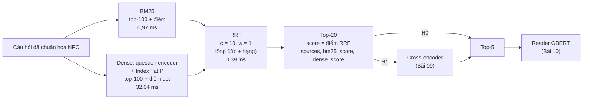

# BÀI 08 — HYBRID RETRIEVAL BẰNG RECIPROCAL RANK FUSION (RRF)

> **Vị trí trong giáo trình**: Bài 04 dựng BM25 (B0), Bài 06–07 dựng dense (B1). Hai bộ truy hồi sai ở những câu khác nhau. Bài này dạy cách **gộp hai danh sách xếp hạng** thành một, đúng như cấu hình **H0**, cấu hình mặc định của API:
> - vì sao gộp theo **hạng** chứ không cộng **điểm**;
> - vai trò của ba tham số `rrf_c`, độ sâu mỗi nhánh và `w_dense`;
> - quy trình chọn tham số ghi trước, trên train-select, xác nhận một lần trên dev-unseen;
> - phân tích bổ trợ (bốn ô), giới hạn của RRF, và kết quả **H0 trên test**.
>
> **Ví dụ xuyên suốt**: câu "Wann wurde Hundefett in der Medizin verwendet?". BM25 xếp passage đúng (bài Haushund) ở hạng 3, dense xếp ở hạng 1, và RRF đưa nó lên hạng 1 với điểm 0,1678.
>
> **Nguồn số liệu**: báo cáo mục 2.4, 5.3, 5.6; `src/germanqa/retrieval/rrf.py`, `hybrid.py`; `configs/hybrid.yaml`; `results/13_prereg.json`, `13_selection.json`, `13_confirmation.json`, `13c_analysis.json`, `13c_cases.json`, `rrf_sweep.json`, `final_test_matrix.json`. Các phép đo gắn 📙 **[MỞ RỘNG]** chạy ngày 2026-11-14 trên **train-select** (1.989 câu) hoặc tập chọn (2.223 câu), từ hai tệp run có sẵn `results/B0_select_top100.jsonl` và `B1_select_top100_384.jsonl`. Không mở test, không chọn lại cấu hình.

---

## Mục lục

- [A. Learning Objectives](#a-learning-objectives)
- [B. Prerequisite Knowledge](#b-prerequisite-knowledge)
- [C. Theoretical Foundation](#c-theoretical-foundation)
- [D. Mathematical Foundation](#d-mathematical-foundation)
- [E. Architecture & Working Mechanism](#e-architecture--working-mechanism)
- [F. Application in Our Project](#f-application-in-our-project)
- [G. Implementation Mapping](#g-implementation-mapping)
- [H. YouTube Learning Resources](#h-youtube-learning-resources)
- [I. Knowledge Check](#i-knowledge-check)
- [J. Implementation Readiness](#j-implementation-readiness)
- [Đáp án và lời giải](#đáp-án-và-lời-giải)
- [Tài liệu tham khảo bài 08](#tài-liệu-tham-khảo-bài-08)

---

## A. LEARNING OBJECTIVES

### A.1. Mục tiêu kiến thức

Sau bài học, bạn giải thích được:

1. Vì sao BM25 và dense **bổ trợ** nhau, và bằng chứng định lượng của điều đó (bảng bốn ô).
2. Khác biệt giữa **score fusion** (cộng điểm, cần chuẩn hóa) và **rank fusion** (gộp theo hạng).
3. Công thức RRF, ý nghĩa của hằng số làm trơn $c$, và vì sao $c$ **không** phải top-k.
4. Vì sao project chọn $c = 10$ và độ sâu 100, chứ không giữ mặc định $c = 60$, độ sâu 50.
5. Vì sao RRF có thể **làm mất** passage mà một nhánh đã xếp hạng 1, và điều kiện toán học của hiện tượng đó.
6. Giới hạn của RRF: không biết nhánh nào đáng tin hơn với từng câu hỏi; nhạy với cách phá đồng điểm.

### A.2. Mục tiêu kỹ năng

1. Tính tay điểm RRF cho hai danh sách, với $c$ và trọng số bất kỳ.
2. Đọc `results/13_prereg.json` và kể lại đúng quy trình chọn và xác nhận.
3. Dựng bảng bốn ô (cả hai trúng, chỉ dense, chỉ BM25, cả hai trượt) từ hai tệp run.
4. Cài lại RRF và một phương pháp score fusion (min-max), so sánh ghép cặp trên train-select.

### A.3. Những gì phải nhớ

| Con số | Ý nghĩa | Nguồn |
|---|---|---|
| $\mathrm{RRF}(d) = \sum_r w_r / (c + \mathrm{rank}_r(d))$ | công thức (5.1) | 📘 mục 5.3.1 |
| $c = 10$, độ sâu 100 mỗi nhánh, giữ 20, $w_{\text{dense}} = 1$ | cấu hình H0 | `configs/hybrid.yaml` |
| Train-select Hit@5: B0 0,6516 · B1 0,8215 · RRF mặc định 0,8658 · **RRF chọn 0,8959** | chọn cấu hình | 📘 Bảng 5.5 |
| Dev-unseen Hit@5: hybrid 0,8889 so với dense 0,7650 (+0,1239 [+0,0684; +0,1752]) | xác nhận một lần | 📘 Bảng 5.5 |
| Bốn ô (tập chọn 2.223 câu): 1.214 · 599 · 233 · 177 | bổ trợ | 📘 Bảng 5.6 |
| Trần hợp hai tập top-5: 0,9204; hybrid đạt 0,8952 | RRF không phải phép hợp hoàn hảo | 📘 mục 5.3.2 |
| Test Hit@5: B0 0,793 · B1 0,709 · **H0 0,919** | H0 hơn cả hai | 📘 Bảng 5.13 |
| Test EM (tham chiếu đầu): B0 0,222 · H0 **0,261** (+0,039 [+0,027; +0,050]) | cải thiện end-to-end | 📘 Bảng 5.14, 5.15 |
| Thời gian: BM25 0,97 ms + dense 32,04 ms + hợp nhất 0,39 ms | RRF gần như miễn phí | 📘 mục 5.3.1 |

### A.4. Thành phần pipeline dùng kiến thức này

| Cấu hình | Dùng RRF thế nào |
|---|---|
| B0, B1 | Không dùng (một nhánh) |
| **H0** (mặc định API) | BM25 top-100 + dense top-100 → RRF → top-20 → top-5 vào reader |
| H1 | Như H0, rồi cross-encoder xếp lại 20 passage (Bài 09) |

---

## B. PREREQUISITE KNOWLEDGE

### B.1. Kiến thức cần biết trước

| Kiến thức | Mức | Ôn ở đâu |
|---|---|---|
| BM25: điểm không bị chặn trên, phụ thuộc câu hỏi | Hiểu | Bài 04 C, D |
| Dense: dot không chuẩn hóa, độ dài vector | Hiểu | Bài 06 C.3, D.1 |
| Hit@k, MRR@k, Recall@k | Hiểu | Bài 01 D.2; Bài 04 D.6 |
| Tập chọn, dev-unseen, nhiễm bẩn | Hiểu | Bài 07 C.7, C.8, E.3 |
| Quy tắc `adopt_alternative`, bootstrap ghép cặp | Hiểu | Bài 07 C.7, D.4 |

### B.2. Thuật ngữ mới

| Thuật ngữ | Giải thích |
|---|---|
| **Hybrid retrieval** | Kết hợp nhiều bộ truy hồi khác cơ chế (ở đây sparse + dense). |
| **Score fusion** | Gộp bằng **điểm**: chuẩn hóa điểm từng nhánh rồi cộng (có trọng số). Ví dụ CombSUM, CombMNZ (Fox & Shaw, 1994). |
| **Rank fusion** | Gộp bằng **hạng**: chỉ dùng vị trí của passage trong từng danh sách. RRF là một ví dụ. |
| **Min-max normalization** | $(s - s_{\min}) / (s_{\max} - s_{\min})$ trong danh sách của một câu hỏi, đưa điểm về $[0, 1]$. |
| **z-score normalization** | $(s - \mu)/\sigma$ trong danh sách của một câu hỏi. |
| **RRF** | Reciprocal Rank Fusion (Cormack, Clarke & Büttcher, 2009): điểm là tổng $w/(c + \text{hạng})$ qua các nhánh. |
| **`rrf_c`** | Hằng số làm trơn $c$. **Không** phải số passage lấy. |
| **Độ sâu (depth)** | Số passage lấy từ **mỗi** nhánh đưa vào RRF (`bm25_top_k`, `dense_top_k`). |
| **`fusion_top_k`** | Số passage giữ lại **sau** RRF (20). |
| **`w_dense`** | Trọng số nhánh dense; nhánh BM25 luôn có trọng số 1. |
| **Oracle union** | Trần lý thuyết: câu được tính trúng nếu **ít nhất một** nhánh có passage đúng ở top-5. |
| **Tie-break** | Quy tắc xếp các passage có điểm RRF **bằng nhau**. |

### B.3. Mối liên hệ với bài trước

- Bài 07 C.8 kết thúc ở một nghịch lý: trên test, dense **thua** BM25 ở Hit@5 (0,709 so với 0,793) và nhất là Hit@1, nhưng gần **hòa** ở Hit@20. Bài này cho thấy gộp hai nhánh lại thì được 0,919, cao hơn cả hai.
- Bài 04 và Bài 06 đều dùng câu Hundefett. Bài này đặt hai danh sách thật của câu đó cạnh nhau và gộp bằng tay.

---

## C. THEORETICAL FOUNDATION

### C.1. Vì sao gộp: hai bộ truy hồi sai ở những câu khác nhau

📘 **[BÁO CÁO]** (mục 5.3.1, động cơ): BM25 xếp hạng theo mức trùng từ khóa, nên mạnh với tên riêng, số liệu, thuật ngữ, nhưng yếu khi câu hỏi diễn đạt khác văn bản. Dense so khớp trong không gian vector nên nhận ra diễn đạt khác, nhưng phụ thuộc dữ liệu huấn luyện của encoder và có thể bỏ sót các câu trùng từ khóa rất rõ. Hai cơ chế sai ở những câu khác nhau, nên kết hợp chúng là hướng tự nhiên.

Bằng chứng định lượng là **bảng bốn ô** trên tập chọn (2.223 câu), xếp mỗi câu theo việc passage đúng có nằm trong top-5 của từng nhánh hay không:

📘 **[BÁO CÁO]** Bảng 5.6:

| Ô | Số câu | Hybrid trúng top-5 | Hybrid trượt |
|---|---|---|---|
| Cả hai nhánh trúng | 1.214 | 1.214 | 0 |
| Chỉ dense trúng | 599 | 512 | 87 |
| Chỉ BM25 trúng | 233 | 212 | 21 |
| Cả hai trượt | 177 | 52 | 125 |
| **Tổng** | 2.223 | **1.990** (Hit@5 = 0,8952) | 233 |

Đọc bảng:

- 233 câu **chỉ BM25** tìm được: đó là phần dense bỏ sót mà BM25 cứu được. Nếu chỉ dùng dense, 233 câu này mất.
- 599 câu **chỉ dense** tìm được: phần BM25 bỏ sót.
- Hybrid **không** làm mất câu nào ở ô "cả hai trúng" (0/1.214). Về lý thuyết điều này vẫn có thể xảy ra, nhưng cần một cấu hình hạng rất đặc biệt (D.2).
- Nhưng hybrid **có** làm mất 108 câu (87 + 21) mà một nhánh đã đưa vào top-5. RRF không phải phép hợp tập.

📙 **[MỞ RỘNG]** Hai danh sách giao nhau ít đến mức nào? Trên tập chọn, top-100 của BM25 và top-100 của dense chung trung vị **18** passage (trung bình 19,1). Ở top-20 chỉ chung trung vị **3** passage. Như vậy phần lớn passage trong danh sách gộp chỉ đến từ **một** nhánh, và điểm RRF của chúng chỉ có một số hạng. Đây là chìa khóa để hiểu D.2.

### C.2. Score fusion: cộng điểm có vấn đề gì?

Cách tự nhiên nhất là cộng điểm: $s(d) = s_{\text{BM25}}(d) + s_{\text{dense}}(d)$. 📘 **[BÁO CÁO]** (mục 2.4 và 5.3.1) nêu hai khó khăn:

1. **Hai thang đo khác nhau.** Điểm BM25 không bị chặn trên và phụ thuộc độ dài câu hỏi cùng thống kê corpus. Điểm dense là tích vô hướng của các vector không chuẩn hóa. Ví dụ Hundefett: passage đúng có BM25 9,94, dense 168,27.
2. **Chuẩn hóa nhạy với phân phối điểm.** Muốn cộng phải chuẩn hóa (min-max, z-score) và chọn trọng số; cách nào tốt lại phụ thuộc dữ liệu.

📙 **[MỞ RỘNG]** Nhưng "điểm dense lớn gấp 17 lần" không có nghĩa dense **áp đảo hoàn toàn** khi cộng thô. Điều quyết định thứ tự là **độ trải** của điểm trong danh sách ứng viên, không phải độ lớn tuyệt đối. Đo trên train-select (trung vị qua 1.989 câu):

| | Điểm hạng 1 | Chênh hạng 1 → hạng 5 | Chênh hạng 1 → hạng 100 |
|---|---|---|---|
| BM25 | 19,76 | 5,27 | 12,67 |
| Dense | 195,20 | 16,03 | 52,82 |

Độ trải của dense chỉ gấp khoảng 3–4 lần BM25. Một passage có mặt trong top-100 BM25 nhận thêm khoảng 7–20 điểm, đủ để vượt nhiều passage mà dense xếp trên nó vài điểm. Kết quả: danh sách top-5 của phép cộng thô **trùng đúng thứ tự** với top-5 của dense chỉ ở 229/1.989 câu. Vì vậy câu "cộng trực tiếp sẽ khiến nhánh dense áp đảo hoàn toàn" ở mục 2.4 của báo cáo là quá mạnh với dữ liệu này: dense **trội hơn**, nhưng BM25 vẫn đổi thứ tự ở phần lớn câu hỏi.

Điều này không làm cộng thô trở thành lựa chọn tốt: tỉ lệ độ trải giữa hai nhánh là **ngẫu nhiên theo dữ liệu**. Nó đổi nếu đổi encoder, đổi tham số BM25, hay đổi sang tập câu hỏi mà encoder chưa thấy (train-select có điểm dense cao bất thường vì encoder đã học các câu này, Bài 07 C.8). Một phương pháp không phụ thuộc thang đo thì không có rủi ro đó.

### C.3. Rank fusion và RRF

Rank fusion bỏ hẳn điểm, chỉ giữ hạng. Hạng có **cùng thang đo** ở mọi nhánh: hạng 1 là hạng 1, bất kể điểm là 9,94 hay 168,27.

📘 **[BÁO CÁO]** Công thức (5.1):

$$\mathrm{RRF}(d) = \sum_{r \in R} \frac{w_r}{c + \mathrm{rank}_r(d)}$$

- $\mathrm{rank}_r(d)$ bắt đầu từ 1; nếu $d$ vắng khỏi danh sách của nhánh $r$ thì nhánh đó **không đóng góp** (số hạng bằng 0).
- $w_r$ là trọng số nhánh, mặc định 1.
- $c$ là hằng số làm trơn. Cormack và cộng sự (2009) dùng $c = 60$ và báo cáo RRF tốt hơn nhiều phương pháp gộp khác, kể cả phương pháp học xếp hạng, trên các bộ TREC của họ.
- Đồng điểm được phá bằng hạng tốt nhất ở bất kỳ nhánh nào, rồi theo `passage_id`, nên kết quả **tất định**.

Ba tính chất làm RRF hợp với project:

| Tính chất | Hệ quả |
|---|---|
| Không dùng điểm | Không cần chuẩn hóa, không phụ thuộc thang đo |
| Không có tham số học | Chỉ ba tham số chọn bằng lưới: $c$, độ sâu, $w$ |
| Đơn điệu theo hạng | Lên hạng ở một nhánh không bao giờ làm điểm giảm |

Cái giá: RRF **bỏ thông tin về độ tự tin**. Nếu dense chắc chắn với hạng 1 (cách hạng 2 rất xa), RRF vẫn coi nó như hạng 1 sát nút. Đây là giới hạn được nêu trong 📘 mục 5.3.2: RRF thuần thứ hạng không nhận biết nhánh nào đáng tin hơn cho từng câu.

### C.4. Vai trò của $c$

📘 **[BÁO CÁO]** (mục 5.3.1): $c$ quyết định mức chênh giữa các hạng đầu. Với $c = 60$, hạng 1 và hạng 10 được 1/61 và 1/70, gần nhau; với $c = 10$ là 1/11 và 1/20, hạng cao được ưu tiên rõ hơn.

Hai giới hạn giúp hiểu $c$ (chứng minh ở D.3):

- **$c \to 0$**: điểm là $1/\text{hạng}$. Một passage hạng 1 ở **một** nhánh (điểm 1) thắng một passage hạng 2 ở **cả hai** nhánh (điểm 1). Danh sách gộp gần như **xen kẽ** hạng 1 của nhánh này, hạng 1 của nhánh kia, rồi hạng 2…
- **$c \to \infty$**: mọi số hạng gần bằng $1/c$. Passage có mặt ở **hai** nhánh luôn thắng passage chỉ ở một nhánh; trong cùng nhóm, thắng nhau bằng **tổng hạng** nhỏ hơn.

📙 **[MỞ RỘNG — đo hậu nghiệm, không dùng để chọn]** Hit@5 trên train-select, độ sâu 100:

| $c$ | 0 | 1 | 3 | 5 | **10** | 15 | 20 | 30 | 60 | 100 | 1.000 | $10^6$ |
|---|---|---|---|---|---|---|---|---|---|---|---|---|
| Hit@5 | 0,8622 | 0,8698 | 0,8839 | 0,8924 | **0,8959** | 0,8939 | 0,8854 | 0,8753 | 0,8612 | 0,8547 | 0,8512 | 0,8507 |

Đường cong có đỉnh rõ quanh $c \approx 10$: cả hai giới hạn đều kém. Ở dữ liệu này, $c = 60$ của bài báo gốc thiên về "có mặt ở cả hai nhánh" quá mạnh. Lý do được định lượng ở D.2: với hai danh sách giao nhau ít (C.1), $c$ lớn phạt quá nặng các passage chỉ một nhánh tìm thấy, kể cả khi nhánh đó xếp chúng hạng 1. Các giá trị $c$ = 10, 20, 60, 100 ở bảng khớp đúng lưới chính trong 📘 Bảng 5.5 (0,8959; 0,8854; 0,8612; 0,8547), và $c$ = 1, 3, 5 khớp `C_extension_posthoc_not_used` trong `13c_analysis.json`.

### C.5. Độ sâu mỗi nhánh

Độ sâu là số passage lấy từ **mỗi** nhánh. Passage xếp sau độ sâu thì coi như vắng.

📘 **[BÁO CÁO]** (lưới chính, Hit@5 train-select):

| Độ sâu \ $c$ | 10 | 20 | 60 | 100 |
|---|---|---|---|---|
| 20 | 0,8813 | 0,8758 | 0,8758 | 0,8758 |
| 50 | 0,8934 | 0,8819 | 0,8658 (mặc định) | 0,8653 |
| 100 | **0,8959** | 0,8854 | 0,8612 | 0,8547 |

Nguồn: `results/rrf_sweep.json` (qua `13c_analysis.json`, `C_grid_train`); 📙 tái lập lại đúng từng ô bằng `rrf.py` trên hai tệp run.

Hai quan sát:

1. Với $c = 10$, độ sâu càng lớn càng tốt. Lý do: 52 câu ở ô "cả hai trượt" được hybrid cứu nhờ passage đúng nằm ở hạng **6 trở xuống ở cả hai nhánh**, ví dụ (BM25 9, dense 15), (7, 27), (6, 21). 📙 Với độ sâu 20, cặp (7, 27) mất số hạng dense.
2. Với $c$ lớn, độ sâu lớn lại **hại** (0,8758 → 0,8547 ở $c = 100$). Khi $c$ lớn, hạng 80 vẫn được điểm gần bằng hạng 1, nên thêm nhiều passage xa chỉ làm nhiễu.

Độ sâu và $c$ vì vậy **tương tác**, không chọn riêng từng cái được. Đó là lý do lưới là $3 \times 4$ chứ không phải hai lưới một chiều.

### C.6. Trọng số $w_{\text{dense}}$

📘 **[BÁO CÁO]** (nhóm thăm dò, tại $c = 10$, độ sâu 100):

| $w_{\text{dense}}$ | Hit@5 | Chênh so với $w = 1$ [KTC 95%] | Quyết định |
|---|---|---|---|
| 1,0 | 0,8959 | (mốc) | giữ |
| 1,5 | 0,9035 | +0,0075 [−0,0020; +0,0186] | không nhận |
| 2,0 | 0,8914 | −0,0045 [−0,0156; +0,0076] | không nhận |

$w = 1,5$ cao hơn 0,75 điểm nhưng khoảng tin cậy chứa 0, nên theo `adopt_alternative` không nhận. Đây là ví dụ đúng tinh thần của quy tắc ghi trước: một con số **cao hơn** chưa phải bằng chứng.

Chú ý thêm: trên train-select, dense được thổi phồng (encoder đã thấy câu hỏi). Trọng số tối ưu cho dense **trên train-select** có khả năng cao hơn trọng số tối ưu trên dữ liệu sạch; trên test, B1 còn thua B0 (Bài 07 C.8). Nếu đã nhận $w = 1,5$, rủi ro là chọn quá tay cho dense.

### C.7. Quy trình chọn và xác nhận

📘 **[BÁO CÁO]** `results/13_prereg.json` (ghi 2026-11-07 19:48:54, khóa bằng SHA-1 của `rrf.py`, `fusion_select.py`, `decision.py` và các tệp đầu vào):

| Bước | Nội dung |
|---|---|
| Mặc định | độ sâu 50, $c$ = 60, $w$ = 1, giữ 20 |
| Lưới chính | độ sâu {20, 50, 100} × $c$ {10, 20, 60, 100} = 12 cấu hình |
| Thăm dò | $w_{\text{dense}}$ {1,5; 2,0} tại cấu hình chính cuối cùng; tối đa 14 cấu hình |
| Chọn | Hit@5 cao nhất trên **train-select** (1.989); hòa thì Recall@20, MRR@10, rồi gần mặc định nhất |
| Nhận | `adopt_alternative`: chênh Hit@5 ghép cặp có cận dưới > 0, cận dưới chênh Hit@20 ≥ −0,01 |
| Xác nhận | chạy cấu hình cuối **một lần** trên dev-unseen (234); H0 chỉ được gọi là hơn B1 nếu cận dưới Hit@5 > 0 |
| Test | **không mở** |

Kết quả (`13_selection.json`, `13_confirmation.json`):

- (độ sâu 100, $c$ 10) so với mặc định: Hit@5 +0,0302, cận dưới +0,0196 > 0; Hit@20 cận dưới −0,0015 ≥ −0,01 → **nhận**.
- Nhóm thăm dò: không $w$ nào qua quy tắc → giữ $w = 1$.
- Dev-unseen, chạy một lần (2026-11-07 20:14:05):

| | Hit@1 | Hit@5 | Hit@20 | MRR@10 |
|---|---|---|---|---|
| BM25 | 0,385 | 0,645 | 0,838 | 0,494 |
| Dense 384 | 0,427 | 0,765 | 0,927 | 0,562 |
| **Hybrid** | **0,534** | **0,889** | **0,983** | **0,683** |
| Hybrid − dense | +0,107 [+0,038; +0,175] | +0,124 [+0,068; +0,175] | +0,056 [+0,026; +0,085] | +0,120 [+0,068; +0,170] |

Kết luận ghi trong tệp: "H0 hơn B1 về Hit@5 (cận dưới > 0)".

Vì sao xác nhận trên dev-unseen chứ không trên train-select? Vì 1.989 câu train-select đã dùng để **chọn**: cấu hình thắng ở đó được hưởng lợi từ may mắn của chính tập đó (winner's curse). Dev-unseen chưa tham gia chọn, nên số trên đó là ước lượng ít thiên lệch hơn. Nó vẫn chưa sạch hoàn toàn: 114/234 câu có passage đúng từng là positive khi huấn luyện encoder (Bài 07 C.8).

### C.8. Khi nào bổ trợ hiệu quả, khi nào không

📘 **[BÁO CÁO]** Bảng 5.7, theo tỉ lệ từ khóa (bỏ stopword) của câu hỏi có trong passage đúng:

| Trùng từ khóa | Số câu | BM25 hụt | Dense hụt | Hybrid hụt | Hybrid hơn / kém dense |
|---|---|---|---|---|---|
| 0–25% | 194 | 95,4% | 23,7% | 42,3% | 2 / 38 |
| 25–50% | 630 | 59,8% | 18,3% | 14,8% | 60 / 38 |
| 50–75% | 967 | 20,5% | 19,6% | 4,7% | 154 / 9 |
| 75–100% | 432 | 3,7% | 13,7% | 3,0% | 48 / 2 |

- Khi trùng nhiều (≥ 50%), BM25 gần bằng hoặc hơn dense, hai nhánh **cùng** đưa passage đúng lên cao, và hybrid hơn dense ở 202 câu, kém ở 11 câu.
- Khi trùng ít (< 25%), BM25 hụt gần hết và trả về toàn passage sai **có điểm hạng cao**. Các passage này chiếm chỗ trong danh sách gộp: hybrid hụt 42,3%, **gần gấp đôi** dense một mình (23,7%).

Đây là giới hạn cốt lõi của RRF: với mọi câu hỏi, hạng 1 của BM25 luôn có giá trị 1/11, dù BM25 đang đoán mò. Các hướng như trọng số theo câu hỏi (ví dụ theo mức trùng từ, hay theo độ tự tin của từng nhánh) hoặc mô hình học xếp hạng có thể khắc phục; 📘 báo cáo nêu chúng như hướng đáng thử, **chưa thực hiện**.

📘 **[BÁO CÁO]** (`13c_analysis.json`, `E_miss_kinds`) Phân loại các lần trượt top-5:

| Nhánh | Trượt top-5 | (a) top-5 có passage khác chứa chuỗi đáp án | (b) đúng bài, sai đoạn | (c) trượt thật |
|---|---|---|---|---|
| BM25 | 776 | 55 | 248 | 473 |
| Dense 384 | 410 | 39 | 217 | 154 |
| Hybrid | 233 | 25 | 142 | 66 |

Hybrid giảm mạnh nhất ở loại (c): từ 473 (BM25) và 154 (dense) xuống 66. Phần còn lại phần lớn là "đúng bài, sai đoạn" (142/233), đúng loại lỗi mà một reranker đọc cả cặp câu hỏi và passage có thể sửa (Bài 09).

### C.9. Kết quả của H0

📘 **[BÁO CÁO]** Bảng 5.13 (test, n = 2.203):

| | Hit@1 | Hit@5 | Hit@10 | Hit@20 | MRR@10 |
|---|---|---|---|---|---|
| B0 (BM25) | 0,605 | 0,793 | 0,849 | 0,887 | 0,686 |
| B1 (dense) | 0,379 | 0,709 | 0,807 | 0,874 | 0,516 |
| **H0 (RRF)** | **0,673** | **0,919** | **0,958** | **0,977** | **0,777** |

H0 − B0: Hit@5 +0,1266 [+0,1117; +0,1407], Hit@20 +0,0903 [+0,0781; +0,1021], MRR@10 +0,0915 [+0,0775; +0,1049]. H0 − B1: Hit@5 +0,210 [+0,192; +0,230].

Điều đáng nhớ: trên test, dense **một mình** thua BM25, nhưng gộp vào thì nâng BM25 thêm 12,7 điểm Hit@5. Một bộ truy hồi yếu hơn vẫn có giá trị nếu nó **sai ở chỗ khác**.

📘 **[BÁO CÁO]** End-to-end (Bảng 5.14, 5.15): EM theo tham chiếu đầu B0 0,222, B1 0,220, **H0 0,261**; H0 − B0 = +0,039 [+0,027; +0,050]; theo mọi tham chiếu +0,053 [+0,039; +0,066]. Đây là lý do H0 là cấu hình mặc định (📘 mục 5.5.2): EM cao nhất, trung vị 141,9 ms mỗi câu, không cần nạp thêm mô hình.

⚠️ **Một chi tiết trên dev đáng chú ý** (`13c_analysis.json`, `G_end_to_end`, không có trong bảng của báo cáo): trên **dev đầy đủ** (1.176 câu), H0 có Hit@5 cao hơn B1 (0,899 so với 0,816) nhưng EM lại **thấp hơn** (0,329 so với 0,339). Trên dev-unseen thì đúng chiều (0,209 so với 0,197). EM khi đã trúng top-5 trên dev giảm từ 0,407 (B1) xuống 0,363 (H0): các passage thêm vào top-5 nhờ BM25 làm reader **phân tâm** nhiều hơn. Đây là lời nhắc rằng Hit@5 không chuyển thẳng thành EM (Bài 10, Bài 12), và là thêm một lý do không đọc số trên dev.

### C.10. Một đối chứng mà báo cáo không nêu

⚠️ **[THIẾU TRONG BÁO CÁO]** Script `scripts/GD13/13c_analyze.py` có chạy một đối chứng **score fusion min-max** (mục D của script) và ghi vào `13c_analysis.json`:

| Train-select, độ sâu 100 | Hit@5 | Hit@20 | MRR@10 |
|---|---|---|---|
| RRF chọn ($c$ 10) | 0,8959 | 0,9784 | 0,7539 |
| Min-max sum (đối chứng của project) | **0,9045** | 0,9799 | 0,7586 |

Báo cáo (mục 2.4 và 5.3.1) lập luận cho RRF bằng việc "chuẩn hóa nhạy với phân phối điểm", nhưng không nhắc rằng chính đối chứng min-max của project cho Hit@5 **cao hơn** trên train-select.

📙 **[MỞ RỘNG]** Đo thêm cùng điều kiện (train-select, độ sâu 100, bootstrap ghép cặp 1.000 lần, seed 42):

| Phương pháp | Hit@5 | Hit@20 | Chênh Hit@5 so với RRF [KTC 95%] |
|---|---|---|---|
| RRF ($c$ 10) | 0,8959 | 0,9784 | (mốc) |
| Min-max sum | 0,9045 | 0,9799 | +0,0085 [+0,0005; +0,0171] (thắng 43, thua 26 câu) |
| z-score sum | 0,8813 | 0,9734 | (thấp hơn) |
| Cộng thô (không chuẩn hóa) | 0,9070 | 0,9693 | +0,0111 [+0,0005; +0,0231] |

Cách đọc đúng:

1. Đây là **phân tích hậu nghiệm** trên chính tập dùng để chọn. Hai phương pháp này không có trong danh sách ứng viên ghi trước, nên không thể "nhận" chúng mà không phá giao thức. Cận dưới +0,0005 sát 0, trong khi đã thử ít nhất ba biến thể: khả năng thắng do may là có thật.
2. Train-select là dữ liệu dense đã thấy: điểm dense ở đó cao và **tách biệt** bất thường (trung vị điểm hạng 1 là 195,2). Score fusion tận dụng thông tin này; trên câu hỏi mới, phân phối điểm khác và lợi thế có thể đổi chiều. RRF bỏ điểm nên không phụ thuộc chuyện đó. Đây là lập luận **độ vững**, và chính nó mới là lý do tốt để chọn RRF, chứ không phải "score fusion kém hơn".
3. z-score lại kém RRF: cùng là "chuẩn hóa", hai cách khác nhau cho kết quả trái chiều. Điều này minh họa đúng ý của báo cáo: cách chuẩn hóa nào tốt phụ thuộc dữ liệu.
4. Muốn kết luận thật, phải đưa min-max vào một lần ghi trước mới, chọn trên train-select, xác nhận trên dev-unseen. Bruch, Gai & Ingber (2023) phân tích kỹ so sánh này (convex combination có chuẩn hóa so với RRF) và kết luận rằng score fusion có thể tốt hơn RRF khi chỉnh trên dữ liệu trong miền; đây là thông tin từ bài báo, 📗 **[NỀN TẢNG]**, chưa kiểm trong project.

---

## D. MATHEMATICAL FOUNDATION

### D.1. Tính tay: câu Hundefett

Top-5 thật của hai nhánh (Bài 04, Bài 06; `*` là passage đúng):

| Hạng | BM25 | Dense |
|---|---|---|
| 1 | Vachellia_tortilis | **Haushund\*** |
| 2 | Somatologie | Haushund (passage 2) |
| 3 | **Haushund\*** | Lebenserwartung |
| 4 | Sprachtest | Haushund (passage 4) |
| 5 | Biorhythmus | Ernährung_des_Menschen |

Với $c = 10$:

$$\mathrm{RRF}(\text{Haushund*}) = \frac{1}{10+3} + \frac{1}{10+1} = 0{,}0769 + 0{,}0909 = 0{,}1678$$

$$\mathrm{RRF}(\text{Vachellia}) = \frac{1}{10+1} = 0{,}0909 \quad(\text{không có trong top-100 dense})$$

$$\mathrm{RRF}(\text{Somatologie}) = \frac{1}{12} = 0{,}0833 = \mathrm{RRF}(\text{Haushund p2})$$

Danh sách gộp thật của pipeline (`reports/pipeline_dev_hybrid_predictions.jsonl`):

| Hạng gộp | Passage | Điểm RRF | Nguồn (hạng) |
|---|---|---|---|
| 1 | **Haushund\*** | 0,1678 | BM25 3, dense 1 |
| 2 | Vachellia_tortilis | 0,0909 | BM25 1 |
| 3 | Somatologie | 0,0833 | BM25 2 |
| 4 | Haushund (p2) | 0,0833 | dense 2 |
| 5 | Lebenserwartung | 0,0769 | dense 3 |
| 6 | Sprachtest | 0,0714 | BM25 4 |
| 7 | Haushund (p4) | 0,0714 | dense 4 |

Ba điều nhìn thấy được:

- Passage đúng **không đứng đầu** nhánh nào mà vẫn lên hạng 1, vì nó là passage duy nhất trong top-8 có mặt ở **cả hai** nhánh.
- Danh sách gộp **xen kẽ** hai nhánh: BM25 1, BM25 2, dense 2, dense 3, BM25 4, dense 4…
- Hạng 3 và 4 có điểm **bằng nhau tuyệt đối** (1/12). Thứ tự giữa chúng do tie-break quyết định (D.6).

Với $c = 60$: Haushund* = 1/63 + 1/61 = 0,0323; Vachellia = 1/61 = 0,0164; Somatologie = Haushund p2 = 1/62 = 0,0161. Thứ tự **giống hệt**, chỉ khoảng cách giữa các hạng hẹp lại. Ở ví dụ này $c$ không quan trọng; nó quan trọng ở D.2.

### D.2. Khi nào RRF làm mất passage hạng 1 của một nhánh?

Xét passage $x$ đứng hạng 1 ở dense nhưng **vắng** trong BM25 (như phần lớn passage, C.1). Điểm của nó là $1/(c+1)$.

Một passage $y$ có mặt ở cả hai nhánh, cùng hạng $a$, có điểm $2/(c+a)$. $y$ thắng $x$ khi:

$$\frac{2}{c+a} > \frac{1}{c+1} \iff 2(c+1) > c+a \iff a < c+2$$

| $c$ | $y$ thắng $x$ nếu $y$ ở hạng $a \le$ … của cả hai nhánh |
|---|---|
| 10 | 11 |
| 60 | 61 |

Với $c = 60$, **bất kỳ** passage nào nằm trong top-61 của cả hai nhánh đều vượt hạng 1 của một nhánh đơn lẻ. Mỗi câu hỏi có trung vị 18 passage chung trong hai top-100 (C.1), nên với $c = 60$, một passage đúng mà chỉ dense tìm thấy, dù ở hạng 1, có thể bị đẩy xuống dưới hạng 5 bởi các passage chung tầm thường. Với $c = 10$, ngưỡng là hạng 11, khắt khe hơn nhiều. Đây là giải thích định lượng cho việc $c = 10$ thắng $c = 60$ trên dữ liệu này.

📙 **[MỞ RỘNG]** Kiểm trên 87 câu "chỉ dense trúng nhưng hybrid trượt" (tập chọn, cấu hình chọn):

- Passage đúng **vắng hẳn** trong top-100 BM25 ở 56 câu; ở hạng 21–100 BM25 ở 24 câu; ở hạng 6–20 ở 7 câu.
- Hạng dense của passage đúng: hạng 1 ở 24 câu, hạng 2 ở 5, hạng 3 ở 20, hạng 4 ở 15, hạng 5 ở 23.
- Top-5 hybrid của 87 câu này có trung bình **3,92** passage nằm trong **cả hai** danh sách.

Đúng như D.2 dự đoán: thứ đẩy passage đúng ra ngoài là các passage "hai nhánh cùng thấy". Ví dụ trong `13c_cases.json`: "Was hat man in Ostpreußen angebaut?" (dense hạng 1, BM25 hạng 63, hybrid hạng 6), top-3 hybrid là ba passage khác cùng bài Ostpreußen.

**Còn ô "cả hai trúng" thì sao?** Nếu passage đúng ở hạng $a \le 5$ và $b \le 5$ của hai nhánh, điểm của nó ít nhất $2/(c+5) = 2/15 \approx 0{,}133$ (với $c = 10$). Một passage chỉ ở một nhánh có tối đa $1/11 \approx 0{,}091$, nên **không** đối thủ một nhánh nào vượt được nó. Muốn đẩy nó khỏi top-5 phải có **5 đối thủ có mặt ở cả hai nhánh**, mỗi đối thủ đều có tổng điểm lớn hơn. Điều đó không bị cấm về toán học. Ví dụ passage đúng ở (5, 5), điểm 0,1333, và sáu đối thủ ở (1, 6), (6, 1), (2, 7), (7, 2), (3, 4), (4, 3) có điểm 0,1534; 0,1534; 0,1422; 0,1422; 0,1484; 0,1484: passage đúng rơi xuống hạng 7. Nhưng cấu hình này đòi hỏi hai danh sách gần như **trùng nhau** ở đầu, trong khi trên thực tế hai top-20 chỉ chung trung vị 3 passage (C.1). Vì vậy trên dữ liệu thật, số câu bị mất ở ô này là 0/1.214 (Bảng 5.6): một kết quả **thực nghiệm**, không phải một định lý.

### D.3. Hai giới hạn của $c$

**$c \to \infty$.** Khai triển $\frac{1}{c+r} = \frac{1}{c} - \frac{r}{c^2} + O(c^{-3})$. Với passage có mặt ở $m$ nhánh, tổng hạng $\Sigma$:

$$\mathrm{RRF}(d) \approx \frac{m}{c} - \frac{\Sigma}{c^2}$$

Số hạng $m/c$ chiếm ưu thế: sắp theo **số nhánh có mặt** trước, rồi theo **tổng hạng** nhỏ hơn (tương tự đếm Borda). Hit@5 khi $c = 10^6$ là 0,8507.

**$c \to 0$.** Điểm là $\sum_r 1/\mathrm{rank}_r(d)$. Hạng 1 ở một nhánh được điểm 1, bằng một passage hạng 2 ở cả hai nhánh (1/2 + 1/2). Hạng tốt nhất chiếm ưu thế, danh sách gần như xen kẽ hai nhánh. Hit@5 khi $c = 0$ là 0,8622.

$c$ là núm vặn giữa hai cực "tin hạng đầu của từng nhánh" và "tin sự đồng thuận". Dữ liệu này cần ở giữa.

### D.4. Trần của việc gộp và kế toán bốn ô

Trần hợp (oracle union) ở top-5:

$$\frac{1.214 + 599 + 233}{2.223} = \frac{2.046}{2.223} = 0{,}9204$$

Hybrid đạt:

$$\frac{1.214 + 512 + 212 + 52}{2.223} = \frac{1.990}{2.223} = 0{,}8952$$

Hybrid **có thể vượt** trần này về nguyên tắc, vì trần chỉ tính top-5 của từng nhánh, còn RRF nhìn đến hạng 100: 52 câu được cứu từ ô "cả hai trượt". Nhưng trên thực tế, số câu mất (108) lớn hơn số câu cứu được (52).

Trên dev-unseen (234 câu): cả hai trúng 122, chỉ dense 57, chỉ BM25 29, cả hai trượt 26. RRF cứu 8 câu từ ô "cả hai trượt" và làm mất 8 câu (7 từ "chỉ dense", 1 từ "chỉ BM25"). Hit@5 hybrid = (122 + 50 + 28 + 8)/234 = 208/234 = 0,889.

### D.5. Công thức của các phương pháp score fusion

Với một câu hỏi, gọi $L_r$ là danh sách (độ sâu 100) của nhánh $r$, điểm $s_r(d)$:

- **Min-max**: $\tilde s_r(d) = \dfrac{s_r(d) - \min_{L_r} s_r}{\max_{L_r} s_r - \min_{L_r} s_r}$, rồi $S(d) = \sum_{r:\, d \in L_r} \tilde s_r(d)$.
- **z-score**: $\tilde s_r(d) = (s_r(d) - \mu_r)/\sigma_r$ với trung bình và độ lệch chuẩn trên $L_r$.
- **Cộng thô (CombSUM thô)**: $S(d) = \sum_{r:\, d \in L_r} s_r(d)$.

Passage vắng ở nhánh $r$ không nhận số hạng đó, giống RRF. Với min-max, passage cuối danh sách nhận 0, nên "vắng" và "đứng cuối" bằng nhau; với z-score, passage cuối danh sách nhận số **âm**, nên vắng lại **tốt hơn** đứng cuối. Đây là một nguồn khác biệt giữa hai cách chuẩn hóa, và có thể góp phần giải thích vì sao z-score kém ở C.10 (giả thuyết, chưa kiểm riêng).

RRF có thể xem là score fusion với "điểm" $1/(c + \text{hạng})$: một phép chuẩn hóa cố định, không phụ thuộc điểm gốc.

### D.6. Đồng điểm

Hai passage có hạng $(a, b)$ và $(b, a)$ ở hai nhánh luôn có cùng điểm RRF khi $w_{\text{dense}} = 1$. Hai passage chỉ ở một nhánh, cùng hạng $r$ (ví dụ Somatologie và Haushund p2 ở D.1) cũng vậy. Vì danh sách gộp xen kẽ hai nhánh, đồng điểm là **thường xuyên**, không phải hiếm.

📙 **[MỞ RỘNG]** Trên tập chọn (2.223 câu, cấu hình chọn):

- 313 câu (14,1%) có hai passage đồng điểm đúng ở ranh giới hạng 5/6.
- 16 câu trong đó, passage đúng là một trong hai passage đồng điểm: Hit@5 của câu đó do tie-break quyết định.
- Đổi tie-break thì Hit@5 đổi:

| Tie-break (sau điểm) | Hit@5 tập chọn | Số câu đổi kết quả |
|---|---|---|
| Hạng tốt nhất, rồi `passage_id` tăng (project) | 0,8952 | (mốc) |
| Hạng tốt nhất, rồi `passage_id` giảm | 0,8970 | 16 |
| Hạng dense trước | 0,8979 | 6 |
| Hạng BM25 trước | 0,8943 | 10 |

Biên dao động khoảng ±0,3 điểm, cùng cỡ với nhiều chênh lệch "nhỏ nhưng có ý nghĩa" khác. `passage_id` là một mã băm, nên phá đồng điểm theo nó tương đương với **ngẫu nhiên nhưng cố định**. Nó đảm bảo tính tất định, không phải tính tối ưu.

Còn một chi tiết số học: hai tổng khác nhau về mặt phân số vẫn có thể bằng nhau, ví dụ $\frac{1}{12} + \frac{1}{60} = \frac{1}{15} + \frac{1}{30} = \frac{1}{10}$, tức hạng (2, 50) và (5, 20) khi $c = 10$. Trong số thực dấu phẩy động, hai tổng này có thể lệch nhau một bit cuối, và khi đó **sai số làm tròn**, chứ không phải tie-break, quyết định thứ tự. 📙 Tính lại bằng phân số chính xác, thứ tự top-20 khác ở 13/2.223 câu; Hit@5 không đổi.

---

## E. ARCHITECTURE & WORKING MECHANISM

### E.1. Luồng của H0



Thời gian là trung bình mỗi câu trên dev (📘 mục 5.3.1, `eval_dev_hybrid_20261107T135423Z_598ddf6f.json`). Toàn bộ phần truy hồi của H0 khoảng 33 ms, nhỏ hơn reader (khoảng 70–90 ms, 📘 mục 5.6.6).

### E.2. Input → Processing → Output

| | Nội dung |
|---|---|
| **Input** | Câu hỏi (chuỗi). Hai đối tượng đã dựng sẵn: `BM25Retriever`, `DenseRetriever`. Cấu hình `hybrid.yaml`. |
| **Processing** | (1) BM25 trả 100 dòng `{passage_id, score, rank}`. (2) Dense trả 100 dòng. (3) `rrf()` gộp hai danh sách `passage_id` theo hạng, bỏ id lặp trong cùng nhánh, phá đồng điểm. (4) Giữ 20 dòng, gắn lại điểm gốc. |
| **Output** | 20 dòng `{passage_id, score (RRF), rank, sources {bm25: hạng, dense: hạng}, bm25_score, dense_score}`. Nhánh vắng thì **không có khóa** trong `sources` và điểm gốc là `None`. Đo thời gian từng phần trong `last_timing`. |

### E.3. Ví dụ một dòng đầu ra

Dòng hạng 1 của câu Hundefett:

```json
{"passage_id": "p_c25e144a863973b9", "score": 0.1678, "rank": 1,
 "sources": {"bm25": 3, "dense": 1}, "bm25_score": 9.94, "dense_score": 168.27}
```

Dòng hạng 2 (`Vachellia_tortilis`): `sources = {"bm25": 1}`, `dense_score = None`. `None` nghĩa là "nằm ngoài top-100 dense", **không** có nghĩa điểm dense bằng 0.

---

## F. APPLICATION IN OUR PROJECT

### F.1. Thành phần này nằm ở đâu?

| Việc | File / hàm | Cấu hình |
|---|---|---|
| Công thức RRF | `src/germanqa/retrieval/rrf.py: rrf(ranked_lists, c, top_k, weights)` | — |
| Retriever hybrid | `src/germanqa/retrieval/hybrid.py: HybridRetriever.retrieve`, `.from_config` | `configs/hybrid.yaml` |
| Chọn cấu hình | `src/germanqa/evaluation/fusion_select.py: choose_config`; `scripts/GD13/13a_sweep.py` | `results/13_prereg.json` |
| Quy tắc nhận | `src/germanqa/evaluation/decision.py: adopt_alternative` | `margin = 0,01` |
| Phân tích | `scripts/GD13/13c_analyze.py` | `results/13c_*.json` |
| API | retriever mặc định là hybrid, không nạp reranker | `configs/api.yaml` |

### F.2. Vì sao nhóm cần hiểu bài này?

- H0 là **cấu hình chạy thật** của API. Mọi câu trả lời người dùng thấy đi qua RRF.
- H0 là cải tiến có hiệu quả **đã kiểm chứng trên test** của project (📘 mục 5.7): Hit@5 +0,127 và EM +0,039 so với B0.
- Hiểu D.2 và C.8 là hiểu vì sao còn 233 câu hybrid trượt top-5, và vì sao bước tiếp theo là reranker (Bài 09) chứ không phải chỉnh $c$ thêm.

### F.3. Đầu vào và đầu ra thực tế

`HybridRetriever(bm25, dense, bm25_top_k=100, dense_top_k=100, fusion_top_k=20, rrf_c=10, w_dense=1.0)`. Hàm `retrieve(question)` trả 20 dòng như E.3. `QAPipeline` không biết nó đang dùng hybrid: giao diện giống hệt `BM25Retriever` và `DenseRetriever`.

📘 **[BÁO CÁO]** (`H_online_vs_offline_top5_identical`): top-5 của pipeline online trùng với RRF tính offline từ hai tệp run ở 233/234 câu dev-unseen. Báo cáo không giải thích câu còn lại, nhưng `results/14i_crosscheck.json` (GĐ14) có bằng chứng: khi chạy lại trực tiếp, điểm BM25 trùng tuyệt đối với tệp run, còn điểm dense lệch tối đa 0,0786 (do mã hóa câu hỏi lại trên GPU fp16); pool 20 passage khác **thứ tự** ở 11/234 câu và khác **tập** ở 1/234 câu. Sai khác nhỏ của điểm dense đủ đổi hạng giữa hai passage sát điểm, và với RRF, đổi một hạng là đổi điểm.

### F.4. Nếu thay đổi thì sao?

| Thay đổi | Ảnh hưởng | Phải làm lại |
|---|---|---|
| `rrf_c` 10 → 60 | Hit@5 train-select 0,8959 → 0,8612 (C.4) | Không cần mã hóa lại; phá giao thức nếu chọn trên số đã thấy |
| Độ sâu 100 → 20 | Mất các câu cứu từ hạng 6–27; Hit@5 0,8813 | Như trên |
| `w_dense` > 1 | Có thể lợi trên train-select, rủi ro trên dữ liệu sạch (C.6) | Ghi trước mới |
| Đổi BM25 (`k1`, `b`) hay encoder | Hai danh sách đổi; cấu hình RRF đã chọn có thể không còn tốt | Chạy lại lưới; mã hóa lại nếu đổi encoder |
| Thay RRF bằng score fusion | Có thể tốt hơn trên train-select (C.10), chưa xác nhận | Ghi trước, chọn, xác nhận dev-unseen |
| `fusion_top_k` 20 → 10 | Pool cho reranker nhỏ lại; Hit@20 không còn ý nghĩa | Cập nhật `pipeline.yaml` (`retrieval_top_k`) |

### F.5. Tham số cần chú ý

| Tham số | Giá trị | Ở đâu | Ghi chú |
|---|---|---|---|
| `rrf_c` | 10 | `hybrid.yaml` | Không phải top-k |
| `bm25_top_k`, `dense_top_k` | 100 | `hybrid.yaml` | "Độ sâu" trong báo cáo |
| `fusion_top_k` | 20 | `hybrid.yaml` | Khớp `pipeline.retrieval_top_k` |
| `w_dense` | 1,0 | `hybrid.yaml` | BM25 luôn 1 |
| `reader_top_k` | 5 | `pipeline.yaml` | Bước chọn top-5 nằm **sau** reranker (nếu có) |

---

## G. IMPLEMENTATION MAPPING

### G.1. Thư viện

RRF không cần thư viện: chỉ dict và `sorted` của Python. Đây là một ưu điểm thực tế: không có phụ thuộc mới, không có mô hình, không cần GPU. Thời gian 0,39 ms mỗi câu chủ yếu là dựng dict cho 200 dòng.

### G.2. Class và function

| Tên | Vai trò |
|---|---|
| `rrf(ranked_lists, c=60, top_k=None, weights=None)` | Hàm thuần: nhận `{tên_nhánh: [id]}`, trả `[{passage_id, score, rank, sources}]`. Kiểm $c \ge 0$, trọng số $\ge 0$, trọng số cho nhánh không tồn tại. |
| `HybridRetriever.__init__` | Nhận hai retriever **đã dựng sẵn** (không nạp encoder lần nữa) và năm tham số |
| `HybridRetriever.retrieve(question, top_k)` | Gọi hai nhánh, đo thời gian, gộp, gắn lại điểm gốc |
| `HybridRetriever.from_config(bm25, dense, cfg)` | Dựng từ dict cấu hình |

Lưu ý: giá trị mặc định của `c` trong `rrf()` là 60 (giá trị của bài báo), còn của `HybridRetriever` là 60 trong code nhưng `hybrid.yaml` đặt 10. Luôn dựng qua `from_config` để không lẫn.

### G.3. Pseudocode

```
function RRF(lists, c, weights, top_k):
    score ← {}, sources ← {}
    for each (name, ids) in lists (thứ tự cố định):
        w ← weights[name] or 1
        seen ← ∅
        for pos, d in enumerate(ids, start = 1):
            if d ∈ seen: continue            # id lặp: chỉ tính lần đầu
            seen ← seen ∪ {d}
            score[d] += w / (c + pos)
            sources[d][name] ← pos
    order ← sort by (−score[d], min(sources[d]), d)
    return first top_k of order
```

### G.4. Code minh họa: RRF tự viết và câu Hundefett

Đã chạy; kết quả in bên dưới là kết quả thật.

```python
def rrf(lists, c=60, weights=None):
    """lists: {tên: [id theo thứ tự]}; trả [(id, điểm, {tên: hạng})] giảm dần."""
    weights = weights or {}
    score, src = {}, {}
    for name, ids in lists.items():
        w, seen = weights.get(name, 1.0), set()
        for r, d in enumerate(ids, start=1):
            if d in seen:
                continue
            seen.add(d)
            score[d] = score.get(d, 0.0) + w / (c + r)
            src.setdefault(d, {})[name] = r
    order = sorted(score, key=lambda d: (-score[d], min(src[d].values()), d))
    return [(d, round(score[d], 4), src[d]) for d in order]

bm25  = ["Vachellia", "Somatologie", "Haushund*", "Sprachtest", "Biorhythmus"]
dense = ["Haushund*", "Haushund_p2", "Lebenserwartung", "Haushund_p4", "Ernaehrung"]
for c in (10, 60):
    print("c =", c)
    for row in rrf({"bm25": bm25, "dense": dense}, c=c)[:6]:
        print("  ", row)

# Ngưỡng ở D.2
for c in (10, 60):
    a_max = max(a for a in range(1, 500) if 2 / (c + a) > 1 / (c + 1))
    print("c =", c, "-> mọi a <=", a_max, "đều thắng (công thức: a < c + 2)")
```

Kết quả:

```
c = 10
   ('Haushund*', 0.1678, {'bm25': 3, 'dense': 1})
   ('Vachellia', 0.0909, {'bm25': 1})
   ('Haushund_p2', 0.0833, {'dense': 2})
   ('Somatologie', 0.0833, {'bm25': 2})
   ('Lebenserwartung', 0.0769, {'dense': 3})
   ('Haushund_p4', 0.0714, {'dense': 4})
c = 60
   ('Haushund*', 0.0323, {'bm25': 3, 'dense': 1})
   ('Vachellia', 0.0164, {'bm25': 1})
   ('Haushund_p2', 0.0161, {'dense': 2})
   ('Somatologie', 0.0161, {'bm25': 2})
   ('Lebenserwartung', 0.0159, {'dense': 3})
   ('Haushund_p4', 0.0156, {'dense': 4})
c = 10 -> mọi a <= 11 đều thắng (công thức: a < c + 2)
c = 60 -> mọi a <= 61 đều thắng (công thức: a < c + 2)
```

Để ý: ở đây `Haushund_p2` đứng trước `Somatologie` vì tên ngắn gọn so theo bảng chữ cái; trong pipeline thật, Somatologie đứng trước vì `passage_id` của nó nhỏ hơn. Cùng một quy tắc, khóa khác nhau thì thứ tự đồng điểm khác nhau (D.6).

### G.5. Code: tái lập lưới và đối chứng score fusion

Chạy từ thư mục gốc project bằng `venv`. Chỉ dùng train-select.

```python
import sys, numpy as np; sys.path.insert(0, "src")
from germanqa.retrieval.rrf import rrf
from germanqa.data.io_utils import read_json
from germanqa.evaluation.run_cache import read_run

sel = read_json("results/select_question_ids.json"); tr = list(sel["train"])
qrels = read_json("data/processed/qrels_train.json")
rb = {r["question_id"]: r["hits"] for r in read_run("results/B0_select_top100.jsonl")}       # [[pid, điểm], ...]
rd = {r["question_id"]: r["hits"] for r in read_run("results/B1_select_top100_384.jsonl")}
rel = {q: set(qrels[q]) for q in tr}
hit5 = lambda run, q: any(p in rel[q] for p in run[:5])

def fuse_rrf(q, c=10, depth=100):
    lists = {"bm25": [h[0] for h in rb[q][:depth]], "dense": [h[0] for h in rd[q][:depth]]}
    return [r["passage_id"] for r in rrf(lists, c=c, top_k=20)]

def fuse_minmax(q, depth=100):
    tot = {}
    for rows in (rb[q][:depth], rd[q][:depth]):
        if not rows:
            continue                                   # 1 câu BM25 không trả gì
        s = np.array([x[1] for x in rows]); lo, hi = s.min(), s.max()
        for (pid, _), v in zip(rows, (s - lo) / (hi - lo) if hi > lo else np.ones_like(s)):
            tot[pid] = tot.get(pid, 0.0) + float(v)
    return [p for p, _ in sorted(tot.items(), key=lambda kv: (-kv[1], kv[0]))[:20]]

for c in (10, 20, 60, 100):
    print("RRF c", c, round(np.mean([hit5(fuse_rrf(q, c), q) for q in tr]), 4))
A = {q: fuse_minmax(q) for q in tr}; B = {q: fuse_rrf(q) for q in tr}
d = np.array([hit5(A[q], q) - hit5(B[q], q) for q in tr], dtype=float)
rng = np.random.default_rng(42)
bs = [d[rng.integers(0, len(d), len(d))].mean() for _ in range(1000)]
print("min-max − RRF", round(d.mean(), 4), np.percentile(bs, [2.5, 97.5]).round(4))
```

Kết quả (2026-11-14): RRF $c$ 10 / 20 / 60 / 100 = 0,8959 / 0,8854 / 0,8612 / 0,8547, khớp 📘 Bảng 5.5; min-max − RRF = +0,0085 [+0,0005; +0,0171].

### G.6. Kiểm tra từng bước

| Bước | Kiểm gì | Giá trị mong đợi |
|---|---|---|
| Hai nhánh | Mỗi nhánh trả đúng 100 dòng (BM25 có thể ít hơn hoặc rỗng) | 1 câu tập chọn BM25 rỗng |
| `sources` | Có khóa nhánh ⇔ điểm gốc khác `None` | Luôn đúng |
| Điểm RRF | Tính lại tay cho hạng 1 | Hundefett 0,1678 |
| Ô "cả hai trúng" | Hybrid trượt bao nhiêu | 0 (D.2) |
| Online và offline | Top-5 pipeline = RRF từ tệp run | 233/234 |
| Lưới | Tái lập 12 ô | Khớp `rrf_sweep.json` |

### G.7. Lỗi thường gặp

| Lỗi | Hậu quả | Cách tránh |
|---|---|---|
| Nhầm `rrf_c` với top-k | Đặt $c$ = 20 vì "muốn lấy 20 passage" | Đọc docstring: $c$ là hằng số làm trơn |
| Gán điểm 0 cho nhánh vắng rồi đưa vào score fusion | Với z-score, 0 cao hơn passage cuối danh sách | Dùng `None`, xử lý riêng |
| So `score` RRF với `bm25_score` hay `dense_score` | Kết luận vô nghĩa | Điểm RRF không cùng thang, không phải xác suất |
| Hạng bắt đầu từ 0 | Hạng đầu nhận $1/c$; với $c = 0$ là chia cho 0 | `enumerate(..., start=1)` |
| Một id xuất hiện hai lần trong cùng nhánh | Bị cộng hai lần | Chỉ tính lần đầu (hạng tốt nhất) |
| Không cố định thứ tự nhánh và tie-break | Kết quả đổi giữa các lần chạy | Thứ tự nhánh cố định, tie-break tất định |
| Chỉnh $c$ trên dev-unseen hay test | Hết dữ liệu sạch để xác nhận | Chỉ chọn trên train-select |
| Đổi BM25 hay encoder mà giữ cấu hình RRF | Cấu hình cũ không còn là tối ưu đã kiểm | Chạy lại lưới |

---

## H. YOUTUBE LEARNING RESOURCES

> Mọi URL dưới đây xuất hiện trong kết quả tìm kiếm web (giới hạn youtube.com) ngày 2026-11-14. Kết quả tìm kiếm **không hiển thị tên kênh**, nên giáo trình ghi "chưa xác nhận". Tên video ghi theo đúng tiêu đề trong kết quả. Hãy mở video kiểm tra trước khi trích dẫn. Các video này chủ yếu là hướng dẫn thực hành trong bối cảnh RAG, không phải bài giảng học thuật.

### H.1. Video đã tìm thấy

| # | Tên video | Kênh | URL | Hỗ trợ mục |
|---|---|---|---|---|
| 1 | Understanding Reciprocal Rank Fusion in Hybrid Search [Advanced RAG] | chưa xác nhận | https://www.youtube.com/watch?v=6dDvfGrxFns | C.3, D.1 |
| 2 | Hybrid RAG Explained: Dense + BM25 + RRF for Better Search Quality | chưa xác nhận | https://www.youtube.com/watch?v=UgYrGLKyYmI | C.1, E.1 |
| 3 | Reciprocal Rank Fusion in Python: Combine BM25 and Embedding Search | chưa xác nhận | https://www.youtube.com/watch?v=tHTQw-zHxks | G.4 |
| 4 | RRF vs DBSF with Qdrant: Hybrid Retrieval Fusion for RAG in Python | chưa xác nhận | https://www.youtube.com/watch?v=i-GeohKiYyA | C.2, C.10 (rank fusion so với một cách score fusion) |

### H.2. Nội dung chính và đoạn cần tập trung

| # | Nội dung (theo tiêu đề) | Tập trung vào |
|---|---|---|
| 1 | Giải thích RRF | Công thức và vai trò của $k$ (tức $c$). Hầu hết tài liệu dùng 60; so với C.4: dữ liệu này cần 10 |
| 2 | Hybrid BM25 + dense | Vì sao hai nhánh bổ trợ. So với C.8: bổ trợ không đều theo mức trùng từ |
| 3 | Cài RRF bằng Python | So với G.4: hạng bắt đầu từ 1, xử lý id lặp, tie-break |
| 4 | So sánh RRF với một phương pháp gộp theo điểm | Liên hệ C.10: score fusion có thể tốt hơn trong miền, đổi lại phụ thuộc phân phối điểm |

### H.3. Thứ tự xem đề xuất

```
① → ② → làm D.1 bằng tay → ③ rồi chạy G.4 → ④ → đọc C.10 và chạy G.5
```

### H.4. Link tìm kiếm YouTube (không phải video đã xác minh)

- RRF: https://www.youtube.com/results?search_query=reciprocal+rank+fusion+explained
- Hybrid search: https://www.youtube.com/results?search_query=hybrid+search+bm25+dense+retrieval
- Score fusion, chuẩn hóa: https://www.youtube.com/results?search_query=score+normalization+hybrid+search+min+max
- Rank aggregation, Borda: https://www.youtube.com/results?search_query=rank+aggregation+borda+count

### H.5. Tài liệu chính thức

| Loại | Tài liệu | Dùng cho |
|---|---|---|
| Bài báo gốc | Cormack, Clarke & Büttcher (2009), SIGIR — RRF | C.3, C.4 |
| Bài báo | Bruch, Gai & Ingber (2023), ACM TOIS — phân tích các hàm gộp cho hybrid retrieval | C.10 |
| Bài báo | Fox & Shaw (1994), TREC-2 — CombSUM, CombMNZ | B.2, D.5 |
| Mã nguồn project | `src/germanqa/retrieval/rrf.py`, `hybrid.py` | G |
| Tệp ghi trước | `results/13_prereg.json` | C.7 |

---

## I. KNOWLEDGE CHECK

### I.1. Câu hỏi kiến thức cơ bản (5)

1. Viết công thức RRF. Nếu passage vắng ở một nhánh thì nhánh đó đóng góp bao nhiêu?
2. Năm tham số của `HybridRetriever` là gì, và giá trị của H0?
3. Bảng bốn ô trên tập chọn gồm những ô nào, mỗi ô bao nhiêu câu?
4. Hit@5 của B0, B1, H0 trên test là bao nhiêu? EM theo tham chiếu đầu của B0 và H0?
5. Cấu hình RRF được chọn trên tập nào, xác nhận trên tập nào, và test được dùng thế nào?

### I.2. Câu hỏi giải thích cơ chế (5)

6. Vì sao project gộp theo hạng chứ không cộng điểm? Câu "dense áp đảo hoàn toàn khi cộng thô" đúng đến đâu với dữ liệu này?
7. Chứng minh ngưỡng $a < c + 2$ ở D.2, và dùng nó giải thích vì sao $c = 10$ thắng $c = 60$.
8. Vì sao độ sâu 100 tốt hơn 20 khi $c = 10$, nhưng kém hơn khi $c = 100$?
9. Vì sao hybrid không bao giờ làm mất câu ở ô "cả hai trúng", nhưng làm mất 87 câu ở ô "chỉ dense"?
10. Vì sao khi câu hỏi và passage đúng trùng ít từ (< 25%), hybrid lại kém dense một mình?

### I.3. Câu hỏi phân tích tình huống (3)

11. Một thành viên muốn đổi sang min-max sum vì "đối chứng của chính project cho Hit@5 0,9045 > 0,8959". Bạn trả lời thế nào?
12. Nhóm định thay encoder dense bằng một mô hình mới mạnh hơn. Những gì của RRF phải làm lại, và vì sao?
13. Một người đề xuất đặt $w_{\text{dense}} = 1,5$ vì "Hit@5 cao hơn 0,75 điểm". Áp `adopt_alternative`, và nêu thêm một lý do dữ liệu khiến đề xuất này rủi ro.

### I.4. Bài tập vận dụng (2)

14. **Tính tay.** BM25 trả [A, B, C, D, E], dense trả [C, F, A, G, B]. Tính điểm RRF và top-4 với (a) $c = 1$, (b) $c = 10$, (c) $c = 60$, (d) $c = 10$, $w_{\text{dense}} = 2$. Ở câu nào có đồng điểm, và tie-break của project xử lý ra sao?
15. **Viết code.** Mở rộng G.5: cài thêm z-score sum và CombMNZ (tổng điểm min-max nhân với số nhánh có mặt). Báo Hit@5 và Hit@20 trên train-select. Giải thích vì sao z-score kém min-max (gợi ý: D.5, passage cuối danh sách).

### I.5. Bài tập liên hệ pipeline của nhóm (1)

16. **Trọng số theo câu hỏi.** C.8 cho thấy RRF kém khi câu hỏi ít trùng từ với passage. Thiết kế một biến thể "RRF có trọng số theo câu hỏi": $w_{\text{bm25}}$ phụ thuộc một đại lượng tính được **lúc chạy** (không được dùng passage đúng).
    - (a) Chọn đại lượng và lý do (gợi ý: điểm BM25 hạng 1, chênh điểm hạng 1 và hạng 5, số passage chung của hai top-20).
    - (b) Viết giao thức: ghi trước những gì, chọn trên tập nào, xác nhận ở đâu, tiêu chí nhận.
    - (c) Chạy trên train-select và báo Hit@5 so với RRF chọn. **Không** chạy trên dev-unseen hay test cho đến khi giao thức đã ghi.

---

## J. IMPLEMENTATION READINESS

> Trên website, các ô tick được. Trạng thái lưu trong `localStorage` của **trình duyệt đang dùng**: không đồng bộ giữa thiết bị hay trình duyệt, không ai khác thấy, mất khi xóa dữ liệu trang hoặc dùng cửa sổ ẩn danh. Trong file Markdown, sửa `[ ]` thành `[x]`.

### J.1. Giải thích được khái niệm

- [ ] Phân biệt score fusion và rank fusion, nêu ưu và nhược điểm của mỗi loại.
- [ ] Giải thích $c$, độ sâu, `fusion_top_k`, `w_dense`, và phân biệt $c$ với top-k.

### J.2. Hiểu sơ đồ hoạt động

- [ ] Vẽ lại E.1, gồm thời gian từng phần và chỗ rẽ H0/H1.
- [ ] Kể lại quy trình ghi trước → chọn → xác nhận ở C.7.

### J.3. Giải thích được công thức

- [ ] Tính tay điểm RRF của câu Hundefett với $c$ = 10 và 60.
- [ ] Chứng minh ngưỡng $a < c + 2$ và nêu hai giới hạn của $c$.

### J.4. Biết dữ liệu vào và ra

- [ ] Đọc một dòng đầu ra của `HybridRetriever` và giải thích `sources`, `None`.
- [ ] Đọc bảng bốn ô và tính trần hợp 0,9204.

### J.5. Hiểu vai trò trong pipeline

- [ ] Giải thích vì sao H0 là mặc định của API, dựa trên số test.
- [ ] Giải thích vì sao 233 câu hybrid trượt dẫn đến Bài 09.

### J.6. Mô tả cách cài đặt

- [ ] Chạy G.4 và giải thích đồng điểm ở hạng 3–4.
- [ ] Chạy G.5, tái lập lưới, và đọc đúng kết quả min-max (hậu nghiệm, không phải bằng chứng).

**Đánh giá**: đạt ≥ 10/12 mục thì chuyển sang Bài 09 (Cross-Encoder Reranking).

---

## ĐÁP ÁN VÀ LỜI GIẢI

### Câu 1
$\mathrm{RRF}(d) = \sum_{r} w_r / (c + \mathrm{rank}_r(d))$, hạng bắt đầu từ 1. Nhánh không chứa $d$ (trong độ sâu đã lấy) đóng góp **0**: không có số hạng nào.

### Câu 2
`bm25_top_k` = 100, `dense_top_k` = 100, `fusion_top_k` = 20, `rrf_c` = 10, `w_dense` = 1,0 (`configs/hybrid.yaml`).

### Câu 3
Cả hai trúng 1.214; chỉ dense 599; chỉ BM25 233; cả hai trượt 177 (tổng 2.223). Hybrid trúng tương ứng 1.214, 512, 212, 52.

### Câu 4
Hit@5 test: B0 0,793, B1 0,709, H0 0,919. EM tham chiếu đầu: B0 0,222, H0 0,261.

### Câu 5
Chọn trên train-select (1.989 câu) theo quy tắc ghi trong `13_prereg.json`; xác nhận **một lần** trên dev-unseen (234 câu); test không mở trong bước này, chỉ chạy một lần ở cuối dự án để báo cáo (📘 mục 5.6).

### Câu 6
Hai thang điểm khác nhau và phụ thuộc dữ liệu; cộng điểm cần chuẩn hóa và chọn trọng số, và cách chuẩn hóa tốt phụ thuộc phân phối điểm. Hạng có cùng thang ở mọi nhánh. Câu "dense áp đảo hoàn toàn" là quá mạnh: độ trải điểm dense trong top-100 (trung vị 52,8) chỉ gấp khoảng 4 lần BM25 (12,7), nên cộng thô vẫn đổi thứ tự top-5 so với dense ở 1.760/1.989 câu train-select (chỉ 229 câu trùng). Nhưng tỉ lệ độ trải này phụ thuộc encoder và tập câu hỏi, nên dựa vào nó là rủi ro.

### Câu 7
$2/(c+a) > 1/(c+1) \iff 2c + 2 > c + a \iff a < c + 2$. Với $c = 60$, mọi passage trong top-61 của cả hai nhánh vượt hạng 1 của một nhánh đơn lẻ; vì hai top-100 chung trung vị 18 passage, một passage đúng chỉ dense thấy dễ bị đẩy khỏi top-5. Với $c = 10$, ngưỡng là hạng 11, nên chỉ các passage được **cả hai** nhánh xếp khá cao mới vượt được. Dữ liệu (C.4): 0,8959 với $c$ 10 so với 0,8612 với $c$ 60.

### Câu 8
Với $c = 10$, đóng góp giảm nhanh theo hạng, nên thêm passage hạng 21–100 hầu như không nhiễu, nhưng lại cho các passage đúng ở hạng thấp ở **cả hai** nhánh (ví dụ (7, 27)) đủ số hạng để lên top-5: 52 câu được cứu. Với $c = 100$, hạng 80 được điểm 1/180, gần hạng 1 (1/101); thêm nhiều passage xa làm tăng số passage "có mặt ở cả hai nhánh" tầm thường, và chúng vượt các passage tốt chỉ ở một nhánh (D.2 với $c$ lớn).

### Câu 9
Ô "cả hai trúng": passage đúng có điểm ít nhất $2/15 \approx 0{,}133$, lớn hơn mọi passage chỉ một nhánh ($\le 1/11$), nên chỉ các passage có mặt ở cả hai nhánh với hạng tốt hơn mới vượt được. Cần 5 passage như vậy, tức hai danh sách gần như trùng nhau ở đầu; về toán học vẫn có thể (ví dụ ở D.2), nhưng hai top-20 thật chỉ chung trung vị 3 passage, nên trên dữ liệu không xảy ra lần nào. Ô "chỉ dense": passage đúng thường vắng ở BM25 (56/87 câu) nên chỉ có một số hạng; trung bình 3,92 passage trong top-5 hybrid là passage hai nhánh cùng thấy, và theo ngưỡng $a < c + 2$ chúng vượt được cả hạng 1 dense.

### Câu 10
Khi trùng ít, BM25 gần như luôn sai (hụt 95,4%), nhưng RRF vẫn cho hạng 1, 2, 3… của BM25 điểm 1/11, 1/12, 1/13 như mọi câu khác. Các passage sai đó chiếm chỗ trong top-5 gộp và đẩy passage đúng của dense xuống. RRF không biết BM25 "đang đoán mò". Kết quả: hybrid hụt 42,3% so với 23,7% của dense; hơn dense 2 câu, kém 38 câu.

### Câu 11
Ba điểm. (1) Đó là đối chứng **hậu nghiệm** trên tập dùng để chọn; min-max không có trong danh sách ứng viên ghi trước, nhận nó là phá giao thức. (2) Chênh lệch nhỏ: +0,0085 [+0,0005; +0,0171], cận dưới sát 0, và đã có ít nhất ba biến thể score fusion được thử; tie-break riêng đã làm Hit@5 dao động ±0,3 điểm (D.6). (3) Train-select là dữ liệu dense đã thấy, điểm dense ở đó cao và tách biệt bất thường; score fusion khai thác điểm nên lợi thế có thể không giữ trên câu mới, trong khi RRF không phụ thuộc thang điểm. Cách làm đúng: ghi trước một so sánh mới (min-max so với RRF), chọn trên train-select, xác nhận trên dev-unseen. Đồng thời ghi nhận đây là điểm báo cáo chưa nêu (C.10).

### Câu 12
Mã hóa lại kho và dựng chỉ mục mới (Bài 07); chạy lại B1 trên tập chọn để có tệp run mới; **chạy lại lưới RRF** (12 cấu hình) vì danh sách dense đổi, độ giao nhau với BM25 đổi, nên $c$ và độ sâu tối ưu có thể đổi; ghi trước mới; xác nhận lại trên dev-unseen; chạy lại reranker nếu dùng H1. Encoder mới có thể chưa thấy GermanDPR, khi đó cả mức thổi phồng ở train-select cũng đổi.

### Câu 13
Chênh +0,0075 [−0,0020; +0,0186]: cận dưới < 0, điều kiện 1 của `adopt_alternative` không đạt, nên không nhận, không cần xét điều kiện 2. Lý do dữ liệu: train-select là câu hỏi encoder đã thấy, dense được thổi phồng; trọng số tối ưu cho dense trên đó có xu hướng cao hơn trên dữ liệu sạch. Trên test, dense một mình còn thua BM25 (Bài 07 C.8), nên tăng trọng số dense có nguy cơ hại.

### Câu 14
Điểm (đã chạy bằng hàm ở G.4):

- (a) $c = 1$: A = 1/2 + 1/4 = 0,75; C = 1/4 + 1/2 = 0,75; B = 1/3 + 1/6 = 0,5; F = 1/3 = 0,3333.
- (b) $c = 10$: A = 1/11 + 1/13 = 0,1678; C = 0,1678; B = 1/12 + 1/15 = 0,15; F = 1/12 = 0,0833.
- (c) $c = 60$: A = C = 0,0323; B = 1/62 + 1/65 = 0,0315; F = 0,0161.
- (d) $c = 10$, $w_{\text{dense}} = 2$: C = 1/13 + 2/11 = 0,2587; A = 1/11 + 2/13 = 0,2448; B = 1/12 + 2/15 = 0,2167; F = 2/12 = 0,1667.

Top-4 ở (a), (b), (c): A, C, B, F. A và C **đồng điểm** ở mọi $c$ khi $w = 1$, vì hạng (1, 3) và (3, 1) đối xứng. Tie-break: hạng tốt nhất của cả hai là 1, hòa; tiếp theo theo id, nên A trước C. Ở (d), trọng số phá đối xứng: C lên đầu. Để ý B (hạng 2 và 5) luôn vượt F (hạng 2 chỉ ở dense): đúng ngưỡng D.2.

### Câu 15
Gợi ý cài đặt: z-score dùng `(s - s.mean()) / s.std()`; CombMNZ lấy tổng min-max nhân số nhánh chứa passage. Giá trị tham khảo đã đo: z-score Hit@5 0,8813, Hit@20 0,9734; min-max 0,9045 và 0,9799. Lý do z-score kém: passage cuối danh sách nhận điểm âm, nên một passage có mặt ở cuối danh sách BM25 lại bị **trừ** điểm so với passage vắng hẳn; "có mặt ở hai nhánh" không còn luôn là lợi thế. Với min-max, điểm thấp nhất là 0, bằng vắng mặt. (Đây là giải thích hợp lý, nên kiểm thêm bằng cách gán cho passage vắng điểm z thấp nhất của nhánh đó.)

### Câu 16
Mẫu lời giải:

- (a) Ví dụ: $w_{\text{bm25}} = f(\Delta)$ với $\Delta$ là chênh điểm BM25 giữa hạng 1 và hạng 5, chuẩn hóa theo phân vị trên train-select. Lý do: khi BM25 tìm được passage khớp term hiếm, hạng 1 tách xa phần còn lại; khi BM25 đoán mò, các điểm sát nhau. Một lựa chọn khác: số passage chung của hai top-20 (đồng thuận cao thì tin cả hai). Đại lượng chỉ dùng thông tin lúc chạy, không dùng passage đúng.
- (b) Ghi trước (file mới, kiểu `13_prereg.json`, khóa SHA-1 mã và đầu vào): dạng của $f$, lưới tham số nhỏ (ví dụ 2 ngưỡng × 3 mức trọng số), chỉ số chính Hit@5, quy tắc `adopt_alternative` so với RRF chọn, số cấu hình tối đa. Chọn trên train-select; xác nhận một lần trên dev-unseen; test chỉ chạy nếu nhóm quyết định đưa vào kết quả cuối, và chạy một lần.
- (c) Kết quả phụ thuộc lựa chọn của bạn; hãy báo kèm bảng theo mức trùng từ như C.8 để xem biến thể có sửa đúng nhóm 0–25% không, và số câu thắng/thua so với RRF.

---

## Tài liệu tham khảo bài 08

- G. V. Cormack, C. L. A. Clarke, S. Büttcher, "Reciprocal rank fusion outperforms Condorcet and individual rank learning methods," *Proc. ACM SIGIR*, 2009, pp. 758–759. (Báo cáo [3])
- S. Bruch, S. Gai, A. Ingber, "An analysis of fusion functions for hybrid retrieval," *ACM Transactions on Information Systems*, 2023.
- E. A. Fox, J. A. Shaw, "Combination of multiple searches," *Proc. TREC-2*, 1994.
- S. Robertson, H. Zaragoza, "The probabilistic relevance framework: BM25 and beyond," *Foundations and Trends in Information Retrieval*, 2009. (Báo cáo [1])
- V. Karpukhin et al., "Dense passage retrieval for open-domain question answering," *Proc. EMNLP*, 2020. (Báo cáo [2])
- B. Efron, R. J. Tibshirani, *An Introduction to the Bootstrap*, 1993. (Báo cáo [5])
