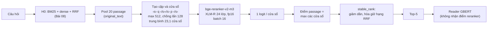

# BÀI 09 — CROSS-ENCODER RERANKING: XẾP LẠI 20 ỨNG VIÊN CỦA H0

> **Vị trí trong giáo trình**: Bài 08 cho H0, gộp BM25 và dense bằng RRF thành 20 ứng viên. Bài này dạy bước **tùy chọn** tiếp theo của cấu hình **H1**: một cross-encoder đọc **từng cặp** (câu hỏi, passage) và xếp lại 20 ứng viên đó. Bài trả lời bốn câu hỏi:
> - cross-encoder khác bi-encoder ở đâu, và vì sao chỉ dùng được cho vài chục ứng viên;
> - project chọn reranker nào trong ba ứng viên, bằng quy trình nào, và có rào chắn gì cho chuyện "mô hình đã thấy dữ liệu";
> - passage dài hơn 512 token được xử lý ra sao (truncate hay windows);
> - vì sao H1 có **Hit@5 cao nhất** nhưng **EM thấp hơn H0**, và vì sao API mặc định **tắt** reranker.
>
> **Ví dụ xuyên suốt**: câu "Wann wurde Hundefett in der Medizin verwendet?". H0 đã xếp passage đúng (Haushund) ở hạng 1. Bài này chạy bge-reranker-v2-m3 thật trên đúng 20 passage đó để xem nó đổi những gì.
>
> **Nguồn số liệu**: báo cáo mục 5.4, 5.5, 5.6; `src/germanqa/rerank/*.py`; `configs/rerank.yaml`, `configs/api.yaml`; `results/14_prereg.json`, `14_erratum.md`, `14a_probe.json`, `14b_truncation.json`, `14_selection.json`, `14_confirmation.json`, `14f_H1_dev_unseen.json`, `14i_crosscheck.json`, `14j_error_breakdown.json`, `14k_ml6team_exploratory.json`, `14l_vram_real.json`, `14c_scores_bge_m3.jsonl`. Các phép đo gắn 📙 **[MỞ RỘNG]** chạy ngày 2026-11-14: (1) trên điểm reranker đã lưu sẵn của **train-select** (1.989 câu, `14c_scores_bge_m3.jsonl`), không chạy lại mô hình; (2) chạy bge-reranker thật trên GPU cho câu Hundefett (dev). Không mở test, không chọn lại cấu hình.

---

## Mục lục

- [A. Learning Objectives](#a-learning-objectives)
- [B. Prerequisite Knowledge](#b-prerequisite-knowledge)
- [C. Theoretical Foundation](#c-theoretical-foundation)
- [D. Mathematical Foundation](#d-mathematical-foundation)
- [E. Architecture & Working Mechanism](#e-architecture--working-mechanism)
- [F. Application in Our Project](#f-application-in-our-project)
- [G. Implementation Mapping](#g-implementation-mapping)
- [H. YouTube Learning Resources](#h-youtube-learning-resources)
- [I. Knowledge Check](#i-knowledge-check)
- [J. Implementation Readiness](#j-implementation-readiness)
- [Đáp án và lời giải](#đáp-án-và-lời-giải)
- [Tài liệu tham khảo bài 09](#tài-liệu-tham-khảo-bài-09)

---

## A. LEARNING OBJECTIVES

### A.1. Mục tiêu kiến thức

Sau bài học, bạn giải thích được:

1. Khác biệt giữa **bi-encoder** (Bài 06) và **cross-encoder** về đầu vào, chi phí và loại tương tác giữa câu hỏi và passage.
2. Vì sao reranker **không thể** vượt trần Hit@20 của retriever đứng trước nó.
3. Điểm của reranker là **logit**, không phải xác suất; cách project gộp hai nhãn thành một điểm (log-odds).
4. Hai cách xử lý passage dài: **truncate** và **windows** (stride 128, lấy max), cùng cái giá của mỗi cách.
5. Quy trình chọn reranker có **rào chắn tiếp xúc** (nhóm passage "chưa thấy"), và vì sao mô hình đã học GermanDPR lại **kém nhất**.
6. Nghịch lý H1: Hit@5 tăng 5 điểm nhưng EM giảm 1,1 điểm trên test, và vì sao điều đó dẫn đến quyết định tắt reranker trong API.

### A.2. Mục tiêu kỹ năng

1. Gọi `CrossEncoderReranker.rerank` cho một câu hỏi và đọc `rank_before`, `rank`, `rerank_score`.
2. Tính số cửa sổ của một passage từ số token, `max_length` và `stride`.
3. Phân rã EM thành $P(\text{gold ở top-5}) \times P(\text{EM} \mid \text{gold ở top-5})$ để tìm nút thắt.
4. Dùng tệp điểm đã lưu để thử các phương án (pool nhỏ hơn, truncate) mà không chạy lại mô hình.

### A.3. Những gì phải nhớ

| Con số | Ý nghĩa | Nguồn |
|---|---|---|
| `BAAI/bge-reranker-v2-m3`, 568M tham số, XLM-RoBERTa 24 lớp | reranker được chọn | 📘 Bảng 5.8; `config.json` |
| `max_length` 512, `overflow: windows`, `stride` 128, pool 20 | cấu hình H1 | `configs/rerank.yaml` |
| Train-select Hit@5: H0 0,8959 → bge_m3 windows **0,9678** | chọn reranker | 📘 Bảng 5.9 |
| gbert_dpr (đã học GermanDPR) kém nhất: Hit@5 0,9080 | tiếp xúc không tự tạo lợi thế | 📘 Bảng 5.9 |
| Dev-unseen Hit@5: 0,8889 → 0,9615 (+0,0726 [+0,0342; +0,1154]) | xác nhận một lần | 📘 mục 5.4.1 |
| Trần của H1 = Hit@20 của H0: 0,9829 (dev-unseen), 0,9773 (test) | reranker không thêm passage mới | 📘 mục 5.4.1 |
| 13,79% cặp vượt 512 token; truncate làm mất đáp án ở 23 câu (1,06%) | lý do dùng windows | 📘 mục 5.4.2 |
| Rerank 583,5 ms trong tổng 720,8 ms của H1 (H0: 113,8 ms) | cái giá | 📘 Bảng 5.10 |
| Test: Hit@5 H1 0,969 so với H0 0,919, nhưng EM 0,250 so với **0,261** | nghịch lý H1 | 📘 Bảng 5.13–5.15 |

### A.4. Thành phần pipeline dùng kiến thức này

| Cấu hình | Có reranker? |
|---|---|
| B0, B1, H0 | Không |
| **H1** | bge_m3 xếp lại 20 passage của H0, rồi chọn top-5 cho reader |
| API | `reranker: null` mặc định; bật bằng `08_serve.py --reranker bge_m3` |

---

## B. PREREQUISITE KNOWLEDGE

### B.1. Kiến thức cần biết trước

| Kiến thức | Mức | Ôn ở đâu |
|---|---|---|
| Transformer, attention, cặp câu với [CLS] và [SEP] | Hiểu | Bài 05 C, E |
| Bi-encoder, dot, vector tính trước | Hiểu | Bài 06 C.2 |
| H0, pool 20, Hit@20 | Hiểu | Bài 08 E.1 |
| Tập chọn, dev-unseen, nhóm passage đã thấy | Hiểu | Bài 07 C.7–C.8 |
| `adopt_alternative`, bootstrap ghép cặp | Hiểu | Bài 07 C.7, D.4 |

### B.2. Thuật ngữ mới

| Thuật ngữ | Giải thích |
|---|---|
| **Cross-encoder** | Mô hình nhận **cả cặp** (câu hỏi, passage) trong một chuỗi và trả một điểm liên quan. |
| **Reranker** | Thành phần xếp lại một danh sách ứng viên nhỏ do retriever đưa ra. |
| **Pool** | Tập ứng viên đưa vào reranker; ở project là 20 passage của H0. |
| **Pointwise** | Mỗi cặp được chấm độc lập (monoBERT, Nogueira & Cho, 2019). Khác với pairwise (so hai passage) hay listwise. |
| **Logit** | Đầu ra trước softmax/sigmoid. Không bị chặn, không phải xác suất. |
| **Log-odds** | $\log(p_1/p_0)$; với hai nhãn bằng $\ell_1 - \ell_0$. |
| **Truncate** | Cắt phần passage vượt `max_length`. |
| **Windows (sliding window)** | Chia passage thành các cửa sổ chồng lấn, chấm từng cửa sổ, lấy **max**. |
| **Stride** | Ở tokenizer HuggingFace: số token **chồng lấn** giữa hai cửa sổ liền kề (không phải bước nhảy). |
| **Nhóm tiếp xúc** | positive / negative / never: passage đúng từng là positive, chỉ là negative, hay chưa từng xuất hiện trong GermanDPR train. |
| **Difference-in-differences** | "Chênh của chênh": mức tăng ở nhóm đã thấy trừ mức tăng ở nhóm chưa thấy. |

### B.3. Mối liên hệ với bài trước

- Bài 08 C.8 kết luận: phần lớn lần hybrid trượt top-5 là "**đúng bài, sai đoạn**" (142/233), và RRF không biết nhánh nào đáng tin cho từng câu. Một mô hình **đọc** câu hỏi và passage cùng lúc là ứng viên tự nhiên để sửa loại lỗi này.
- Bài 06 C.2 nói bi-encoder nén passage thành một vector **trước khi** thấy câu hỏi. Cross-encoder bỏ hẳn ràng buộc đó, và trả giá bằng tốc độ.

---

## C. THEORETICAL FOUNDATION

### C.1. Bi-encoder và cross-encoder

📘 **[BÁO CÁO]** (mục 5.4.1): Bi-encoder mã hóa câu hỏi và passage độc lập rồi so khớp bằng tích vô hướng; vector passage tính trước nên tìm trên toàn corpus nhanh. Cross-encoder đưa cả hai vào cùng một mô hình dưới dạng một chuỗi, nên attention nối được từng từ của câu hỏi với từng từ của passage; điểm lấy từ đầu ra của mô hình (một logit). Độ chính xác thường cao hơn, nhưng phải chạy lại cho từng cặp, nên chỉ áp dụng lên số ít ứng viên.

| | Bi-encoder (DPR, Bài 06) | Cross-encoder (bge_m3) |
|---|---|---|
| Đầu vào | câu hỏi **hoặc** passage | câu hỏi **và** passage, một chuỗi |
| Tương tác | chỉ qua một phép dot ở cuối | attention giữa mọi token của hai bên, ở **mọi** lớp |
| Tính trước được | vector của 26.864 passage | không gì cả (phụ thuộc câu hỏi) |
| Chi phí mỗi câu hỏi | 1 lần mã hóa câu hỏi + 1 phép nhân ma trận | 1 lượt mô hình cho **mỗi** cặp (và mỗi cửa sổ) |
| Dùng được trên | toàn corpus | vài chục ứng viên |

📗 **[NỀN TẢNG]** Giữa hai thái cực có **late interaction** (ColBERT, Khattab & Zaharia, 2020): giữ một vector cho **mỗi token** của passage, tính trước được, rồi so khớp token với token lúc chạy. Project không dùng.

### C.2. Vai trò sau retriever, và trần của nó

📘 **[BÁO CÁO]**: Retriever được tối ưu để **không bỏ sót** trên toàn corpus nên chấp nhận nhiều passage không liên quan trong top-k. Reranker nhận tập ứng viên nhỏ đó và tối ưu **thứ tự**, tức tăng Hit@1, Hit@5, MRR. Reranker **không thể cứu** passage không có trong pool: trần của H1 là Hit@20 của H0, bằng 0,9829 trên dev-unseen và 0,9773 trên test.

Vì vậy trong mọi bảng kết quả, **Hit@20 của H1 = Hit@20 của H0** (ví dụ 0,977 = 0,977 trên test). Đây là kiểm tra nhanh rằng reranker không thêm hay bớt ứng viên.

### C.3. Ba ứng viên và chuyện "đã thấy dữ liệu"

📘 **[BÁO CÁO]** Bảng 5.8:

| Mô hình | Tham số | Dữ liệu huấn luyện (theo model card) | Tiếp xúc với GermanDPR |
|---|---|---|---|
| `cross-encoder/mmarco-mMiniLMv2-L12-H384-v1` (mmarco) | 118M | mMARCO: MS MARCO dịch máy, có tiếng Đức | Không nhắc |
| `deepset/gbert-base-germandpr-reranking` (gbert_dpr) | 110M | GermanDPR train | **Đã học** câu hỏi và passage |
| `BAAI/bge-reranker-v2-m3` (bge_m3) | 568M | bge-m3-data, quora, fever (gồm MS MARCO, NQ, SQuAD, Mr.TyDi, MIRACL, MLDR…) | Không nhắc; **không kiểm được** trùng passage |

📘 **[BÁO CÁO]** Đính chính (`results/14_erratum.md`): tệp ghi trước viết "dữ liệu huấn luyện của bge không công bố đầy đủ", nhưng model card có liệt kê nguồn. Điều đúng là không kiểm được việc các bộ đa ngôn ngữ (Mr.TyDi, MIRACL, MLDR) có trùng passage Wikipedia tiếng Đức với corpus hay không. Nhãn "chưa kiểm chứng" vẫn đúng, chỉ lý do ghi sai; không số đo nào đổi. Đính chính nằm ở tệp riêng, **không sửa** `14_prereg.json` vì tệp đó đã khóa SHA-1.

Đây là một thực hành tốt đáng học: tệp ghi trước sai một chi tiết thì **không sửa lùi**, mà ghi đính chính kèm ảnh hưởng.

Vì sao chuyện tiếp xúc quan trọng? Bài 07 C.8 cho thấy dense đã học GermanDPR được thổi phồng trên dev. Một reranker đã học GermanDPR cũng có thể "nhớ" passage. Trên train-select, các câu hỏi chưa từng được thấy, nhưng **passage đúng** của 963/1.989 câu từng là positive trong GermanDPR train, 210 câu chỉ từng là negative, và chỉ 816 câu ở nhóm **never** (`14_selection.json`, `group_sizes`).

### C.4. Quy trình chọn

📘 **[BÁO CÁO]** (`results/14_prereg.json`, ghi 2026-11-08 20:55:22): lưới 3 mô hình × 2 cách xử lý passage dài = 6 cấu hình, không có nhóm thăm dò. Nền so sánh là H0 (Hit@5 0,8959 trên train-select).

Bảng 5.9 (train-select, n = 1.989):

| Mô hình | Passage dài | Hit@1 | Hit@5 | Hit@20 | MRR@10 | Cửa sổ/câu |
|---|---|---|---|---|---|---|
| mmarco | truncate | 0,7004 | 0,9482 | 0,9784 | 0,8053 | 20,0 |
| mmarco | windows | 0,7039 | 0,9492 | 0,9784 | 0,8074 | 23,1 |
| gbert_dpr | truncate | 0,5777 | 0,9080 | 0,9784 | 0,7149 | 20,0 |
| gbert_dpr | windows | 0,5767 | 0,9055 | 0,9784 | 0,7138 | 21,7 |
| bge_m3 | truncate | 0,7592 | 0,9673 | 0,9784 | 0,8513 | 20,0 |
| **bge_m3** | **windows** | **0,7617** | **0,9678** | 0,9784 | **0,8530** | 23,1 |

Quy tắc chọn: Hit@5 cao nhất thỏa `adopt_alternative` so với H0, **cộng thêm rào chắn tiếp xúc**: trên nhóm never, chênh Hit@5 phải dương và cận dưới không thấp hơn −0,01 (`select.exposure_guard`).

- bge_m3 windows so với H0: +0,0719 [+0,0603; +0,0840]; nhóm never: +0,0931 [+0,0723; +0,1152]. Qua cả hai điều kiện → **nhận**.
- Cột Hit@20 giống hệt nhau (0,9784): đúng như C.2.

Ba quan sát đáng nhớ:

1. **gbert_dpr, mô hình đã học GermanDPR, lại kém nhất**: Hit@5 0,9080, Hit@1 0,5777, thấp hơn cả H0 ở Hit@1 (0,6466). Tiếp xúc với dữ liệu không tự nó tạo lợi thế ở khâu rerank.
2. **Mức tăng ở nhóm đã thấy không lớn hơn nhóm chưa thấy**. Chênh của chênh (positive − never): bge_m3 −0,0423 [−0,0687; −0,0160], mmarco −0,0154 [−0,0444; +0,0137], gbert_dpr −0,0172 [−0,0514; +0,0182]. Nếu mô hình "nhớ" passage, nhóm positive phải tăng **nhiều hơn**; ở đây ngược lại. Một phần lý do có thể là nhóm positive vốn đã cao ở H0 (dense thổi phồng), nên còn ít chỗ để tăng.
3. **Windows hơn truncate rất ít** (0,9678 so với 0,9673). C.6 giải thích vì sao.

📘 **[BÁO CÁO]** Một mô hình thứ tư (`ml6team/cross-encoder-mmarco-german-distilbert-base`) được thử **sau khi** đã có kết quả, đánh dấu `exploratory_after_results: true`, `not_part_of_prereg: true`: Hit@5 0,9246, thấp hơn bge_m3 (−0,0432 [−0,0533; −0,0332]). Không thay đổi H1.

### C.5. Xác nhận trên dev-unseen

📘 **[BÁO CÁO]** (`14_confirmation.json`, 2026-11-08 21:29:47, chạy một lần, n = 234):

| | Hit@1 | Hit@5 | Hit@20 | MRR@10 |
|---|---|---|---|---|
| H0 | 0,534 | 0,889 | 0,983 | 0,683 |
| H1 | **0,726** | **0,962** | 0,983 | **0,829** |
| H1 − H0 [KTC 95%] | +0,192 [+0,124; +0,256] | +0,073 [+0,034; +0,115] | 0 | +0,146 [+0,101; +0,189] |

Theo nhóm tiếp xúc (dev-unseen): positive (114 câu) +0,061 [+0,018; +0,114]; never (108 câu) +0,093 [+0,019; +0,158]; negative (12 câu) 0 [−0,25; +0,25]. Kết luận ghi trong tệp: "H1 hơn H0 về Hit@5 (cận dưới > 0)".

Mức tăng lớn nhất là ở **Hit@1** (+19 điểm): reranker giỏi nhất ở việc chọn passage **tốt nhất**, đúng vai trò của nó.

### C.6. Passage dài: truncate hay windows

📘 **[BÁO CÁO]** (mục 5.4.2, `14b_truncation.json`):

| bge_m3, tập chọn | Giá trị |
|---|---|
| Số cặp (câu hỏi, passage) | 44.460 (2.223 × 20) |
| Độ dài cặp (token): trung vị / p90 / p99 / max | 316 / 542 / 925 / 2.676 |
| Cặp vượt 512 token | 6.131 (13,79%) |
| Câu có passage đúng trong pool | 2.176 |
| Passage đúng vượt 512 | 262 |
| Đáp án nằm ngoài phần được thấy khi truncate | **23 câu (1,06%)** |

**Windows**: chia cặp dài thành các cửa sổ chồng lấn 128 token, mỗi cửa sổ gồm câu hỏi và một đoạn passage; điểm của passage là **max** điểm các cửa sổ. Giả định: một passage liên quan khi **có một đoạn** của nó trả lời câu hỏi.

Vì sao windows chỉ hơn truncate 0,0005? 📙 **[MỞ RỘNG]** Trên train-select, Hit@5 của hai chế độ khác nhau ở đúng **3/1.989 câu** (windows hơn ở 2, kém ở 1). Lý do: chỉ 23 câu bị mất đáp án do truncate, và với phần lớn trong đó, phần đầu passage đã đủ để reranker nhận ra chủ đề. Windows đúng về nguyên tắc, nhưng ở corpus này (trung vị 316 token) lợi ích rất nhỏ, còn chi phí tăng 15,5% (23,1 so với 20,0 cửa sổ mỗi câu).

Cái giá ẩn của **max**: passage càng nhiều cửa sổ càng có nhiều "lần thử" để được điểm cao (D.5). 📙 Trên train-select, passage **sai** có từ 3 cửa sổ trở lên lọt top-5 ở 25,2% trường hợp khi dùng windows, so với 18,6% khi truncate (452 passage); với 1 cửa sổ là 20,5% và 20,7%. Hiệu ứng có thật nhưng chỉ chạm một nhóm nhỏ.

### C.7. Chi phí

📘 **[BÁO CÁO]** Bảng 5.10 (cùng một tiến trình, 100 câu × 3 vòng, trung vị):

| Cấu hình | Truy hồi (ms) | Rerank (ms) | Reader (ms) | Tổng (ms) |
|---|---|---|---|---|
| B0 | 1,3 | 0 | 73,5 | 75,1 |
| B1 | 44,4 | 0 | 71,5 | 116,0 |
| H0 | 43,9 | 0 | 68,9 | 113,8 |
| H1 | 57,0 | **583,5** | 73,9 | **720,8** |

Rerank chiếm khoảng 81% thời gian của H1, gấp khoảng 6,3 lần toàn bộ H0. Trên test, p50 H0 141,9 ms so với H1 743,6 ms; p95 206,2 so với 1.047,8 ms.

Về bộ nhớ: mô phỏng trong `14l_vram_real.json` cho thấy H1 chạy được trên card 4 GB khi chương trình khác chiếm sẵn 1.377 MB, nhưng chỉ còn trống 245–252 MB. Đây là **mô phỏng** bằng cách chiếm sẵn VRAM, chưa phải đo trong dịch vụ API thực (📘 mục 5.4.2, 5.5).

### C.8. Nghịch lý H1: truy hồi tốt hơn, đáp án không tốt hơn

📘 **[BÁO CÁO]** Trên test (n = 2.203):

| | Hit@5 | MRR@10 | EM (tham chiếu đầu) | F1 (tham chiếu đầu) |
|---|---|---|---|---|
| H0 | 0,919 | 0,777 | **0,261** | **0,454** |
| H1 | **0,969** | **0,914** | 0,250 | 0,433 |
| H1 − H0 | +0,050 [+0,040; +0,059] | +0,137 | −0,011 [−0,022; −0,001] | −0,020 [−0,033; −0,008] |

H1 − H0 về EM có khoảng không chứa 0: chênh lệch có ý nghĩa thống kê nhưng nhỏ (khoảng 25 câu trên 2.203). Kết luận đúng là "H1 không giúp EM trong thiết lập hiện tại", chưa phải "H1 gây hại lớn" (📘 mục 5.6.3).

Vì sao? 📘 **[BÁO CÁO]** Bảng 5.18 (dev-unseen, n = 234):

| | H0 | H1 |
|---|---|---|
| Passage đúng ngoài top-20 | 4 | 4 |
| Trong top-20, ngoài top-5 | 22 | **5** |
| Passage đúng ở top-5 | 208 | **225** |
| Reader chọn đúng passage | 136 (65,4%) | 136 (**60,4%**) |
| Câu đúng EM | 49 | 48 |

Reranker đưa passage đúng vào top-5 thêm 17 câu (22 cứu, 5 mất), nhưng số lần reader **chọn** passage đúng vẫn là 136. Trong 22 câu được cứu, reader chỉ chọn đúng passage ở 10 câu. 📘 Giả thuyết của báo cáo (chưa kiểm chứng trực tiếp): top-5 của H1 chứa nhiều passage **gần chủ đề** hơn, và reader, vốn được huấn luyện để chọn span chứ không để phân biệt passage, bị các đáp án hợp lý ở passage sai đánh lừa.

Một chi tiết kỹ thuật làm giả thuyết này hợp lý hơn: **reader không nhận điểm của reranker** (Bài 02). Reader chạy trên từng passage trong top-5 và lấy span có điểm reader cao nhất. Reranker biết passage nào tốt nhất (Hit@1 tăng 19 điểm), nhưng thông tin đó **bị bỏ đi** ở ranh giới reranker → reader; chỉ còn lại tập top-5. D.7 phân rã chuyện này bằng số.

📘 **[BÁO CÁO]** Hệ quả triển khai (mục 5.5.2): H0 là mặc định của API. Lý do: trên test, H0 có EM cao nhất, cao hơn H1 có ý nghĩa thống kê; nhanh hơn (141,9 so với 743,6 ms); không cần nạp thêm mô hình 568M tham số. H1 chỉ đáng khi mục tiêu là **thứ tự passage bằng chứng**, không phải EM.

### C.9. Điểm của reranker là gì?

📘 Quy ước ở đầu `cross_encoder.py`:

- Mô hình một đầu ra (`num_labels = 1`, như bge_m3, mmarco): điểm = logit đó.
- Mô hình nhiều nhãn (gbert_dpr có 2 nhãn): điểm = logit(nhãn liên quan) − logsumexp(các nhãn còn lại). Nhãn liên quan do người gọi **chỉ định** (`relevant_label = 1` cho gbert_dpr, kiểm bằng 5 cặp thử trong `14a_probe.json`: nhãn 1 thắng 5/5), không đoán.
- Điểm **không** phải xác suất và **không** so được với BM25, dense hay RRF.
- Đồng điểm giữ thứ tự cũ (hạng RRF nhỏ hơn đứng trước): `stable_rank`.

📙 **[MỞ RỘNG]** Phân phối logit của bge_m3 trên train-select (pool 20, chỉ các câu có passage đúng trong pool):

| | p10 | trung vị | p90 | p99 |
|---|---|---|---|---|
| Passage đúng | 0,89 | 3,97 | 6,60 | — |
| Passage khác | −9,35 | −5,19 | −0,34 | 4,49 |

94,7% passage đúng có logit dương; 8,7% passage sai cũng dương. Áp sigmoid lên trung vị của passage đúng được 0,982, nhưng con số này **không** nên đọc là "98% chắc chắn": mô hình chưa được hiệu chỉnh (calibrate) trên dữ liệu này, và một passage sai vẫn có thể có logit 4,49. Logit chỉ dùng để **so sánh trong cùng một câu hỏi**.

---

## D. MATHEMATICAL FOUNDATION

### D.1. Điểm của một cặp

Với chuỗi $x = [\langle s\rangle;\ q;\ \langle/s\rangle\langle/s\rangle;\ p;\ \langle/s\rangle]$ (định dạng của XLM-RoBERTa), mô hình cho vector ẩn của token đầu $h_0 \in \mathbb{R}^{1024}$ ở lớp cuối. Đầu phân loại của `XLMRobertaForSequenceClassification`:

$$s(q, p) = w_2^\top \tanh(W_1 h_0 + b_1) + b_2, \qquad W_1 \in \mathbb{R}^{1024 \times 1024},\ w_2 \in \mathbb{R}^{1024}$$

Số tham số của đầu này: $1024 \cdot 1024 + 1024 + 1024 + 1 = 1.050.625$, khớp đúng số đếm từ `model.safetensors` (D.3).

Khác với dense: ở dense, $q$ và $p$ chỉ gặp nhau ở phép dot cuối cùng. Ở đây, từ lớp 1, token "Hundefett" trong câu hỏi đã attend được tới "Hundefett" trong passage, và token "Medizin" attend được tới "Behandlung von Gelenkerkrankungen".

### D.2. Từ hai logit thành một điểm

Mô hình hai nhãn cho $(\ell_0, \ell_1)$. Với softmax, $p_1 = e^{\ell_1}/(e^{\ell_0} + e^{\ell_1})$, và

$$\log\frac{p_1}{p_0} = \ell_1 - \ell_0 = \ell_1 - \operatorname{logsumexp}(\ell_0)$$

Tổng quát cho $K$ nhãn: $s = \ell_r - \log\sum_{j \ne r} e^{\ell_j}$. Ví dụ $(\ell_0, \ell_1) = (0{,}3;\ 2{,}1)$: $s = 1{,}8$, và $p_1 = 0{,}8581$, $\log(p_1/p_0) = 1{,}8$ (chạy ở G.5). Dùng log-odds thay vì $p_1$ vì nó **đơn điệu** theo $p_1$ (cùng thứ tự) nhưng không bị bão hòa gần 0 và 1.

Vì sao không dùng thẳng $\ell_1$? Vì softmax bất biến khi cộng cùng một hằng số vào mọi logit: $\ell_1$ một mình có thể lớn chỉ vì $\ell_0$ cũng lớn. Chỉ **hiệu** mới có nghĩa.

### D.3. Chi phí

📙 **[MỞ RỘNG]** Đếm tham số bge_m3 từ `model.safetensors`:

| Phần | Tham số |
|---|---|
| Embedding (từ vựng 250.002 × 1.024, vị trí 8.194 × 1.024, LayerNorm) | 264.395.776 |
| 24 lớp Transformer × 12.596.224 | 302.309.376 |
| Đầu phân loại | 1.050.625 |
| **Tổng** | **567.755.777** |

Gần một nửa tham số là bảng embedding của từ vựng đa ngôn ngữ 250 nghìn token; bảng này chỉ tra cứu, không tốn phép nhân. Phần tính toán là khoảng 302M tham số của 24 lớp.

Ước lượng phép tính mỗi câu hỏi (quy tắc thô: một lượt qua mạng tốn khoảng $2 \times$ số tham số tính toán $\times$ số token FLOP):

$$\underbrace{23{,}1}_{\text{cửa sổ}} \times 2 \times 3{,}02 \cdot 10^{8} \times \underbrace{316}_{\text{token, trung vị}} \approx 4{,}4 \cdot 10^{12}\ \text{FLOP}$$

So với dense (Bài 06–07): mã hóa câu hỏi khoảng $2 \times 8{,}5 \cdot 10^7 \times 12 \approx 2 \cdot 10^9$ FLOP cộng tìm kiếm $26.864 \times 768 \times 2 \approx 4 \cdot 10^7$. Reranker tốn cỡ **2.000 lần** dense mỗi câu hỏi. Đây là ước lượng bậc độ lớn (bỏ qua attention bậc hai và đệm), đủ để thấy vì sao rerank cả corpus là không thể: $26.864$ cặp thay vì 20 sẽ tốn khoảng 1.300 lần thời gian hiện tại, tức cỡ 13 phút mỗi câu hỏi.

### D.4. Số cửa sổ

Với tokenizer HuggingFace, `truncation="only_second"`, `return_overflowing_tokens=True`, `stride` $= S$ là số token chồng lấn. Gọi $Q$ là số token câu hỏi, $P$ số token passage, $M$ = `max_length`, và XLM-R dùng 4 token đặc biệt cho một cặp. Chỗ cho passage trong một cửa sổ là $A = M - Q - 4$. Khi đó

$$n(P) = \begin{cases} 1 & P \le A \\ 1 + \left\lceil \dfrac{P - A}{A - S} \right\rceil & P > A \end{cases}$$

Với câu Hundefett, $Q = 9$, nên $A = 499$, bước nhảy thực $A - S = 371$:

| $P$ (token passage) | 300 | 499 | 500 | 870 | 871 | 1.000 | 2.676 |
|---|---|---|---|---|---|---|---|
| Số cửa sổ | 1 | 1 | 2 | 2 | 3 | 3 | 7 |

$P = 1.000$ cho 3 cửa sổ, khớp Hình 5.6 của báo cáo. 📙 Công thức được kiểm trên 321 passage dài thật của corpus bằng tokenizer bge_m3: khớp 321/321.

Chú ý: câu hỏi được cắt tối đa 64 token (`MAX_QUERY_TOKENS`) trước khi ghép, để luôn chừa chỗ cho passage.

### D.5. Lấy max có thiên lệch

Nếu điểm mỗi cửa sổ của một passage **sai** là nhiễu độc lập $\mathcal{N}(\mu, \sigma^2)$, thì $\mathbb{E}[\max_{i \le n} s_i]$ tăng theo $n$. Mô phỏng với $\mu = -5$, $\sigma = 2$ (G.5):

| $n$ cửa sổ | 1 | 2 | 3 | 5 |
|---|---|---|---|---|
| $\mathbb{E}[\max]$ | −5,00 | −3,86 | −3,30 | −2,67 |

Một passage sai dài 5 cửa sổ được "cộng" trung bình hơn 2 điểm logit chỉ vì dài. Trên thực tế các cửa sổ không độc lập (chồng lấn 128 token, cùng chủ đề) nên thiên lệch nhỏ hơn mô phỏng; C.6 đo được hiệu ứng ở nhóm 3+ cửa sổ (25,2% so với 18,6%). Các cách giảm thiên lệch (lấy trung bình top-2 cửa sổ, hay chuẩn hóa theo số cửa sổ) có tồn tại, project không thử.

### D.6. Pool lớn bao nhiêu là đủ?

📙 **[MỞ RỘNG]** Dùng điểm đã lưu, chỉ xếp lại $k$ passage đầu của H0, giữ nguyên phần còn lại (train-select):

| Xếp lại top-$k$ | 5 | 8 | 10 | 15 | 20 (project) |
|---|---|---|---|---|---|
| Hit@5 | 0,8959 | 0,9346 | 0,9462 | 0,9613 | 0,9678 |
| Hit@1 | 0,7340 | 0,7516 | 0,7577 | 0,7602 | 0,7617 |
| Cửa sổ/câu | 5,9 | 9,3 | 11,6 | 17,4 | 23,1 |

- $k = 5$: Hit@5 **không đổi** (đúng: xếp lại trong top-5 không đổi tập top-5), nhưng Hit@1 đã từ 0,6466 (H0) lên 0,7340. Khoảng 3/4 mức tăng Hit@1 (+0,0874 trong tổng +0,1151) đến từ việc xếp lại **trong** top-5.
- $k = 10$ đạt 0,9462 với khoảng một nửa chi phí. Chi phí rerank tỉ lệ gần tuyến tính với số cửa sổ, nên rerank top-10 ước khoảng 290 ms thay vì 583 ms.

Đây là phân tích hậu nghiệm trên tập chọn, không phải đề xuất đổi cấu hình; nhưng nó cho thấy đường cong đánh đổi trông thế nào trước khi ghi trước một thí nghiệm.

### D.7. Phân rã EM

Với $G$ = "passage đúng ở top-5":

$$\mathrm{EM} = P(G)\, P(\mathrm{EM} \mid G) + P(\neg G)\, P(\mathrm{EM} \mid \neg G)$$

📘 **[BÁO CÁO]** (`14j_error_breakdown.json`, dev-unseen):

| | $P(G)$ | $P(\mathrm{EM} \mid G)$ | Câu đúng khi $G$ | Câu đúng khi $\neg G$ | EM |
|---|---|---|---|---|---|
| H0 | 208/234 = 0,889 | 0,2308 | 48 | 1 | 49/234 = 0,209 |
| H1 | 225/234 = 0,962 | 0,2133 | 48 | 0 | 48/234 = 0,205 |

$P(G)$ tăng 8%, nhưng $P(\mathrm{EM} \mid G)$ giảm 7,6%; hai hiệu ứng triệt tiêu. Để H1 thắng, phải nâng **thừa số thứ hai**, tức phần của reader (Bài 10–11). Đây là lý do báo cáo gọi reader là nút thắt.

---

## E. ARCHITECTURE & WORKING MECHANISM

### E.1. Luồng của H1



### E.2. Input → Processing → Output

| | Nội dung |
|---|---|
| **Input** | Câu hỏi; 20 dòng của H0 `{passage_id, ...}` kèm `text` là `original_text` (không phải `retrieval_text` chữ thường: reranker cần chữ hoa và dấu câu). |
| **Processing** | (1) Cắt câu hỏi còn tối đa 64 token. (2) Tokenize 20 cặp; với windows, sinh cửa sổ và `overflow_to_sample_mapping`. (3) Sắp cửa sổ theo độ dài để đệm ít, chạy theo lô 16, fp16. (4) Lấy logit (hoặc log-odds). (5) Max theo passage. (6) Sắp ổn định. |
| **Output** | 20 dòng, mỗi dòng có thêm `rank_before`, `rank`, `rerank_score`; `last_stats = {pairs, windows, seconds}`. Không thêm, không bỏ passage nào. |

### E.3. Ví dụ thật: câu Hundefett

📙 **[MỞ RỘNG]** Chạy `CrossEncoderReranker` với đúng `configs/rerank.yaml` (GPU RTX 3050, fp16) trên 20 passage H0 của câu Hundefett:

| Hạng mới | Hạng H0 | Passage | Logit |
|---|---|---|---|
| 1 | 1 | **Haushund (gold)** | **+2,13** |
| 2 | 7 | Haushund (passage 4) | −5,45 |
| 3 | 17 | Säugetiere | −8,02 |
| 4 | 19 | Zink | −8,84 |
| 5 | 11 | Infrarotstrahlung | −8,88 |
| 6 | 14 | Schwertbohne | −9,50 |
| 7 | 2 | Vachellia_tortilis | −10,06 |
| 8 | 6 | Sprachtest | −10,24 |

20 cặp, 20 cửa sổ (passage đúng dài 991 ký tự, vừa một cửa sổ), 1,36 s cho lần chạy đầu (gồm khởi động CUDA).

Đọc bảng:

- Passage đúng giữ hạng 1, và **tách xa** đối thủ (+2,13 so với −5,45): một khoảng cách RRF không có cách nào biểu diễn.
- Vachellia và Sprachtest, hai passage BM25 đưa lên vì trùng "Medizin", "verwendet", bị đẩy xuống hạng 7–8.
- Top-5 mới chứa Säugetiere, Zink, Infrarotstrahlung, các passage H0 xếp 11–19. Tất cả đều có logit rất âm: reranker **không** coi chúng liên quan, chúng chỉ "ít sai hơn" các passage khác. Năm passage này vẫn đi vào reader. Đây là hình ảnh cụ thể của C.8: thứ tự trên cùng tốt hơn, nhưng các vị trí 2–5 vẫn là nhiễu, và reader không biết hạng 1 cách xa phần còn lại.

📙 **[MỞ RỘNG]** Độ nhạy của logit với câu hỏi, cùng passage đúng:

| Câu hỏi | Logit |
|---|---|
| Wann wurde Hundefett in der Medizin verwendet? (gốc) | +2,13 |
| Wofür wurde Hundefett verwendet? | **+3,79** |
| Wann wurde Hundefett in der **Küche** verwendet? | +0,28 |
| Wann wurde **Schweinefett** in der Medizin verwendet? | **−5,17** |
| Wie alt werden Hunde? | −7,25 |
| (câu gốc, nhưng xáo trộn thứ tự từ của passage) | −1,44 |

- Đổi một từ "Hundefett" → "Schweinefett" làm điểm giảm hơn 7 logit: mô hình kiểm **đúng thực thể**, điều BM25 (chỉ đếm từ trùng) và dense (một vector cho cả câu) làm kém hơn.
- "Wofür … verwendet?" được điểm **cao hơn** câu gốc: passage nói Hundefett dùng để chữa bệnh khớp, đúng là trả lời "để làm gì".
- Xáo trộn từ của passage làm điểm giảm 3,6: mô hình dùng **thứ tự từ**, không chỉ là túi từ.

Đây là một vài ví dụ trên một passage, không phải phép đo tổng quát.

---

## F. APPLICATION IN OUR PROJECT

### F.1. Thành phần này nằm ở đâu?

| Việc | File / hàm | Cấu hình |
|---|---|---|
| Chấm điểm và xếp lại | `src/germanqa/rerank/cross_encoder.py: CrossEncoderReranker.score_detail`, `.rerank`, `combine_logits`, `stable_rank` | `configs/rerank.yaml` |
| Dựng từ cấu hình | `rerank/factory.py: build_reranker(cfg)` (tách riêng vì `cross_encoder.py` đã khóa SHA-1 trong prereg) | `rerank.yaml`, `api.yaml: reranker_models` |
| Pool của H0 (offline) | `rerank/pool.py: hybrid_pool` | `13_selection.json` |
| Nhóm tiếp xúc | `rerank/exposure.py: passage_role`, `question_group` | trường `source` của corpus |
| Chọn và rào chắn | `rerank/select.py: choose_config`, `exposure_guard`, `decide` | `14_prereg.json` |
| Phân tích điểm đã lưu | `rerank/analysis.py: load_scores`, `integrity_problems`, `did_ci` | `14c_scores_*.jsonl` |
| Script | `scripts/GD14/14a_probe.py` … `14l_vram_real.py` | — |
| Model cục bộ | `models/rerank_bge_m3_976fb4ad` (SHA-1 của `model.safetensors` bắt đầu bằng `976fb4ad`, khớp prereg) | `commit: 953dc6f6…` |

### F.2. Vì sao nhóm cần hiểu bài này?

- H1 là cấu hình có **truy hồi tốt nhất** của project (Hit@5 0,969, MRR@10 0,914 trên test). Nếu ứng dụng cần trả **passage bằng chứng** (ví dụ hiển thị nguồn cho người dùng), H1 là lựa chọn đúng.
- Nhưng nó **không** là mặc định. Hiểu C.8 và D.7 là hiểu một kết luận quan trọng của cả project: tối ưu một khâu giữa không tự cải thiện đầu ra.
- Bài này cũng là ví dụ đầy đủ nhất của giao thức ghi trước: lưới cố định, rào chắn tiếp xúc, đính chính tách tệp, mô hình thứ tư đánh dấu thăm dò.

### F.3. Đầu vào và đầu ra thực tế

Một dòng sau rerank (câu Hundefett, hạng 2):

```json
{"passage_id": "p_...", "text": "...", "rank_before": 7, "rank": 2, "rerank_score": -5.45}
```

Các khóa của H0 (`sources`, `bm25_score`, `dense_score`, điểm RRF) được **giữ nguyên** trong dòng: `stable_rank` sao chép dòng cũ rồi thêm khóa mới.

📘 **[BÁO CÁO]** Kiểm tính nhất quán (`14i_crosscheck.json`, dev-unseen): trên 222 câu có pool trùng giữa chạy trực tiếp và tệp, 4.440 điểm rerank trùng **tuyệt đối** (lệch tối đa 0,0). Reranker tất định khi đầu vào giống nhau.

### F.4. Nếu thay đổi thì sao?

| Thay đổi | Ảnh hưởng | Phải làm lại |
|---|---|---|
| Bật reranker trong API | +600 ms mỗi câu, +~1,1 GB VRAM trọng số; EM không tăng | Kiểm VRAM thật trong dịch vụ (chưa làm) |
| Pool 20 → 10 | Hit@5 0,9678 → 0,9462 (train-select, D.6), nhanh gấp đôi | Ghi trước, xác nhận dev-unseen |
| `overflow` windows → truncate | Hit@5 −0,0005, nhanh hơn 13% | Như trên |
| Đổi sang mmarco | Nhỏ hơn 5 lần (118M), Hit@5 0,9492 | `api.yaml` đã có sẵn cấu hình mmarco |
| Đổi H0 phía trước (ví dụ RRF khác) | Pool đổi, trần đổi | Chấm lại điểm (`14c`), chọn lại |
| Truyền điểm reranker cho reader | Có thể sửa C.8 | Sửa reader và pipeline (chưa làm, Bài 10–11) |

### F.5. Tham số cần chú ý

| Tham số | Giá trị | Ở đâu | Ghi chú |
|---|---|---|---|
| `model`, `repo`, `commit` | bge_m3, `BAAI/bge-reranker-v2-m3`, `953dc6f6…` | `rerank.yaml` | ghim commit |
| `checkpoint` | `models/rerank_bge_m3_976fb4ad` | `rerank.yaml` | không dựa cache HF |
| `relevant_label` | `null` | `rerank.yaml` | một đầu ra |
| `max_length` | 512 | `rerank.yaml` | cho **cả cặp** |
| `overflow`, `stride` | windows, 128 | `rerank.yaml` | 128 là phần chồng lấn |
| `batch_size`, `fp16` | 16, true | `rerank.yaml` | batch 8 nhanh hơn một chút ở `14a` (0,372 so với 0,449 s/20 cặp) |
| `pool` | 20 | `rerank.yaml`; `api.yaml: max_rerank_pool` | `retrieval_top_k` khi rerank phải ≤ 20 |
| `reranker` | `null` | `api.yaml` | mặc định tắt |

---

## G. IMPLEMENTATION MAPPING

### G.1. Thư viện

| Thư viện | Dùng cho |
|---|---|
| `transformers` | `AutoTokenizer` (bắt buộc bản **fast** để có `overflow_to_sample_mapping`), `AutoModelForSequenceClassification` |
| `torch` | suy luận `inference_mode`, fp16 trên CUDA |
| (không dùng) `sentence-transformers` | project tự viết lớp `CrossEncoderReranker`, không dùng `CrossEncoder` của sentence-transformers |

### G.2. Class và function

| Tên | Vai trò |
|---|---|
| `CrossEncoderReranker(checkpoint, max_length, batch_size, fp16, relevant_label, overflow, stride, device)` | Nạp tokenizer và model; báo lỗi nếu tokenizer không fast, nếu `overflow` sai, nếu model nhiều nhãn mà thiếu `relevant_label` |
| `encode_pairs(query, texts)` | Trả `(encoding, owner)`; `owner[j]` là passage của cửa sổ $j$ |
| `score_detail(query, texts)` | Trả `score` (theo chế độ), `first` (điểm cửa sổ đầu = điểm truncate), `windows` (số cửa sổ) |
| `rerank(query, candidates, top_n)` | `score_texts` rồi `stable_rank` |
| `token_lengths(query, texts)` | Độ dài cặp nếu không cắt (dùng cho `14b`) |
| `fingerprint()` | SHA-1 của trọng số, tokenizer và cấu hình chấm: đổi bất kỳ thứ gì thì điểm đệm không dùng lại |

Một chi tiết đáng học trong `score_detail`: vì trả cả `score` (windows) **và** `first` (cửa sổ đầu), một lần chấm cho ra điểm của **cả hai** chế độ. Bảng 5.9 có hàng truncate và windows mà không phải chạy mô hình hai lần.

### G.3. Pseudocode

```
function RERANK(q, candidates, model, M = 512, S = 128):
    q ← cắt q còn ≤ 64 token
    windows, owner ← tokenize cặp (q, text) với truncation only_second, max M, chồng lấn S
    sắp windows theo độ dài
    for each batch of 16 windows:
        logits ← model(batch)
        score_win ← logit (1 nhãn) hoặc ℓ_r − logsumexp(ℓ_khác)
    for each passage i: score[i] ← max{ score_win[j] : owner[j] = i }
    order ← sort i by (−score[i], i)         # hòa: giữ hạng cũ
    return candidates theo order, kèm rank_before, rank, rerank_score
```

### G.4. Code: xếp lại câu Hundefett bằng lớp của project

Chạy từ thư mục gốc project bằng `venv`, cần GPU hoặc chờ lâu hơn trên CPU. Đã chạy; kết quả ở E.3.

```python
import sys, json; sys.path.insert(0, "src")
from germanqa.data.io_utils import read_jsonl
from germanqa.rerank.cross_encoder import CrossEncoderReranker

C = {r["passage_id"]: r for r in read_jsonl("data/processed/corpus.jsonl")}
for line in open("reports/pipeline_dev_hybrid_predictions.jsonl", encoding="utf8"):
    d = json.loads(line)
    if d["question_id"] == "q_0801808ed0ccd8b5":
        break
pool = [{"passage_id": r["passage_id"], "text": C[r["passage_id"]]["original_text"]} for r in d["retrieved"][:20]]

R = CrossEncoderReranker("models/rerank_bge_m3_976fb4ad", max_length=512, batch_size=16,
                         fp16=True, overflow="windows", stride=128)
for row in R.rerank(d["question"], pool)[:8]:
    print(row["rank"], "<-", row["rank_before"], C[row["passage_id"]]["title"], round(row["rerank_score"], 2))
print(R.last_stats)

gold = C["p_c25e144a863973b9"]["original_text"]
for q in ["Wann wurde Schweinefett in der Medizin verwendet?", "Wofür wurde Hundefett verwendet?"]:
    print(round(R.score_texts(q, [gold])[0], 2), q)
```

### G.5. Code minh họa: số cửa sổ, log-odds, thiên lệch của max

Chạy được không cần mô hình. Đã chạy, kết quả thật:

```python
import math
import numpy as np

def n_windows(q_tokens, p_tokens, max_length=512, stride=128, special=4):
    """Số cửa sổ khi chia passage (cách của tokenizer HF với truncation='only_second').
    special = 4 với XLM-R: <s> q </s></s> p </s>."""
    room = max_length - q_tokens - special          # số token passage vừa một cửa sổ
    if p_tokens <= room:
        return 1
    return 1 + math.ceil((p_tokens - room) / (room - stride))

def log_odds(logits, relevant):
    """Điểm của model nhiều nhãn: logit nhãn liên quan trừ logsumexp các nhãn còn lại."""
    others = [l for i, l in enumerate(logits) if i != relevant]
    return logits[relevant] - math.log(sum(math.exp(l) for l in others))

print("windows:", [(p, n_windows(9, p)) for p in (300, 499, 500, 870, 871, 1000, 2676)])
print("log-odds [0.3, 2.1] ->", round(log_odds([0.3, 2.1], 1), 3))

rng = np.random.default_rng(0)
for n in (1, 2, 3, 5):
    print("n =", n, "E[max] =", round(rng.normal(-5, 2, size=(100000, n)).max(axis=1).mean(), 2))
```

```
windows: [(300, 1), (499, 1), (500, 2), (870, 2), (871, 3), (1000, 3), (2676, 7)]
log-odds [0.3, 2.1] -> 1.8
n = 1 E[max] = -5.0
n = 2 E[max] = -3.86
n = 3 E[max] = -3.3
n = 5 E[max] = -2.67
```

### G.6. Code: thử phương án từ điểm đã lưu

Tệp `results/14c_scores_bge_m3.jsonl` có, cho mỗi câu của tập chọn, 20 `passage_ids` theo thứ tự H0, `score` (windows), `first` (truncate), `windows`. Mọi phân tích ở C.6, C.9, D.6 chạy từ tệp này, **không** cần GPU:

```python
import sys, json, numpy as np; sys.path.insert(0, "src")
from germanqa.data.io_utils import read_json

sel = read_json("results/select_question_ids.json"); tr = list(sel["train"])
rel = {q: set(v) for q, v in read_json("data/processed/qrels_train.json").items()}
S = {d["question_id"]: d for d in map(json.loads, open("results/14c_scores_bge_m3.jsonl", encoding="utf8"))}

def reranked(q, key="score", k=20):
    d = S[q]
    idx = sorted(range(k), key=lambda i: (-d[key][i], i))       # hòa: giữ hạng H0
    return [d["passage_ids"][i] for i in idx] + d["passage_ids"][k:]

hit5 = lambda lst, q: any(p in rel[q] for p in lst[:5])
for k in (5, 10, 20):
    print("top", k, round(np.mean([hit5(reranked(q, k=k), q) for q in tr]), 4))
print("truncate", round(np.mean([hit5(reranked(q, "first"), q) for q in tr]), 4))
```

Kết quả: top-5 0,8959; top-10 0,9462; top-20 0,9678; truncate 0,9673 (khớp 📘 Bảng 5.9).

### G.7. Kiểm tra từng bước

| Bước | Kiểm gì | Giá trị mong đợi |
|---|---|---|
| Nạp | `num_labels`, `relevant_label` | bge_m3: 1 và `null`; gbert_dpr: 2 và 1 |
| Hướng điểm | Cặp đúng có điểm cao hơn cặp sai | `14a`: 5/5 |
| Cửa sổ | `last_stats["windows"]` so với số cặp | trung bình 23,1 / 20 |
| Không thêm, bớt | Tập passage trước và sau rerank | trùng |
| Hit@20 | H1 so với H0 | bằng nhau |
| Tất định | Chấm hai lần cùng pool | lệch 0,0 (`14i`) |
| Đồng điểm | Giữ hạng H0 | `stable_rank` |

### G.8. Lỗi thường gặp

| Lỗi | Hậu quả | Cách tránh |
|---|---|---|
| Dùng `retrieval_text` (chữ thường) làm đầu vào | Mất chữ hoa, dấu câu; khác dữ liệu huấn luyện của reranker | Dùng `original_text` |
| Đoán nhãn liên quan của model hai nhãn | Xếp ngược hoàn toàn | Chỉ định `relevant_label`, kiểm bằng cặp thử |
| Đọc logit như xác suất, đặt ngưỡng "> 0,5" | Kết luận sai, nhất là khi đổi model | So sánh trong cùng câu hỏi; muốn ngưỡng thì phải hiệu chỉnh |
| Hiểu `stride` là bước nhảy | Ước lượng sai số cửa sổ và chi phí | Ở HF, `stride` là phần chồng lấn |
| Tokenizer không fast | Không có `overflow_to_sample_mapping`, gán sai cửa sổ cho passage | Lớp của project báo lỗi ngay |
| Rerank cả corpus | Cỡ 13 phút mỗi câu (D.3) | Chỉ rerank pool nhỏ |
| Trộn điểm reranker với điểm RRF bằng phép cộng | Hai thang khác nhau (Bài 08 C.2) | Không trộn; muốn gộp thì gộp theo hạng |
| Kết luận "H1 tốt hơn" từ Hit@5 | Bỏ qua EM giảm | Luôn báo cả truy hồi và end-to-end |

---

## H. YOUTUBE LEARNING RESOURCES

> Mọi URL dưới đây xuất hiện trong kết quả tìm kiếm web (giới hạn youtube.com) ngày 2026-11-14. Kết quả tìm kiếm **không hiển thị tên kênh**, nên giáo trình ghi "chưa xác nhận". Tên video ghi theo đúng tiêu đề trong kết quả. Hãy mở video kiểm tra trước khi trích dẫn.

### H.1. Video đã tìm thấy

| # | Tên video | Kênh | URL | Hỗ trợ mục |
|---|---|---|---|---|
| 1 | Bi-Encoder vs Cross-Encoder Explained | chưa xác nhận | https://www.youtube.com/watch?v=lP-pOM6Jr5I | C.1 |
| 2 | RAG Reranking Explained: Bi-Encoder vs Cross-Encoder (with benchmarking code) | chưa xác nhận | https://www.youtube.com/watch?v=tA85v3aGBIU | C.1, C.7 (đo chi phí) |

⚠️ Lượt tìm video về bài báo monoBERT (Nogueira & Cho, 2019) không trả về video nào trên youtube.com; phần đó dùng bài báo gốc (H.5) và link tìm kiếm (H.4).

### H.2. Nội dung chính và đoạn cần tập trung

| # | Nội dung (theo tiêu đề) | Tập trung vào |
|---|---|---|
| 1 | So sánh hai kiến trúc | Vì sao cross-encoder không tính trước được. So với D.3: bậc độ lớn chi phí |
| 2 | Reranking trong RAG, có code đo | Phần đo thời gian. So với C.7, C.8: video RAG thường dừng ở chỉ số truy hồi; project cho thấy đầu ra cuối có thể không tăng |

### H.3. Thứ tự xem đề xuất

```
① → đọc C.1, D.1 → ② → chạy G.5, G.6 → (nếu có GPU) G.4 → đọc C.8, D.7
```

### H.4. Link tìm kiếm YouTube (không phải video đã xác minh)

- Cross-encoder: https://www.youtube.com/results?search_query=cross+encoder+reranker+explained
- monoBERT / BERT re-ranking: https://www.youtube.com/results?search_query=passage+re-ranking+with+BERT+monoBERT
- ColBERT late interaction: https://www.youtube.com/results?search_query=ColBERT+late+interaction+explained
- BGE reranker: https://www.youtube.com/results?search_query=bge+reranker+v2+m3

### H.5. Tài liệu chính thức

| Loại | Tài liệu | Dùng cho |
|---|---|---|
| Bài báo | Nogueira & Cho (2019), "Passage re-ranking with BERT", arXiv:1901.04085 (báo cáo [4]) | C.1, D.1 |
| Bài báo | Chen et al. (2024), BGE M3-Embedding, arXiv:2402.03216 (báo cáo [7]) | C.3 |
| Bài báo | Bonifacio et al. (2021), mMARCO, arXiv:2108.13897 (báo cáo [8]) | C.3 |
| Bài báo | Khattab & Zaharia (2020), ColBERT, SIGIR | C.1 |
| Model card | https://huggingface.co/BAAI/bge-reranker-v2-m3 | C.3, F.5 |
| Model card | https://huggingface.co/deepset/gbert-base-germandpr-reranking | C.3 |
| Tài liệu project | `docs/reranker_model_cards.md`, `results/14_erratum.md` | C.3 |

---

## I. KNOWLEDGE CHECK

### I.1. Câu hỏi kiến thức cơ bản (5)

1. Ba reranker ứng viên là gì? Cái nào đã học GermanDPR, và cái nào được chọn?
2. Trần Hit@ của H1 là gì, và bằng bao nhiêu trên dev-unseen và test?
3. `overflow: windows` và `stride: 128` nghĩa là gì? Điểm của một passage nhiều cửa sổ tính thế nào?
4. Hit@5 và EM (tham chiếu đầu) của H0 và H1 trên test là bao nhiêu?
5. Vì sao `configs/api.yaml` để `reranker: null`?

### I.2. Câu hỏi giải thích cơ chế (5)

6. Vì sao cross-encoder chính xác hơn bi-encoder, nhưng không dùng được trên toàn corpus? Dùng bậc độ lớn ở D.3.
7. Với model hai nhãn, vì sao điểm là $\ell_1 - \ell_0$ chứ không phải $\ell_1$?
8. Vì sao windows chỉ hơn truncate 0,0005 Hit@5, dù 13,79% cặp vượt 512 token?
9. Rào chắn tiếp xúc trong quy trình chọn là gì? Vì sao chênh của chênh âm (bge_m3 −0,0423) lại là tin tốt?
10. Dùng D.7, giải thích vì sao H1 tăng $P(G)$ mà EM không tăng.

### I.3. Câu hỏi phân tích tình huống (3)

11. Sếp hỏi: "Reranker tăng Hit@5 5 điểm trên test, sao không bật?" Trả lời bằng 4–5 câu có số liệu.
12. Một thành viên muốn chọn gbert_dpr vì "nó học đúng GermanDPR nên phải hợp nhất". Số liệu nói gì?
13. Ứng dụng mới cần hiển thị **một** passage nguồn cho mỗi câu trả lời, độ trễ cho phép 1 giây. Bạn chọn H0 hay H1, và cấu hình gì? Nêu rủi ro còn lại.

### I.4. Bài tập vận dụng (2)

14. **Tính tay.** Câu hỏi 20 token, `max_length` 512, `stride` 128, XLM-R (4 token đặc biệt). Tính số cửa sổ cho passage 450, 488, 489, 900, 1.600 token. Nếu đổi `stride` thành 0, số cửa sổ của passage 1.600 token là bao nhiêu? Vì sao vẫn nên chồng lấn?
15. **Viết code.** Từ `14c_scores_bge_m3.jsonl`, tính Hit@5 trên train-select khi thay "max các cửa sổ" bằng "điểm cửa sổ đầu" (đã có: `first`) và so với windows theo từng nhóm số cửa sổ của passage đúng (1, 2, 3+). Nhóm nào windows giúp nhiều nhất?

### I.5. Bài tập liên hệ pipeline của nhóm (1)

16. **Cho reader biết điều reranker biết.** Thiết kế một thay đổi để thông tin của reranker đến được reader, nhằm sửa nghịch lý C.8. Gợi ý ba hướng: (a) chỉ đưa top-$k$ < 5 passage khi khoảng cách logit giữa hạng 1 và hạng 2 lớn; (b) điểm cuối = điểm reader + $\lambda \times$ logit reranker; (c) chỉ đọc passage hạng 1 của reranker. Với mỗi hướng: nêu cần dữ liệu gì, tham số nào phải chọn, chọn trên tập nào, và đo bằng chỉ số nào. Chọn một hướng để ghi trước, giải thích lý do.

---

## J. IMPLEMENTATION READINESS

> Trên website, các ô tick được. Trạng thái lưu trong `localStorage` của **trình duyệt đang dùng**: không đồng bộ giữa thiết bị hay trình duyệt, không ai khác thấy, mất khi xóa dữ liệu trang hoặc dùng cửa sổ ẩn danh. Trong file Markdown, sửa `[ ]` thành `[x]`.

### J.1. Giải thích được khái niệm

- [ ] So sánh bi-encoder và cross-encoder về đầu vào, tương tác, chi phí.
- [ ] Giải thích trần Hit@20 và vì sao Hit@20 của H1 = H0.

### J.2. Hiểu sơ đồ hoạt động

- [ ] Vẽ lại E.1, gồm bước tạo cửa sổ và lấy max.
- [ ] Kể lại quy trình chọn có rào chắn tiếp xúc ở C.4.

### J.3. Giải thích được công thức

- [ ] Tính số cửa sổ bằng D.4.
- [ ] Phân rã EM bằng D.7 với số thật của H0, H1.

### J.4. Biết dữ liệu vào và ra

- [ ] Đọc một dòng đầu ra: `rank_before`, `rank`, `rerank_score`.
- [ ] Biết `14c_scores_*.jsonl` chứa gì và dùng để làm gì.

### J.5. Hiểu vai trò trong pipeline

- [ ] Giải thích vì sao API mặc định tắt reranker.
- [ ] Nêu khi nào nên bật H1.

### J.6. Mô tả cách cài đặt

- [ ] Chạy G.5 và G.6, tái lập Bảng 5.9 cho bge_m3.
- [ ] (Nếu có GPU) chạy G.4 và giải thích bảng E.3.

**Đánh giá**: đạt ≥ 10/12 mục thì chuyển sang Bài 10 (GBERT Extractive QA).

---

## ĐÁP ÁN VÀ LỜI GIẢI

### Câu 1
mmarco (`cross-encoder/mmarco-mMiniLMv2-L12-H384-v1`, 118M), gbert_dpr (`deepset/gbert-base-germandpr-reranking`, 110M, **đã học** GermanDPR train), bge_m3 (`BAAI/bge-reranker-v2-m3`, 568M). Chọn bge_m3 với windows.

### Câu 2
Trần là Hit@20 của H0, vì reranker chỉ xếp lại 20 passage đó: 0,9829 trên dev-unseen, 0,9773 trên test.

### Câu 3
Passage dài được chia thành các cửa sổ, mỗi cửa sổ gồm câu hỏi và một đoạn passage sao cho cả cặp ≤ 512 token; hai cửa sổ liền kề **chồng lấn** 128 token. Mỗi cửa sổ được chấm riêng; điểm passage là **max** các điểm cửa sổ.

### Câu 4
Test: H0 Hit@5 0,919, EM 0,261; H1 Hit@5 0,969, EM 0,250.

### Câu 5
Vì trên test H0 có EM cao nhất và cao hơn H1 có ý nghĩa thống kê (−0,011 [−0,022; −0,001] cho H1 − H0), H0 nhanh hơn khoảng 5 lần (141,9 so với 743,6 ms p50), và không phải nạp thêm mô hình 568M tham số trên card 4 GB.

### Câu 6
Cross-encoder cho attention giữa mọi token của câu hỏi và passage ở mọi lớp, nên kiểm được thực thể, quan hệ, thứ tự từ (E.3: "Schweinefett" làm điểm giảm hơn 7 logit). Nhưng nó không tính trước được gì: mỗi cặp là một lượt mô hình. Mỗi câu hỏi tốn khoảng $4{,}4 \cdot 10^{12}$ FLOP cho 23 cửa sổ, cỡ 2.000 lần dense; với cả 26.864 passage sẽ là cỡ 13 phút mỗi câu.

### Câu 7
Softmax bất biến khi cộng cùng hằng số vào mọi logit, nên $\ell_1$ một mình không có nghĩa tuyệt đối: nó có thể lớn chỉ vì $\ell_0$ cũng lớn. $\ell_1 - \ell_0 = \log(p_1/p_0)$ là đại lượng xác định, đơn điệu theo $p_1$, nên giữ đúng thứ tự mà không bị bão hòa như $p_1$.

### Câu 8
Vượt 512 không có nghĩa đáp án nằm sau token 512: chỉ 23/2.176 câu (1,06%) có đáp án của passage đúng rơi ra ngoài phần truncate thấy được, và phần đầu passage thường đã đủ để nhận ra passage liên quan. Trên train-select, hai chế độ chỉ khác kết quả Hit@5 ở 3 câu.

### Câu 9
Ngoài điều kiện `adopt_alternative` so với H0 trên toàn train-select, cấu hình phải có chênh Hit@5 dương với cận dưới ≥ −0,01 trên nhóm **never** (816 câu có passage đúng chưa từng xuất hiện trong GermanDPR train). Chênh của chênh âm nghĩa là mức tăng ở nhóm passage **đã thấy** nhỏ hơn ở nhóm chưa thấy: không có dấu hiệu mô hình được lợi nhờ nhớ passage; mức tăng đến từ khả năng xếp hạng thật.

### Câu 10
$P(G)$ tăng từ 0,889 lên 0,962, nhưng $P(\mathrm{EM} \mid G)$ giảm từ 0,2308 xuống 0,2133, nên số câu đúng khi $G$ vẫn là 48; H0 còn có 1 câu đúng dù passage đúng không ở top-5. Reranker đưa thêm passage đúng vào top-5, nhưng reader không chọn chúng (136 lần chọn đúng ở cả hai), và reader không nhận điểm reranker.

### Câu 11
Mẫu: "Reranker tăng Hit@5 từ 0,919 lên 0,969 trên test, tức đưa passage đúng vào 5 passage đầu nhiều hơn. Nhưng EM giảm từ 0,261 xuống 0,250, khoảng tin cậy [−0,022; −0,001] không chứa 0, tức đáp án cuối không tốt hơn, còn hơi kém. Nguyên nhân nằm ở reader: trên dev-unseen số lần reader chọn đúng passage không tăng (136 ở cả hai). Trong khi đó H1 chậm hơn khoảng 5 lần (743,6 so với 141,9 ms) và cần thêm mô hình 568M trên card 4 GB. Nên bật khi cần hiển thị passage bằng chứng, không bật khi mục tiêu là đáp án."

### Câu 12
gbert_dpr là cấu hình **kém nhất**: Hit@5 0,9080 (truncate) và 0,9055 (windows) so với 0,9678 của bge_m3; Hit@1 0,5777, thấp hơn cả H0 không rerank (0,6466). Chênh của chênh của nó không loại trừ 0 (−0,0172 [−0,0514; +0,0182]): không có bằng chứng tiếp xúc giúp nó. "Học đúng dữ liệu" không thay được năng lực mô hình (110M so với 568M) và chất lượng dữ liệu huấn luyện rerank.

### Câu 13
Chọn H1, vì mục tiêu là passage nguồn: Hit@1 test 0,870 so với 0,673 của H0. Độ trễ p95 trên test 1.047,8 ms, sát 1 giây; có thể giảm bằng pool nhỏ hơn (D.6: pool 10 giữ Hit@1 0,7577 so với 0,7617 trên train-select, nhanh gấp đôi) hoặc truncate, nhưng phải ghi trước và xác nhận lại. Hiển thị passage hạng 1 của reranker, **không** phải passage chứa span của reader (hai cái có thể khác nhau). Rủi ro: VRAM trong dịch vụ thật chưa đo (chỉ mô phỏng, còn trống 245–252 MB); số đo chỉ đúng với RTX 3050 4 GB.

### Câu 14
Chỗ cho passage $A = 512 - 20 - 4 = 488$, bước thực $A - S = 360$.

- 450 → 1; 488 → 1; 489 → 1 + ⌈1/360⌉ = 2; 900 → 1 + ⌈412/360⌉ = 3; 1.600 → 1 + ⌈1.112/360⌉ = 5.
- `stride` 0: bước 488, 1.600 → 1 + ⌈1.112/488⌉ = 4.

Nên chồng lấn vì một câu chứa đáp án có thể bị cắt đôi ở ranh giới cửa sổ; với 128 token chồng lấn, một đoạn ngắn hơn 128 token luôn nằm trọn trong ít nhất một cửa sổ.

### Câu 15
Gợi ý: với mỗi câu có passage đúng trong pool, lấy số cửa sổ của passage đúng (trường `windows`), chia nhóm, tính Hit@5 với `score` và với `first`. Dự đoán: nhóm 1 cửa sổ không khác nhau (điểm giống hệt); khác biệt chỉ có thể ở nhóm 2 và 3+, và tổng cộng chỉ 3 câu đổi kết quả (C.6). Hãy báo cả số câu mỗi nhóm, vì nhóm 3+ rất nhỏ nên tỉ lệ dao động mạnh.

### Câu 16
Mẫu lời giải:

- (a) Cắt top-$k$ thích nghi: cần logit hạng 1 và hạng 2 (đã có trong `14c`); tham số là ngưỡng khoảng cách $\delta$ và $k$ nhỏ. (b) Gộp điểm: cần điểm reader cho từng passage (đã có trong `candidates` của pipeline) và logit reranker; tham số $\lambda$; nhớ hai thang khác nhau, nên chuẩn hóa trong câu hỏi hoặc dùng hạng. (c) Chỉ đọc hạng 1: không tham số, nhưng mất khi reranker sai hạng 1 (Hit@1 train-select 0,7617, tức gần 24% câu).
- Chọn trên train-select, cần chạy reader trên train-select (tốn thời gian GPU), chỉ số chính là **EM** chứ không phải Hit@5, xác nhận một lần trên dev-unseen. Lưu ý dev-unseen chỉ 234 câu: chênh EM cỡ 1 điểm khó phát hiện.
- Hướng nên ghi trước đầu tiên: (b) hoặc (a), vì chúng giữ được lợi ích của Hit@5 cao mà cho reader dùng thông tin thứ tự. (c) đơn giản nhất và là một mốc so sánh tốt nên đưa vào cùng lưới.

---

## Tài liệu tham khảo bài 09

- R. Nogueira, K. Cho, "Passage re-ranking with BERT," arXiv:1901.04085, 2019. (Báo cáo [4])
- J. Chen et al., "BGE M3-Embedding: Multi-lingual, multi-functionality, multi-granularity text embeddings through self-knowledge distillation," arXiv:2402.03216, 2024. (Báo cáo [7])
- L. Bonifacio et al., "mMARCO: A multilingual version of the MS MARCO passage ranking dataset," arXiv:2108.13897, 2021. (Báo cáo [8])
- T. Möller, J. Risch, M. Pietsch, "GermanQuAD and GermanDPR: Improving non-English question answering and passage retrieval," arXiv:2104.12741, 2021. (Báo cáo [6])
- O. Khattab, M. Zaharia, "ColBERT: Efficient and effective passage search via contextualized late interaction over BERT," *Proc. SIGIR*, 2020.
- A. Conneau et al., "Unsupervised cross-lingual representation learning at scale" (XLM-RoBERTa), *Proc. ACL*, 2020.
- B. Efron, R. J. Tibshirani, *An Introduction to the Bootstrap*, 1993. (Báo cáo [5])
