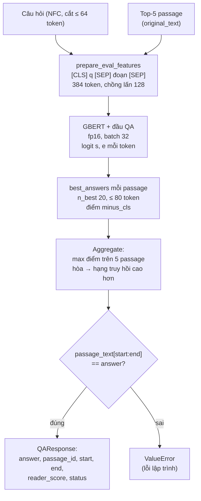

# BÀI 10 — GBERT READER: TRÍCH XUẤT SPAN VÀ CHỌN ĐÁP ÁN TỪ NHIỀU PASSAGE

> **Vị trí trong giáo trình**: Bài 05 dạy Transformer và đầu QA ở mức một cặp câu ngắn. Bài 08–09 dạy cách đưa 5 passage tốt nhất tới reader. Bài này dạy **reader như một thành phần của pipeline**:
> - từ ký tự đáp án đến nhãn token, và cửa sổ trượt 384/128;
> - giải mã span: `n_best`, `max_answer_tokens`, `raw` và `minus_cls`;
> - chọn **một** đáp án từ 5 passage, và vì sao đây chính là nút thắt Bài 09 tìm ra;
> - đọc đúng các con số: reader trên passage gold (EM 0,469) so với end-to-end (EM 0,236).
>
> Phần **huấn luyện** reader (loss, AdamW, warmup, chọn checkpoint) nằm ở Bài 11.
>
> **Ví dụ xuyên suốt**: câu "Wann wurde Hundefett in der Medizin verwendet?". Reader đọc 5 passage của BM25 và chọn passage hạng 3 (Haushund) với điểm 26,8, đáp án "vom Mittelalter bis in die Neuzeit", ký tự [576, 610).
>
> **Nguồn số liệu**: báo cáo mục 2.6, 4.3.1, 4.3.4, 4.5, 4.6.3–4.6.4; `src/germanqa/reader/features.py`, `postprocess.py`, `inference.py`, `qa_metrics.py`; `src/germanqa/pipeline.py`; `configs/reader.yaml`, `configs/pipeline.yaml`; `reports/reader_gold_context.json`, `pipeline_dev_predictions.jsonl`, `error_analysis_dev.json`, `paired_comparisons_dev.json`. Các phép đo gắn 📙 **[MỞ RỘNG]** chạy ngày 2026-11-14 bằng checkpoint `models/reader_20261101T213758Z_96717e35` trên GPU, **chỉ trên dev** (1.176 câu): đọc lại 5 passage BM25 của mỗi câu (5.879 passage, 7.441 cửa sổ) và passage gold. Không mở test.

---

## Mục lục

- [A. Learning Objectives](#a-learning-objectives)
- [B. Prerequisite Knowledge](#b-prerequisite-knowledge)
- [C. Theoretical Foundation](#c-theoretical-foundation)
- [D. Mathematical Foundation](#d-mathematical-foundation)
- [E. Architecture & Working Mechanism](#e-architecture--working-mechanism)
- [F. Application in Our Project](#f-application-in-our-project)
- [G. Implementation Mapping](#g-implementation-mapping)
- [H. YouTube Learning Resources](#h-youtube-learning-resources)
- [I. Knowledge Check](#i-knowledge-check)
- [J. Implementation Readiness](#j-implementation-readiness)
- [Đáp án và lời giải](#đáp-án-và-lời-giải)
- [Tài liệu tham khảo bài 10](#tài-liệu-tham-khảo-bài-10)

---

## A. LEARNING OBJECTIVES

### A.1. Mục tiêu kiến thức

Sau bài học, bạn giải thích được:

1. Reader biến (câu hỏi, passage) thành các **cửa sổ** token thế nào, và nhãn start/end được gán ra sao khi đáp án nằm ngoài cửa sổ.
2. Quy trình **giải mã span**: lấy `n_best` vị trí start và end, lọc cặp hợp lệ, tính điểm, cắt chuỗi bằng offset.
3. Khác biệt giữa điểm **`raw`** và **`minus_cls`**, và vì sao `minus_cls` không đổi thứ tự **trong** một cửa sổ.
4. Vì sao reader **cũng là bộ chọn passage**, và điều đó tạo ra loại lỗi "wrong passage".
5. Vì sao EM end-to-end chỉ khoảng một nửa EM trên passage gold.
6. EM và F1 của project chuẩn hóa chuỗi thế nào (không bỏ mạo từ tiếng Đức).

### A.2. Mục tiêu kỹ năng

1. Gọi `Reader.read(question, passages)` và đọc kết quả từng passage.
2. Tự viết hàm giải mã span cho một cửa sổ và kiểm bằng ví dụ có số.
3. Tính trần EM khi chọn passage hoàn hảo, và so với EM thực tế.
4. Chấm EM, F1 cho một cặp dự đoán và tham chiếu bằng tay.

### A.3. Những gì phải nhớ

| Con số | Ý nghĩa | Nguồn |
|---|---|---|
| `deepset/gbert-base` + đầu QA 768 → 2: 109.338.626 tham số (đầu QA 1.538) | reader | 📘 mục 4.3.1 |
| `max_length` 384, `stride` 128, câu hỏi ≤ 64 token | cửa sổ | `reader.yaml`, 📘 mục 2.6.7 |
| `n_best` 20, `max_answer_tokens` 80, `score_mode` minus_cls | giải mã | `pipeline.yaml`, 📘 Bảng 4.6 |
| Train: 10.301 câu → 13.263 cửa sổ, 18,0% nhãn [CLS] | dữ liệu huấn luyện | 📘 Bảng 4.4 |
| Dev, passage gold: EM 0,469, F1 0,699 | năng lực trích xuất | 📘 mục 4.6.3 |
| Dev, BM25 + reader: EM 0,236, F1 0,380 | end-to-end B0 | 📘 mục 4.6.3 |
| Gold ở top-5 trong 750 câu; reader chọn đúng passage ở 473 (63,1%) | reader là bộ chọn passage | 📘 mục 4.5.3 |
| 📙 Trần nếu chọn passage hoàn hảo: EM 0,305 | còn 7 điểm ở bước chọn | đo thêm |

### A.4. Thành phần pipeline dùng kiến thức này

Mọi cấu hình B0, B1, H0, H1 dùng **cùng một** reader và cùng cách giải mã. Chỉ 5 passage đưa vào thay đổi. Đây là thiết kế có chủ đích: chênh lệch EM giữa các cấu hình quy được về tầng truy hồi (📘 mục 2.1).

---

## B. PREREQUISITE KNOWLEDGE

### B.1. Kiến thức cần biết trước

| Kiến thức | Mức | Ôn ở đâu |
|---|---|---|
| WordPiece, `##`, offset mapping | Hiểu | Bài 05 C.1–C.2, E.3 |
| Đầu QA: logit start, end; softmax | Hiểu | Bài 05 C.7, D.8 |
| Cặp [CLS] q [SEP] c [SEP], `token_type_ids` | Hiểu | Bài 05 E |
| Cửa sổ chồng lấn, `stride` của HF | Hiểu | Bài 09 D.4 |
| Pipeline Retrieve → Select → Read, `minus_cls` lần đầu | Hiểu | Bài 02 E.4–E.5 |

### B.2. Thuật ngữ mới

| Thuật ngữ | Giải thích |
|---|---|
| **Extractive QA** | Đáp án là một đoạn con liên tục của passage, xác định bằng vị trí start và end. |
| **Feature / cửa sổ** | Một chuỗi [CLS] q [SEP] (một phần passage) [SEP] ≤ 384 token. Một passage có thể sinh nhiều cửa sổ. |
| **Nhãn [CLS]** | Nhãn (0, 0) cho cửa sổ không chứa trọn đáp án. |
| **`n_best`** | Số vị trí start (và end) có logit cao nhất được xét mỗi cửa sổ. |
| **`max_answer_tokens`** | Độ dài span tối đa (token) khi giải mã. |
| **`raw`** | Điểm span $= s_i + e_j$. |
| **`minus_cls`** | Điểm span $= s_i + e_j - (s_0 + e_0)$: trừ điểm "không có đáp án ở cửa sổ này". |
| **Aggregate** | Bước chọn đáp án có điểm cao nhất trong 5 passage. |
| **Wrong passage / wrong span** | Hai loại lỗi của reader: chọn passage khác dù gold ở top-5; chọn đúng passage nhưng sai ranh giới. |
| **first_ref / all_refs** | Chấm theo tham chiếu đầu tiên, hoặc lấy điểm cao nhất trên mọi tham chiếu (chỉ test có nhiều tham chiếu). |

### B.3. Mối liên hệ với bài trước

- Bài 09 D.7 kết luận: $P(\mathrm{EM} \mid \text{gold ở top-5})$ là thừa số quyết định, và nó **giảm** khi reranker đưa thêm passage gần chủ đề vào top-5. Bài này mở hộp đen đó: reader chọn passage bằng cách nào, và vì sao cách đó dễ bị đánh lừa.
- Bài 05 D.8 đã tính `minus_cls` = +0,57 cho một cặp câu ngắn một cửa sổ. Bài này cho thấy `minus_cls` chỉ có tác dụng khi so **giữa** các cửa sổ và passage.

---

## C. THEORETICAL FOUNDATION

### C.1. Bài toán của reader

📘 **[BÁO CÁO]** (mục 4.3): Reader là thành phần **duy nhất** của baseline được huấn luyện trên dữ liệu của đề tài. Với một câu hỏi và một passage, nó chỉ ra đoạn con của passage là câu trả lời. Backbone là `deepset/gbert-base` (Chan et al., 2020): 12 lớp, ẩn 768, 12 đầu, FFN 3.072, từ vựng 31.102 token WordPiece **cased**, 512 vị trí. Đầu QA là một lớp tuyến tính 768 → 2 (1.538 tham số), cho mỗi token hai logit $s_i$ (start) và $e_i$ (end).

Đặc điểm quan trọng nhất của reader trích xuất: **đáp án luôn kiểm chứng được**. Nó là chuỗi con của văn bản gốc, cắt bằng offset ký tự, không phải chữ do mô hình sinh ra. Pipeline kiểm bất biến `passage_text[start:end] == answer` trước khi trả về, và báo lỗi lập trình nếu sai (📘 mục 4.5.4).

Giới hạn tương ứng (📘 mục 2.6.7): reader không xử lý được đáp án **không liên tục** hoặc cần **tổng hợp** từ nhiều passage, và không có cơ chế **từ chối** trả lời ở V1.

### C.2. Từ ký tự đến nhãn token

📘 **[BÁO CÁO]** (mục 4.3.1). Dữ liệu cho đáp án dưới dạng chuỗi và vị trí ký tự bắt đầu. Hai bước:

1. **Bỏ khoảng trắng thừa** ở hai đầu đáp án (nhiều đáp án gốc có dấu cách ở cuối), rồi tính khoảng ký tự $[a, b)$ (`features.answer_chars`).
2. **Chuyển sang token** nhờ offset mapping (`features.label_window`): token start là token context **đầu tiên** có offset kết thúc $> a$; token end là token context **cuối cùng** có offset bắt đầu $< b$.

Cách chọn này bảo đảm đáp án nằm **trọn** trong khoảng token được gán, kể cả khi ranh giới rơi giữa một từ bị tách thành nhiều mảnh. Ví dụ thật trong báo cáo (Hình 4.4): đáp án "681" của "Wann wurde das Bulgarische Reich gegründet?" bị tách thành "68" và "##1", nên nhãn start là "68" (token 201), end là "##1" (token 202).

Nếu cửa sổ **không** chứa trọn đáp án, nhãn là (0, 0), tức token [CLS]. Quy ước này mượn từ SQuAD 2.0 (Devlin et al., 2019) và có hai tác dụng: giữ được mọi cửa sổ làm dữ liệu, và dạy mô hình cho điểm [CLS] **cao** khi cửa sổ không có đáp án. Điểm này là nền của `minus_cls` (C.5).

📘 **[BÁO CÁO]** Bảng 4.4:

| | Train | Dev |
|---|---|---|
| Số câu (mỗi câu một passage gold) | 10.301 | 1.176 |
| 1 / 2 / 3 cửa sổ | 7.366 / 2.908 / 27 | 830 / 345 / 1 |
| Tổng cửa sổ | 13.263 | 1.523 |
| Cửa sổ nhãn [CLS] | 2.382 (18,0%) | 264 (17,3%) |
| Độ dài cửa sổ trung bình (token) | 273,8 | 265,9 |
| Câu có ít nhất một cửa sổ chứa trọn đáp án | 10.300 | 1.176 |

Một câu train không có cửa sổ nào chứa trọn đáp án; nó chỉ góp các cửa sổ nhãn [CLS].

### C.3. Cửa sổ trượt

📘 **[BÁO CÁO]** (mục 4.3.4): BERT chỉ nhận 512 vị trí, và chi phí attention tăng theo bình phương độ dài. Passage trong corpus có trung bình 236 token, phân vị 95 là 454, một số dài hơn 2.000 token. Cắt cụt sẽ mất đáp án ở đuôi: ở dev, 11,9% câu có đáp án nằm sau 256 token đầu của passage gold.

Ví dụ thật (Hình 4.6): passage 489 token, câu hỏi 8 token. Cửa sổ 1 chứa token 0–372 của passage (373 token, tổng 384); cửa sổ 2 chứa token 245–488 (244 token, tổng 255); chồng lấn 128 token (245–372). Đáp án "681" ở token 436–437, nên chỉ cửa sổ 2 chứa nó.

Hai tính chất phải nhớ:

- Đáp án **ngắn hơn 128 token** luôn nằm trọn trong ít nhất một cửa sổ (nếu nó vắt qua biên cuối cửa sổ trước, phần đầu của nó nằm trong vùng chồng lấn và do đó nằm trong cửa sổ sau).
- Đáp án nằm trong vùng chồng lấn xuất hiện ở **cả hai** cửa sổ, cả hai có nhãn dương.

Khác với reranker (Bài 09), reader dùng `max_length` 384 chứ không phải 512: cửa sổ ngắn hơn rẻ hơn, và 70,6% passage gold của dev vừa một cửa sổ.

### C.4. Giải mã span trong một cửa sổ

📘 **[BÁO CÁO]** (mục 4.3.4, `postprocess.best_answers`). Với mỗi cửa sổ:

1. Lấy 20 vị trí có $s$ cao nhất và 20 vị trí có $e$ cao nhất (`n_best` = 20): tối đa 400 cặp $(i, j)$.
2. Giữ cặp **hợp lệ**: cả hai vị trí thuộc phần passage (offset khác `None`; không phải câu hỏi hay token đặc biệt), $j \ge i$, và $j - i + 1 \le$ `max_answer_tokens`.
3. Điểm cặp theo `raw` hoặc `minus_cls` (C.5).
4. Cặp điểm cao nhất trong **mọi cửa sổ** của passage là span của passage đó. Văn bản cắt từ passage gốc bằng $[\text{offset}_i.\text{start}, \text{offset}_j.\text{end})$.

Hai điểm tinh tế:

- `n_best` lấy trên **toàn** cửa sổ, kể cả token câu hỏi và [CLS]; các vị trí đó bị loại ở bước 2. Vì vậy số vị trí passage thực sự được xét có thể ít hơn 20. 📙 **[MỞ RỘNG]** Trên dev với passage gold, giải mã với `n_best` = 20 và giải mã vét cạn (mọi cặp) cho **đúng cùng** 1.176 đáp án: 20 là đủ.
- Nếu không cặp nào hợp lệ, passage nhận start −1 và điểm $-\infty$. Nếu cả 5 passage đều vậy, pipeline trả trạng thái `no_valid_span`.

### C.5. `raw` và `minus_cls`

$$\text{raw}(i, j) = s_i + e_j \qquad \text{minus\_cls}(i, j) = s_i + e_j - (s_0 + e_0)$$

với vị trí 0 là [CLS] của **cửa sổ chứa span**.

Lý do (📘 mục 2.6.6, 4.3.4): softmax được tính **riêng** trong từng cửa sổ khi huấn luyện, nên logit thô của các cửa sổ khác nhau không cùng thang. Một cửa sổ mà mô hình tin chắc "không có đáp án" vẫn có thể có cặp $(i, j)$ tổng logit khá lớn. Trừ điểm [CLS] biến điểm thành **độ chênh so với phương án "không có đáp án"**, nên so sánh giữa các cửa sổ và passage có cơ sở hơn. Wang et al. (2019) đề xuất cách triệt để hơn: chuẩn hóa toàn cục trên mọi passage của câu hỏi ngay khi huấn luyện; reader của project **không** huấn luyện theo cách đó, và `minus_cls` chỉ là một xấp xỉ.

Hệ quả quan trọng: $s_0 + e_0$ là **hằng số trong một cửa sổ**. Vì vậy `minus_cls` **không đổi** thứ tự các span trong cùng cửa sổ; nó chỉ đổi phép so sánh **giữa** cửa sổ và giữa passage. Trên passage gold có 70,6% câu chỉ một cửa sổ, nên không ngạc nhiên khi hai chế độ gần như bằng nhau ở Bảng 4.6.

📘 **[BÁO CÁO]** Bảng 4.6 (dev, passage gold cho sẵn, EM / F1):

| Chế độ | 20 token | 30 | 50 | 80 |
|---|---|---|---|---|
| raw | 0,428 / 0,651 | 0,450 / 0,679 | 0,464 / 0,691 | 0,465 / 0,698 |
| minus_cls | 0,430 / 0,653 | 0,455 / 0,680 | 0,469 / 0,691 | **0,469 / 0,699** |

Trên toàn pipeline 5 passage, chênh EM giữa hai chế độ là −0,003 [−0,018; 0,012], chứa 0. 📘 Báo cáo nói rõ: giữ `minus_cls` vì **cơ sở lý thuyết** khi so giữa nhiều passage, không phải vì chênh lệch đo được có ý nghĩa.

📙 **[MỞ RỘNG]** Kiểm lại cơ sở lý thuyết đó bằng dữ liệu: trên 750 câu dev có gold ở top-5 BM25, chế độ nào chọn đúng **passage** gold nhiều hơn?

| | Chọn đúng passage gold | EM end-to-end (1.176 câu) | EM khi đã chọn đúng passage |
|---|---|---|---|
| minus_cls (project) | 473 / 750 | 0,2364 | 0,522 |
| raw | **497 / 750** | 0,2338 | 0,483 |
| raw − minus_cls [KTC 95%] | +0,032 [−0,003; +0,067] | −0,0026 [−0,017; +0,015] | |

Kết quả ngược với kỳ vọng: `raw` chọn đúng passage **nhiều hơn** 24 câu (khoảng tin cậy vẫn chứa 0), nhưng EM không cao hơn vì các câu `raw` "thêm" được thường là câu khó, trích sai span. Lập luận "`minus_cls` so giữa passage tốt hơn" vì vậy **chưa được dữ liệu dev ủng hộ**; cả hai chế độ đều là xấp xỉ, và việc giữ `minus_cls` là một lựa chọn hợp lý nhưng không phải đã kiểm chứng. Số EM của `minus_cls` (0,2364) và chênh −0,0026 khớp báo cáo, nên phép đo tái lập đúng pipeline.

### C.6. Độ dài đáp án tối đa

📘 **[BÁO CÁO]** Bảng 4.6: tăng `max_answer_tokens` từ 20 lên 80 làm EM tăng từ 0,428 lên 0,465 (raw); từ 50 lên 80 mức tăng đã rất nhỏ. Lý do là GermanQuAD có những đáp án **thật sự dài**.

📙 **[MỞ RỘNG]** Độ dài (token GBERT) của 1.176 đáp án tham chiếu ở dev: trung vị 8, p90 39, p99 95, dài nhất 126. Có 161 đáp án dài hơn 30 token và 22 đáp án (1,9%) dài hơn 80. Với `max_answer_tokens` = 80, 22 câu này **không thể** đạt EM, dù reader có hoàn hảo. Đáp án GermanQuAD dài hơn hẳn SQuAD tiếng Anh, nơi giới hạn 30 token là mặc định phổ biến; đây là lý do phải chọn lại tham số này trên dev thay vì giữ mặc định.

Chú ý: một đáp án dài 81–127 token vẫn vừa trong vùng chồng lấn 128 token, nên giới hạn ở đây đến từ `max_answer_tokens`, không phải từ cửa sổ.

### C.7. Từ 5 passage ra một đáp án: reader cũng là bộ chọn passage

📘 **[BÁO CÁO]** (mục 4.5.1–4.5.3). Pipeline đọc **từng** passage trong top-5 như một ví dụ riêng, lấy span tốt nhất của mỗi passage, rồi chọn passage có điểm span **cao nhất**; hòa thì passage hạng truy hồi cao hơn thắng. Reader **không** nhận điểm hay hạng truy hồi (Bài 02).

Vì vậy reader làm **hai** việc: trích span và chọn passage. Trên dev với BM25 (1.176 câu), passage được chọn có hạng BM25 1 ở 415 câu (35,3%), hạng 2 ở 264 (22,4%), hạng 3 ở 196 (16,7%), hạng 4 ở 174 (14,8%), hạng 5 ở 127 (10,8%): **64,7%** số lần reader chọn passage không đứng đầu. Trong 750 câu có gold ở top-5, reader chọn đúng passage gold ở 473 câu (63,1%).

📙 **[MỞ RỘNG]** Bước chọn passage đáng giá bao nhiêu (dev, B0, top-5):

| Cách chọn đáp án | EM |
|---|---|
| Chỉ đọc passage hạng 1 của BM25 | 0,1658 |
| Max điểm `raw` trên 5 passage | 0,2338 |
| **Max điểm `minus_cls` trên 5 passage (project)** | **0,2364** |
| Chọn passage hoàn hảo: đọc passage gold nếu nó ở top-5 (trần) | 0,3053 |

- Đọc 5 passage và để reader chọn tốt hơn hẳn chỉ đọc passage hạng 1 (+7,1 điểm): điểm reader **có** giá trị phân biệt passage.
- Nhưng còn **6,9 điểm EM** nằm ở bước chọn passage: nếu reader luôn chọn đúng passage gold khi có, EM lên 0,305. Đây là con số định lượng cho loại lỗi "wrong passage" (253 câu, 📘 Bảng 4.14) và cho nghịch lý H1 ở Bài 09.

### C.8. Chuẩn hóa và chấm EM, F1

📘 **[BÁO CÁO]** (mục 4.6.1, `qa_metrics.py`). Trước khi so, dự đoán và tham chiếu được: hạ chữ thường; bỏ dấu câu, **kể cả** dấu ngoặc kép tiếng Đức „ “ ‚ ‘ » «, gạch ngang – —, ba chấm …; gộp khoảng trắng. **Không** bỏ mạo từ der, die, das (khác với script SQuAD tiếng Anh, vốn bỏ a, an, the), vì đó là từ thật trong tiếng Đức.

- EM = 1 nếu hai chuỗi đã chuẩn hóa giống hệt.
- F1 tính trên túi từ chung (có tính lặp).
- Nhiều tham chiếu: lấy điểm **cao nhất**. Dev có một tham chiếu mỗi câu; test có nhiều, nên báo cả first_ref và all_refs. Cùng một hệ thống B0 trên test: EM 0,222 (first_ref) so với 0,330 (all_refs), chỉ do cách chấm.

Hệ quả của việc không bỏ mạo từ: 📘 10 câu dev chỉ khác đáp án ở mạo từ đứng đầu bị tính sai (mục 4.6.4). Đây là lựa chọn nghiêm khắc có chủ đích, không phải lỗi.

### C.9. Reader trên passage gold và end-to-end

📘 **[BÁO CÁO]** (mục 4.6.3):

| | Dev EM / F1 | Test EM (first_ref) | Test EM (all_refs) |
|---|---|---|---|
| Reader, passage gold cho sẵn | 0,469 / 0,699 | 0,416 | 0,583 |
| BM25 + reader (B0) | 0,236 / 0,380 | 0,222 | 0,330 |
| Tỉ lệ | 50% | 53% | 57% |

EM end-to-end chỉ khoảng một nửa EM đọc hiểu: phần mất là cái giá của việc phải tìm đúng passage trong 26.864 passage, đưa nó vào top-5, **và** để reader chọn nó.

Reader trên passage gold cũng phụ thuộc số cửa sổ: dev 1 cửa sổ (830 câu) EM 0,490, F1 0,724; 2 cửa sổ (345 câu) EM 0,420, F1 0,638. 📘 Báo cáo không tách được hai nguyên nhân: passage dài nhiều nhiễu hơn, hay so sánh logit giữa cửa sổ khó hơn.

📘 **[BÁO CÁO]** Phân rã 898 câu sai của B0 trên dev (Bảng 4.14): truy hồi (ngoài top-20) 216; chọn (top-20, ngoài top-5) 203; **wrong passage** 253; **wrong span** 226. Hai loại của reader chiếm 479 câu (40,7% tổng số câu). Trong 226 câu wrong span, 119 câu có F1 ≥ 0,5, và 157 câu (69%) chỉ lệch ranh giới (88 thiếu chữ, 69 thừa chữ). Bài 12 phân tích sâu hơn.

### C.10. Điểm reader có dùng để từ chối trả lời được không?

V1 **luôn** trả một span nếu có ít nhất một span hợp lệ (📘 mục 4.5.4). 📙 **[MỞ RỘNG]** Điểm `minus_cls` của đáp án được chọn có liên hệ với độ đúng không? Chia 1.176 câu dev (B0) thành 5 nhóm bằng nhau theo điểm:

| Nhóm điểm (ngũ phân vị) | < 13,81 | 13,81–18,21 | 18,21–21,33 | 21,33–24,34 | > 24,34 |
|---|---|---|---|---|---|
| EM | 0,085 | 0,179 | 0,183 | 0,282 | 0,451 |

Điểm cao thì đúng nhiều hơn rõ rệt, nên điểm reader **có** tín hiệu. Nhưng từ chối theo ngưỡng thì được ít: ngưỡng 10 bỏ 113 câu, EM trên số còn lại tăng từ 0,236 lên 0,252, và trong 113 câu bị bỏ vẫn có 8,8% câu đúng. Muốn dùng để từ chối thật cần hiệu chỉnh và chọn ngưỡng trên một tập riêng; project chưa làm.

---

## D. MATHEMATICAL FOUNDATION

### D.1. Phân phối start, end và điểm span

Trong một cửa sổ $n$ token, mô hình cho $s, e \in \mathbb{R}^n$:

$$P(\text{start} = i) = \frac{e^{s_i}}{\sum_{k=1}^{n} e^{s_k}}, \qquad P(\text{end} = j) = \frac{e^{e_j}}{\sum_{k=1}^{n} e^{e_k}}$$

Nếu coi start và end độc lập:

$$\log P(i, j) = s_i + e_j - \log Z_s - \log Z_e$$

với $Z_s, Z_e$ là hai mẫu số. Trong **một** cửa sổ, $\log Z_s + \log Z_e$ là hằng số, nên xếp hạng theo $s_i + e_j$ (raw) đúng bằng xếp hạng theo log-xác suất. **Giữa** hai cửa sổ thì không: mỗi cửa sổ có $Z$ riêng.

### D.2. `minus_cls` là gì về mặt xác suất?

$$\text{minus\_cls}(i, j) = (s_i + e_j) - (s_0 + e_0) = \log \frac{P(i, j)}{P(0, 0)}$$

vì $\log Z$ triệt tiêu. Đây là **log-tỉ số** giữa "đáp án là $(i, j)$" và "không có đáp án ở cửa sổ này", trong cùng một cửa sổ. Thay hằng số chuẩn hóa $\log Z$ (không so được giữa cửa sổ) bằng một điểm tham chiếu mà mô hình **được huấn luyện** để làm cao khi không có đáp án.

Ví dụ thật, passage gold của câu Hundefett (📙 E.3): raw 17,16; $s_0 + e_0 = -9{,}65$; minus_cls $= 17{,}16 - (-9{,}65) = 26{,}81$. Mô hình rất chắc cửa sổ này **có** đáp án, nên `minus_cls` cộng thêm gần 10 điểm.

### D.3. Hàm mất mát (tóm tắt, chi tiết ở Bài 11)

Với nhãn $(y_s, y_e)$ của một cửa sổ:

$$\mathcal{L} = \frac{1}{2}\left[ -\log P(\text{start} = y_s) - \log P(\text{end} = y_e) \right]$$

Cửa sổ nhãn [CLS] có $y_s = y_e = 0$: hàm mất mát đẩy $s_0, e_0$ lên. Đó là lý do $s_0 + e_0$ là một "điểm không có đáp án" có nghĩa.

### D.4. Kích thước không gian tìm kiếm

Một cửa sổ có $c$ token passage. Số span hợp lệ với độ dài tối đa $L$:

$$N(c, L) = \sum_{\ell=1}^{\min(c, L)} (c - \ell + 1)$$

Với $c = 250$, $L = 80$: $N = 80 \cdot 251 - \frac{80 \cdot 81}{2} = 20.080 - 3.240 = 16.840$ span. `n_best` = 20 xét tối đa 400 cặp, trong đó chỉ một phần hợp lệ. Vét cạn vẫn rẻ (vài chục nghìn phép cộng), nhưng `n_best` gọn hơn và, như C.4 đo, không mất gì.

### D.5. EM và F1: ví dụ tính tay

Tham chiếu: „vom Mittelalter bis in die Neuzeit“. Dự đoán: "Mittelalter bis in die Neuzeit".

- Chuẩn hóa: tham chiếu → `vom mittelalter bis in die neuzeit` (6 từ, dấu „ “ bị bỏ); dự đoán → `mittelalter bis in die neuzeit` (5 từ).
- EM = 0 (khác nhau ở "vom").
- Từ chung: 5. Precision = 5/5 = 1; Recall = 5/6. $F_1 = \frac{2 \cdot 1 \cdot 5/6}{1 + 5/6} = \frac{10/6}{11/6} = \frac{10}{11} \approx 0{,}909$.

Đây là loại "thiếu chữ" (dự đoán nằm trọn trong tham chiếu), nhóm đông nhất của wrong span (88/226).

### D.6. Trần EM theo tầng

Gọi $G_5$ = "gold ở top-5", $P$ = "reader chọn passage gold", $S$ = "span đúng". Với B0 trên dev (📘 và 📙):

$$\Pr(G_5) = \frac{750}{1.176} = 0{,}638, \quad \Pr(P \mid G_5) = \frac{473}{750} = 0{,}631, \quad \Pr(S \mid P) = 0{,}522$$

$$\Pr(G_5)\Pr(P \mid G_5)\Pr(S \mid P) = 0{,}638 \times 0{,}631 \times 0{,}522 = 0{,}210$$

Phần còn lại đến EM 0,236 là các câu đúng **không** qua passage gold (chuỗi đáp án xuất hiện ở passage khác: 📘 mục 4.6.4 đếm được 37 + 51 + 77 câu như vậy trong các nhóm lỗi). Ba thừa số cho thấy ba đòn bẩy: truy hồi ($\Pr(G_5)$, Bài 04–09), chọn passage ($\Pr(P \mid G_5)$, bài này) và trích span ($\Pr(S \mid P)$, Bài 11).

---

## E. ARCHITECTURE & WORKING MECHANISM

### E.1. Luồng của reader trong pipeline



### E.2. Input → Processing → Output

| | Nội dung |
|---|---|
| **Input** | Câu hỏi đã chuẩn hóa; danh sách `[{passage_id, text}]` (5 passage, `original_text`, giữ chữ hoa và dấu câu). |
| **Processing** | (1) `_cut_question`: cắt câu hỏi còn ≤ 64 token, đánh dấu `question_truncated`. (2) `prepare_eval_features`: tokenize cặp, `truncation="only_second"`, sinh cửa sổ, offset `None` cho phần không thuộc passage. (3) `predict_logits`: sắp cửa sổ theo độ dài, chạy theo lô 32 với fp16 autocast. (4) `best_answers`: giải mã từng passage. (5) Aggregate và kiểm bất biến. |
| **Output** | `QAResponse`: `answer`, `passage_id`, `passage_text`, `answer_start`, `answer_end` (ký tự), `retrieval_score`, `reader_score`, các thời gian, phiên bản mô hình và corpus, `status` ∈ {ok, question_truncated, empty_question, no_passages, no_valid_span}. Với `trace=True`: thêm `candidates` (span và điểm của **từng** passage). |

### E.3. Ví dụ thật: câu Hundefett

📙 **[MỞ RỘNG]** Đọc lại top-5 BM25 của câu Hundefett bằng checkpoint của project (dev):

| Hạng BM25 | Passage | Gold? | raw | $s_0 + e_0$ | **minus_cls** | Span (đầu chuỗi) |
|---|---|---|---|---|---|---|
| 1 | Vachellia_tortilis | | 0,75 | 2,56 | −1,81 | "Traditionell werden aus der Rinde Stricke …" |
| 2 | Somatologie | | −9,03 | 6,36 | −15,39 | "Der Begriff wird heute auch in der Literatur …" |
| 3 | **Haushund** | ✓ | **17,16** | **−9,65** | **26,80** | "vom Mittelalter bis in die Neuzeit" |
| 4 | Sprachtest | | −7,68 | 2,30 | −9,97 | "Häufig verwendet man zu diesem Zweck …" |
| 5 | Biorhythmus | | −9,95 | 1,74 | −11,69 | "Die von der Biorhythmik postulierten …" |

Đọc bảng:

- Bốn passage sai đều có $s_0 + e_0$ **dương**: mô hình nghiêng về "không có đáp án ở đây", nên `minus_cls` kéo điểm của chúng xuống thêm. Passage gold có $s_0 + e_0 = -9{,}65$: mô hình rất chắc có đáp án, nên điểm được kéo **lên**.
- Ở câu này hai chế độ cho cùng kết quả, nhưng `minus_cls` làm khoảng cách giữa gold và hạng nhì tăng từ 16,4 lên 28,6.
- Các span của passage sai là những **câu dài vô nghĩa** với câu hỏi: khi không có đáp án, reader vẫn buộc phải chọn một span, và nó chọn một đoạn dài gần giới hạn 80 token. Đây là hình ảnh của "không có cơ chế từ chối".
- Điểm các passage khớp số trong báo cáo (Hình 4.8: −1,8; −15,4; +26,8; …), nên phép chạy lại tái lập đúng pipeline.

📙 Phân phối $s_0 + e_0$ trên 7.441 cửa sổ (5 passage BM25 × 1.176 câu dev): trung vị −0,63, p10 −10,95, p90 +10,43. Điểm [CLS] dao động hơn 20 logit giữa các cửa sổ: đủ lớn để đổi kết quả so sánh giữa passage, nên chọn có trừ hay không là chuyện đáng bàn (C.5).

---

## F. APPLICATION IN OUR PROJECT

### F.1. Thành phần này nằm ở đâu?

| Việc | File / hàm | Cấu hình |
|---|---|---|
| Đọc dữ liệu QA kèm passage gold | `reader/features.py: load_examples` | `data/processed/qa_*.jsonl` |
| Ký tự → nhãn token | `features.answer_chars`, `label_window` | — |
| Cửa sổ cho train / eval | `features.prepare_train_features`, `prepare_eval_features` | `reader.yaml: max_length, stride` |
| Tokenizer, mô hình | `reader/model_io.py: get_tokenizer` (gọi `tokenization.load_bert_tokenizer`), `get_model` | `vocab.txt`, `config.json` |
| Chạy mô hình | `reader/trainer.py: predict_logits` | `eval_batch_size` |
| Giải mã | `reader/postprocess.py: best_answers` | `pipeline.yaml: score_mode, max_answer_tokens` |
| Lớp suy luận | `reader/inference.py: Reader.read`, `.logits`, `.decode` | — |
| Ghép pipeline | `pipeline.py: QAPipeline.answer`, `_cut_question` | `pipeline.yaml: reader_top_k` |
| Chấm điểm | `reader/qa_metrics.py: normalize`, `exact_match`, `f1_score`, `score_answers` | — |

Một chi tiết thiết kế đáng học: `Reader.logits` và `Reader.decode` **tách riêng**. Chạy mô hình một lần, rồi thử nhiều cách giải mã (lưới `max_answer_tokens` × `score_mode` ở Bảng 4.6) mà không chạy lại GPU.

### F.2. Vì sao nhóm cần hiểu bài này?

- Reader là thành phần duy nhất được huấn luyện; mọi cải tiến ở Chương 5 đều giữ nguyên nó. Bài 09 chỉ ra nó là **nút thắt** của H1.
- Hiểu C.7 và D.6 là biết cải tiến tiếp theo nên đặt ở đâu: còn 6,9 điểm EM ở bước chọn passage, chưa kể phần trích span.
- Giao diện API hiển thị `passage_text` và tô sáng `[answer_start, answer_end)`; hiểu bất biến offset là hiểu vì sao việc tô sáng luôn đúng.

### F.3. Đầu vào và đầu ra thực tế

Một dòng `reports/pipeline_dev_predictions.jsonl` (rút gọn):

```json
{"question_id": "q_0801808ed0ccd8b5", "question": "Wann wurde Hundefett in der Medizin verwendet?",
 "answer": "vom Mittelalter bis in die Neuzeit", "passage_id": "p_c25e144a863973b9",
 "answer_start": 576, "answer_end": 610, "reader_score": 26.8, "status": "ok",
 "candidates": [{"rank": 1, "answer": "Traditionell werden …", "reader_score": -1.81}, "…"]}
```

`reader_score` là điểm `minus_cls`, không phải xác suất, và không so được với `retrieval_score`.

### F.4. Nếu thay đổi thì sao?

| Thay đổi | Ảnh hưởng | Phải làm lại |
|---|---|---|
| `max_answer_tokens` 80 → 30 | EM gold 0,469 → 0,455; mất các đáp án dài | Chỉ giải mã lại |
| `score_mode` → raw | EM pipeline −0,003 (chứa 0); chọn passage gold +24 câu (C.5) | Chỉ giải mã lại |
| `reader_top_k` 5 → 10 | EM +0,017 [0,004; 0,029] (dev B0), chậm hơn | `pipeline.yaml` |
| `reader_top_k` 5 → 3 | EM −0,013 [−0,025; 0,000] (đảo dấu của phép so 5 với 3) | như trên |
| `max_length` 384 → 512 | Ít cửa sổ hơn, mỗi cửa sổ đắt hơn; khác lúc huấn luyện | Nên huấn luyện lại |
| Đổi tokenizer | Offset, nhãn, checkpoint đều không còn khớp | Huấn luyện lại |
| Thêm ngưỡng từ chối | Có tín hiệu (C.10) nhưng chưa hiệu chỉnh | Chọn ngưỡng trên tập riêng, thêm trạng thái mới |

Số của `reader_top_k`: 📘 Bảng 4.10, ghép cặp trên dev.

### F.5. Tham số cần chú ý

| Tham số | Giá trị | Ở đâu | Ghi chú |
|---|---|---|---|
| `max_length` | 384 | `reader.yaml` | cả câu hỏi và token đặc biệt |
| `stride` | 128 | `reader.yaml` | phần chồng lấn |
| `MAX_QUESTION_TOKENS` | 64 | `pipeline.py` | câu hỏi dài hơn bị cắt, trạng thái `question_truncated` |
| `n_best` | 20 | `reader.yaml` | đủ, theo C.4 |
| `max_answer_tokens` | 80 (suy luận) / 30 (đánh giá lúc huấn luyện) | `pipeline.yaml` / `reader.yaml` | xem Bài 11 |
| `score_mode` | minus_cls | `pipeline.yaml` | |
| `reader_top_k` | 5 | `pipeline.yaml` | lựa chọn về chi phí |
| `checkpoint` | `models/reader_20261101T213758Z_96717e35` | `pipeline.yaml` | epoch 2 (Bài 11) |

---

## G. IMPLEMENTATION MAPPING

### G.1. Thư viện

| Thư viện | Dùng cho |
|---|---|
| `transformers` | `BertForQuestionAnswering` / `AutoModelForQuestionAnswering`; tokenizer nhanh để có `offset_mapping`, `overflow_to_sample_mapping`, `sequence_ids` |
| `germanqa.tokenization` | Dựng WordPiece trực tiếp từ `vocab.txt` và **kiểm** từ vựng. 📘 Lý do (mục 4.3.1): với transformers 5.17–5.22, lớp tokenizer nhanh có sẵn bỏ qua từ vựng mà không báo lỗi, khiến mọi từ thành [UNK] |
| `torch` | autocast fp16, `inference_mode` |
| `numpy` | `argsort` khi giải mã |

### G.2. Class và function

| Tên | Vai trò |
|---|---|
| `label_window(offsets, seq_ids, start_char, end_char)` | Nhãn (start, end) trong một cửa sổ, hoặc (0, 0) |
| `prepare_eval_features(examples, tokenizer, max_length, stride)` | Cửa sổ + offset (`None` ngoài passage) + `example_index` |
| `best_answers(examples, feats, start_logits, end_logits, n_best, max_answer_tokens, score_mode)` | Span tốt nhất **mỗi ví dụ** (một passage), qua mọi cửa sổ |
| `Reader.read(question, passages)` | Span tốt nhất của **từng** passage, đúng thứ tự đầu vào |
| `QAPipeline.answer(question, ...)` | Retrieve → (rerank) → Select → Read → Aggregate → kiểm bất biến |
| `normalize`, `exact_match`, `f1_score` | Chấm điểm |

### G.3. Pseudocode

```
function ANSWER(q, passages[1..5]):
    q ← cut(q, 64 token)
    for each passage p:
        windows ← split([CLS] q [SEP] p [SEP], 384, overlap 128)
        best[p] ← (−∞, none)
        for each window w:
            s, e ← reader(w)
            bias ← s[0] + e[0]
            for i in top20(s), j in top20(e):
                if i, j ∈ context(w) and i ≤ j and j − i + 1 ≤ 80:
                    best[p] ← max(best[p], s[i] + e[j] − bias)
    (span, p*) ← argmax over p of best[p]      # hòa: hạng truy hồi cao hơn
    assert text(p*)[span] == answer
    return answer, p*, span
```

### G.4. Code minh họa: giải mã một cửa sổ

Không cần mô hình. Đã chạy, kết quả thật:

```python
import numpy as np

def decode(start, end, offsets, n_best=3, max_len=4, minus_cls=True):
    """start, end: logit từng token của MỘT cửa sổ; offsets[i] = (a, b) nếu token i thuộc context, None nếu không."""
    bias = start[0] + end[0] if minus_cls else 0.0          # token 0 là [CLS]
    best = (-np.inf, None, None)
    for i in np.argsort(start)[::-1][:n_best]:
        for j in np.argsort(end)[::-1][:n_best]:
            if offsets[i] is None or offsets[j] is None or j < i or j - i + 1 > max_len:
                continue
            score = start[i] + end[j] - bias
            if score > best[0]:
                best = (score, i, j)
    return best

context = "Von Hundefett nahm man an, dass es hilft."
#  token: [CLS] Wann ? [SEP] Von Hunde ##fe ##tt nahm man an , dass es hilft . [SEP]
offsets = [None, None, None, None, (0, 3), (4, 9), (9, 11), (11, 13), (14, 18), (19, 22), (23, 25),
           (25, 26), (27, 31), (32, 34), (35, 40), (40, 41), None]
start = np.array([1.0, -5, -5, -6, 0.5, 4.0, -3, -3, 1.0, -2, -2, -4, -1, -2, 0.0, -4, -6])
end   = np.array([0.5, -5, -5, -6, -1, -2, -1, 3.5, -1, -2, 1.5, -3, -2, -2, 2.0, -1, -6])
for mc in (False, True):
    s, i, j = decode(start, end, offsets, minus_cls=mc)
    print("minus_cls" if mc else "raw      ", "score", float(s), "tokens", (int(i), int(j)),
          "->", repr(context[offsets[i][0]:offsets[j][1]]))
for nb in (3, 5):
    s, i, j = decode(start, end, offsets, n_best=nb, max_len=2)
    print("max_len=2, n_best=%d ->" % nb, "không có span hợp lệ" if i is None
          else (int(i), int(j), repr(context[offsets[i][0]:offsets[j][1]]), float(s)))
```

```
raw       score 7.5 tokens (5, 7) -> 'Hundefett'
minus_cls score 6.0 tokens (5, 7) -> 'Hundefett'
max_len=2, n_best=3 -> không có span hợp lệ
max_len=2, n_best=5 -> (5, 6, "'Hundefe'", 1.5)
```

Ba bài học từ 9 dòng này:

1. `raw` và `minus_cls` chọn **cùng** span trong một cửa sổ; chỉ điểm khác nhau (7,5 và 6,0, lệch đúng $s_0 + e_0 = 1{,}5$).
2. Ràng buộc chặt + `n_best` nhỏ có thể không còn cặp hợp lệ nào: đó là `no_valid_span`.
3. Span có thể kết thúc ở một mảnh `##` giữa từ ("Hundefe"): giải mã của project **không** cấm điều đó. 📙 Trên dev (B0, 1.176 đáp án), không đáp án nào bị cắt giữa từ (0/1.176): mô hình đã học ranh giới từ từ dữ liệu, nhưng đó là hành vi học được, không phải ràng buộc.

### G.5. Code: đọc lại top-5 và đo bước chọn passage

Chạy từ thư mục gốc project bằng `venv`, cần GPU (khoảng 2 phút cho 7.441 cửa sổ). Đây là phần lõi của script đã dùng cho C.5, C.7, E.3:

```python
import sys, json, numpy as np; sys.path.insert(0, "src")
from germanqa.config import PROCESSED_DIR
from germanqa.data.io_utils import read_jsonl, read_json
from germanqa.reader.features import load_examples
from germanqa.reader.inference import Reader
from germanqa.reader.postprocess import best_answers
from germanqa.reader.qa_metrics import exact_match

C = {r["passage_id"]: r["original_text"] for r in read_jsonl("data/processed/corpus.jsonl")}
qrels = read_json("data/processed/qrels_dev.json")
dev = {e["id"]: e for e in load_examples(PROCESSED_DIR, "dev")}
preds = [json.loads(l) for l in open("reports/pipeline_dev_predictions.jsonl", encoding="utf8")]

R = Reader("models/reader_20261101T213758Z_96717e35")
exs, meta = [], []
for p in preds:
    for r in p["retrieved"][:5]:
        exs.append({"id": p["question_id"] + "|" + r["passage_id"], "question": p["question"],
                    "context": C[r["passage_id"]], "answers": []})
        meta.append((p["question_id"], r["passage_id"], r["rank"]))
feats, s, e = R.logits(exs)                                   # chạy mô hình MỘT lần
mc = best_answers(exs, feats, s, e, 20, 80, "minus_cls")       # giải mã bao nhiêu lần cũng được
by = {}
for (q, pid, rk), ex in zip(meta, exs):
    by.setdefault(q, []).append((rk, pid, mc[ex["id"]]))

em = lambda q, t: max(exact_match(t, a["text"]) for a in dev[q]["answers"])
pick = {q: max(L, key=lambda x: (x[2]["score"], -x[0])) for q, L in by.items()}   # hòa: hạng cao hơn
print("EM project", np.mean([em(q, pick[q][2]["text"]) for q in by]))
gold_in = [q for q in by if any(pid in qrels[q] for _, pid, _ in by[q])]
print("chọn đúng passage", sum(pick[q][1] in qrels[q] for q in gold_in), "/", len(gold_in))
```

Kết quả: EM 0,2364; chọn đúng passage 473/750 (khớp 📘 mục 4.5.3).

### G.6. Kiểm tra từng bước

| Bước | Kiểm gì | Giá trị mong đợi |
|---|---|---|
| Tokenizer | `hundefett` không thành [UNK]; `vocab_size` 31.102 | `tokenization.py` kiểm |
| Nhãn | Cắt lại chuỗi từ token nhãn bằng offset | đúng đáp án (Hình 4.4) |
| Cửa sổ | Số cửa sổ dev | 1.523 |
| Gold context | EM, F1 dev | 0,469 / 0,699 |
| Pipeline | EM dev B0 | 0,236 |
| Bất biến | `passage_text[start:end] == answer` | luôn đúng, nếu không là `ValueError` |
| Câu dài | Câu hỏi > 64 token | `status = question_truncated` |

### G.7. Lỗi thường gặp

| Lỗi | Hậu quả | Cách tránh |
|---|---|---|
| Đưa `retrieval_text` (chữ thường) vào reader | Reader cased mất tín hiệu chữ hoa; đáp án là chữ thường, và offset tính trên `retrieval_text` không còn tô sáng đúng trên `original_text` | Dùng `original_text` |
| Ghép đáp án từ token (`tokenizer.decode`) | Mất khoảng trắng, dấu, chữ hoa gốc | Cắt bằng offset |
| Không bỏ khoảng trắng ở đầu đáp án gốc | Nhãn lệch, đáp án có dấu cách thừa | `answer_chars` |
| `truncation=True` thay vì `only_second` | Câu hỏi có thể bị cắt | `only_second` |
| So `raw` giữa các cửa sổ như so xác suất | Cửa sổ có $Z$ lớn thắng oan (D.1) | Hiểu cả hai chỉ là xấp xỉ |
| Dùng `max_answer_tokens` 30 vì là mặc định SQuAD | EM thấp hơn; đáp án GermanQuAD dài | Chọn trên dev (C.6) |
| Bỏ mạo từ khi chấm theo script SQuAD | Số không so được với báo cáo | Dùng `qa_metrics.normalize` |
| So EM test all_refs với EM dev | So hai cách chấm khác nhau | So first_ref với dev |

---

## H. YOUTUBE LEARNING RESOURCES

> Mọi URL dưới đây xuất hiện trong kết quả tìm kiếm web (giới hạn youtube.com) ngày 2026-11-14. Kết quả tìm kiếm **không hiển thị tên kênh**; khi đó giáo trình ghi "chưa xác nhận". Tên video ghi theo đúng tiêu đề trong kết quả. Hãy mở video kiểm tra trước khi trích dẫn.

### H.1. Video đã tìm thấy

| # | Tên video | Kênh | URL | Hỗ trợ mục |
|---|---|---|---|---|
| 1 | Data processing for Question Answering | chưa xác nhận (kết quả tìm kiếm mô tả là video của Hugging Face course) | https://www.youtube.com/watch?v=qgaM0weJHpA | C.2, C.3 |
| 2 | 🤗 Tasks: Question Answering | chưa xác nhận | https://www.youtube.com/watch?v=ajPx5LwJD-I | C.1 |
| 3 | Document STRIDE when Tokenizing with HuggingFace Transformer for NLP Projects | chưa xác nhận | https://www.youtube.com/watch?v=91msLyGC-LI | C.3 |

### H.2. Nội dung chính và đoạn cần tập trung

| # | Nội dung (theo tiêu đề và mô tả) | Tập trung vào |
|---|---|---|
| 1 | Tiền xử lý dữ liệu QA: offset, cửa sổ, nhãn | So với C.2: quy tắc gán nhãn [CLS] khi đáp án ngoài cửa sổ |
| 2 | Tổng quan nhiệm vụ QA trích xuất | Phân biệt extractive và generative |
| 3 | `stride` khi tokenize | Xác nhận `stride` là phần **chồng lấn** |

### H.3. Thứ tự xem đề xuất

```
② → ① → đọc C.2–C.4 → ③ → chạy G.4 → đọc tài liệu HF (H.5) phần hậu xử lý → chạy G.5 nếu có GPU
```

### H.4. Link tìm kiếm YouTube (không phải video đã xác minh)

- Span prediction: https://www.youtube.com/results?search_query=BERT+question+answering+start+end+logits
- SQuAD 2.0 no-answer: https://www.youtube.com/results?search_query=SQuAD+2.0+no+answer+CLS+token
- Open-domain QA reader: https://www.youtube.com/results?search_query=open+domain+question+answering+retriever+reader
- GBERT: https://www.youtube.com/results?search_query=GBERT+German+BERT+deepset

### H.5. Tài liệu chính thức

| Loại | Tài liệu | Dùng cho |
|---|---|---|
| Khóa học chính thức | Hugging Face LLM/NLP course, chương 7, mục Question answering: https://huggingface.co/learn/nlp-course/chapter7/7 | C.2–C.4, G |
| Bài báo | Devlin et al. (2019), BERT, NAACL | C.1, D.1 |
| Bài báo | Chan, Schweter & Möller (2020), German's next language model (GBERT), COLING | C.1 |
| Bài báo | Wang et al. (2019), Multi-passage BERT, EMNLP | C.5 |
| Bài báo | Rajpurkar et al. (2016), SQuAD, EMNLP | C.8 |
| Bài báo | Möller, Risch & Pietsch (2021), GermanQuAD and GermanDPR | C.6 |
| Model card | https://huggingface.co/deepset/gbert-base | C.1 |

---

## I. KNOWLEDGE CHECK

### I.1. Câu hỏi kiến thức cơ bản (5)

1. Đầu QA của reader có bao nhiêu tham số, và cho ra gì với mỗi token?
2. Một cửa sổ không chứa trọn đáp án được gán nhãn gì? Tỉ lệ cửa sổ như vậy ở train là bao nhiêu?
3. Ba điều kiện để một cặp $(i, j)$ là span hợp lệ là gì?
4. EM của reader trên passage gold và của B0 end-to-end trên dev là bao nhiêu?
5. Chuẩn hóa EM của project khác script SQuAD tiếng Anh ở điểm nào?

### I.2. Câu hỏi giải thích cơ chế (5)

6. Vì sao token start được chọn là token **đầu tiên** có offset kết thúc $> a$, chứ không phải token có offset bắt đầu $= a$?
7. Chứng minh `minus_cls` không đổi thứ tự span trong một cửa sổ. Vậy nó có tác dụng ở đâu?
8. Dùng D.1–D.2, giải thích vì sao `raw` không phải log-xác suất khi so giữa hai cửa sổ, còn `minus_cls` là gì.
9. Vì sao reader "cũng là bộ chọn passage"? Dữ liệu nào cho thấy vai trò đó lớn?
10. Vì sao `max_answer_tokens` = 80 tốt hơn 30 trên GermanQuAD? Có câu nào không thể đạt EM với 80 không?

### I.3. Câu hỏi phân tích tình huống (3)

11. Một thành viên đề xuất "chỉ đọc passage hạng 1 cho nhanh gấp 5". Dùng số liệu C.7 để trả lời.
12. Người dùng phàn nàn: "Hỏi câu mà hệ thống không có thông tin, nó vẫn trả lời một câu dài vô nghĩa." Giải thích nguyên nhân bằng E.3 và đề xuất cách sửa có giao thức.
13. Sau khi nâng cấp `transformers`, EM dev tụt từ 0,469 xuống gần 0. Bạn kiểm gì trước tiên, và vì sao?

### I.4. Bài tập vận dụng (2)

14. **Tính tay.** Một cửa sổ có $s_0 = 1{,}2$, $e_0 = 0{,}8$. Chỉ các vị trí sau thuộc top-`n_best` (đều nằm trong passage): start $s_{10} = 5{,}0$, $s_{30} = 4{,}0$; end $e_{12} = 4{,}5$, $e_{31} = 5{,}5$, $e_{40} = 6{,}0$. `max_answer_tokens` = 20. (a) Liệt kê **mọi** cặp, loại cặp không hợp lệ, tính raw và minus_cls, chọn span. (b) Một cửa sổ khác của passage khác có span tốt nhất raw 9,0 và $s_0 + e_0 = -3{,}0$. Theo từng chế độ, pipeline chọn passage nào? (c) Tính EM và F1 giữa dự đoán „im Jahr 681“ và tham chiếu "681".
15. **Viết code.** Mở rộng G.5: tính EM khi aggregate bằng **tổng** softmax xác suất span thay vì max điểm (gợi ý: với mỗi passage, $p = \exp(\text{minus\_cls})$, chọn passage có $p$ lớn nhất sau khi chuẩn hóa trên 5 passage). Kết quả có khác "max minus_cls" không? Vì sao?

### I.5. Bài tập liên hệ pipeline của nhóm (1)

16. **Thu hẹp khoảng 6,9 điểm ở bước chọn passage.** Thiết kế một thay đổi cho bước Aggregate, dùng thêm thông tin đã có sẵn (hạng truy hồi, điểm RRF hoặc logit reranker, điểm reader của từng passage). Viết: công thức chọn, tham số cần chọn, tập để chọn, tập để xác nhận, chỉ số chính, và một kiểm tra để chắc rằng thay đổi không chỉ dời lỗi từ "wrong passage" sang "wrong span".

---

## J. IMPLEMENTATION READINESS

> Trên website, các ô tick được. Trạng thái lưu trong `localStorage` của **trình duyệt đang dùng**: không đồng bộ giữa thiết bị hay trình duyệt, không ai khác thấy, mất khi xóa dữ liệu trang hoặc dùng cửa sổ ẩn danh. Trong file Markdown, sửa `[ ]` thành `[x]`.

### J.1. Giải thích được khái niệm

- [ ] Giải thích nhãn start/end, nhãn [CLS], và cửa sổ 384/128.
- [ ] Phân biệt `raw` và `minus_cls`, và nêu khi nào chúng khác nhau.

### J.2. Hiểu sơ đồ hoạt động

- [ ] Vẽ lại E.1, gồm bước kiểm bất biến offset.
- [ ] Giải thích bước Aggregate và quy tắc hòa điểm.

### J.3. Giải thích được công thức

- [ ] Viết `minus_cls` dưới dạng log-tỉ số (D.2).
- [ ] Tính EM, F1 bằng tay (D.5) và phân rã EM theo ba tầng (D.6).

### J.4. Biết dữ liệu vào và ra

- [ ] Đọc một dòng `pipeline_dev_predictions.jsonl`, gồm `candidates`.
- [ ] Kể năm trạng thái của `QAResponse`.

### J.5. Hiểu vai trò trong pipeline

- [ ] Giải thích vì sao EM end-to-end ≈ một nửa EM trên passage gold.
- [ ] Giải thích bằng C.7 vì sao reader là nút thắt của H1.

### J.6. Mô tả cách cài đặt

- [ ] Chạy G.4 và giải thích ba dòng kết quả.
- [ ] (Nếu có GPU) chạy G.5 và tái lập EM 0,2364, 473/750.

**Đánh giá**: đạt ≥ 10/12 mục thì chuyển sang Bài 11 (Fine-tuning và tối ưu reader).

---

## ĐÁP ÁN VÀ LỜI GIẢI

### Câu 1
1.538 tham số: lớp tuyến tính 768 → 2 gồm $768 \times 2$ trọng số và 2 bias. Với mỗi token, nó cho hai logit: $s_i$ (điểm làm vị trí bắt đầu) và $e_i$ (điểm làm vị trí kết thúc).

### Câu 2
Nhãn (0, 0), tức token [CLS]. Ở train: 2.382/13.263 cửa sổ (18,0%).

### Câu 3
Cả $i$ và $j$ thuộc phần passage (offset khác `None`); $j \ge i$; $j - i + 1 \le$ `max_answer_tokens` (80).

### Câu 4
Passage gold: EM 0,469 (F1 0,699). B0 end-to-end: EM 0,236 (F1 0,380).

### Câu 5
Không bỏ mạo từ (der, die, das là từ thật trong tiếng Đức), và bỏ thêm các dấu câu tiếng Đức („ “ ‚ ‘ » «), gạch ngang, ba chấm.

### Câu 6
Ký tự $a$ có thể nằm **giữa** một token (ví dụ đáp án bắt đầu giữa một mảnh WordPiece), khi đó không token nào có offset bắt đầu đúng bằng $a$. "Token đầu tiên có offset kết thúc $> a$" là token **chứa** ký tự $a$, nên đáp án luôn nằm trọn trong khoảng token được gán. Tương tự cho end.

### Câu 7
Trong một cửa sổ, $s_0 + e_0$ là hằng số $c$. Với hai span bất kỳ, $(s_i + e_j - c) > (s_k + e_l - c) \iff s_i + e_j > s_k + e_l$, nên thứ tự không đổi. `minus_cls` chỉ có tác dụng khi so span thuộc **các cửa sổ khác nhau**: các cửa sổ của cùng một passage dài, và giữa 5 passage ở bước Aggregate.

### Câu 8
$s_i + e_j = \log P(i,j) + \log Z_s + \log Z_e$, và $\log Z$ khác nhau giữa các cửa sổ, nên so `raw` giữa hai cửa sổ là so log-xác suất **cộng một hằng số khác nhau**. `minus_cls` $= \log[P(i,j)/P(0,0)]$: $\log Z$ triệt tiêu, còn lại log-tỉ số giữa "đáp án là $(i,j)$" và "không có đáp án ở đây", trong cùng cửa sổ. Nó có nghĩa hơn khi so giữa cửa sổ, nhưng vẫn là xấp xỉ vì hai cửa sổ có thể có $P(0,0)$ khác nhau vì những lý do không liên quan đến đáp án.

### Câu 9
Pipeline chọn đáp án có điểm reader cao nhất trên 5 passage, không dùng hạng truy hồi, nên chọn đáp án = chọn passage. Dev B0: 64,7% số lần passage được chọn không phải hạng 1; trong 750 câu có gold ở top-5, chọn đúng gold 473 (63,1%). Đọc 5 passage cho EM 0,236 so với 0,166 khi chỉ đọc hạng 1; chọn passage hoàn hảo sẽ cho 0,305.

### Câu 10
Đáp án GermanQuAD dài: trung vị 8 token nhưng p90 là 39 token, 161/1.176 đáp án dev dài hơn 30 token. Giới hạn 30 loại bỏ chúng; tăng lên 80 làm EM gold tăng từ 0,455 lên 0,469 (minus_cls). Có 22 đáp án dev (1,9%) dài hơn 80 token, không thể đạt EM với giới hạn này.

### Câu 11
Chỉ đọc passage hạng 1 cho EM 0,166 so với 0,236 khi đọc 5 passage: mất khoảng 30% số câu đúng. Lý do: passage hạng 1 chỉ là passage được chọn ở 35,3% số câu, và reader thường tìm ra passage gold ở hạng 2–5. Nếu cần nhanh hơn, giảm `reader_top_k` có mức mất nhỏ hơn nhiều (5 so với 3: chỉ +0,013 EM), và phải đo lại bằng so sánh ghép cặp.

### Câu 12
Reader luôn phải chọn một span trong passage, kể cả khi không passage nào chứa đáp án. Ở E.3, các passage sai có $s_0 + e_0$ dương (mô hình nghiêng về "không có đáp án") nhưng vẫn trả span dài, điểm âm. V1 không có cơ chế từ chối, nên đáp án có điểm cao nhất, dù thấp, vẫn được trả. Cách sửa: thêm trạng thái `no_answer` khi điểm `minus_cls` cao nhất dưới ngưỡng $\tau$. C.10 cho thấy điểm có tín hiệu (EM 0,085 ở ngũ phân vị thấp nhất so với 0,451 ở cao nhất). Giao thức: chọn $\tau$ trên train-select hoặc một phần dev đã định trước theo một tiêu chí ghi trước (ví dụ độ chính xác của các câu được trả lời ≥ mức nào, tỉ lệ từ chối ≤ mức nào), xác nhận một lần trên dev-unseen.

### Câu 13
Kiểm tokenizer trước tiên: xem `tokenizer.tokenize("Hundefett")` có ra [UNK] không, và `vocab_size` có còn 31.102 không. 📘 Báo cáo ghi rõ với transformers 5.17–5.22 lớp tokenizer nhanh có sẵn bỏ qua từ vựng mà không báo lỗi, khiến mọi từ thành [UNK]; đó là lý do `tokenization.py` dựng WordPiece từ `vocab.txt` và kiểm từ vựng. EM gần 0 là dấu hiệu đầu vào hỏng chứ không phải mô hình kém.

### Câu 14
(a) $s_0 + e_0 = 2{,}0$. Sáu cặp:

| Cặp | Độ dài | Hợp lệ? | raw | minus_cls |
|---|---|---|---|---|
| (10, 12) | 3 | có | 9,5 | 7,5 |
| (10, 31) | 22 | không (> 20) | | |
| (10, 40) | 31 | không (> 20) | | |
| (30, 12) | — | không ($j < i$) | | |
| (30, 31) | 2 | có | 9,5 | 7,5 |
| (30, 40) | 11 | có | **10,0** | **8,0** |

Chọn (30, 40). Để ý: cặp tốt nhất **không** dùng start tốt nhất ($s_{10}$), vì end tốt của $s_{10}$ đều quá xa.

(b) Passage thứ hai: raw 9,0, minus_cls $9{,}0 - (-3{,}0) = 12{,}0$. Theo raw: 10,0 > 9,0, chọn passage đầu. Theo minus_cls: 12,0 > 8,0, chọn passage thứ hai. Đây đúng là trường hợp hai chế độ khác nhau: passage thứ hai có điểm thô thấp hơn nhưng mô hình chắc chắn hơn rằng cửa sổ của nó có đáp án.

(c) Chuẩn hóa: dự đoán `im jahr 681` (3 từ; dấu „ “ bị bỏ), tham chiếu `681` (1 từ). EM = 0. Từ chung 1; precision 1/3, recall 1. $F_1 = \frac{2 \cdot (1/3) \cdot 1}{1/3 + 1} = 0{,}5$.

### Câu 15
Gợi ý: `p = np.exp(scores - scores.max()); p /= p.sum()`, chọn passage có `p` lớn nhất. Vì $\exp$ đơn điệu và chuẩn hóa trên 5 passage không đổi thứ tự, kết quả **giống hệt** "max minus_cls". Muốn khác, phải **cộng** xác suất của nhiều span có cùng chuỗi đáp án (ví dụ cùng đáp án xuất hiện ở nhiều passage hay nhiều cửa sổ) trước khi chọn, kiểu "gộp bằng chứng". Đó là một biến thể đáng thử, cần giao thức như Câu 16.

### Câu 16
Mẫu lời giải: điểm chọn $= \text{minus\_cls}(p) + \lambda \cdot f(\text{hạng truy hồi của } p)$, với $f(r) = -\log r$ hoặc $f$ = logit reranker đã chuẩn hóa trong câu hỏi. Tham số $\lambda$ (và dạng $f$) chọn trên train-select (cần chạy reader trên train-select: các câu train-select là câu reader **đã học**, nên nên tách một phần dev không dùng để chọn khác, hoặc ghi rõ giới hạn này); xác nhận một lần trên dev-unseen. Chỉ số chính là **EM**; chỉ số phụ là tỉ lệ chọn đúng passage gold trong các câu có gold ở top-5. Kiểm tra dời lỗi: báo lại bảng phân rã (wrong passage, wrong span) trước và sau; thay đổi tốt phải giảm wrong passage mà không tăng tương ứng wrong span, và EM khi đã chọn đúng passage không được giảm (C.5 cho thấy chọn đúng passage nhiều hơn chưa chắc tăng EM).

---

## Tài liệu tham khảo bài 10

- J. Devlin, M.-W. Chang, K. Lee, K. Toutanova, "BERT: Pre-training of deep bidirectional transformers for language understanding," *Proc. NAACL-HLT*, 2019.
- B. Chan, S. Schweter, T. Möller, "German's next language model," *Proc. COLING*, 2020.
- Z. Wang, P. Ng, X. Ma, R. Nallapati, B. Xiang, "Multi-passage BERT: A globally normalized BERT model for open-domain question answering," *Proc. EMNLP-IJCNLP*, 2019.
- P. Rajpurkar, J. Zhang, K. Lopyrev, P. Liang, "SQuAD: 100,000+ questions for machine comprehension of text," *Proc. EMNLP*, 2016.
- T. Möller, J. Risch, M. Pietsch, "GermanQuAD and GermanDPR: Improving non-English question answering and passage retrieval," arXiv:2104.12741, 2021.
- A. Vaswani et al., "Attention is all you need," *NeurIPS*, 2017.
