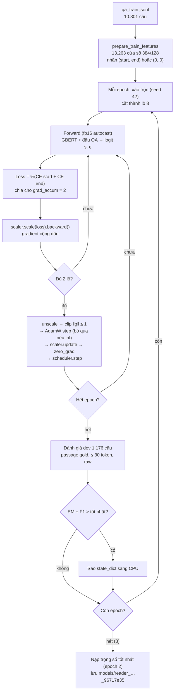

# BÀI 11 — FINE-TUNING READER: CROSS-ENTROPY, ADAMW, WARMUP, FP16 VÀ CHỌN CHECKPOINT

> **Vị trí trong giáo trình**: Bài 10 dạy reader **dùng** thế nào: cửa sổ, giải mã span, chọn passage. Bài này dạy reader được **học** thế nào:
> - hàm mất mát cross-entropy trên nhãn start/end, kể cả cửa sổ nhãn [CLS];
> - lan truyền ngược, mini-batch, tích lũy gradient;
> - AdamW, weight decay tách rời, lịch warmup rồi giảm tuyến tính;
> - cắt gradient, fp16 và loss scaling;
> - epoch, đánh giá trên dev, chọn checkpoint epoch 2, và những gì báo cáo **chưa** đo được.
>
> Trong toàn hệ thống, **chỉ reader** được cập nhật trọng số bằng dữ liệu của nhóm (Bài 00). DPR và reranker là checkpoint dựng sẵn; contrastive loss của DPR đã học ở Bài 07.
>
> **Ví dụ xuyên suốt**: cửa sổ duy nhất (230 token) của câu "Wann wurde Hundefett in der Medizin verwendet?" trên passage gold Haushund, nhãn start 137, end 142 ("vom Mittelalter bis in die Neuzeit"). Trước fine-tune, mô hình gán xác suất 0,0044 cho start đúng; sau fine-tune là 0,705.
>
> **Nguồn số liệu**: báo cáo mục 2.7, 4.3.1–4.3.3, 4.3.5, 7.1; `configs/reader.yaml`; `src/germanqa/reader/trainer.py`, `model_io.py`, `features.py`; `scripts/GD4/04c_train_reader.py`; `results/reader_20261101T213758Z_96717e35.json`; `models/reader_20261101T213758Z_96717e35/`. Các phép đo gắn 📙 **[MỞ RỘNG]** chạy ngày 2026-11-14 và 2026-11-15 trên RTX 3050 Laptop 4 GB, **chỉ trên train và dev**, không mở test.

---

## Mục lục

- [A. Learning Objectives](#a-learning-objectives)
- [B. Prerequisite Knowledge](#b-prerequisite-knowledge)
- [C. Theoretical Foundation](#c-theoretical-foundation)
- [D. Mathematical Foundation](#d-mathematical-foundation)
- [E. Architecture & Working Mechanism](#e-architecture--working-mechanism)
- [F. Application in Our Project](#f-application-in-our-project)
- [G. Implementation Mapping](#g-implementation-mapping)
- [H. YouTube Learning Resources](#h-youtube-learning-resources)
- [I. Knowledge Check](#i-knowledge-check)
- [J. Implementation Readiness](#j-implementation-readiness)
- [Đáp án và lời giải](#đáp-án-và-lời-giải)
- [Tài liệu tham khảo bài 11](#tài-liệu-tham-khảo-bài-11)

---

## A. LEARNING OBJECTIVES

### A.1. Mục tiêu kiến thức

Sau bài học, bạn giải thích được:

1. Fine-tuning thay đổi **những gì** trong reader: đầu QA khởi tạo ngẫu nhiên và toàn bộ 12 lớp GBERT.
2. Hàm mất mát cross-entropy trên start và end, và vì sao cửa sổ nhãn [CLS] dạy mô hình điểm "không có đáp án".
3. Gradient của cross-entropy theo logit có dạng "xác suất trừ nhãn", và hệ quả: cửa sổ đã học tốt cho gradient nhỏ.
4. AdamW khác Adam + L2 ở đâu; vì sao bias và LayerNorm không bị weight decay.
5. Lịch warmup 248 bước rồi giảm tuyến tính về 0 trong 2.487 bước.
6. Tích lũy gradient, cắt gradient theo chuẩn toàn cục, fp16 autocast và GradScaler giải quyết vấn đề gì.
7. Vì sao giữ epoch 2, và vì sao kết luận "epoch 3 quá khớp" là **không** có cơ sở.
8. Những gì quy trình huấn luyện của project chưa đo: độ biến thiên theo seed, đường loss, nhiễu từ truy hồi.

### A.2. Mục tiêu kỹ năng

1. Đọc `trainer.train` và chỉ ra từng bước của vòng lặp: forward, loss, backward, unscale, clip, step, update, zero_grad, scheduler.
2. Tính tay: loss của một cửa sổ, gradient theo logit, một bước AdamW, hệ số cắt gradient, tốc độ học ở một bước bất kỳ.
3. Ước lượng bộ nhớ GPU cần cho fine-tune một mô hình 109 triệu tham số.
4. Chạy một thí nghiệm huấn luyện thu nhỏ và đọc đúng kết quả của nó.

### A.3. Những gì phải nhớ

| Con số | Ý nghĩa | Nguồn |
|---|---|---|
| `deepset/gbert-base`, 109.338.626 tham số, cập nhật **toàn bộ** | fine-tuning toàn phần, không đóng băng lớp nào | 📘 mục 4.3.3 |
| Train 10.301 câu → 13.263 cửa sổ, 18,0% nhãn [CLS] | dữ liệu học | 📘 Bảng 4.4 |
| Lô 8 × tích lũy 2 = 16 cửa sổ; 829 bước/epoch; 3 epoch = 2.487 bước | đơn vị "bước" | 📘 mục 4.3.3 |
| lr đỉnh 3·10⁻⁵, warmup 10% = 248 bước, giảm tuyến tính về 0 | lịch học | `reader.yaml`, 📘 Bảng 4.5 |
| weight decay 0,01 (trừ bias, LayerNorm), clip 1,0, fp16 + GradScaler, seed 42 | ổn định huấn luyện | 📘 Bảng 4.5 |
| Dev (passage gold, ≤ 30 token, raw): EM 0,405 / 0,450 / 0,446 sau epoch 1 / 2 / 3 | chọn epoch 2 | 📘 Bảng 4.7 |
| Sau khi chọn lại giải mã (80 token, minus_cls): EM 0,469, F1 0,699 | số reader "chính thức" trên dev | 📘 mục 4.3.5 |
| 3.176 giây ≈ 53 phút trên RTX 3050 Laptop 4 GB | chi phí | 📘 mục 4.3.2 |
| 📙 Loss dev: 6,11 trước fine-tune → 1,43 sau | mô hình đã học gì | đo thêm |

### A.4. Thành phần pipeline dùng kiến thức này

Checkpoint `models/reader_20261101T213758Z_96717e35` sinh ra từ quá trình trong bài này là reader của **mọi** cấu hình B0, B1, H0, H1 (Bài 10 A.4). Huấn luyện lại reader làm thay đổi mọi số EM end-to-end; vì vậy project chỉ huấn luyện **một lần** và cố định nó trước các thí nghiệm truy hồi.

---

## B. PREREQUISITE KNOWLEDGE

### B.1. Kiến thức cần biết trước

| Kiến thức | Mức | Ôn ở đâu |
|---|---|---|
| Softmax, log, $-\log p$ | Tính được | Bài 05 D.8, Bài 10 D.1 |
| Nhãn start/end, nhãn [CLS], cửa sổ 384/128 | Hiểu | Bài 10 C.2–C.3 |
| Đạo hàm, quy tắc dây chuyền | Hiểu cơ chế | Giải tích cơ bản; video H.1 #1 |
| Train / dev / test, overfitting | Hiểu | Bài 01, Bài 03 |
| PyTorch: `Tensor`, `.backward()`, `optimizer.step()` | Đọc được code | Bài 05 G |

### B.2. Thuật ngữ mới

| Thuật ngữ | Giải thích |
|---|---|
| **Fine-tuning** | Tiếp tục huấn luyện một mô hình đã tiền huấn luyện trên dữ liệu có nhãn của nhiệm vụ đích. |
| **Backbone / head** | Phần thân tiền huấn luyện (12 lớp GBERT) và phần đầu mới cho nhiệm vụ (lớp tuyến tính 768 → 2). |
| **Cross-entropy (CE)** | $-\log$ xác suất mô hình gán cho nhãn đúng. |
| **Mini-batch / lô hiệu dụng** | Nhóm cửa sổ trong một lần forward (8) / số cửa sổ góp vào một lần cập nhật (16). |
| **Bước (step)** | Một lần cập nhật trọng số (`optimizer.step()`), không phải một mini-batch. |
| **Epoch** | Một lượt đi qua toàn bộ 13.263 cửa sổ huấn luyện. |
| **Gradient accumulation** | Cộng dồn gradient của nhiều mini-batch trước khi cập nhật. |
| **AdamW** | Adam với weight decay **tách rời** khỏi gradient. |
| **Warmup / linear decay** | Tăng dần lr từ gần 0 lên đỉnh, rồi giảm tuyến tính về 0. |
| **Gradient clipping** | Thu nhỏ vector gradient khi chuẩn của nó vượt ngưỡng. |
| **fp16 / autocast / GradScaler** | Số thực 16 bit; cơ chế tự chọn phép tính nào chạy fp16; bộ nhân loss chống gradient bị làm tròn về 0. |
| **Checkpoint** | Bản lưu trọng số tại một thời điểm, đủ để nạp lại và suy luận. |
| **Seed** | Hạt giống ngẫu nhiên, cố định khởi tạo đầu QA, dropout và thứ tự xáo trộn. |

### B.3. Mối liên hệ với bài trước

- Bài 10 D.3 đã nêu hàm mất mát và nói "chi tiết ở Bài 11". Bài 10 D.6 phân rã EM thành ba thừa số; thừa số cuối $\Pr(S \mid P) = 0{,}522$ (trích đúng span khi đã chọn đúng passage) là thứ quá trình huấn luyện trong bài này quyết định trực tiếp.
- Bài 07 đã dạy contrastive loss của DPR: softmax trên **passage**. Bài này là softmax trên **vị trí token**. Cùng một ý tưởng "đẩy xác suất về phía đáp án đúng", khác tập ứng viên.

---

## C. THEORETICAL FOUNDATION

### C.1. Fine-tuning thay đổi những gì?

📘 **[BÁO CÁO]** (mục 2.7.1, 4.3.3). GBERT đã có biểu diễn ngôn ngữ tốt từ tiền huấn luyện, nhưng **đầu QA được khởi tạo ngẫu nhiên**. Fine-tuning cập nhật **đồng thời** đầu QA và toàn bộ trọng số GBERT: cả 109.338.626 tham số, không đóng băng lớp nào. Vì xuất phát từ một mô hình đã tốt, chỉ cần ít epoch và lr nhỏ (Devlin et al., 2019).

Khi nạp `deepset/gbert-base` vào `BertForQuestionAnswering`, `transformers` báo hai nhóm khóa:

- **UNEXPECTED**: `cls.predictions.*`, `cls.seq_relationship.*`, `bert.pooler.*`. Đây là các đầu tiền huấn luyện (MLM, NSP) và pooler, bị **bỏ đi**.
- **MISSING**: `qa_outputs.weight`, `qa_outputs.bias`. Đây là đầu QA, được **khởi tạo mới** (phân phối chuẩn, độ lệch chuẩn `initializer_range` = 0,02).

Đây là cảnh báo **đúng mong đợi**, không phải lỗi. Nếu nạp **checkpoint của project** mà vẫn thấy `qa_outputs` MISSING thì mới là lỗi: bạn đang nạp nhầm backbone.

📙 **[MỞ RỘNG]** Fine-tune làm được gì, đo bằng chính hàm mất mát (dev, 1.523 cửa sổ có nhãn, passage gold):

| | Loss trung bình | Trung vị $P(\text{start đúng})$ |
|---|---|---|
| Đoán đều mọi vị trí (tham chiếu) | ≈ 5,6 ($\approx \ln 266$) | ≈ 0,004 |
| Backbone + đầu QA ngẫu nhiên (seed 42) | 6,11 | 0,0041 |
| **Checkpoint của project** | **1,43** | **0,491** |
| Checkpoint, trên 1.176 câu **train** (cùng cách đo) | 0,58 | 0,763 |

Ba điều đọc ra:

1. Trước fine-tune, mô hình **không hơn** đoán bừa. Biểu diễn của GBERT có sẵn, nhưng đầu QA chưa biết đọc chúng. Mọi năng lực QA đến từ fine-tuning.
2. Sau fine-tune, trung vị xác suất start đúng là 0,49: một nửa số cửa sổ dev có start đúng với xác suất ≥ 0,49.
3. Loss trên train (0,58) thấp hơn hẳn dev (1,43). Mô hình khớp dữ liệu đã thấy tốt hơn dữ liệu mới: khoảng cách tổng quát hóa (generalization gap) là chuyện bình thường. Nó **không** tự chứng minh overfitting; overfitting là khi chỉ số **dev** xấu đi theo thời gian huấn luyện (C.7).

### C.2. Hàm mất mát: cross-entropy trên start và end

📘 **[BÁO CÁO]** (mục 2.7.2, 4.3.3, công thức 4.3–4.5). Với mỗi cửa sổ $n$ token, mô hình cho hai vector logit $s, e \in \mathbb{R}^n$. Softmax biến chúng thành hai phân phối trên vị trí. Với nhãn $(y_s, y_e)$:

$$\mathcal{L} = \frac{1}{2}\Big[-\log P_{\text{start}}(y_s) - \log P_{\text{end}}(y_e)\Big]$$

Đây là cài đặt của `BertForQuestionAnswering` (transformers 5.19), và loss của lô là **trung bình theo cửa sổ**.

Ý nghĩa của $-\log p$:

| $P$(nhãn đúng) | 1 | 0,7 | 0,5 | 0,1 | 0,01 | 0,0044 |
|---|---|---|---|---|---|---|
| $-\log p$ | 0 | 0,36 | 0,69 | 2,30 | 4,61 | 5,43 |

Loss bằng 0 khi mô hình chắc chắn đúng, và tăng **không giới hạn** khi xác suất của nhãn đúng tiến về 0. Một dự đoán tự tin nhưng sai bị phạt rất nặng.

**Cửa sổ nhãn [CLS].** 2.382/13.263 cửa sổ train (18,0%) không chứa trọn đáp án, nhãn $y_s = y_e = 0$. Loss trên các cửa sổ này đẩy $s_0, e_0$ **lên**: mô hình học "cửa sổ này không có đáp án". Đây là nền của điểm `minus_cls` ở Bài 10 C.5. Không có các cửa sổ này, $s_0 + e_0$ sẽ không mang nghĩa gì.

**Ba điểm tinh tế của loss trung bình theo cửa sổ.**

- Một câu hỏi có 2 cửa sổ đóng góp **hai** mẫu (một dương, thường thêm một [CLS]). Câu có passage dài vì vậy được "đếm" nhiều hơn.
- Start và end được học **độc lập**: loss không biết rằng end phải sau start. Ràng buộc $j \ge i$ và độ dài tối đa chỉ được áp lúc **giải mã** (Bài 10 C.4).
- Softmax tính **trong từng cửa sổ**. Mô hình không bao giờ được dạy so sánh điểm giữa hai cửa sổ hay hai passage. Đây là lý do gốc khiến bước chọn passage (Bài 10 C.7) khó: điểm giữa passage chưa được hiệu chỉnh (📘 mục 7.1). Wang et al. (2019) xử lý bằng cách chuẩn hóa **toàn cục** trên mọi passage của một câu hỏi ngay khi huấn luyện; project chưa làm.

📙 **[MỞ RỘNG]** Cửa sổ Hundefett (230 token, nhãn 137–142):

| | $P_{\text{start}}(137)$ | $P_{\text{end}}(142)$ | Hạng của start đúng | Loss |
|---|---|---|---|---|
| Trước fine-tune | 0,0044 | 0,0031 | 93 / 230 | 5,60 |
| Sau fine-tune | **0,705** | **0,815** | **1** | **0,28** |

Loss trước fine-tune (5,60) gần bằng loss của đoán đều ($\ln 230 = 5{,}44$): đúng như bảng C.1.

### C.3. Mini-batch, lan truyền ngược, tích lũy gradient

📘 **[BÁO CÁO]** (mục 2.7.3, 4.3.2–4.3.3).

- **Mini-batch**: danh sách 13.263 cửa sổ được xáo trộn (seed 42) rồi cắt thành các nhóm 8. Các cửa sổ của cùng một câu có thể rơi vào các mini-batch khác nhau: mỗi cửa sổ là một mẫu độc lập.
- **Padding động**: mỗi lô được đệm tới độ dài lớn nhất **trong lô**, không phải 384 (`collate`). Độ dài cửa sổ train trung bình 273,8 token, nên tiết kiệm đáng kể.
- **Lan truyền ngược** (Rumelhart et al., 1986): tính gradient của loss theo từng tham số bằng quy tắc dây chuyền, từ đầu QA ngược về embedding.
- **Tích lũy gradient**: loss mỗi mini-batch chia cho $A = 2$ trước `backward()`. Gradient của hai mini-batch liên tiếp **cộng dồn** vào cùng bộ nhớ `.grad`, rồi mới cập nhật một lần. Kết quả tương đương một lô 16 cửa sổ (D.4), nằm trong khoảng 16–32 mà Devlin et al. (2019) dùng.

Vì sao không dùng thẳng lô 16? 📘 Bảng 4.5: "giới hạn bộ nhớ GPU 4 GB (chưa thử giá trị lớn hơn)". D.6 tính lý do.

Đơn vị đếm: 13.263 / 8 → 1.658 mini-batch → **829 bước** mỗi epoch, **2.487 bước** cho 3 epoch. "Bước" luôn là một lần cập nhật trọng số.

### C.4. AdamW và weight decay

📘 **[BÁO CÁO]** (mục 2.7.4, 4.3.3). Gradient descent thô cập nhật $\theta \leftarrow \theta - \eta g$: mọi tham số dùng chung một lr. Adam (Kingma & Ba, 2015) giữ hai trung bình động cho **từng** tham số:

- $m_t$: trung bình gradient (mômen bậc một, "đà");
- $v_t$: trung bình bình phương gradient (mômen bậc hai, "độ lớn điển hình").

Bước cập nhật là $\eta \cdot \hat m_t / (\sqrt{\hat v_t} + \epsilon)$: chia cho độ lớn điển hình, nên mỗi tham số có lr hiệu dụng riêng. Tham số có gradient lớn không bị đẩy quá mạnh; tham số gradient nhỏ vẫn tiến được.

**AdamW** (Loshchilov & Hutter, 2019): với Adam, cộng $\lambda\theta$ vào gradient (L2) **không** tương đương suy giảm trọng số thật, vì số hạng đó cũng bị chia cho $\sqrt{\hat v_t}$: tham số gradient lớn bị phạt ít hơn. AdamW trừ $\eta\lambda\theta$ **trực tiếp** vào tham số, ngoài phần Adam (D.2).

Cấu hình của project: $\lambda = 0{,}01$; $\beta_1 = 0{,}9$, $\beta_2 = 0{,}999$, $\epsilon = 10^{-8}$ là mặc định của PyTorch, không nằm trong `reader.yaml`.

**Không weight decay cho bias và LayerNorm.** `trainer.py` chia tham số thành hai nhóm theo tên: chứa `"bias"` hoặc `"LayerNorm.weight"` thì $\lambda = 0$. Lý do: weight decay là kéo **độ lớn trọng số** về 0 để hạn chế độ phức tạp; bias và hệ số tỉ lệ của LayerNorm không đóng vai trò đó, và kéo hệ số LayerNorm về 0 làm hỏng chuẩn hóa.

📙 **[MỞ RỘNG]** Đếm trên mô hình thật:

| Nhóm | Số tham số | Tỉ lệ |
|---|---|---|
| Có weight decay | 109.217.280 | 99,89% |
| Không weight decay | 121.346 | 0,11% |

121.346 = 82.944 bias của các lớp tuyến tính ($12 \times 6.912$) + 19.200 trọng số LayerNorm + 19.200 bias LayerNorm ($25 \times 768$ mỗi loại) + 2 bias đầu QA. Để ý: ma trận **embedding** từ vựng (23,9 triệu tham số) **có** bị weight decay; đây cũng là mặc định của Hugging Face.

### C.5. Lịch tốc độ học: warmup rồi giảm tuyến tính

📘 **[BÁO CÁO]** (mục 2.7.5, 4.3.3, công thức 4.10). $T = 2.487$ bước, $T_w = \lfloor 0{,}1 \cdot 2.487 \rfloor = 248$ bước warmup, đỉnh $\eta_{\max} = 3 \cdot 10^{-5}$: lr tăng tuyến tính từ gần 0 lên đỉnh trong 248 bước, rồi giảm tuyến tính về 0 ở bước cuối.

Vì sao warmup (Goyal et al., 2017)? Ở những bước đầu, đầu QA còn ngẫu nhiên nên gradient lớn và lộn xộn. Một bước lớn lúc này lan ngược vào các lớp GBERT và có thể phá biểu diễn đã tiền huấn luyện. Ngoài ra, ước lượng $v_t$ của Adam ở vài bước đầu dựa trên rất ít gradient nên chưa đáng tin. Vì sao giảm về 0? Bước càng nhỏ về cuối, trọng số càng "lắng" quanh một điểm tốt thay vì nhảy quanh nó.

📙 **[MỞ RỘNG]** Giá trị thật theo `LambdaLR` của project (G.4 tính lại):

| Lần cập nhật thứ | 1 | 2 | 124 | 248 | 249 | 830 (đầu epoch 2) | 1.659 (đầu epoch 3) | 2.487 (cuối) |
|---|---|---|---|---|---|---|---|---|
| lr | 1,21·10⁻⁷ | 2,42·10⁻⁷ | 1,50·10⁻⁵ | **3,00·10⁻⁵** | 3,00·10⁻⁵ | 2,22·10⁻⁵ | 1,11·10⁻⁵ | 1,34·10⁻⁸ |

Epoch 3 chạy với lr từ 1,11·10⁻⁵ xuống 0: nó chỉ "tinh chỉnh nhẹ". Điều này góp phần giải thích vì sao dev hầu như không đổi giữa epoch 2 và 3 (C.7).

### C.6. Ba kỹ thuật ổn định: cắt gradient, fp16, loss scaling

📘 **[BÁO CÁO]** (mục 2.7.6, 4.3.3).

**Cắt gradient theo chuẩn toàn cục** (Pascanu et al., 2013). Sau khi cộng dồn và unscale, tính chuẩn Euclid của **toàn bộ** gradient (ghép mọi tham số thành một vector). Nếu chuẩn vượt $c = 1{,}0$, nhân mọi gradient với $c / \lVert g \rVert$. Hướng cập nhật **không đổi**, chỉ độ dài bị giới hạn. Một lô bất thường không thể đẩy trọng số đi quá xa. (📙 D.5: với cấu hình này, ngưỡng bị chạm ở **mọi** bước.)

**Mixed precision** (Micikevicius et al., 2018). Phần lớn phép nhân ma trận chạy ở fp16: nhanh hơn trên Tensor Core, tốn ít bộ nhớ kích hoạt hơn. Nhược điểm: fp16 chỉ biểu diễn được số dương nhỏ nhất khoảng $6 \cdot 10^{-8}$ và lớn nhất 65.504. Gradient nhỏ hơn $6 \cdot 10^{-8}$ bị làm tròn về **0** (underflow).

**Loss scaling**: nhân loss với một hệ số lớn $S$ trước `backward()`, nên mọi gradient cũng lớn gấp $S$ và thoát vùng underflow. Trước khi cập nhật, chia lại cho $S$ (bước **unscale**). `GradScaler` của PyTorch chọn $S$ **động**: bắt đầu ở $2^{16} = 65.536$; nếu gradient có `inf`/`NaN` (tràn số) thì **bỏ qua** bước cập nhật đó và giảm $S$ một nửa; sau 2.000 bước liên tiếp không tràn thì tăng gấp đôi.

📗 **[NỀN TẢNG]** Một điểm báo cáo nói gọn: project dùng **autocast**, không phải cách "trọng số fp16 + bản chính fp32" của Micikevicius et al. Trọng số **luôn** ở fp32; autocast chỉ ép kiểu sang fp16 **tại chỗ** cho các phép toán an toàn (nhân ma trận), còn softmax, LayerNorm và loss chạy ở fp32. Bộ tối ưu cập nhật trên trọng số fp32. Kết quả tương đương về ý tưởng ("giữ bản 32 bit"), nhưng không có hai bản trọng số.

**Thứ tự bắt buộc** trong mỗi bước (`trainer.py` dòng 88–97):

```
scaler.scale(loss).backward()      # gradient × S, cộng dồn
scaler.unscale_(opt)               # chia S: gradient về thang thật
clip_grad_norm_(params, 1.0)       # cắt trên gradient THẬT
scaler.step(opt)                   # bỏ qua nếu có inf/NaN
scaler.update()                    # chỉnh S
opt.zero_grad(set_to_none=True)
sched.step()
```

Cắt **trước** unscale là sai: chuẩn đo được lớn gấp $S \approx 65.536$ lần, nên **mọi** bước đều bị cắt và ngưỡng 1,0 mất ý nghĩa. Sau unscale, chuẩn toàn cục chỉ còn khoảng $1/S \approx 1{,}5 \cdot 10^{-5}$, trải trên khoảng $10^8$ tham số thì mỗi gradient cỡ $1{,}5 \cdot 10^{-5} / \sqrt{10^8} \approx 10^{-9}$, nhỏ hơn $\epsilon = 10^{-8}$ của Adam. Bước Adam $\hat m / (\sqrt{\hat v} + \epsilon)$ khi đó bị $\epsilon$ chi phối, co lại cỡ 10 lần một cách không kiểm soát.

📙 **[MỞ RỘNG]** GradScaler trong thực tế (các lần chạy thu nhỏ ở C.8, cùng `trainer.train`): $S$ bắt đầu ở 65.536, gặp gradient tràn số ở **lần cập nhật thứ 2** nên bước đó bị bỏ qua và $S$ giảm còn 32.768; trong 107 bước thường có thêm một lần tràn nữa, $S$ còn 16.384. Tổng cộng 1–2 bước bị bỏ qua trên 107, và 3–4 trên 321. Mất vài bước trong hàng trăm bước là không đáng kể, nhưng đó là lý do một bước "biến mất" khỏi lịch học. Lần huấn luyện đầy đủ không ghi lại $S$ (⚠️ C.9).

Khi chạy trainer, PyTorch in cảnh báo "Detected call of `lr_scheduler.step()` before `optimizer.step()`". Mã của PyTorch đưa cảnh báo này khi lần gọi scheduler đầu tiên không thấy một `optimizer.step()` thật trước nó; với AMP, nguyên nhân hay gặp là GradScaler bỏ qua bước đầu. Trong các lần chạy thu nhỏ, bước bị bỏ qua đầu tiên là bước 2 chứ không phải bước 1, nên giáo trình **chưa xác định chắc** nguyên nhân của cảnh báo trong project. Hậu quả tối đa là lịch lr lệch một bước trên 2.487: không đáng kể, nhưng không nên tắt cảnh báo mà không hiểu nó.

### C.7. Epoch, dev và chọn checkpoint

📘 **[BÁO CÁO]** (mục 2.7.7, 4.3.5). Sau **mỗi** epoch, mô hình được đánh giá trên **toàn bộ** dev (1.176 câu) với passage gold cho sẵn, giải mã `n_best` 20, `max_answer_tokens` 30, chế độ raw. Nếu EM + F1 cao hơn giá trị tốt nhất trước đó, toàn bộ `state_dict` được **sao sang CPU** làm "trọng số tốt nhất". Cuối cùng, trọng số tốt nhất được nạp lại và lưu. **Không** dùng early stopping: luôn chạy đủ 3 epoch.

📘 **[BÁO CÁO]** Bảng 4.7:

| Epoch | Bước | EM | F1 | EM + F1 | Thời gian tích lũy |
|---|---|---|---|---|---|
| 1 | 829 | 0,405 | 0,628 | 1,033 | 1.079 s |
| **2** | **1.658** | **0,450** | **0,679** | **1,129** | 2.127 s |
| 3 | 2.487 | 0,446 | 0,673 | 1,120 | 3.176 s |

Epoch 2 được giữ. Đọc bảng **đúng mức**, như báo cáo làm:

- Epoch 3 kém epoch 2: EM −0,0034 (đúng **4 câu** trên 1.176), F1 −0,0061. Khoảng tin cậy 95% của một EM quanh 0,45 trên 1.176 câu rộng khoảng ±0,03 (D.7). Chênh 0,0034 nhỏ hơn gần mười lần.
- Vì vậy **không** được kết luận "epoch 3 quá khớp". Điều nói được: dev không còn tăng sau epoch 2.
- Trọng số epoch 3 **không được lưu**, nên không thể so hai checkpoint trên dữ liệu khác (ví dụ test hay end-to-end).

**Checkpoint chứa gì** (📘 mục 4.3.5): `model.safetensors` (109.338.626 trọng số fp32, 437,4 MB), `config.json`, `vocab.txt`, `reader_config.json`. **Không** có trạng thái AdamW ($m$, $v$), scheduler hay GradScaler. Dùng được để suy luận hoặc fine-tune tiếp, nhưng không thể **tiếp tục chính xác** một lượt huấn luyện dang dở.

**Dev được dùng hai lần.** Lần một: chọn epoch (theo EM + F1, ≤ 30 token, raw). Lần hai: chọn cách giải mã (lưới `max_answer_tokens` × `score_mode`, Bảng 4.6) → EM 0,469, F1 0,699. Mỗi lần chọn "cái tốt nhất trên dev" làm số dev hơi lạc quan (📘 mục 2.7.7). Số không thiên lệch của reader là trên test, đo một lần: EM 0,416 (first_ref) với passage gold (Bài 10 C.9). Một phần chênh 0,469 → 0,416 có thể đến từ việc chọn trên dev, phần khác từ test khác dev về phân phối; project không tách được hai phần này. Bài 12 bàn tiếp.

📘 **[BÁO CÁO]** (mục 4.3.2): các siêu tham số học (lr, epoch, lô, warmup, weight decay) được **cố định trước** theo khuyến nghị cho BERT, **không** dò trên dev. Đây là lựa chọn đúng về phương pháp: dò lr trên dev rồi báo số dev sẽ thêm một tầng lạc quan nữa.

### C.8. Thí nghiệm thu nhỏ: siêu tham số nhạy đến đâu?

Báo cáo không thử siêu tham số nào khác (C.7). Để thấy chúng tác động thế nào, giáo trình chạy lại **chính** `trainer.train` trên một bản thu nhỏ.

📙 **[MỞ RỘNG]** Thiết kế: 1.300 câu train chọn ngẫu nhiên (1.700 cửa sổ, 320 nhãn [CLS]), 300 câu dev chọn ngẫu nhiên; mọi thứ khác như `reader.yaml` (lô 8 × 2, clip 1,0, fp16, giải mã ≤ 30 token, raw). 1 epoch = 107 bước. Với 300 câu, khoảng tin cậy 95% của EM rộng khoảng ±0,05, nên chênh dưới 0,05 coi như nhiễu.

**Thí nghiệm 1: một epoch (107 bước).**

| Cấu hình | lr | Warmup | Seed | Loss cuối (5 bước) | EM | F1 |
|---|---|---|---|---|---|---|
| A (như project) | 3·10⁻⁵ | 0,1 | 42 | 3,52 | 0,043 | 0,151 |
| A' (đổi seed) | 3·10⁻⁵ | 0,1 | 7 | 3,45 | 0,030 | 0,112 |
| C (bỏ warmup) | 3·10⁻⁵ | 0 | 42 | 3,48 | 0,050 | 0,155 |
| D (lr nhỏ) | 1·10⁻⁵ | 0,1 | 42 | 4,34 | 0,033 | 0,136 |
| B (lr gấp 10) | 3·10⁻⁴ | 0,1 | 42 | 2,40 | **0,280** | **0,526** |
| E (đóng băng GBERT, chỉ học đầu QA) | 1·10⁻³ | 0,1 | 42 | 4,65 | 0,010 | 0,111 |

**Thí nghiệm 2: ba epoch (321 bước), EM / F1 sau từng epoch.**

| lr | Epoch 1 | Epoch 2 | Epoch 3 |
|---|---|---|---|
| 3·10⁻⁵ (như project) | 0,097 / 0,258 | 0,183 / 0,419 | 0,210 / 0,452 |
| 1·10⁻⁴ | 0,240 / 0,455 | 0,297 / 0,560 | **0,330 / 0,561** |
| 3·10⁻⁴ | 0,203 / 0,423 | 0,250 / 0,506 | 0,303 / 0,535 |

Đọc hai bảng (và cũng là chỗ dự đoán ban đầu của giáo trình **sai**: giáo trình đã đoán lr 3·10⁻⁴ sẽ làm hỏng huấn luyện):

1. **lr tối ưu phụ thuộc số bước.** Với chỉ 107–321 bước, lr 3·10⁻⁵ quá chậm: sau 1 epoch mới EM 0,04. Lr gấp 3–10 lần tốt hơn hẳn. Lần huấn luyện đầy đủ có 829 bước mỗi epoch, nên 3·10⁻⁵ đã đạt EM 0,405 sau epoch 1. **Không** được suy ra "project nên dùng 1·10⁻⁴": kết luận ở quy mô nhỏ không chuyển sang quy mô lớn, và muốn biết phải thử trên dữ liệu đầy đủ, với nhiều seed, và chấp nhận rằng chọn lr trên dev làm số dev lạc quan thêm (C.7).
2. **Cùng số epoch, khác lịch lr, ra trọng số khác.** Lr 3·10⁻⁴ sau 1 epoch: EM 0,280 khi tổng là 1 epoch (lr đã giảm về 0 cuối epoch), nhưng 0,203 khi tổng là 3 epoch (cuối epoch 1 lr vẫn còn cao). Đó là lý do "đặt epochs = 2 sẽ ra đúng checkpoint epoch 2" là **sai** (F.4).
3. **Đóng băng GBERT thì gần như không học được.** Chỉ học 1.538 tham số của đầu QA, dù lr lớn gấp 33 lần, loss chỉ xuống 4,65 và EM 0,010. Biểu diễn của GBERT tiền huấn luyện **chưa** sẵn sàng cho QA; phải điều chỉnh cả backbone. Đây là bằng chứng trực tiếp cho lựa chọn fine-tuning toàn phần.
4. **Warmup không tạo khác biệt đo được ở đây** (EM 0,043 so với 0,050, trong nhiễu). Lợi ích của warmup là **phòng** những lần phân kỳ hiếm gặp lúc đầu, nên một lần chạy không thấy được. Kết luận đúng: "không thấy khác biệt", không phải "warmup vô ích".
5. **Seed**: đổi seed 42 → 7 làm EM đổi 0,013 (4 câu). Ở quy mô này, nhiễu theo seed nhỏ hơn khoảng tin cậy. Dodge et al. (2020) và Mosbach et al. (2021) cho thấy fine-tune BERT trên tập nhỏ có thể dao động lớn theo seed, kể cả có lần thất bại hẳn; độ biến thiên của lần huấn luyện **đầy đủ** của project vẫn chưa được đo (C.9).

Đây là thí nghiệm **minh họa**, không phải bằng chứng cho cấu hình của project: dữ liệu bằng 1/8, dev 300 câu, mỗi ô một seed.

### C.9. Những gì báo cáo chưa đo

⚠️ **[THIẾU TRONG BÁO CÁO]** Các khoảng trống sau đều được báo cáo **tự thừa nhận** (📘 mục 4.3.2, 4.3.5, 7.1) hoặc thấy được từ file kết quả:

| Khoảng trống | Hệ quả | Cách bổ sung |
|---|---|---|
| Chỉ **một** lần huấn luyện, một seed | Không biết EM 0,469 dao động bao nhiêu nếu huấn luyện lại; mọi so sánh "reader A vs reader B" sau này phải đo độ biến thiên này trước | Huấn luyện 3–5 seed, báo trung bình ± độ lệch chuẩn |
| **Đường loss không được lưu**: log mỗi 50 bước chỉ in ra màn hình, `results/reader_*.json` chỉ có `history` theo epoch | Không vẽ lại được đường học; không kiểm được warmup có đủ, loss có dao động bất thường | Ghi `loss`, `lr`, `grad_norm`, `scale` mỗi bước vào file JSONL |
| Không có chỉ số **train** theo epoch | Không thấy khoảng cách train–dev thay đổi ra sao | Đánh giá trên một mẫu train cố định sau mỗi epoch |
| Trọng số epoch 3 không lưu | Không so được epoch 2 và 3 ngoài dev | Lưu checkpoint mỗi epoch (437 MB mỗi bản) |
| Reader chỉ học trên **passage gold** | Chưa bao giờ thấy passage nhiễu do BM25 trả về, nên chọn passage kém (Bài 10 C.7) | Thêm passage truy hồi không chứa đáp án làm mẫu [CLS]; hoặc chuẩn hóa chung (Clark & Gardner, 2018; Wang et al., 2019). 📘 mục 7.3 nêu đây là hướng ưu tiên |
| Không thử lô lớn hơn 8 | Không biết 8 × 2 có phải giới hạn thật | Đo bộ nhớ đỉnh (`torch.cuda.max_memory_allocated`) |

---

## D. MATHEMATICAL FOUNDATION

### D.1. Gradient của cross-entropy theo logit

Xét riêng phần start của một cửa sổ: $\ell = -\log P(y_s)$ với $P(k) = e^{s_k} / \sum_j e^{s_j}$. Khi đó:

$$\ell = -s_{y_s} + \log \sum_j e^{s_j} \quad\Rightarrow\quad \frac{\partial \ell}{\partial s_k} = P(k) - \mathbb{1}[k = y_s]$$

Với loss của project có hệ số $\tfrac{1}{2}$: $\partial \mathcal{L} / \partial s_k = \tfrac{1}{2}\big(P(k) - \mathbb{1}[k = y_s]\big)$.

Đọc công thức:

- Ở vị trí đúng, gradient **âm**: tăng $s_{y_s}$ làm loss giảm. Ở mọi vị trí khác, gradient **dương** và tỉ lệ với xác suất mô hình đang gán sai cho vị trí đó.
- Tổng gradient theo mọi $k$ bằng 0: logit chỉ được "chuyển" xác suất từ chỗ sai sang chỗ đúng.
- Độ lớn ở vị trí đúng là $\tfrac{1}{2}(1 - P(y_s))$. Cửa sổ Hundefett: trước fine-tune $\tfrac{1}{2}(1 - 0{,}0044) = 0{,}498$; sau fine-tune $\tfrac{1}{2}(1 - 0{,}705) = 0{,}147$. **Cửa sổ đã học tốt cho tín hiệu học nhỏ.** Gradient tự tập trung vào các cửa sổ mô hình còn sai.

Gradient theo trọng số đầu QA $W \in \mathbb{R}^{2 \times 768}$: logit $s_k = w_s^\top h_k + b_s$, nên $\partial \mathcal{L} / \partial w_s = \sum_k \tfrac{1}{2}(P(k) - \mathbb{1}[k = y_s])\, h_k$: một tổ hợp của các vector ngữ cảnh, kéo $w_s$ về phía $h_{y_s}$ và ra xa các $h_k$ đang bị gán nhầm. Lan truyền ngược tiếp tục qua $h_k$ vào 12 lớp encoder.

### D.2. AdamW: công thức và một bước tính tay

Với gradient $g_t$ tại bước $t$:

$$m_t = \beta_1 m_{t-1} + (1-\beta_1) g_t, \qquad v_t = \beta_2 v_{t-1} + (1-\beta_2) g_t^2$$

$$\hat m_t = \frac{m_t}{1-\beta_1^t}, \qquad \hat v_t = \frac{v_t}{1-\beta_2^t}$$

$$\theta_t = \theta_{t-1} - \eta_t \lambda\, \theta_{t-1} - \eta_t \frac{\hat m_t}{\sqrt{\hat v_t} + \epsilon}$$

(📘 công thức 4.8–4.9; PyTorch áp số hạng decay trước, dưới dạng $\theta \leftarrow \theta(1 - \eta\lambda)$.)

**Bước đầu tiên**, $m_0 = v_0 = 0$: $\hat m_1 = g_1$, $\hat v_1 = g_1^2$, nên $\hat m_1 / \sqrt{\hat v_1} = \pm 1$. Bước Adam đầu tiên có độ lớn **đúng bằng** $\eta$ (trừ $\epsilon$), bất kể gradient lớn hay nhỏ. Đây là một lý do nữa cho warmup: không có warmup, **mọi** tham số đều nhảy một bước $3 \cdot 10^{-5}$ ngay lần cập nhật đầu, dựa trên đúng một mini-batch.

Ví dụ số (G.4 kiểm bằng `torch.optim.AdamW`): $\theta = 0{,}5$, $g = 0{,}2$, $\eta = 3 \cdot 10^{-5}$, $\lambda = 0{,}01$.

- Decay: $0{,}5 \times 3 \cdot 10^{-5} \times 0{,}01 = 1{,}5 \cdot 10^{-7}$.
- Adam: $\hat m / \sqrt{\hat v} = 0{,}2 / 0{,}2 = 1$, bước $= 3 \cdot 10^{-5}$.
- $\theta_1 = 0{,}5 - 0{,}00000015 - 0{,}00003 = 0{,}49996985$. PyTorch cho đúng 0,4999698500.

**Vì sao L2 ≠ weight decay trong Adam.** Với L2, gradient thành $g + \lambda\theta$, và cả phần $\lambda\theta$ cũng bị chia cho $\sqrt{\hat v}$. Tham số có gradient lớn ($\hat v$ lớn) bị kéo về 0 **yếu** hơn. Với AdamW, mọi tham số bị co theo **cùng** tỉ lệ $(1 - \eta\lambda)$ mỗi bước.

Độ lớn tác động của decay trong project: mỗi bước co $\eta\lambda \le 3 \cdot 10^{-7}$. Qua 2.487 bước, tích $\prod(1 - \eta_t\lambda) \approx \exp(-\lambda \sum_t \eta_t) \approx \exp(-0{,}01 \times 0{,}0373) \approx 0{,}9996$: trọng số chỉ co khoảng 0,04%. Với fine-tuning ngắn, weight decay 0,01 gần như **không** đáng kể; nó quan trọng hơn khi huấn luyện lâu. ($\sum_t \eta_t \approx \tfrac{1}{2} \times 2.487 \times 3 \cdot 10^{-5} = 0{,}0373$, vì lịch tam giác có trung bình bằng nửa đỉnh.)

### D.3. Lịch tốc độ học

Code (`trainer.py` dòng 72–73), với $s$ là số lần `sched.step()` đã gọi:

$$\lambda(s) = \begin{cases} \dfrac{s+1}{T_w} & s < T_w \\[2mm] \max\!\Big(0,\ \dfrac{T - s}{T - T_w}\Big) & s \ge T_w \end{cases} \qquad \eta = \eta_{\max}\, \lambda(s)$$

Lần cập nhật thứ $k$ (đếm từ 1) dùng $\lambda(k-1)$, vì scheduler được gọi **sau** `optimizer.step()`. Ví dụ:

- Lần 1: $\lambda(0) = 1/248$, $\eta = 3 \cdot 10^{-5}/248 = 1{,}21 \cdot 10^{-7}$.
- Lần 830 (đầu epoch 2): $\lambda(829) = (2.487 - 829)/2.239 = 0{,}7405$, $\eta = 2{,}22 \cdot 10^{-5}$.
- Lần 2.487: $\lambda(2.486) = 1/2.239$, $\eta = 1{,}34 \cdot 10^{-8}$.

### D.4. Tích lũy gradient bằng một lô lớn

Hai mini-batch $B_1, B_2$, mỗi lô 8 cửa sổ, loss trung bình $\bar{\mathcal{L}}_{B}$. Chia mỗi loss cho $A = 2$ rồi cộng gradient:

$$\nabla\Big(\frac{\bar{\mathcal{L}}_{B_1}}{2}\Big) + \nabla\Big(\frac{\bar{\mathcal{L}}_{B_2}}{2}\Big) = \nabla\Big(\frac{1}{16}\sum_{x \in B_1 \cup B_2} \mathcal{L}_x\Big)$$

Đúng bằng gradient của loss trung bình trên lô 16, **với điều kiện** hai lô bằng cỡ. Hai chỗ không hoàn toàn tương đương:

- Lô cuối epoch có 13.263 − 1.657 × 8 = 7 cửa sổ: cặp cuối gồm 8 + 7 cửa sổ, mỗi cửa sổ ở lô 7 nặng hơn một chút. Ảnh hưởng không đáng kể.
- **Dropout** và padding động khác nhau giữa hai lô; về toán học vẫn đúng.

### D.5. Cắt gradient

$$g \leftarrow g \cdot \min\Big(1,\ \frac{c}{\lVert g \rVert_2 + 10^{-6}}\Big), \qquad \lVert g \rVert_2 = \sqrt{\textstyle\sum_{\text{mọi tham số}} g_i^2}$$

Ví dụ (G.4): hai tensor gradient $[3, 4]$ và $[12]$: chuẩn toàn cục $\sqrt{9 + 16 + 144} = 13$, hệ số $1/13 = 0{,}0769$, gradient mới $[0{,}231;\ 0{,}308]$ và $[0{,}923]$. Tỉ lệ giữa các thành phần giữ nguyên.

Tương tác với Adam: vì Adam chia cho $\sqrt{\hat v}$, nhân **mọi** gradient với cùng một hằng số gần như không đổi bước Adam ở trạng thái ổn định. Theo thiết kế, cắt gradient có tác dụng rõ nhất khi **một** lô bất thường có chuẩn rất lớn so với các lô trước: nó ngăn $m_t$ và $v_t$ bị một lô đó chi phối. Đo thực tế cho thấy một bức tranh khác:

📙 **[MỞ RỘNG]** Ngưỡng 1,0 có thực sự "hiếm khi" chạm tới không? Ghi giá trị trả về của `clip_grad_norm_` (chuẩn **trước** khi cắt) ở thí nghiệm 3 epoch của C.8: 10 bước đầu có chuẩn 7,5–12 (một bước `inf`, chính là bước GradScaler bỏ qua); trung vị cả 321 bước là 18,6 (lr 3·10⁻⁵), 14,7 (1·10⁻⁴), 15,5 (3·10⁻⁴); **100%** số bước có chuẩn > 1.

Vậy với cấu hình của project, cắt gradient **luôn** kích hoạt: mỗi bước, gradient được co về chuẩn đúng 1. Nó không còn là cái phanh cho "lô bất thường" mà trở thành một phép **chuẩn hóa** gradient ở mọi bước. Với Adam, chia mọi gradient cho cùng một số trong một bước gần như không đổi hướng; nhưng vì hệ số co ($1/18$ ở bước này, $1/12$ ở bước khác) khác nhau giữa các bước, nó đổi **trọng số tương đối** của các bước trong $m_t$, $v_t$: lô có gradient lớn bị "nói nhỏ" lại. Ngưỡng 1,0 là mặc định phổ biến khi fine-tune BERT (cũng là mặc định của `transformers.Trainer`), nên tình trạng này là bình thường; báo cáo mô tả mục đích "chống bùng nổ gradient", đúng nhưng chưa đủ (⚠️ đây là phát hiện từ lần chạy thu nhỏ; lần chạy đầy đủ không ghi chuẩn gradient).

### D.6. Bộ nhớ GPU cho fine-tuning

Với $N = 109.338.626$ tham số fp32 (4 byte):

| Thành phần | Công thức | Bộ nhớ |
|---|---|---|
| Trọng số | $4N$ | 437 MB |
| Gradient | $4N$ | 437 MB |
| AdamW $m$, $v$ | $8N$ | 875 MB |
| **Cộng (cố định)** | $16N$ | **1,75 GB** |
| Kích hoạt (lưu cho backward) | tỉ lệ với lô × độ dài × lớp | phần còn lại |

Trên GPU 4 GB (trừ phần của hệ điều hành và CUDA context), còn khoảng 1,5–2 GB cho kích hoạt: đủ cho lô 8 cửa sổ ≤ 384 token có fp16, nên project chọn 8 × 2. Bài 10 cho thấy suy luận chỉ cần trọng số (437 MB, hoặc một nửa nếu fp16): **huấn luyện tốn bộ nhớ gấp khoảng 4 lần suy luận** chỉ riêng phần cố định.

### D.7. Độ không chắc chắn của EM trên dev

EM là trung bình của 1.176 biến 0/1. Với $p \approx 0{,}45$:

$$\text{SE} = \sqrt{\frac{p(1-p)}{n}} = \sqrt{\frac{0{,}45 \times 0{,}55}{1.176}} = 0{,}0145, \qquad \text{KTC 95\%} \approx \pm 1{,}96 \times 0{,}0145 = \pm 0{,}028$$

Khớp mức "±0,03" của 📘 mục 4.3.5. Chênh EM giữa epoch 2 và 3 là 0,0034. (Phép so **ghép cặp** hai epoch trên cùng câu sẽ có khoảng hẹp hơn, nhưng cần dự đoán của cả hai epoch, mà epoch 3 không lưu.)

---

## E. ARCHITECTURE & WORKING MECHANISM

### E.1. Vòng lặp huấn luyện



### E.2. Input → Processing → Output

| | Nội dung |
|---|---|
| **Input** | `data/processed/qa_train.jsonl` (10.301 câu, mỗi câu một passage gold và một đáp án ký tự); `qa_dev.jsonl` (1.176 câu) để chọn epoch; `configs/reader.yaml`; seed 42 (`germanqa.config.SEED`). |
| **Processing** | (1) Tokenizer WordPiece dựng từ `vocab.txt` (Bài 10 G.1). (2) Cửa sổ và nhãn. (3) `get_model("deepset/gbert-base")`: backbone + đầu QA mới. (4) `train`: 3 epoch × 829 bước, đánh giá sau mỗi epoch. (5) Nạp trọng số tốt nhất, `save_pretrained`, chép `vocab.txt`, ghi `reader_config.json`. (6) `save_run` ghi cấu hình, môi trường và `history`. |
| **Output** | Thư mục `models/reader_20261101T213758Z_96717e35/` (437,4 MB); `results/reader_20261101T213758Z_96717e35.json` gồm `config`, `environment` (Python 3.13.3, transformers 5.19.0, …), `metrics.history` (3 epoch). |

Tên thí nghiệm = `reader_` + dấu thời gian UTC + 8 ký tự băm của cấu hình (`new_experiment_id`). Đổi một tham số bất kỳ trong `reader.yaml` sẽ ra mã băm khác, nên hai lần chạy khác cấu hình không bao giờ ghi đè nhau.

### E.3. Theo dõi một cửa sổ qua một bước

Cửa sổ Hundefett (giả sử nằm trong một lô ở epoch 1):

1. `collate`: `input_ids` 230 token, `token_type_ids` 0 cho câu hỏi và 1 cho passage, nhãn (137, 142). Lô được đệm tới cửa sổ dài nhất trong 8.
2. Forward: logit $s, e \in \mathbb{R}^{230}$ (phần đệm bị che bằng `attention_mask`).
3. Loss: trước fine-tune $\tfrac{1}{2}(5{,}43 + 5{,}77) = 5{,}60$.
4. Backward: gradient tại logit start đúng $\tfrac{1}{2}(0{,}0044 - 1) = -0{,}498$, tại các vị trí khác $\tfrac{1}{2}P(k)$.
5. Cộng với gradient của 15 cửa sổ khác trong lô hiệu dụng, unscale, cắt về chuẩn 1 (chuẩn trước khi cắt ở những bước đầu khoảng 8–12, D.5), AdamW cập nhật 109 triệu tham số.
6. Sau 2.487 bước như vậy (thực tế: giữ trạng thái sau bước 1.658), cửa sổ này có loss 0,28, start đúng đứng hạng 1 với xác suất 0,705.

---

## F. APPLICATION IN OUR PROJECT

### F.1. Thành phần này nằm ở đâu?

| Việc | File / hàm | Cấu hình |
|---|---|---|
| Script huấn luyện | `scripts/GD4/04c_train_reader.py` (`--limit N` để chạy thử) | — |
| Cửa sổ và nhãn train | `reader/features.py: prepare_train_features`, `label_window` | `reader.yaml: max_length, stride` |
| Nạp mô hình, tokenizer | `reader/model_io.py: get_model`, `get_tokenizer` | `model_name` |
| Vòng lặp | `reader/trainer.py: train`, `collate`, `set_all_seeds` | `reader.yaml: train.*` |
| Đánh giá mỗi epoch | `trainer.evaluate` → `postprocess.best_answers` → `qa_metrics.evaluate_answers` | `n_best`, `max_answer_tokens` |
| Ghi kết quả | `germanqa.experiment: new_experiment_id`, `save_run` | — |
| Chọn lại giải mã sau huấn luyện | `scripts/GD4/04d_eval_reader.py` | `answer_grid` |

### F.2. Vì sao nhóm cần hiểu bài này?

- Mọi hướng cải tiến reader trong 📘 mục 7.3 (backbone lớn hơn, huấn luyện với passage nhiễu, nhiều seed) đều là **huấn luyện lại**. Không hiểu vòng lặp này thì không làm được, và không đánh giá được kết quả.
- Khi EM thay đổi sau một lần huấn luyện lại, phải phân biệt được: cải tiến thật, hay nhiễu theo seed (C.8, C.9).
- GPU 4 GB đặt giới hạn cứng; D.6 cho biết giới hạn đó đến từ đâu, và đổi gì thì vượt được (lô nhỏ hơn + tích lũy nhiều hơn, gradient checkpointing, 8-bit Adam).

### F.3. Đầu vào và đầu ra thực tế

`results/reader_20261101T213758Z_96717e35.json` (rút gọn):

```json
{"experiment_id": "reader_20261101T213758Z_96717e35",
 "config": {"model_name": "deepset/gbert-base", "max_length": 384, "stride": 128, "n_best": 20,
            "max_answer_tokens": 30, "train": {"epochs": 3, "lr": 3e-05, "batch_size": 8, "grad_accum": 2,
            "warmup_ratio": 0.1, "weight_decay": 0.01, "max_grad_norm": 1.0, "fp16": true}},
 "environment": {"python": "3.13.3", "packages": {"transformers": "5.19.0", "numpy": "2.5.4"}},
 "metrics": {"history": [
   {"epoch": 1, "step": 829,  "dev": {"em": 0.4048, "f1": 0.6280, "queries": 1176}, "seconds": 1079},
   {"epoch": 2, "step": 1658, "dev": {"em": 0.4498, "f1": 0.6793, "queries": 1176}, "seconds": 2127},
   {"epoch": 3, "step": 2487, "dev": {"em": 0.4464, "f1": 0.6732, "queries": 1176}, "seconds": 3176}]},
 "checkpoint": "…/models/reader_20261101T213758Z_96717e35"}
```

Để ý: `max_answer_tokens` ở đây là 30, giá trị **lúc huấn luyện**. Pipeline dùng 80 (`pipeline.yaml`), chọn sau (Bài 10 C.6).

### F.4. Nếu thay đổi thì sao?

| Thay đổi | Ảnh hưởng dự kiến | Bằng chứng |
|---|---|---|
| lr 3·10⁻⁵ → 1·10⁻⁴ hoặc 3·10⁻⁴ | Ở quy mô thu nhỏ **tốt hơn** hẳn (EM 0,04 → 0,28 sau 107 bước); ở quy mô đầy đủ chưa đo, không suy ra được | 📙 C.8 |
| Bỏ warmup | Không thấy khác biệt ở quy mô thu nhỏ (trong nhiễu); lợi ích là phòng phân kỳ hiếm gặp | 📙 C.8 |
| lr → 1·10⁻⁵ | Học chậm hơn với cùng số bước | 📙 C.8 |
| Chỉ huấn luyện đầu QA (đóng băng GBERT) | Gần như không học (EM 0,010 ở quy mô thu nhỏ) | 📙 C.8 |
| Đổi seed | Số dev dao động; mức dao động chưa đo trên bản đầy đủ | 📙 C.8, ⚠️ C.9 |
| epochs 3 → 2 | **Không** ra lại checkpoint epoch 2: lịch lr khác (giảm về 0 nhanh hơn), nên trọng số khác | D.3, 📙 C.8 điểm 2 |
| Lô 8 → 4, grad_accum 2 → 4 | Cùng lô hiệu dụng 16, ít bộ nhớ hơn, chậm hơn | D.4 |
| Tắt fp16 | Chậm hơn, tốn bộ nhớ kích hoạt gấp khoảng 2; có thể không vừa lô 8 trên 4 GB | D.6 |
| Thêm passage BM25 làm mẫu âm | Hướng cải tiến 📘 mục 7.3; chưa làm | C.9 |
| Đổi `max_length` | Phải đổi **cả** lúc suy luận; tính lại thống kê cửa sổ | Bài 10 F.4 |

### F.5. Tham số cần chú ý

| Tham số | Giá trị | Ở đâu | Ghi chú |
|---|---|---|---|
| `model_name` | `deepset/gbert-base` | `reader.yaml` | phải khớp `vocab.txt` |
| `epochs` | 3 | `reader.yaml: train` | giữ epoch tốt nhất, không early stopping |
| `lr` | 3·10⁻⁵ | | một trong 5/3/2·10⁻⁵ (Devlin et al., 2019) |
| `batch_size` × `grad_accum` | 8 × 2 | | lô hiệu dụng 16 |
| `warmup_ratio` | 0,1 | | 248 bước |
| `weight_decay` | 0,01 | | trừ bias, LayerNorm |
| `max_grad_norm` | 1,0 | | sau unscale |
| `fp16` | true | | autocast + GradScaler, chỉ trên CUDA |
| `log_every` | 50 | | chỉ in ra màn hình (C.9) |
| β₁, β₂, ε | 0,9 / 0,999 / 10⁻⁸ | mặc định PyTorch | không có trong cấu hình |
| `SEED` | 42 | `germanqa.config` | dùng chung cho chia dữ liệu và huấn luyện |

---

## G. IMPLEMENTATION MAPPING

### G.1. Thư viện

| Thư viện | Dùng cho |
|---|---|
| `torch` | `optim.AdamW`, `optim.lr_scheduler.LambdaLR`, `amp.GradScaler`, `autocast`, `nn.utils.clip_grad_norm_` |
| `transformers` | `BertForQuestionAnswering` (tính sẵn loss khi có `start_positions`, `end_positions`), `save_pretrained` |
| `random`, `numpy` | Xáo trộn có seed (`random.Random(seed)`), seed toàn cục |
| `germanqa.experiment` | Mã thí nghiệm, ghi cấu hình và môi trường |

Project **không** dùng `transformers.Trainer`. Vòng lặp tự viết dài khoảng 55 dòng, nên mọi bước đều nhìn thấy được và khớp từng dòng với báo cáo.

### G.2. Class và function

| Tên | Vai trò |
|---|---|
| `prepare_train_features(examples, tokenizer, max_length, stride)` | Cửa sổ + `start_positions`, `end_positions` |
| `collate(batch, pad_id=0)` | Ghép lô, đệm động, tạo `attention_mask` |
| `train(model, train_feats, dev_examples, dev_feats, cfg, seed, device, log)` | Vòng lặp; trả về `(best_state, history)` |
| `evaluate(model, examples, feats, n_best, max_answer_tokens, batch_size, device, fp16)` | EM, F1 với passage gold |
| `set_all_seeds(seed)` | `random`, `numpy`, `torch`, `torch.cuda` |
| `get_model(name_or_dir)` | Nạp `BertForQuestionAnswering` từ Hub hoặc thư mục checkpoint |

### G.3. Pseudocode

```
function TRAIN(windows, dev, cfg):
    θ ← GBERT pretrained;  head ← random N(0, 0.02²)
    groups ← {params có decay: λ = 0.01}, {bias, LayerNorm.weight: λ = 0}
    opt ← AdamW(groups, lr = 3e-5);  S ← 65536
    T ← ceil(|windows| / 16) × 3;  Tw ← floor(0.1 T)
    best ← −∞
    for epoch in 1..3:
        shuffle(windows, seed 42 stream)
        for each mini-batch b of 8 (index i):
            L ← mean_{x∈b} ½(CE(s_x, y_s) + CE(e_x, y_e)) / 2     # fp16 autocast
            backward(S · L)                                       # gradient cộng dồn
            if i is even or b is last:
                g ← g / S
                if any(g is inf/NaN): S ← S/2; skip update
                else: g ← g · min(1, 1/‖g‖); θ ← AdamW(θ, g, lr(step))
                zero g;  step ← step + 1
        m ← EM+F1(dev, gold passage, ≤30 token, raw)
        if m > best: best ← m; keep ← copy(θ) on CPU
    return keep
```

### G.4. Code minh họa: tính tay các thành phần

Không cần GPU, không cần mô hình. Đã chạy, kết quả thật:

```python
import math
import torch

# 1) Lịch learning rate đúng như trainer.py (s = số lần sched.step() đã gọi)
total, warm, peak = 2487, int(2487 * 0.1), 3e-5
lam = lambda s: (s + 1) / max(warm, 1) if s < warm else max(0.0, (total - s) / max(total - warm, 1))
for s in (0, 1, 123, 247, 248, 829, 1658, 2486):
    print(f"step {s:4d}  lr = {peak * lam(s):.3e}")

# 2) Một bước AdamW tính tay, so với torch.optim.AdamW
theta, g = 0.5, 0.2
lr, b1, b2, eps, wd = 3e-5, 0.9, 0.999, 1e-8, 0.01
m = (1 - b1) * g; v = (1 - b2) * g * g
mh, vh = m / (1 - b1), v / (1 - b2)
by_hand = theta - lr * wd * theta - lr * mh / (math.sqrt(vh) + eps)
p = torch.nn.Parameter(torch.tensor([theta], dtype=torch.float64))
opt = torch.optim.AdamW([p], lr=lr, betas=(b1, b2), eps=eps, weight_decay=wd)
p.grad = torch.tensor([g], dtype=torch.float64); opt.step()
print("AdamW bước 1: tay %.10f | torch %.10f | bước Adam ≈ lr = %.1e" % (by_hand, p.item(), lr))

# 3) Cắt gradient theo chuẩn toàn cục
grads = [torch.tensor([3.0, 4.0]), torch.tensor([12.0])]
norm = math.sqrt(sum(float((x ** 2).sum()) for x in grads))
scale = min(1.0, 1.0 / (norm + 1e-6))
print("chuẩn", norm, "-> hệ số", round(scale, 5), "-> grad mới", [(x * scale).tolist() for x in grads])

# 4) fp16: gradient nhỏ bị làm tròn về 0, loss scaling cứu được
tiny = 1e-8
print("fp16(1e-8) =", float(torch.tensor(tiny, dtype=torch.float16)),
      "| fp16(1e-8 * 65536) / 65536 =", float(torch.tensor(tiny * 65536, dtype=torch.float16)) / 65536)
print("fp16 nhỏ nhất (subnormal) =", float(torch.finfo(torch.float16).tiny) * 2 ** -10,
      "| lớn nhất =", float(torch.finfo(torch.float16).max))
```

```
step    0  lr = 1.210e-07
step    1  lr = 2.419e-07
step  123  lr = 1.500e-05
step  247  lr = 3.000e-05
step  248  lr = 3.000e-05
step  829  lr = 2.222e-05
step 1658  lr = 1.111e-05
step 2486  lr = 1.340e-08
AdamW bước 1: tay 0.4999698500 | torch 0.4999698500 | bước Adam ≈ lr = 3.0e-05
chuẩn 13.0 -> hệ số 0.07692 -> grad mới [[0.23076921701431274, 0.307692289352417], [0.923076868057251]]
fp16(1e-8) = 0.0 | fp16(1e-8 * 65536) / 65536 = 9.997165761888027e-09
fp16 nhỏ nhất (subnormal) = 5.960464477539063e-08 | lớn nhất = 65504.0
```

Bốn bài học:

1. lr đạt đỉnh ở lần cập nhật 248 và giữ đỉnh thêm một lần (249), rồi giảm. Lần cuối gần như bằng 0.
2. Công thức D.2 khớp `torch.optim.AdamW` tới 10 chữ số: PyTorch áp decay kiểu tách rời đúng như Loshchilov & Hutter.
3. Cắt gradient chỉ co độ dài; tỉ lệ 3 : 4 : 12 giữ nguyên.
4. $10^{-8}$ biến mất trong fp16, nhưng nhân với 65.536 trước rồi chia lại thì giữ được ($9{,}997 \cdot 10^{-9}$, sai số làm tròn 0,03%).

### G.5. Code: đo loss trước và sau fine-tune

Chạy từ thư mục gốc project bằng `venv` (CPU được; GPU nhanh hơn). Đây là phần lõi của phép đo ở C.1 và C.2:

```python
import sys, math, torch; sys.path.insert(0, "src")
from germanqa.config import PROCESSED_DIR
from germanqa.reader.features import load_examples, prepare_train_features
from germanqa.reader.model_io import get_model, get_tokenizer
from germanqa.reader.trainer import collate, set_all_seeds

tok = get_tokenizer("deepset/gbert-base")
ex = [e for e in load_examples(PROCESSED_DIR, "dev") if e["question"].startswith("Wann wurde Hundefett")]
f = prepare_train_features(ex, tok, 384, 128)          # dùng hàm train để có nhãn trên dev
set_all_seeds(42)
for name in ("deepset/gbert-base", "models/reader_20261101T213758Z_96717e35"):
    m = get_model(name).eval()
    b = collate(f)
    with torch.no_grad():
        o = m(**b)
    ys, ye = f[0]["start_positions"], f[0]["end_positions"]
    ps, pe = torch.softmax(o.start_logits[0], -1), torch.softmax(o.end_logits[0], -1)
    print(name, "nhãn", (ys, ye), "P_s %.4f P_e %.4f loss %.3f (HF %.3f)"
          % (ps[ys], pe[ye], (-math.log(ps[ys]) - math.log(pe[ye])) / 2, o.loss))
```

```
deepset/gbert-base nhãn (137, 142) P_s 0.0044 P_e 0.0031 loss 5.596 (HF 5.596)
models/reader_20261101T213758Z_96717e35 nhãn (137, 142) P_s 0.7054 P_e 0.8152 loss 0.277 (HF 0.277)
```

Loss tính tay khớp `o.loss` của `BertForQuestionAnswering`: công thức C.2 đúng là thứ thư viện cài.

### G.6. Code: một thí nghiệm huấn luyện thu nhỏ

Dùng **chính** `trainer.train` của project, chỉ đổi cấu hình (khoảng 1–5 phút mỗi cấu hình 1 epoch trên RTX 3050 Laptop). Đây là phần lõi của script đã dùng cho C.8:

```python
import sys, copy, random, re, torch; sys.path.insert(0, "src")
from germanqa.config import PROCESSED_DIR
from germanqa.experiment import load_config
from germanqa.reader.features import load_examples, prepare_train_features, prepare_eval_features
from germanqa.reader.model_io import get_model, get_tokenizer
from germanqa.reader import trainer as T

cfg = load_config("reader")["reader"]; tok = get_tokenizer(cfg["model_name"])
rng = random.Random(0)
tr = rng.sample(load_examples(PROCESSED_DIR, "train"), 1300)
dv = rng.sample(load_examples(PROCESSED_DIR, "dev"), 300)
tr_f, dv_f = prepare_train_features(tr, tok, 384, 128), prepare_eval_features(dv, tok, 384, 128)

def run(lr, warmup, seed=42, head_only=False):
    c = copy.deepcopy(cfg); c["train"].update(epochs=1, lr=lr, warmup_ratio=warmup, log_every=5)
    T.set_all_seeds(seed); m = get_model(cfg["model_name"])
    if head_only:                                      # đóng băng GBERT, chỉ học đầu QA
        for n, p in m.named_parameters():
            p.requires_grad = n.startswith("qa_outputs")
    logs = []
    _, hist = T.train(m, tr_f, dv, dv_f, c, seed, "cuda", logs.append)
    curve = [(int(a), float(b)) for a, b in re.findall(r"step (\d+)/\d+ loss ([\d.]+)", "\n".join(logs))]
    del m; torch.cuda.empty_cache()
    return hist[-1]["dev"], curve

print(run(3e-5, 0.1))          # cấu hình của project, thu nhỏ
print(run(3e-4, 0.1))          # lr gấp 10
```

Lưu ý khi chạy: mỗi lần chỉ giữ **một** mô hình trên GPU (`del m; torch.cuda.empty_cache()`). Một lần chạy thử trước đó để backbone gốc nằm lại trên GPU và bị hết bộ nhớ ngay bước đầu.

### G.7. Kiểm tra từng bước

| Bước | Kiểm gì | Giá trị mong đợi |
|---|---|---|
| Nạp backbone | Khóa MISSING | chỉ `qa_outputs.weight`, `qa_outputs.bias` |
| Nạp checkpoint project | Khóa MISSING | không có |
| Dữ liệu | Số cửa sổ train, tỉ lệ [CLS] | 13.263; 18,0% |
| Số bước | `steps_per_epoch`, `total`, `warm` | 829, 2.487, 248 |
| Nhóm tham số | Số tham số không decay | 121.346 |
| Loss ban đầu | Loss trên vài lô đầu | ≈ 5,5–6 (gần $\ln n$) |
| Sau epoch 1 | EM dev (≤ 30, raw) | ≈ 0,40 |
| Checkpoint | Kích thước `model.safetensors` | 437,4 MB |
| Tái lập | Nạp checkpoint, EM dev passage gold (80, minus_cls) | 0,469 |

### G.8. Lỗi thường gặp

| Lỗi | Hậu quả | Cách tránh |
|---|---|---|
| Quên `model.train()` sau khi `evaluate` | Dropout tắt suốt epoch sau (`evaluate` gọi `model.eval()`) | `train` gọi `model.train()` đầu **mỗi** epoch (dòng 79) |
| Cắt gradient trước `scaler.unscale_` | Chuẩn đo được lớn gấp $S$; bước nào cũng bị cắt, gradient thật cỡ $10^{-9}$ < $\epsilon$ của Adam, học chậm đi nhiều lần (C.6) | unscale → clip → step |
| Gọi `sched.step()` mỗi mini-batch thay vì mỗi bước | lr giảm nhanh gấp 2, warmup chỉ còn một nửa | Gọi trong khối `if bi % grad_accum == 0` |
| Không chia loss cho `grad_accum` | Gradient gấp 2; với Adam ít ảnh hưởng nhưng chuẩn bị cắt sai | `loss / grad_accum` |
| `zero_grad` sai chỗ (mỗi mini-batch) | Mất tác dụng tích lũy | Chỉ sau `scaler.step` |
| Lưu "trọng số tốt nhất" bằng `model.state_dict()` không `clone()` | Các tensor vẫn trỏ vào trọng số đang học; "tốt nhất" bị ghi đè bởi epoch sau | `.detach().cpu().clone()` (dòng 109) |
| Weight decay cả LayerNorm | Hệ số chuẩn hóa bị kéo về 0 | Hai nhóm tham số theo tên |
| Tắt cảnh báo "`lr_scheduler.step()` before `optimizer.step()`" mà không đọc | Bỏ lỡ lỗi thứ tự thật nếu có | Đọc C.6; trong project hậu quả tối đa là lệch một bước lr |
| Chọn epoch **và** báo số trên cùng dev như số cuối | Số lạc quan | Báo số test đo một lần (Bài 12) |
| So hai lần huấn luyện khác seed rồi kết luận | Nhầm nhiễu thành cải tiến | Nhiều seed, khoảng tin cậy |

---

## H. YOUTUBE LEARNING RESOURCES

> Mọi URL dưới đây xuất hiện trong kết quả tìm kiếm web (giới hạn youtube.com) ngày 2026-11-15. Kết quả tìm kiếm thường **không hiển thị tên kênh**; khi đó giáo trình ghi "chưa xác nhận". Tên video ghi theo đúng tiêu đề trong kết quả. Hãy mở video kiểm tra trước khi trích dẫn.

### H.1. Video đã tìm thấy

| # | Tên video | Kênh | URL | Hỗ trợ mục |
|---|---|---|---|---|
| 1 | Backpropagation calculus | 3Blue1Brown (kết quả tìm kiếm ghi là "Deep Learning Chapter 4" của kênh này) | https://www.youtube.com/watch?v=tIeHLnjs5U8 | C.3, D.1 |
| 2 | Backpropagation, intuitively | 3Blue1Brown (theo kết quả tìm kiếm) | https://www.youtube.com/watch?v=Ilg3gGewQ5U | C.3 |
| 3 | ADAM Optimization Algorithm Explained Visually | chưa xác nhận | https://www.youtube.com/watch?v=MWZakqZDgfQ | C.4, D.2 |
| 4 | Adam, AdaGrad & AdaDelta - EXPLAINED! | chưa xác nhận | https://www.youtube.com/watch?v=5KyxlN3M7HQ | C.4 |
| 5 | Mixed Precision Training From Scratch - Tutorial | chưa xác nhận | https://www.youtube.com/watch?v=C7NrYjhpiCY | C.6 |
| 6 | NVAITC Webinar: Automatic Mixed Precision Training in PyTorch | chưa xác nhận | https://www.youtube.com/watch?v=b5dAmcBKxHg | C.6 |
| 7 | Fine-Tune BERT For Question-Answering(Q&A) - PyTorch & HuggingFace | chưa xác nhận | https://www.youtube.com/watch?v=PikqVppe408 | E.1, G |
| 8 | The Trainer API | chưa xác nhận (kết quả tìm kiếm mô tả là video của Hugging Face course) | https://www.youtube.com/watch?v=nvBXf7s7vTI | G.1 (so với vòng lặp tự viết) |

### H.2. Nội dung chính và đoạn cần tập trung

| # | Nội dung (theo tiêu đề và mô tả) | Tập trung vào |
|---|---|---|
| 1 | Giải tích của lan truyền ngược | Quy tắc dây chuyền qua một lớp; so với D.1 |
| 2 | Trực giác của lan truyền ngược | "Mỗi mẫu muốn đẩy trọng số theo hướng nào" ↔ gradient "xác suất trừ nhãn" |
| 3 | Adam = Momentum + RMSProp | Vai trò của $m_t$ và $v_t$ |
| 4 | So sánh AdaGrad, AdaDelta, Adam | Đoạn về Adam (theo mô tả: khoảng 6:08–8:13) |
| 5 | Mixed precision tự viết | Underflow, loss scaling; so với G.4 mục 4 |
| 6 | AMP trong PyTorch | `autocast` + `GradScaler`; video cũ nên API có thể là `torch.cuda.amp` |
| 7 | Fine-tune BERT cho QA bằng PyTorch | So vòng lặp của video với E.1 |
| 8 | `Trainer` của Hugging Face | Những gì `Trainer` làm sẵn mà project tự viết |

### H.3. Thứ tự xem đề xuất

```
② → ① → đọc C.2–C.3, D.1 → ③ → ④ (đoạn Adam) → đọc C.4–C.5, D.2–D.3 → chạy G.4
→ ⑤ → đọc C.6 → ⑦ → đọc E.1, đối chiếu trainer.py → ⑧ (tùy chọn) → chạy G.5, G.6 nếu có GPU
```

### H.4. Link tìm kiếm YouTube (không phải video đã xác minh)

- Cross-entropy loss: https://www.youtube.com/results?search_query=cross+entropy+loss+softmax+gradient
- AdamW: https://www.youtube.com/results?search_query=AdamW+decoupled+weight+decay
- Warmup: https://www.youtube.com/results?search_query=learning+rate+warmup+linear+decay+transformer
- Gradient clipping: https://www.youtube.com/results?search_query=gradient+clipping+exploding+gradients
- Gradient accumulation: https://www.youtube.com/results?search_query=gradient+accumulation+pytorch

### H.5. Tài liệu chính thức

| Loại | Tài liệu | Dùng cho |
|---|---|---|
| Tài liệu PyTorch | Automatic Mixed Precision: https://pytorch.org/docs/stable/amp.html | C.6 |
| Tài liệu PyTorch | `torch.optim.AdamW`: https://pytorch.org/docs/stable/generated/torch.optim.AdamW.html | C.4, D.2 |
| Khóa học | Hugging Face LLM/NLP course, chương 3 (fine-tuning) và chương 7 mục Question answering: https://huggingface.co/learn/nlp-course/chapter7/7 | E, G |
| Bài báo | Devlin et al. (2019), BERT | C.1, F.5 |
| Bài báo | Kingma & Ba (2015), Adam | C.4 |
| Bài báo | Loshchilov & Hutter (2019), Decoupled weight decay | C.4, D.2 |
| Bài báo | Goyal et al. (2017), Accurate, large minibatch SGD | C.5 |
| Bài báo | Pascanu et al. (2013), On the difficulty of training RNNs | C.6, D.5 |
| Bài báo | Micikevicius et al. (2018), Mixed precision training | C.6 |
| Bài báo | Mosbach et al. (2021), On the stability of fine-tuning BERT | C.8 |
| Bài báo | Dodge et al. (2020), Fine-tuning pretrained language models: weight initializations, data orders, and early stopping | C.8, C.9 |

---

## I. KNOWLEDGE CHECK

### I.1. Câu hỏi kiến thức cơ bản (5)

1. Fine-tune reader cập nhật bao nhiêu tham số? Phần nào được khởi tạo ngẫu nhiên?
2. Viết hàm mất mát của một cửa sổ. Cửa sổ không chứa đáp án có nhãn gì?
3. Lô hiệu dụng là bao nhiêu cửa sổ? Một epoch có bao nhiêu bước, và vì sao?
4. Tốc độ học đỉnh, số bước warmup và giá trị lr ở lần cập nhật cuối cùng là bao nhiêu?
5. Checkpoint của project giữ epoch nào, theo tiêu chí gì, và **không** lưu những gì?

### I.2. Câu hỏi giải thích cơ chế (5)

6. Chứng minh $\partial \ell / \partial s_k = P(k) - \mathbb{1}[k = y_s]$. Hệ quả gì cho các cửa sổ mô hình đã học tốt?
7. Vì sao Adam + L2 không tương đương AdamW? Vì sao không weight decay bias và LayerNorm?
8. Vì sao bước Adam đầu tiên có độ lớn xấp xỉ $\eta$ cho mọi tham số? Điều này liên quan gì đến warmup?
9. Giải thích thứ tự `scale → backward → unscale → clip → step → update`. Điều gì xảy ra nếu đổi chỗ unscale và clip?
10. Vì sao loss trên train (0,58) thấp hơn dev (1,43) **không** đủ để kết luận overfitting? Dữ liệu nào mới cho thấy overfitting?

### I.3. Câu hỏi phân tích tình huống (3)

11. Một thành viên đọc Bảng 4.7 và viết "epoch 3 bị overfitting nên giảm EM". Sửa câu này bằng số liệu.
12. Bạn huấn luyện lại reader với seed 7, giữ nguyên mọi thứ khác, được EM dev (passage gold) 0,475 thay vì 0,469. Có thể báo "cải tiến +0,006" không? Phải làm gì?
13. Khi chạy `04c_train_reader.py` trên một máy GPU 4 GB khác, bạn gặp `CUDA out of memory` ngay bước đầu. Liệt kê ba cách sửa **không** đổi lô hiệu dụng, kèm cái giá của từng cách.

### I.4. Bài tập vận dụng (2)

14. **Tính tay.** Một cửa sổ 4 token có logit start $s = [2{,}0;\ 0{,}0;\ 1{,}0;\ 3{,}0]$, nhãn $y_s = 3$. (a) Tính $P$, $-\log P(y_s)$. (b) Tính gradient $\partial \ell / \partial s$ (bỏ hệ số ½). (c) Với lr 0,5, cập nhật **logit** theo gradient descent thô một bước; loss mới bằng bao nhiêu? (d) Với $T = 1.000$, `warmup_ratio` 0,06, $\eta_{\max} = 2 \cdot 10^{-5}$, tính $T_w$ và lr ở các lần cập nhật 1, 60, 61, 500.
15. **Viết code.** Sửa `trainer.train` (bản sao trong scratchpad, không sửa file của project) để ghi mỗi bước một dòng JSON: `step`, `loss`, `lr`, `grad_norm` (giá trị **trả về** của `clip_grad_norm_`), `scale`, `skipped` (bước có bị GradScaler bỏ qua không). Chạy trên cấu hình thu nhỏ của G.6 và vẽ bốn đường. Bạn kỳ vọng thấy gì ở 10 bước đầu?

### I.5. Bài tập liên hệ pipeline của nhóm (1)

16. **Huấn luyện reader với passage nhiễu.** 📘 mục 7.3 đề xuất huấn luyện reader với passage do truy hồi trả về thay vì chỉ passage gold. Thiết kế thí nghiệm: (a) dữ liệu huấn luyện mới lấy từ đâu, gán nhãn thế nào, tránh rò rỉ ra sao; (b) giữ cố định những gì để so công bằng với checkpoint hiện tại; (c) cần bao nhiêu seed và vì sao; (d) chỉ số chính, tập chọn, tập xác nhận; (e) ước lượng thời gian huấn luyện trên RTX 3050 nếu số cửa sổ tăng gấp 3.

---

## J. IMPLEMENTATION READINESS

> Trên website, các ô tick được. Trạng thái lưu trong `localStorage` của **trình duyệt đang dùng**: không đồng bộ giữa thiết bị hay trình duyệt, không ai khác thấy, mất khi xóa dữ liệu trang hoặc dùng cửa sổ ẩn danh. Trong file Markdown, sửa `[ ]` thành `[x]`.

### J.1. Giải thích được khái niệm

- [ ] Giải thích fine-tuning toàn phần, backbone và đầu QA, cảnh báo MISSING/UNEXPECTED.
- [ ] Giải thích AdamW, warmup, cắt gradient, fp16 + GradScaler, mỗi thứ giải quyết vấn đề gì.

### J.2. Hiểu sơ đồ hoạt động

- [ ] Vẽ lại E.1, đúng thứ tự các bước trong một lần cập nhật.
- [ ] Giải thích quy tắc giữ checkpoint và vì sao không có early stopping.

### J.3. Giải thích được công thức

- [ ] Suy ra gradient của cross-entropy theo logit (D.1).
- [ ] Tính một bước AdamW và lr ở một bước bất kỳ (D.2–D.3).

### J.4. Biết dữ liệu vào và ra

- [ ] Đọc `results/reader_*.json` và nói ra epoch được chọn.
- [ ] Kể các file trong thư mục checkpoint và cái checkpoint không chứa.

### J.5. Hiểu vai trò trong pipeline

- [ ] Giải thích vì sao reader chỉ huấn luyện một lần và cố định trước các thí nghiệm truy hồi.
- [ ] Nêu ít nhất ba khoảng trống ở C.9 và cách bổ sung.

### J.6. Mô tả cách cài đặt

- [ ] Chạy G.4 và giải thích bốn kết quả.
- [ ] (Nếu có GPU) chạy G.6 với hai cấu hình và giải thích khác biệt.

**Đánh giá**: đạt ≥ 10/12 mục thì chuyển sang Bài 12 (Đánh giá và phân tích lỗi).

---

## ĐÁP ÁN VÀ LỜI GIẢI

### Câu 1
Toàn bộ 109.338.626 tham số: 12 lớp GBERT, embedding và đầu QA, không đóng băng lớp nào. Chỉ đầu QA (`qa_outputs`, 768 → 2, 1.538 tham số) được khởi tạo ngẫu nhiên; pooler và các đầu MLM/NSP của checkpoint gốc bị bỏ.

### Câu 2
$\mathcal{L} = \tfrac{1}{2}[-\log P_{\text{start}}(y_s) - \log P_{\text{end}}(y_e)]$, softmax trên các vị trí của cửa sổ. Cửa sổ không chứa trọn đáp án có nhãn $(0, 0)$, tức token [CLS]: 18,0% cửa sổ train.

### Câu 3
$8 \times 2 = 16$ cửa sổ. 13.263 cửa sổ chia lô 8 được 1.658 mini-batch; mỗi bước dùng 2 mini-batch, nên 829 bước mỗi epoch (bằng $\lceil 13.263 / 16 \rceil$). 3 epoch = 2.487 bước.

### Câu 4
$\eta_{\max} = 3 \cdot 10^{-5}$; $T_w = \lfloor 0{,}1 \times 2.487 \rfloor = 248$; lần cập nhật cuối dùng $\lambda(2.486) = 1/2.239$, $\eta = 1{,}34 \cdot 10^{-8}$.

### Câu 5
Epoch 2 (bước 1.658), vì EM + F1 trên dev (passage gold, ≤ 30 token, raw) cao nhất: 1,129. Checkpoint không lưu trạng thái AdamW ($m$, $v$), scheduler, GradScaler, và không lưu trọng số epoch 1, 3.

### Câu 6
$\ell = -s_{y} + \log\sum_j e^{s_j}$. Đạo hàm của số hạng đầu theo $s_k$ là $-\mathbb{1}[k = y]$; của số hạng sau là $e^{s_k}/\sum_j e^{s_j} = P(k)$. Cộng lại được $P(k) - \mathbb{1}[k = y]$. Hệ quả: khi $P(y) \to 1$, mọi thành phần gradient tiến về 0; cửa sổ đã học tốt hầu như không còn đóng góp, và tín hiệu học dồn vào các cửa sổ mô hình còn sai (Hundefett: 0,498 trước so với 0,147 sau ở vị trí đúng).

### Câu 7
Với L2, $\lambda\theta$ được cộng vào gradient rồi cùng bị chia cho $\sqrt{\hat v}$: tham số gradient lớn bị kéo về 0 ít hơn, nên "phạt độ lớn" không đều. AdamW trừ $\eta\lambda\theta$ trực tiếp, mọi tham số co cùng tỉ lệ. Bias và hệ số LayerNorm không phải "độ lớn trọng số" cần phạt; kéo hệ số LayerNorm về 0 làm hỏng phép chuẩn hóa.

### Câu 8
Ở bước 1, $m_0 = v_0 = 0$ nên sau hiệu chỉnh độ lệch $\hat m_1 = g_1$, $\hat v_1 = g_1^2$, và $\hat m_1/\sqrt{\hat v_1} = \mathrm{sign}(g_1)$. Mọi tham số có gradient khác 0 đều nhảy đúng một bước $\eta$, dựa trên một mini-batch duy nhất, lúc đầu QA còn ngẫu nhiên. Warmup làm $\eta$ ở những bước này rất nhỏ (1,21·10⁻⁷ ở bước 1), chờ đến khi $m$, $v$ đã trung bình qua nhiều lô.

### Câu 9
`scale`: loss × $S$ để gradient fp16 không underflow. `backward`: gradient (đã × $S$) cộng dồn. `unscale`: chia $S$, gradient về thang thật và phát hiện inf/NaN. `clip`: cắt chuẩn **thật** về ≤ 1. `step`: AdamW cập nhật, hoặc bỏ qua nếu có inf/NaN. `update`: chỉnh $S$. Nếu clip trước unscale: chuẩn đo được lớn gấp $S$ (khoảng 65.536), nên bước nào cũng bị cắt và ngưỡng 1,0 mất ý nghĩa. Sau unscale, chuẩn toàn cục còn khoảng $1/S$; trải trên khoảng $10^8$ tham số, mỗi gradient cỡ $1/(S\sqrt{N}) \approx 10^{-9}$, nhỏ hơn $\epsilon = 10^{-8}$. Adam chia cho $\sqrt{\hat v} + \epsilon \approx \epsilon$, nên bước cập nhật co lại cỡ 10 lần. Mô hình vẫn học, nhưng chậm hơn nhiều và theo cách không ai chủ định.

### Câu 10
Train là dữ liệu mô hình đã tối ưu trực tiếp, nên loss trên đó gần như luôn thấp hơn; khoảng cách train–dev xuất hiện ngay cả khi mô hình đang tổng quát hóa tốt hơn theo thời gian. Overfitting là khi chỉ số **dev** xấu đi trong khi train vẫn tốt lên. Cần đường dev (và train) theo thời gian; ở project, dev theo epoch là 1,033 → 1,129 → 1,120, không đủ để nói dev xấu đi (C.7).

### Câu 11
"Sau epoch 2, EM dev không tăng nữa: epoch 3 thấp hơn 0,0034 (4/1.176 câu) và F1 thấp hơn 0,0061, trong khi khoảng tin cậy 95% của EM rộng khoảng ±0,03. Không có bằng chứng overfitting; chỉ có bằng chứng là thêm epoch 3 không giúp. Ngoài ra lr ở epoch 3 chỉ từ 1,1·10⁻⁵ về 0, nên trọng số thay đổi ít."

### Câu 12
Không. Đây là **một** lần đổi seed; chênh 0,006 (khoảng 7 câu) nằm trong mức dao động thường thấy khi fine-tune BERT với seed khác (Dodge et al., 2020; Mosbach et al., 2021), và nhỏ hơn nhiều so với KTC ±0,03. Hơn nữa con số mới được chọn trên dev (chọn epoch, giữ cách giải mã đã chọn trên dev). Phải: huấn luyện nhiều seed cho **cả** hai cấu hình (thực ra ở đây là cùng một cấu hình, nên đây chỉ là đo độ biến thiên theo seed), báo trung bình ± độ lệch chuẩn, so ghép cặp trên cùng câu. Kết luận đúng là "đã có hai điểm dữ liệu về độ biến thiên theo seed", không phải "cải tiến".

### Câu 13
(1) Lô 4 × tích lũy 4: cùng lô hiệu dụng 16, kích hoạt giảm khoảng một nửa; chậm hơn vì GPU kém bão hòa. (2) Gradient checkpointing (`model.gradient_checkpointing_enable()`): không lưu kích hoạt giữa các lớp, tính lại khi backward; tiết kiệm nhiều bộ nhớ kích hoạt, chậm hơn khoảng 20–30%. (3) Bộ tối ưu 8-bit (ví dụ `bitsandbytes`), giảm $8N$ của $m$, $v$ xuống khoảng $2N$: tiết kiệm khoảng 650 MB; thêm phụ thuộc và có thể lệch nhẹ về số. Ngoài ra kiểm tra không có tiến trình khác chiếm GPU và không có mô hình thừa còn trên GPU (G.6). Đổi `max_length` cũng giảm bộ nhớ nhưng thay đổi dữ liệu huấn luyện, nên không tính.

### Câu 14
(a) $e^{s} = [7{,}389;\ 1;\ 2{,}718;\ 20{,}086]$, tổng 31,193. $P = [0{,}237;\ 0{,}032;\ 0{,}087;\ 0{,}644]$. $-\log 0{,}644 = 0{,}440$.

(b) $P - \mathbb{1}[k = 3] = [0{,}237;\ 0{,}032;\ 0{,}087;\ -0{,}356]$ (tổng bằng 0).

(c) $s \leftarrow s - 0{,}5 \cdot \text{grad} = [1{,}882;\ -0{,}016;\ 0{,}956;\ 3{,}178]$. $e^{s} = [6{,}566;\ 0{,}984;\ 2{,}602;\ 24{,}00]$, tổng 34,15. $P(3) = 0{,}703$, loss mới $-\log 0{,}703 = 0{,}353$ (giảm từ 0,440). Thực tế mô hình không cập nhật logit trực tiếp mà cập nhật trọng số sinh ra logit, nhưng hướng là như vậy.

(d) $T_w = \lfloor 0{,}06 \times 1.000 \rfloor = 60$. Lần 1: $\lambda(0) = 1/60$, $\eta = 3{,}33 \cdot 10^{-7}$. Lần 60: $\lambda(59) = 60/60 = 1$, $\eta = 2 \cdot 10^{-5}$. Lần 61: $\lambda(60) = (1.000 - 60)/940 = 1$, $\eta = 2 \cdot 10^{-5}$. Lần 500: $\lambda(499) = 501/940 = 0{,}533$, $\eta = 1{,}066 \cdot 10^{-5}$.

### Câu 15
Gợi ý: `gn = torch.nn.utils.clip_grad_norm_(...)` trả về chuẩn **trước** khi cắt; `scale_before = scaler.get_scale()` trước `scaler.update()`, rồi `skipped = scaler.get_scale() < scale_before` sau `update()`. Kỳ vọng ở 10 bước đầu: loss gần $\ln n \approx 5{,}5$ và bắt đầu giảm khi lr tăng; `grad_norm` lớn hơn 1 (nên bị cắt) vì đầu QA ngẫu nhiên; `grad_norm` khoảng 8–12 ngay từ đầu và luôn > 1 (C.8 đo: 100% số bước bị cắt); `scale` bắt đầu 65.536 và giảm một nửa ở một trong vài bước đầu (ở lần chạy thu nhỏ là bước 2, `skipped` = true, `grad_norm` = inf). Ghi mọi thứ vào file là bổ sung đúng khoảng trống "đường loss không được lưu" ở C.9.

### Câu 16
Mẫu lời giải. (a) Chạy BM25 (hoặc H0) trên các câu **train**, lấy top-k passage; passage chứa chuỗi đáp án ở đúng vị trí gold thì nhãn dương như hiện nay, passage khác nhãn [CLS]. Vì câu train-select (Bài 08) dùng để chọn tham số truy hồi, ghi rõ việc dùng lại; tuyệt đối không lấy passage từ câu dev/test, và kiểm passage âm không chứa chuỗi đáp án (qrels chỉ ghi một số passage gold, Bài 10 C.7) để tránh nhãn âm sai. (b) Giữ backbone, tokenizer, `max_length`/`stride`, siêu tham số học, số **bước** hoặc số epoch (ghi rõ chọn cái nào, vì dữ liệu nhiều hơn thì cùng số epoch là nhiều bước hơn), giải mã (80, minus_cls), cùng truy hồi B0 lúc đánh giá. (c) Tối thiểu 3 seed cho **mỗi** cấu hình (cả checkpoint gốc huấn luyện lại), vì chưa biết độ biến thiên theo seed (C.9) và hiệu ứng mong đợi có thể chỉ vài điểm EM. (d) Chỉ số chính: EM end-to-end B0 trên dev; phụ: tỉ lệ chọn đúng passage gold khi gold ở top-5 (Bài 10 C.7) và EM trên passage gold (để thấy có làm hỏng khả năng trích span không). Chọn số epoch/tỉ lệ âm trên dev; xác nhận một lần trên test theo giao thức test-một-lần của project. (e) Hiện 829 bước/epoch mất khoảng 1.050 s; gấp 3 cửa sổ là khoảng 3.150 s mỗi epoch, 3 epoch khoảng 2,6 giờ mỗi seed, cộng đánh giá; 3 seed × 2 cấu hình khoảng 16 giờ GPU.

---

## Tài liệu tham khảo bài 11

- J. Devlin, M.-W. Chang, K. Lee, K. Toutanova, "BERT: Pre-training of deep bidirectional transformers for language understanding," *Proc. NAACL-HLT*, 2019.
- B. Chan, S. Schweter, T. Möller, "German's next language model," *Proc. COLING*, 2020.
- D. P. Kingma, J. Ba, "Adam: A method for stochastic optimization," *Proc. ICLR*, 2015.
- I. Loshchilov, F. Hutter, "Decoupled weight decay regularization," *Proc. ICLR*, 2019.
- P. Goyal et al., "Accurate, large minibatch SGD: Training ImageNet in 1 hour," arXiv:1706.02677, 2017.
- R. Pascanu, T. Mikolov, Y. Bengio, "On the difficulty of training recurrent neural networks," *Proc. ICML*, 2013.
- P. Micikevicius et al., "Mixed precision training," *Proc. ICLR*, 2018.
- D. E. Rumelhart, G. E. Hinton, R. J. Williams, "Learning representations by back-propagating errors," *Nature*, 323, 533–536, 1986.
- Z. Wang, P. Ng, X. Ma, R. Nallapati, B. Xiang, "Multi-passage BERT: A globally normalized BERT model for open-domain question answering," *Proc. EMNLP-IJCNLP*, 2019.
- C. Clark, M. Gardner, "Simple and effective multi-paragraph reading comprehension," *Proc. ACL*, 2018.
- J. Dodge, G. Ilharco, R. Schwartz, A. Farhadi, H. Hajishirzi, N. Smith, "Fine-tuning pretrained language models: Weight initializations, data orders, and early stopping," arXiv:2002.06305, 2020.
- M. Mosbach, M. Andriushchenko, D. Klakow, "On the stability of fine-tuning BERT: Misconceptions, explanations, and strong baselines," *Proc. ICLR*, 2021.
