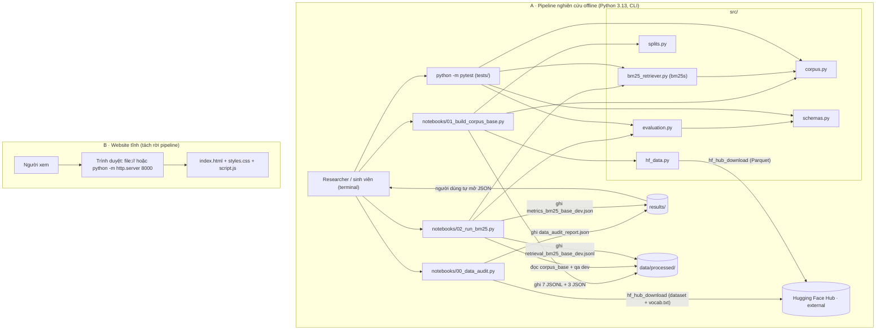
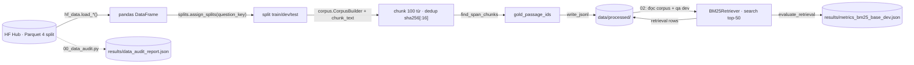

# Kiến trúc hệ thống hiện tại — German Open-Domain Extractive QA

- **Trạng thái mô tả:** code tại commit `fb34890` (nhánh `test1`, 2026-09-11 22:40 +0700).
  Kiểm tra ngày 2026-09-12. Working tree chỉ có thêm `docs/architecture/` và
  `genai.code-workspace` (chưa track), không có thay đổi code chưa commit.
- **Hình:** [`current-architecture.png`](current-architecture.png) (3840×2160, 16:9) và
  [`current-architecture.svg`](current-architecture.svg) (file nguồn để chỉnh sửa).
- **Không nhầm với:** `german-qa-v1-architecture.svg/.png` trong cùng thư mục. Hình đó vẽ
  kiến trúc **mục tiêu** theo spec V1.1, không phải hiện trạng code. Tài liệu này không lấy
  thông tin từ hình đó.

## 1. Kết luận ngắn

Project hiện có **hai phần độc lập**:

1. **Pipeline nghiên cứu offline**: các script Python chạy tay bằng lệnh trên một máy
   Windows. Dữ liệu được trao đổi qua file JSON/JSONL trên đĩa.
2. **Website tĩnh** (`website/`): chỉ mô tả thiết kế, không gọi pipeline.

Repo **không có** backend server, REST API, database, xác thực, Docker, CI/CD, deploy hay
monitoring. Thành phần xếp hạng duy nhất đang chạy là **BM25** (thư viện `bm25s`, dựa trên
khớp từ). Chưa có mô hình neural nào được train hoặc chạy suy luận.

Code hiện theo spec **V1.0**. Spec **V1.1** (frozen 2026-09-11) chưa được triển khai.

## 2. Phương pháp xác minh

Thứ tự ưu tiên nguồn: code → config → package/môi trường → tài liệu `.md` → suy luận.

- Đọc toàn bộ `src/*.py`, `notebooks/*.py`, `tests/test_bm25_retriever.py`, phần liên quan
  của `tests/test_evaluation.py`, và `website/script.js`, `website/qa/check.cjs`.
  Rà `website/index.html` để xem các thẻ `<script>`/`<link>`, `fetch`, `<section>`.
- `git ls-files`, `git status`, `git log`, `git check-ignore`.
- Grep toàn bộ import và biến môi trường (`os.environ`, `getenv`), thư viện mạng/web/DB,
  logging.
- Phiên bản gói: `importlib.metadata` trong Python 3.13.3 (interpreter khớp với
  `__pycache__/*.cpython-313.pyc`).
- Artifact: đọc `data/processed/*.json`, `results/*.json` và dòng đầu mỗi file JSONL để
  xác định schema thật.
- **Không chạy pytest.** Các file `__pycache__/*.pyc` đang được git track, nên chạy test sẽ
  sửa file tracked. Số 51 test được đếm bằng grep `def test_`. Roadmap ghi 51 test pass ở
  lần kiểm tra trước, theo kỳ vọng V1.0.

## 3. Tài liệu `.md` đã đọc

| File | Nội dung | Khớp với code? |
|---|---|---|
| `docs/superpowers/specs/2026-09-10-german-qa-retrieval-module-specs.md` | Hợp đồng kỹ thuật V1.1 (frozen): schema, D1–D6, P1–P4, BM25/Dense/Reranker/Reader, Evaluation, Integration | Là **mục tiêu**. Code theo V1.0 |
| `docs/superpowers/specs/2026-09-10-german-qa-retrieval-design.md` | Đề tài, RQ1–RQ3, Retriever → Selection → Reader | Mục tiêu. Hiện mới có Retriever BM25 |
| `docs/superpowers/specs/2026-09-11-german-qa-retrieval-v1.2-amendments-draft.md` | Draft A1–A4 (run infra, manifest, post-rerank), chưa hiệu lực | Chưa có code |
| `docs/superpowers/plans/2026-09-11-german-qa-learning-roadmap.md` | 10 chặng / 32 buổi | Khớp: roadmap tự ghi code là V1.0 |
| `docs/superpowers/plans/2026-09-11-german-qa-task-catalog.md` | T1.1–T10.2 và các file dự kiến | Các file dự kiến (`qa_records.py`, `retrieval_records.py`, `distractors.py`, `run_manifest.py`, `reader_runner.py`, `integration.py`, `scripts/check_data_acceptance.py`) **chưa tồn tại** |
| `.specify/memory/constitution.md` | Quy tắc quản trị v1.0.0 | Quy trình, không phải runtime |
| `website/README.md` | Website tĩnh, không backend, không fetch/CDN | Khớp code website |
| `website/qa/VALIDATION.md` | QA bằng Playwright ở 375/768/1440 px | Khớp `website/qa/report.json` |

Các file `.md` đã liệt kê nhưng không dùng làm nguồn kiến trúc, vì là công cụ:

- `.agents/skills/speckit-*/SKILL.md`: 10 skill Spec Kit cho Codex.
- `.specify/templates/*.md`: 5 template.
- `.pytest_cache/README.md`: file tự sinh.

Trước khi tạo thư mục này, repo không có `README.md` ở gốc, cũng không có thư mục
`architecture/` hay `design/`.

## 4. Kết quả kiểm tra theo hạng mục

| Hạng mục | Phát hiện | Bằng chứng |
|---|---|---|
| Dependency manifest | **Không có**: không có `requirements*.txt`, `pyproject.toml`, `Pipfile`, lock file, `package.json` | Glob toàn repo |
| Docker / compose | Không có | Glob |
| Frontend | Website tĩnh HTML + CSS + JS thuần. JS chỉ điều khiển walkthrough và menu | `website/script.js`, `index.html` chỉ nạp `styles.css`, `script.js` |
| Backend / API routes | Không có. Không import Flask/FastAPI/Django, không có route | Grep import |
| Services | Không có tiến trình chạy nền. Mỗi script chạy xong thì thoát | `notebooks/*.py` có `main()` |
| Model | Không có model neural, checkpoint hay FAISS index. Index BM25 nằm trong RAM, dựng lại mỗi lần chạy `02` (8,7 s), không lưu | `src/bm25_retriever.py`, `results/metrics_bm25_base_dev.json` |
| Database | Không có. Dữ liệu là file JSONL/JSON | Grep sqlite/sqlalchemy: không có |
| AI/ML pipeline | Chỉ có BM25. Vocab của `gbert-base` chỉ dùng để đếm độ dài token trong audit | `src/bm25_retriever.py`, `notebooks/00_data_audit.py` |
| Cấu hình | Hằng số viết trong code: `WINDOW_WORDS=100`, `OVERLAP_WORDS=20`, `DEV_RATIO=0.10`, `SEED=42`, `DEFAULT_TOP_N=50`, `K_VALUES=(1,5,10,20)`, `MRR_CUTOFF=10`, `RETRIEVAL_K=20`, `READER_K=5`, `RUN_ID="bm25_base_dev"`. Đường dẫn tính từ `Path(__file__)` | `src/*.py`, `notebooks/*.py` |
| Biến môi trường | Không đọc biến nào. Không có file `.env` | Grep `os.environ`/`getenv`: không có |
| API bên thứ ba | Hugging Face Hub, qua `hf_hub_download` (không truyền token trong code) | `src/hf_data.py`, `notebooks/00_data_audit.py` |
| Xác thực | Không có | — |
| Lưu trữ | `data/processed/` (11 file), `results/` (2 JSON), cache HF mặc định của `huggingface_hub` | `git ls-files` |
| Deploy | Không có. Website mới có hướng dẫn GitHub Pages, chưa deploy | `website/README.md` |
| Monitoring / logging | Chỉ có `print()` ra stdout. Không dùng logging framework hay metrics server | Grep `logging`: không có |
| Git | `data/processed/*` và `__pycache__/*.pyc` đang được track dù `.gitignore` có `data/` và `__pycache__/` | `git check-ignore -v --no-index` |

## 5. Kiến trúc thực tế



Các lớp của pipeline A:

- **User:** researcher chạy lệnh trong terminal.
- **Interface:** 3 script trong `notebooks/`, `pytest`, và CLI `python -m src.evaluation`.
  Chưa có frontend hay API cho pipeline.
- **Logic + AI (`src/`):**
  - `hf_data`, `splits`, `corpus`: xây dữ liệu.
  - `bm25_retriever`: truy hồi.
  - `evaluation`, `schemas`: chấm điểm và kiểm tra schema.
- **Storage & external:** Hugging Face Hub, `data/processed/`, `results/`.
- **Result:** file JSON và log terminal. Người dùng tự mở để đọc.

Các phụ thuộc đáng chú ý:

- `00_data_audit.py` **không import `src/`**. Nó tự viết lại `load_split`, `normalize_text`,
  `passage_id`, `question_key`.
- `bm25_retriever.py` import `corpus.normalize_text`.
- `evaluation.py` import `schemas.py`.
- `02_run_bm25.py` chỉ gọi hàm `evaluate_retrieval()`. Hàm này nhận trực tiếp
  `gold_passage_ids`, không đi qua validator.

## 6. Data flow thực tế

Mọi bước là batch, chạy tuần tự bằng tay. Mạng chỉ được dùng để tải file từ Hugging Face
Hub. Không có request/response nội bộ nào.



| Bước | Code | Input → Output |
|---|---|---|
| 1. Tải dữ liệu | `hf_data.load_germanquad()`, `load_germandpr()` | Parquet `plain_text/{train,test}/0000.parquet` trên nhánh `refs/convert/parquet` → DataFrame |
| 2. Gán split | `splits.assign_splits()` | Câu hỏi 4 split → `question_key` được gán train/dev/test. Nhóm test = test GermanQuAD ∪ test GermanDPR. Loại 1.025 key train trùng test khỏi train pool. Dev = 10% (seed 42) |
| 3. Chunk + dedup | `corpus.CorpusBuilder.add_text()`, `chunk_text()` | Context → chunk 100 từ, bước 80. `passage_id = sha256(normalized)[:16]`. Khi trùng, giữ nguồn có ưu tiên cao hơn |
| 4. Gắn gold | `corpus.find_span_chunks()` trong `build_qa_records()` | Answer span → các chunk chứa trọn span. 184/13.722 dòng không chunk nào chứa trọn span → loại và được đếm (coverage 98,66%) |
| 5. Ghi file | `write_jsonl()` trong `01` | 7 JSONL + `split_report.json`, `chunk_coverage_report.json`, `corpus_manifest.json` |
| 6. BM25 | `BM25Retriever(...)`, `.search(top_n=50)` | `corpus_base` (54.071 passage) + 1.031 câu dev → `retrieval_bm25_base_dev.jsonl` |
| 7. Chấm điểm | `evaluation.evaluate_retrieval()` | Recall@1/5/10/20, MRR@10, latency đo local → `results/metrics_bm25_base_dev.json` |
| Nhánh phụ | `notebooks/00_data_audit.py` | HF Hub + `gbert-base/vocab.txt` → `results/data_audit_report.json` |

Schema thật của các file đang có:

- `corpus_base.jsonl`: `passage_id, text, normalized_text, source, title (null), char_len`.
  Nguồn: `germanquad` 7.520, `germandpr_hard_negative` 46.551.
- `qa_germanquad_{split}.jsonl`: `query_id, question, gold_passage_ids, answers[{text,
  answer_start}], source_dataset, source_split`. Đây là schema cũ; `answer_start` tính theo
  vị trí trong chunk. Số dòng train/dev/test: 9.287 / 1.031 / 3.220.
- `retrieval_germandpr_{split}.jsonl`: `query_id, question, positive_passage_ids,
  hard_negative_passage_ids, source_split`. Số dòng: 8.345 / 929 / 1.026.
- `retrieval_bm25_base_dev.jsonl`: `query_id, passage_id, rank, score, retriever_name`.

**Kết quả hiện có** (BM25, corpus base V1.0, dev N = 1.031):

| Recall@1 | Recall@5 | Recall@10 | Recall@20 | MRR@10 | Latency mean |
|---|---|---|---|---|---|
| 0,190 | 0,448 | 0,571 | 0,664 | 0,306 | 0,75 ms/câu |

Latency đo trên máy local, chỉ để tham khảo. Đây **không** phải benchmark V1.1: corpus còn
chứa hard negative, split theo quy tắc V1.0. Chưa có Reader nên chưa có EM/F1 hay answer span.

## 7. Technology stack thực tế

| Lớp | Công nghệ | Phiên bản (môi trường) | Dùng ở đâu |
|---|---|---|---|
| Runtime | Python, Windows 11, CPU | 3.13.3 | Mọi script |
| Data I/O | pandas, pyarrow (engine Parquet), json/jsonl (stdlib) | 2.2.3, 23.0.1 | `hf_data.py`, `00_data_audit.py`, notebooks |
| Dữ liệu ngoài | huggingface_hub → Hugging Face Hub | 1.31.0 | `hf_data.py`, `00_data_audit.py` |
| Retrieval / IR | bm25s (cần numpy) | 0.3.11 (numpy 2.2.5) | `bm25_retriever.py` |
| Tokenizer | tokenizers + `deepset/gbert-base` vocab.txt | 0.23.2 | Chỉ trong `00_data_audit.py` |
| Testing | pytest | 9.1.1 | `tests/` (51 test) |
| Frontend | HTML, CSS, JavaScript thuần | — | `website/` |
| Web QA | Node.js + Playwright (Chromium headless) | Node 24.15.0 | `website/qa/check.cjs` (tùy chọn) |
| Lưu trữ | File JSON/JSONL, cache HF | — | `data/processed/`, `results/` |
| Quy trình dev | Git, Spec Kit (Codex, PowerShell) | Spec Kit 1.0.5 | `.specify/`, `.agents/` |

- **Không có trong repo:** server/API, database, auth, Docker, CI/CD, deploy, monitoring,
  file khai báo dependency.
- **Cài trong môi trường nhưng code không import:** torch 2.11.0, transformers 5.17.0,
  datasets 5.0.1.
- **Chưa cài:** FAISS (`faiss-cpu`, `faiss-gpu`), sentence-transformers, Haystack.

## 8. Chi tiết module

| File | Vai trò | API chính | Phụ thuộc |
|---|---|---|---|
| `src/hf_data.py` | Tải dataset | `load_split(repo, split)`, `load_germanquad()`, `load_germandpr()` | pandas, huggingface_hub |
| `src/splits.py` | Gán split theo câu hỏi | `question_key(q)`, `assign_splits(...)` → `(assignment, report)` | stdlib |
| `src/corpus.py` | Chuẩn hóa, hash, chunk, dedup | `normalize_text`, `passage_id`, `chunk_text`, `find_span_chunks`, `CorpusBuilder` | stdlib |
| `src/bm25_retriever.py` | Truy hồi BM25 | `BM25Retriever(passage_ids, normalized_texts).search(query, top_n=50)` | bm25s, `corpus.normalize_text` |
| `src/schemas.py` | Validator schema V1.0 | `validate_qa_record`, `validate_retrieval_result`, `validate_ranked_list`, `validate_prediction_record`, `SchemaError` | stdlib |
| `src/evaluation.py` | Metric + 3 mode + CLI | `evaluate_retrieval`, `evaluate_end_to_end`, `evaluate_reader_only`, `evaluate_retrieval_results`, `main()` | `schemas.py` |
| `notebooks/00_data_audit.py` | Audit dữ liệu gốc | `main()` | pandas, huggingface_hub, tokenizers |
| `notebooks/01_build_corpus_base.py` | Build corpus base + split | `main()` | `hf_data`, `splits`, `corpus` |
| `notebooks/02_run_bm25.py` | BM25 base/dev + metrics | `main()` | `bm25_retriever`, `evaluation` |
| `tests/` | 51 unit test (schemas 21, evaluation 25, bm25 5) với fixture tổng hợp | pytest | `schemas`, `evaluation`, `bm25_retriever`, `corpus` |
| `website/` | Trang tài liệu tĩnh, hero + 11 mục | `script.js`: walkthrough, menu | Không phụ thuộc pipeline |

## 9. Khác biệt với kiến trúc mục tiêu (spec V1.1)

| Chủ đề | Hiện trạng (code) | V1.1 yêu cầu |
|---|---|---|
| Split (D1) | Dòng GermanQuAD train trùng câu GermanDPR test bị gán vào **test** (test QA = 3.220 dòng) | Giữ đúng test gốc, loại dòng train trùng |
| Corpus (D6) | `corpus_base` chứa 46.551 chunk hard negative | Hard negative chỉ dùng để train, không phải nguồn corpus |
| Distractor / tier | Chỉ có tier base, không có Wikipedia | Base ≈7,5K ⊂ mid 50.000 ⊂ large 150.000, lọc P4 |
| Schema QA | `gold_passage_ids` + `answers` (schema cũ) | `gold_evidences` + `reference_answers`. CLI `evaluation` hiện **từ chối** file QA đang có (có test chứng minh) |
| BM25 tokenize (§4.3) | Mặc định của `bm25s.tokenize` | Tách theo khoảng trắng |
| Bucket lỗi | `reranking_failure`; khi tắt rerank, pool = top-`reader_k` | `selection_failure`; pool luôn là top-`retrieval_k` |
| Run infra (§8) | `RUN_ID` cố định, không có manifest hay fingerprint | `run_manifest.json` + SHA-256 ghi trước khi chạy |
| Model | Không có Dense, Reranker, Reader, FAISS, training | Dense dual-encoder, Cross-Encoder, Reader gbert-base, FAISS |
| Integration | Không có | Retriever → top-20 → Selection ≤5 → Reader, đo latency |

## 10. Tự kiểm tra tính chính xác

1. **Mọi technology trong hình có trong project?** Có. Mỗi thư viện đều xuất hiện trong
   import (`pandas`, `huggingface_hub`, `tokenizers`, `bm25s`, `pytest`) hoặc file thật
   (`website/*`, `qa/check.cjs`, `.specify/*.json`).
   - pyarrow không được import trực tiếp nhưng là engine `pd.read_parquet` đang dùng;
     fastparquet chưa cài.
   - numpy là dependency bắt buộc của bm25s, và code gọi `.tolist()` trên kết quả numpy.
   - torch, transformers, datasets chỉ xuất hiện trong ô "code không dùng".
2. **Mọi service/module có trong source?** Có. Mọi khối trong hình ứng với file đang tồn tại.
   Các thành phần chưa có chỉ nằm trong ô "Chưa có trong code".
3. **Database đúng không?** Không có database. Hình ghi rõ lưu trữ là file.
4. **AI model đúng không?** Chỉ có BM25 (bm25s). Không có model neural.
   `gbert-base` chỉ đóng góp vocab để đếm token trong audit.
5. **API flow đúng không?** Không có API. Truy cập mạng duy nhất là `hf_hub_download`.
6. **Data flow đúng không?** Theo đúng thứ tự gọi hàm trong `01_build_corpus_base.py` và
   `02_run_bm25.py`. Các con số lấy từ `corpus_manifest.json`, `split_report.json`,
   `chunk_coverage_report.json`, `metrics_bm25_base_dev.json`, `data_audit_report.json`.
7. **Có module nào bị bịa ra không?** Không. Các file dự kiến trong task catalog không được
   vẽ thành khối.
8. **Có phản ánh phiên bản hiện tại không?** Có: commit `fb34890`, không có thay đổi code
   chưa commit.

## 11. Tái tạo hình

File SVG là nguồn chỉnh sửa (text thuần, có comment chia vùng). Để xuất PNG 2x bằng Edge
headless, chạy trong PowerShell từ thư mục `nlp`:

```powershell
& "C:\Program Files (x86)\Microsoft\Edge\Application\msedge.exe" --headless=new --disable-gpu --hide-scrollbars `
  --force-device-scale-factor=2 --window-size=1920,1080 `
  --screenshot="$PWD\docs\architecture\current-architecture.png" `
  "file:///$($PWD.Path.Replace('\','/'))/docs/architecture/current-architecture.svg"
```

Khi sửa SVG, không viết `--` bên trong comment `<!-- -->`, vì XML sẽ báo lỗi và trình
duyệt dừng render.

## 12. Giới hạn

- Phiên bản gói lấy từ môi trường Python hiện tại, không phải từ file ghim. Máy khác có thể
  cài bản khác.
- Không chạy lại pipeline hay pytest trong lần kiểm tra này. Mọi con số là của artifact đang
  có trên đĩa.
- Không kiểm tra được revision cụ thể của dataset trên Hugging Face Hub, vì code tải nhánh
  `refs/convert/parquet` mà không ghim commit.
- Khi code được viết lại theo V1.1 (Chặng 5–9), tài liệu và hình này phải cập nhật lại từ
  code mới.
