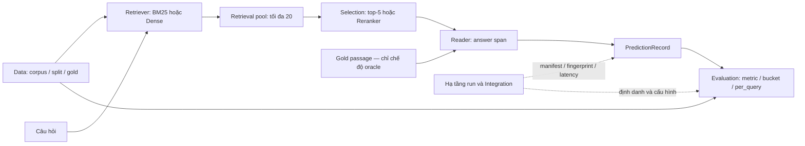

# 00 — Phân tích project German QA

“Chưa làm” là trạng thái học tập của sinh viên, không phải kết luận rằng repo chưa có code. Tài liệu này ghi quan sát chỉ-đọc, không nghiệm thu module hoặc gate. Chỉ bốn tài liệu học của Giai đoạn A–B được tạo; chưa viết bài học Giai đoạn C, chưa tạo chỉ mục Giai đoạn D.

## 1. Kiểm kê nguồn trước phân tích

Đọc theo đúng thứ tự bên dưới. Tất cả sáu nguồn bắt buộc đều tìm thấy và đọc được; không có nguồn bắt buộc bị thiếu hoặc lỗi đọc.

| Thứ tự | File | Tình trạng |
|---|---|---|
| 1 | `docs/superpowers/plans/2026-09-11-german-qa-learning-roadmap.md` | Tìm thấy, đọc toàn bộ |
| 2 | `docs/superpowers/plans/2026-09-11-german-qa-task-catalog.md` | Tìm thấy, đọc toàn bộ |
| 3 | `docs/superpowers/specs/2026-09-10-german-qa-retrieval-module-specs.md` | Tìm thấy, đọc toàn bộ qua các phần; V1.1 frozen |
| 4 | `docs/superpowers/specs/2026-09-10-german-qa-retrieval-design.md` | Tìm thấy, đọc toàn bộ |
| 5 | `docs/superpowers/specs/2026-09-11-german-qa-retrieval-v1.2-amendments-draft.md` | Tìm thấy, đọc toàn bộ; draft chưa hiệu lực |
| 6 | `.specify/memory/constitution.md` | Tìm thấy, đọc toàn bộ |
| 7 | `src/`, `tests/`, `notebooks/`, `data/`, `results/`, `docs/` | Tìm thấy; kiểm kê cây, đọc code V1, test V1, báo cáo và mẫu artifact |
| 7a | `website/README.md`, `future_RAG/README.md` | Tìm thấy, đọc; chỉ bổ trợ hiện trạng |
| 7b | `README.md` ở root | Không thấy trong cây được kiểm kê; không phải một trong sáu nguồn bắt buộc |
| 7c | `docs/learning/` | Chưa tồn tại trước lượt soạn này; đây là thư mục đầu ra mới |

Ưu tiên: constitution quản trị; module spec V1.1 quy định hợp đồng kỹ thuật; design định hướng nghiên cứu; roadmap/catalog phân bổ việc học. Khi code khác spec, ghi lệch và đề xuất xử lý, không sửa spec frozen để hợp thức code. [.specify/memory/constitution.md §I. Spec là nguồn chuẩn kỹ thuật, đóng băng theo phiên bản] [docs/superpowers/specs/2026-09-10-german-qa-retrieval-module-specs.md §0. Nguyên tắc chung & phân chia trách nhiệm module]

Giới hạn khảo sát: không chạy notebook, training, inference, API, build corpus, tải dữ liệu hay benchmark. Không chạy test hành vi; chỉ thu thập tên test. Không suy tiến độ học từ số file hay số test. Tài liệu kỹ thuật V2 chỉ được nhận diện để tránh nhầm với Reader V1.

## 2. Bài toán và câu hỏi nghiên cứu

### 2.1 Bắt đầu bằng câu hỏi, chưa bắt đầu bằng GPU

**QA** là hỏi–đáp; **extractive QA** lấy đáp án bằng một đoạn ký tự có thật trong passage, thay vì viết câu trả lời mới. **Passage** là đoạn văn được hệ thống tìm hoặc đọc; **corpus** là tập passage có thể tìm kiếm. **Closed-context** nhận sẵn context để đọc; **open-domain** phải tìm passage trong corpus trước khi đọc. Đối chiếu hai cách bằng ví dụ Einstein ở buổi 1; không cần hiểu PyTorch hay chi tiết GPU lúc này. [docs/superpowers/plans/2026-09-11-german-qa-learning-roadmap.md §Chặng 1 — Hiểu đề tài và khảo sát project] [docs/superpowers/specs/2026-09-10-german-qa-retrieval-design.md §Kiến trúc và ranh giới module] [docs/superpowers/specs/2026-09-10-german-qa-retrieval-module-specs.md §6.3 Quy tắc xử lý]

**Retrieval** là tìm các passage ứng viên; **selection** chọn số passage đưa vào Reader; **Reader** chọn answer span, tức khoảng ký tự chứa đáp án. **Evaluation** chấm các artifact đã lưu; artifact là file kết quả có thể đọc và kiểm chứng lại. **Gate** là điều kiện cần kiểm chứng trước khi chuyển chặng, không phải ngưỡng điểm cao tự đặt. [docs/superpowers/specs/2026-09-10-german-qa-retrieval-module-specs.md §0. Nguyên tắc chung & phân chia trách nhiệm module] [.specify/memory/constitution.md §VI. Kiểm thử hành vi, nghiệm thu bằng bằng chứng]

Đóng góp dự kiến là giao thức dữ liệu kiểm soát leakage, thực nghiệm có điều kiện so sánh và phân tích điểm nghẽn; không đề xuất model/loss mới. Leakage nghĩa là thông tin thuộc tập kiểm tra lọt vào việc học hoặc lựa chọn cấu hình. Các đóng góp chỉ thành kết quả đạt được sau khi có bằng chứng. [docs/superpowers/specs/2026-09-10-german-qa-retrieval-design.md §Core contribution]

### 2.2 RQ → bảng/hình → bằng chứng

RQ là câu hỏi nghiên cứu. EM đo đáp án khớp hoàn toàn sau chuẩn hóa; F1 đo mức khớp token giữa đáp án dự đoán và tham chiếu. Latency là thời gian xử lý; checkpoint là trạng thái mô hình được lưu; reranker là mô hình xếp lại các passage đã được retriever đưa ra. Những thuật ngữ này chỉ cần nhận biết ở buổi 2, phép tính và cơ chế được dạy dần ở buổi 18, 20–26. [docs/superpowers/specs/2026-09-10-german-qa-retrieval-module-specs.md §3.3 Quy tắc xử lý] [docs/superpowers/specs/2026-09-10-german-qa-retrieval-module-specs.md §7.1 Mục tiêu & phạm vi]

| RQ | So sánh cần giữ công bằng | Bảng/hình bắt buộc | Artifact cần có; buổi phân tích |
|---|---|---|---|
| RQ1 — scale | BM25/Dense × base/mid/large, reranker tắt; cùng query/gold và checkpoint; top-5 vào Reader | Bảng 1: retriever × tier × metric; Hình 1: Recall@20 và EM theo quy mô | Retrieved trước selection, metrics QA, corpus và run manifest; buổi 30 |
| RQ2 — bottleneck | 2 retriever × bật/tắt reranker × 3 tier; 5 bucket cùng N_eval; oracle và final_correct | Bảng 2: tỉ lệ bucket theo cấu hình/tier; Hình 2: cột chồng | Predictions, per_query, counts, run reader-only; buổi 30 |
| RQ3 — selection | Ghép cặp cùng retriever/checkpoint/tier/query/pool, cùng reader_k=5; báo n_latency riêng từng run | Bảng 3: chênh selection_failure, EM/F1, latency; ghi chiều phép trừ | Cặp run bật/tắt, manifest và latency từng stage; buổi 31 |

Nguồn từng hàng: [docs/superpowers/specs/2026-09-10-german-qa-retrieval-design.md §RQ1 — Ảnh hưởng của quy mô corpus] [docs/superpowers/specs/2026-09-10-german-qa-retrieval-design.md §RQ2 — Bottleneck dịch chuyển] [docs/superpowers/specs/2026-09-10-german-qa-retrieval-design.md §RQ3 — Giá trị của khâu selection] [docs/superpowers/plans/2026-09-11-german-qa-learning-roadmap.md §Chặng 10 — Phân tích và bàn giao]

BM25 là baseline tìm theo từ; Dense Retriever tìm bằng vector biểu diễn. Không mặc định Dense thắng. Oracle là chế độ Reader đọc gold passage trực tiếp; đó là mốc năng lực Reader, không phải trần tuyệt đối. Kết luận mô tả trong đúng cấu hình/tập đã chạy; không tuyên bố ý nghĩa thống kê khi chưa có giao thức. [docs/superpowers/specs/2026-09-10-german-qa-retrieval-design.md §Dữ liệu và định hướng mô hình] [docs/superpowers/specs/2026-09-10-german-qa-retrieval-design.md §Giới hạn và phạm vi kết luận]

## 3. Pipeline và ranh giới trách nhiệm

Sơ đồ dưới là kiến trúc mục tiêu, không khẳng định toàn bộ đã tồn tại. “Gold” là nhãn/bằng chứng tham chiếu; manifest là file ghi cấu hình và nguồn artifact; fingerprint là dấu băm của nội dung để phát hiện thay đổi. [docs/superpowers/specs/2026-09-10-german-qa-retrieval-module-specs.md §0. Nguyên tắc chung & phân chia trách nhiệm module] [docs/superpowers/specs/2026-09-10-german-qa-retrieval-module-specs.md §8.7 Artifact]



| Khối | Sở hữu | Không được tự làm | Hợp đồng; chặng |
|---|---|---|---|
| Data/Splits/Corpus | Chuẩn hóa, chunk, dedup, passage_id, provenance, split và nguồn corpus | Không train/chấm metric; không giao quyền chia split lại cho retriever | PassageRecord, QARecord, RetrievalTrainingRecord; chặng 3–5 |
| BM25/Dense | Nhận corpus đã chuẩn bị, trả RetrievalResult | Không dedup/sửa corpus | §1.4, §4/5; chặng 6–7 |
| Selection/Reranker | Chọn trong pool; tắt thì top-5, bật thì rerank top-20 giữ tối đa 5 | Không truy vấn corpus hay thêm passage | §7.1/7.5, §8.3; chặng 8–9 |
| Reader | Đọc passage được chọn, trả text và offset hợp lệ | Không tự retrieval; không dùng normalized_text thay text gốc | §6.2/6.3; chặng 8 |
| Evaluation | Chấm file và kiểm tra tính nhất quán; tính lại không chạy model | Không đo latency, không bỏ query lỗi khỏi mẫu số chất lượng | §3.1–3.7; chặng 6/10 |
| Shared run infra / Integration | ID, fingerprint, manifest; orchestration và phép đo latency | Không đợi chặng 9 mới có danh tính run đầu tiên | §8.3/8.4/8.7; chặng 6/8/9 |

Nguồn: [docs/superpowers/specs/2026-09-10-german-qa-retrieval-module-specs.md §0. Nguyên tắc chung & phân chia trách nhiệm module] [docs/superpowers/specs/2026-09-10-german-qa-retrieval-module-specs.md §8.3 Quy tắc xử lý] [docs/superpowers/plans/2026-09-11-german-qa-task-catalog.md §Phân tách file dùng chung được dự kiến ở chặng 6–9]

## 4. Hiện trạng module: giữ / sửa / viết mới / build lại

Đây là **phân loại công việc đề xuất cho giai đoạn triển khai tương lai**, không phải thao tác đã làm. Fixture là bộ dữ liệu nhỏ có kết quả dự đoán được; validator là hàm kiểm tra hợp đồng dữ liệu.

| Thành phần | Quan sát có nguồn | Phân loại đề xuất; ảnh hưởng bài học |
|---|---|---|
| Normalize/chunk | Có normalize_text, passage_id, chunk_text, find_span_chunks; Chunk giữ char_start/char_end. [src/corpus.py §chunk_text] [src/corpus.py §find_span_chunks] | **Giữ để đọc/reuse có kiểm tra** logic cơ bản; bổ sung test hợp đồng ở T5.1. Chưa thấy tests/test_corpus.py trong kiểm kê |
| CorpusBuilder | records() trả title=None, không xuất parent_document_id/chunk_start_char/chunk_end_char; SOURCE_PRIORITY cho phép germandpr_hard_negative. [src/corpus.py §CorpusBuilder.records] [src/corpus.py §SOURCE_PRIORITY] | **Sửa** producer/provenance/title và D6; không tạo builder trùng trách nhiệm. Không dùng output hiện tại làm mẫu PassageRecord V1.1 hoàn chỉnh |
| Splits | assign_splits trả assignment theo key, mọi TestKeys nhận test; caller chưa phân biệt dòng train cần loại. [src/splits.py §assign_splits] [notebooks/01_build_corpus_base.py §build_qa_records] | **Sửa** D1 theo nguồn dòng và caller; giữ query_id gốc. T5.2; chưa thấy tests/test_splits.py |
| QA producer | build_qa_records bỏ dòng không có gold_indices, dùng primary chunk, xuất gold_passage_ids/answers, query_id theo split đã gán. [notebooks/01_build_corpus_base.py §build_qa_records] | **Sửa/tách có kiểm soát** ở T5.3–T5.4; reference_answers, evidence local và record gold rỗng chưa được producer này đáp ứng |
| DPR producer | Gán mọi chunk positive context là positive; flatten hard negatives rồi thêm vào builder; thiếu positive_texts/hard_negative_groups. [notebooks/01_build_corpus_base.py §build_retrieval_training_records] | **Sửa/tách** ở T5.5; không dùng IDs của nguồn DPR để thay công thức passage_id của project |
| HF loader | load_split gọi hf_hub_download với refs/convert/parquet; không có local_files_only trong lời gọi. [src/hf_data.py §load_split] | **Giữ để nghiên cứu, cần sửa luồng tái lập/offline trong task được duyệt**; không gọi loader trong khảo sát chỉ-đọc; revision branch chưa là bản ghim bất biến |
| Schemas | QA và RetrievalResult validators có; Prediction fields thiếu retrieval_k/reader_k; _field_errors từ chối field ngoài danh sách. [src/schemas.py §QA_RECORD_FIELDS] [src/schemas.py §PREDICTION_RECORD_FIELDS] [src/schemas.py §_field_errors] | **Sửa** T5.0; giữ kiểm tra None/chuỗi rỗng, kiểu/rank có ích; thêm Passage/Training validators theo spec, không tuyên bố schema đạt V1.1 |
| Metric đơn lẻ | Có Recall theo Hit, GoldCoverage riêng, EM/F1 Đức, percentile tuyến tính, final_correct độc lập. [src/evaluation.py §recall_at_k] [src/evaluation.py §normalize_answer] [tests/test_evaluation.py §test_em_f1_einstein_spec_example] | **Giữ/review** các hàm tính tay ở T6.2; các test là nguồn bài tập, chưa chạy trong lượt này |
| Evaluation tổng hợp | _stage_sets khi rerank off thu pool xuống reader_k; BUCKETS còn reranking_failure; _run_identity lấy record đầu; build_parser không có run manifest/fingerprint arguments. [src/evaluation.py §_stage_sets] [src/evaluation.py §BUCKETS] [src/evaluation.py §_run_identity] [src/evaluation.py §build_parser] | **Sửa** T6.2–T6.3: D3/P1/manifest, corpus membership, mode; không dạy kết quả test cũ là đáp án chuẩn |
| Test Evaluation cũ | test_rerank_off_gold_beyond_reader_k_is_retrieval_miss và test_rerank_on_gold_dropped_by_reranker_is_reranking_failure giữ kỳ vọng V1.0. [tests/test_evaluation.py §test_rerank_off_gold_beyond_reader_k_is_retrieval_miss] [tests/test_evaluation.py §test_rerank_on_gold_dropped_by_reranker_is_reranking_failure] | **Sửa kỳ vọng tương lai** theo D3; bài học tính tay gold hạng 8 phải ra selection_failure ở cả bật/tắt |
| BM25 | search trả list tuple (pid, score); notebook bọc thành RetrievalResult. Có test query rỗng/OOV/không trùng ID. [src/bm25_retriever.py §BM25Retriever.search] [notebooks/02_run_bm25.py §main] [tests/test_bm25_retriever.py §test_fully_oov_query_returns_zero_score_deterministic_order] | **Giữ phần lõi, sửa tokenizer/runner**; xem đối chiếu tokenizer bên dưới; T6.4 |
| Run infra / oracle / Integration | Chưa thấy src/run_manifest.py, src/reader_runner.py, src/integration.py hoặc test tương ứng trong cây src/tests. Đây là đường dẫn dự kiến của catalog. [docs/superpowers/plans/2026-09-11-german-qa-task-catalog.md §Phân tách file dùng chung được dự kiến ở chặng 6–9] | **Viết mới hoặc reuse extension point sau inventory** ở T6.1/T8.2/T9.1; tên/signature chưa chốt |
| Dense / Reader / Reranker | Cây src/tests chưa có implementation V1 của ba khối; chưa thấy checkpoint/FAISS trong data/results được kiểm kê. [docs/superpowers/specs/2026-09-10-german-qa-retrieval-module-specs.md §5.2 Input/Output] [docs/superpowers/specs/2026-09-10-german-qa-retrieval-module-specs.md §6.2 Input/Output] [docs/superpowers/specs/2026-09-10-german-qa-retrieval-module-specs.md §7.2 Input/Output] | **Viết mới** theo task chặng 7–8; không nhầm LLMAnswerer với Reader trích xuất |
| Distractor / acceptance | Chưa thấy src/distractors.py, scripts/check_data_acceptance.py hay test được catalog đề xuất. [docs/superpowers/plans/2026-09-11-german-qa-task-catalog.md §Chặng 5 — Danh mục chi tiết và phân bổ sáu buổi] | **Viết mới** logic fixture T5.7/checker T5.8; build thật chờ T9.3 |
| Artifact cũ | Corpus 54.071 dòng; QA test 3.220 dòng; các schema khác V1.1, xem §5.2 dưới đây. | **Build lại sau sửa**, ở namespace mới đề xuất data/processed/v1.1/; giữ nguyên bộ cũ để audit. [docs/superpowers/plans/2026-09-11-german-qa-task-catalog.md §T5.8 — Phạm vi báo cáo và nghiệm thu] |
| Nhánh LLM/RAG | Có src/answerer.py (LLMAnswerer), answer_parser.py, citation.py, prompt_loader.py, llm_clients.py và test tương ứng. Docstring Answerer nói ExtractiveAnswerer chưa nằm trong file. [src/answerer.py §LLMAnswerer] [src/llm_clients.py §FakeLLMClient] | **Giữ ngoài phạm vi roadmap V1**; không train/gọi API và không dùng test V2 chứng minh Reader V1 hoàn tất |
| README | future_RAG/README.md vẫn ghi “Code: chưa có” nhưng src có LLMAnswerer. [future_RAG/README.md §Trạng thái] [src/answerer.py §LLMAnswerer] | **Ghi độ lệch tài liệu**, không sửa README trong nhiệm vụ này; hiện trạng lấy từ file thật |

### 4.1 Tokenizer BM25: một lệch cụ thể, chưa sửa

Spec yêu cầu whitespace split rồi bỏ token toàn ký tự không phải chữ/số. Code gọi bm25s.tokenize không truyền token_pattern. Bản cài local bm25s 0.3.11 khai báo mặc định `(?u)\b\w\w+\b`, tức tách theo regex và loại token một ký tự. Vì vậy chưa thể coi tokenizer hiện tại đúng §4.3 chỉ vì test query rỗng/OOV có sẵn. Đây là đối chiếu code, không phải kết quả benchmark. [docs/superpowers/specs/2026-09-10-german-qa-retrieval-module-specs.md §4.3 Quy tắc xử lý] [src/bm25_retriever.py §BM25Retriever.__init__] [C:/Users/PC/AppData/Local/Programs/Python/Python313/Lib/site-packages/bm25s/tokenization.py §tokenize]

**Ví dụ minh họa cần làm ở buổi 19:** token một ký tự hoặc từ có dấu câu sẽ giúp phát hiện hai cách tokenize khác nhau. Không suy ảnh hưởng đến score trước khi có thực nghiệm hợp lệ.

## 5. Dữ liệu thật, artifact cũ và ranh giới bằng chứng

### 5.1 Cache đã đọc bằng đường dẫn local, không gọi Hub

Các số dưới lấy từ metadata Parquet; chỉ đọc batch đầu để xem record. Không nghiệm thu toàn bộ offset hay leakage trên cache hiện tại.

| Dataset/split | Đường dẫn thực | Metadata số dòng |
|---|---|---:|
| GermanQuAD train | `C:/Users/PC/.cache/huggingface/hub/datasets--deepset--germanquad/snapshots/a2f3a59f0be843fc305d0417d7292ef0b1a66884/plain_text/train/0000.parquet` | 11.518 |
| GermanQuAD test | `C:/Users/PC/.cache/huggingface/hub/datasets--deepset--germanquad/snapshots/a2f3a59f0be843fc305d0417d7292ef0b1a66884/plain_text/test/0000.parquet` | 2.204 |
| GermanDPR train | `C:/Users/PC/.cache/huggingface/hub/datasets--deepset--germandpr/snapshots/d0b867a49c45a44d172041351b5df73a87714372/plain_text/train/0000.parquet` | 9.275 |
| GermanDPR test | `C:/Users/PC/.cache/huggingface/hub/datasets--deepset--germandpr/snapshots/d0b867a49c45a44d172041351b5df73a87714372/plain_text/test/0000.parquet` | 1.025 |

Nguồn mỗi hàng: file Parquet ghi ngay trong hàng, §metadata.num_rows. Revision trong đường dẫn là snapshot cache quan sát được, chưa được chủ project chốt làm revision chuẩn cho các run mới.

GermanQuAD có `id:int32, context:string, question:string, answers:{text:list[string], answer_start:list[int32]}`. Record đầu train có id=51870, câu hỏi nguyên văn “Von welchem Gesetzt stammt das Amerikanische ab? ”; đáp án “britischen Common Laws”, answer_start=146. Kiểm tra slice trên record này cho True. Không sửa chính tả câu hỏi nguồn, không suy mọi record đều đúng từ một ví dụ. [C:/Users/PC/.cache/huggingface/hub/datasets--deepset--germanquad/snapshots/a2f3a59f0be843fc305d0417d7292ef0b1a66884/plain_text/train/0000.parquet §schema và record đầu id=51870]

GermanDPR có `question, answers, positive_ctxs, negative_ctxs, hard_negative_ctxs`; answers là list chuỗi. Mỗi nhóm ctx trong Parquet là **struct chứa ba list song song** `title/text/passage_id`, không phải mặc định list dict. Record đầu train hỏi “Wie viele christlichen Menschen in Deutschland glauben an einen Gott?”, positive title “Gott”, có 3 hard-negative text. Số 3 chỉ thuộc record này; báo cáo cũ có 6 dòng với 1 và 2 dòng với 2 hard negatives. [C:/Users/PC/.cache/huggingface/hub/datasets--deepset--germandpr/snapshots/d0b867a49c45a44d172041351b5df73a87714372/plain_text/train/0000.parquet §schema và record đầu] [results/data_audit_report.json §germandpr_train_hard_negative_count_dist]

Dataset card GermanQuAD cache có metadata `license: cc-by-4.0` và mục Dataset Description dẫn paper. Đây là metadata của card được đọc, chưa xác minh giấy phép của mọi nguồn/dump. [C:/Users/PC/.cache/huggingface/hub/datasets--deepset--germanquad/snapshots/fff05ceaf2ffbe5b65c7e0c57e678f7b7e1a0581/README.md §Dataset Description]
CẦN XÁC MINH: card/license GermanDPR, Wikipedia và bản paper sử dụng trong buổi 7 — giảng viên/chủ project cung cấp nguồn local hoặc cho phép xác minh riêng; không suy từ card GermanQuAD.

### 5.2 Bộ processed hiện tại không phải dữ liệu V1.1 đã nghiệm thu

Đếm dòng chỉ-đọc ngày đối chiếu; không build lại.

| File hiện hữu | Số dòng/giá trị quan sát | Ý nghĩa giới hạn |
|---|---:|---|
| data/processed/corpus_base.jsonl | 54.071 dòng | Schema hàng đầu thiếu provenance; không gọi là base V1.1 |
| data/processed/corpus_manifest.json | actual_size=54.071; germandpr_hard_negative=46.551 | Mâu thuẫn nguồn D6; không sửa hoặc lọc tại chỗ |
| data/processed/qa_germanquad_train.jsonl | 9.287 dòng | Schema cũ gold_passage_ids/answers |
| data/processed/qa_germanquad_dev.jsonl | 1.031 dòng | Hàng đầu query_id=gq-dev-46411, không giữ split gốc như V1.1 |
| data/processed/qa_germanquad_test.jsonl | 3.220 dòng | Không khớp 2.204 dòng test gốc ở metadata cache |
| data/processed/retrieval_germandpr_train.jsonl | 8.345 dòng | hard_negative_passage_ids dạng phẳng |
| data/processed/retrieval_germandpr_dev.jsonl | 929 dòng | Chưa là TrainingRecord V1.1 |
| data/processed/retrieval_germandpr_test.jsonl | 1.026 dòng | Test cache gốc có 1.025 dòng; cần rebuild D1, không chỉ đổi nhãn |
| data/processed/retrieval_bm25_base_dev.jsonl | 51.550 dòng | Kết quả cũ, không có run namespace/fingerprint chuẩn kèm theo |
| data/processed/chunk_coverage_report.json | total=13.722; uncovered=184; coverage_rate=0.9866 | Coverage gộp, không chứng minh ≥98% ở từng file; producer cũ bỏ gold rỗng |

Nguồn: các file cùng tên trong bảng (§toàn bộ dòng JSONL hoặc khóa JSON ghi trong bảng); đối chiếu [docs/superpowers/specs/2026-09-10-german-qa-retrieval-module-specs.md §1.1 Passage record (Corpus)] [docs/superpowers/specs/2026-09-10-german-qa-retrieval-module-specs.md §1.2 QA / gold record — chỉ dùng cho GermanQuAD] [docs/superpowers/specs/2026-09-10-german-qa-retrieval-module-specs.md §2.3 Quy tắc xử lý] [notebooks/01_build_corpus_base.py §build_qa_records].

Báo cáo BM25 cũ ghi n_queries=1.031, recall@20=0.6639185257032008, run_id=bm25_base_dev, latency đo local. Chỉ dùng để tập truy vết báo cáo cũ; không chuyển con số này sang bảng RQ V1.1 hoặc kết luận Dense/BM25. [results/metrics_bm25_base_dev.json §n_queries] [results/metrics_bm25_base_dev.json §recall@20] [results/metrics_bm25_base_dev.json §latency_ms]

`question_counts_raw` trong audit thực ra đếm **số key duy nhất** do main() tạo set, không phải số dòng. Ví dụ audit ghi GermanQuAD test=2.203 key trong khi metadata cache có 2.204 dòng. Buổi 5/8 phải dạy phân biệt trước khi viết phương trình bảo toàn dòng. [notebooks/00_data_audit.py §main] [results/data_audit_report.json §question_counts_raw]

## 6. Hợp đồng dữ liệu và giao thức cần giữ

Provenance là thông tin truy về văn bản/occurrence nguồn; offset là vị trí ký tự; dedup là gộp nội dung có cùng định danh sau chuẩn hóa; tier là một mức corpus. **N_eval** đếm query có gold evidence; **n_latency** đếm record hợp lệ cho từng phép đo thời gian. Các định nghĩa dưới là mục tiêu V1.1, không phải tuyên bố code đã làm đúng.

| Quyết định/hợp đồng | Định nghĩa ngắn | Vì sao tồn tại | Nguồn chuẩn | Chặng phụ thuộc |
|---|---|---|---|---|
| D1 | Test đúng dòng test gốc; train trùng TestKeys bị loại, không đưa vào test; ID giữ split gốc | Chặn leakage chéo thành phần, giữ truy vết nguồn dòng | [docs/superpowers/specs/2026-09-10-german-qa-retrieval-module-specs.md §Nhật ký quyết định V1.1] [docs/superpowers/specs/2026-09-10-german-qa-retrieval-module-specs.md §2.3 Quy tắc xử lý] (e), §1.2/1.3 | 3–10 |
| D2 | Quality dùng N_eval; gold rỗng lưu nhưng loại khỏi mẫu số; query lỗi vẫn trong N_eval; latency dùng n_latency | Không làm score đẹp bằng loại ca lỗi | [docs/superpowers/specs/2026-09-10-german-qa-retrieval-module-specs.md §3.3 Quy tắc xử lý] | 4–10 |
| D3 | selection_failure: gold có ở pool 20 nhưng không trong reader input tối đa 5, cả bật/tắt | Phân biệt lỗi tìm kiếm với lỗi chọn | [docs/superpowers/specs/2026-09-10-german-qa-retrieval-module-specs.md §3.3 Quy tắc xử lý] | 6,8–10 |
| D4 | Không đáp án: cùng None ở cả 5 field, không dùng chuỗi rỗng | Phân biệt no-answer hợp lệ và record lỗi | [docs/superpowers/specs/2026-09-10-german-qa-retrieval-module-specs.md §1.5 Prediction record (đầu ra pipeline — lưu để tính lại metric không cần chạy lại model)] | 5–6,8–9 |
| D5 | Integration đo; Evaluation tóm tắt; warm-up bỏ lượt thử, không loại query khỏi lượt chính thức | Đo công bằng, không lệch theo thứ tự file | [docs/superpowers/specs/2026-09-10-german-qa-retrieval-module-specs.md §8.3 Quy tắc xử lý] | 6,8–10 |
| D6 | Base từ mọi chunk context GQ + positive context DPR; hard negative chỉ training; mid/large dùng một chuỗi distractor | Tránh đưa passage được tuyển theo query vào corpus đánh giá | [docs/superpowers/specs/2026-09-10-german-qa-retrieval-module-specs.md §2.3 Quy tắc xử lý] (d/f/g) | 4–10 |
| P1 | retrieval_k=20, reader_k=5; cùng trong record và manifest; oracle ngoại lệ về sử dụng k | So ngân sách Reader công bằng, kể cả predictions rỗng | [docs/superpowers/specs/2026-09-10-german-qa-retrieval-module-specs.md §1.5 Prediction record (đầu ra pipeline — lưu để tính lại metric không cần chạy lại model)] [docs/superpowers/specs/2026-09-10-german-qa-retrieval-module-specs.md §8.7 Artifact] | 5–10 |
| P2 | Dev/base: Dense Recall@20 trước selection; Reader F1 oracle; Reranker Recall@5 sau rerank trên top-20 cố định; hòa chọn sớm | Không tune test và không lẫn metric giữa stage | [docs/superpowers/specs/2026-09-10-german-qa-retrieval-module-specs.md §5.4 Cấu hình] [docs/superpowers/specs/2026-09-10-german-qa-retrieval-module-specs.md §6.4 Cấu hình] [docs/superpowers/specs/2026-09-10-german-qa-retrieval-module-specs.md §7.4 Cấu hình] | 2,6–10 |
| P3 | DPR test chỉ retrieval_only; mọi positive ID phải trong corpus; báo số record bị loại khi prep | Giữ sanity-check riêng, không trộn vào funnel QA | [docs/superpowers/specs/2026-09-10-german-qa-retrieval-module-specs.md §3.2 Input/Output] [docs/superpowers/specs/2026-09-10-german-qa-retrieval-module-specs.md §3.3 Quy tắc xử lý] | 5–6,9–10 |
| P4 | Lấy title nguồn base trước dedup; NFC, '_'→space, lowercase, gộp space, strip; lọc exact title cho distractor | Giảm cùng nguồn chưa gán gold, không hứa sạch near-duplicate | [docs/superpowers/specs/2026-09-10-german-qa-retrieval-module-specs.md §Nhật ký quyết định V1.1] [docs/superpowers/specs/2026-09-10-german-qa-retrieval-module-specs.md §2.3 Quy tắc xử lý] (d) | 4–5,9–10 |
| Chunk/gold | Cửa sổ 100 từ, overlap 20; chunk độc lập đáp án; local offset=offset nguồn−chunk_start; giữ đủ references | Không cắt corpus theo nhãn và không search nhầm occurrence | [docs/superpowers/specs/2026-09-10-german-qa-retrieval-module-specs.md §2.3 Quy tắc xử lý] (a–c) | 3–5,8 |
| Positive/group/mask | Hợp mọi occurrence answer-bearing; 1 context hard negative=1 group; sampling ≤1 chunk/group/epoch; mask toàn gold_set | Không tăng trọng số context dài và không dùng positive chưa chọn làm negative | [docs/superpowers/specs/2026-09-10-german-qa-retrieval-module-specs.md §1.3 Retrieval training record — dùng cho GermanDPR] [docs/superpowers/specs/2026-09-10-german-qa-retrieval-module-specs.md §5.3 Quy tắc xử lý] | 3–5,7–8 |
| Recall@k | Trung bình chỉ báo có ≥1 gold trong top-k; GoldCoverage là tỉ lệ gold tìm được, tên riêng | Tránh hai công thức cùng tên Recall | [docs/superpowers/specs/2026-09-10-german-qa-retrieval-module-specs.md §3.3 Quy tắc xử lý] | 2 nhận biết; 6–10 tính/đọc |
| Bucket/final_correct | 5 bucket loại trừ nhau; final_correct=EM=1 được lưu độc lập | Mất gold vẫn có thể trả lời đúng từ passage khác | [docs/superpowers/specs/2026-09-10-german-qa-retrieval-module-specs.md §3.3 Quy tắc xử lý] [docs/superpowers/specs/2026-09-10-german-qa-retrieval-module-specs.md §3.7 Artifact] | 6,9–10 |
| Run identity | run_id gồm config/dataset/split/bundle/seed/UUID4 mới; resume giữ ID, chỉ thêm query thiếu | Không ghi đè run, truy được từng kết quả | [docs/superpowers/specs/2026-09-10-german-qa-retrieval-module-specs.md §8.4 Cấu hình] | 6–10 |
| Fingerprint/manifest | SHA-256 byte file; checkpoint hash từ bản đồ file canonical; manifest ghi trước query đầu, kể cả rỗng | Phát hiện khác gold/corpus/checkpoint dù tên giống nhau | [docs/superpowers/specs/2026-09-10-german-qa-retrieval-module-specs.md §8.7 Artifact] | 6–10 |
| Reader span | Raw start+end logits; dedup cùng char-span lấy max; softmax trên mọi ứng viên hợp lệ của passage; tie theo ID/offset | Tất định; không nhầm điểm heuristic với xác suất hiệu chuẩn | [docs/superpowers/specs/2026-09-10-german-qa-retrieval-module-specs.md §6.3 Quy tắc xử lý] | 8–10 |

**Chờ chốt A3:** metric P2 của reranker đã được V1.1 quy định; metadata `evaluation_stage, candidate_run_id, candidate_results_path, candidate_results_sha256` chỉ là đề xuất draft. Có thể học/tính fixture; không dùng schema draft cho production selection, không ghi rằng A3 đã có hiệu lực. [docs/superpowers/specs/2026-09-11-german-qa-retrieval-v1.2-amendments-draft.md §A3 — Phân biệt điểm retriever và điểm sau rerank]

Hai chi tiết cần chủ project làm rõ trước producer thật: question_key trong code có gộp whitespace, còn văn bản §2.3.e chỉ nêu lowercase+strip+NFC; schema corpus_manifest giai đoạn base chưa build mid/large được catalog yêu cầu chốt ở thẻ task. Không tự chọn thay cho nguồn. [src/splits.py §question_key] [docs/superpowers/specs/2026-09-10-german-qa-retrieval-module-specs.md §2.3 Quy tắc xử lý] [docs/superpowers/plans/2026-09-11-german-qa-task-catalog.md §T5.8 — Phạm vi báo cáo và nghiệm thu]

## 7. Sổ lệnh đã đối chiếu và kết quả chỉ-đọc

Các lệnh dưới chạy từ root `D:/Project/2026-2027-HK1/nlp`. Python trên PATH trỏ WindowsApps alias; interpreter thực đã đọc là `C:/Users/PC/AppData/Local/Programs/Python/Python313/python.exe`, phiên bản 3.13.3. Đây là quan sát môi trường ngày đối chiếu, không giả định máy khác giống máy này.

### 7.1 Lệnh đã chạy, không ghi artifact project

```powershell
rg --files src tests notebooks data results docs
Get-Content -LiteralPath 'src/splits.py' -Encoding UTF8
Get-Content -LiteralPath 'data/processed/qa_germanquad_dev.jsonl' -TotalCount 1 -Encoding UTF8
& 'C:/Users/PC/AppData/Local/Programs/Python/Python313/python.exe' -B -m pytest tests --collect-only -q -p no:cacheprovider
```

Kết quả kiểm kê test: **110 tests collected**, exit code 0; đây không phải “110 tests passed”. `-B` tránh ghi bytecode, `-p no:cacheprovider` tắt pytest cache. Đối chiếu collection với test hiện hữu: tests/test_answer_parser.py, test_answerer.py, test_bm25_retriever.py, test_citation.py, test_evaluation.py, test_llm_clients.py, test_prompt_loader.py, test_schemas.py. Không có lệnh cài package.

Metadata package local đọc được: pytest 9.1.1; pandas 2.2.3; pyarrow 23.0.1; bm25s 0.3.11; huggingface-hub 1.31.0. Chưa thấy requirements/pyproject/lockfile qua kiểm kê tên file; chưa có cơ sở coi môi trường đã tái lập.

### 7.2 Cách đọc Parquet đã thực hiện

Đã dùng `pyarrow.parquet.ParquetFile(path)`, đọc `metadata.num_rows`, `schema_arrow`, rồi `next(iter_batches(batch_size=1)).to_pylist()[0]` trên các đường dẫn §5.1. Không gọi `src.hf_data.load_split`. CẦN XÁC MINH trước bài học: đường dẫn cache và interpreter còn tồn tại trên máy sinh viên — giảng viên/sinh viên dùng Test-Path và kiểm metadata lại.

### 7.3 Lệnh không được chạy trong nhiệm vụ học liệu này

- Không chạy/import notebooks/00_data_audit.py: có mkdir ở module scope, gọi hf_hub_download và ghi results/data_audit_report.json trong main(); mô tả “chỉ đọc” đầu file không đủ bảo đảm. [notebooks/00_data_audit.py §main]
- Không chạy/import notebooks/01_build_corpus_base.py: tạo OUT_DIR và main ghi processed cũ. [notebooks/01_build_corpus_base.py §OUT_DIR] [notebooks/01_build_corpus_base.py §main]
- Không chạy notebooks/02_run_bm25.py hoặc CLI Evaluation có --out: có ghi artifact. [notebooks/02_run_bm25.py §main] [src/evaluation.py §main]
- Lệnh `python -m pytest tests/test_splits.py -v` trong thẻ mẫu catalog có **đường dẫn chưa tồn tại hiện tại**. Khi trích vào bài, đặt dưới nhãn **LỆNH MẪU – chưa xác minh**; không coi là lệnh hiện chạy được. [docs/superpowers/plans/2026-09-11-german-qa-task-catalog.md §T5.2 — Thẻ mẫu: Gán split theo D1]

## 8. Điểm cần xác minh trước học liệu chi tiết

1. CẦN XÁC MINH: lịch học là hướng dẫn đọc/fixture hay còn yêu cầu sinh viên hoàn tất implementation trong cùng 90–150 phút — chủ project duyệt phương án ở báo cáo B.
2. CẦN XÁC MINH: môi trường tái lập, quyền truy cập cache/Colab/Drive, GPU thực được cấp — sinh viên và giảng viên kiểm ở buổi 3–4; chưa coi thông tin RTX/T4 trong spec là kiểm kê phần cứng hiện tại.
3. CẦN XÁC MINH: revision dữ liệu/model và giấy phép dùng cho run mới — chủ project chốt sau inventory buổi 7.
4. CẦN XÁC MINH: A3 — chủ project phê chuẩn theo quy trình amendment; hiện **chờ chốt A3**.
5. CẦN XÁC MINH: interface mới, manifest base từng phần, question_key whitespace và luồng encode phục vụ dev selection — kiến trúc sư/chủ project chốt trước các thẻ chặng 5–7.
6. CẦN XÁC MINH: có checkpoint/artifact nghiệm thu ở nơi ngoài repo hay không — chủ project cung cấp đường dẫn; không suy từ README hoặc số test.

Không điều nào ở đây cho phép đổi roadmap/spec/code. Các đề xuất sư phạm và phạm vi duyệt nằm trong 02-roadmap-gap-report.md.

