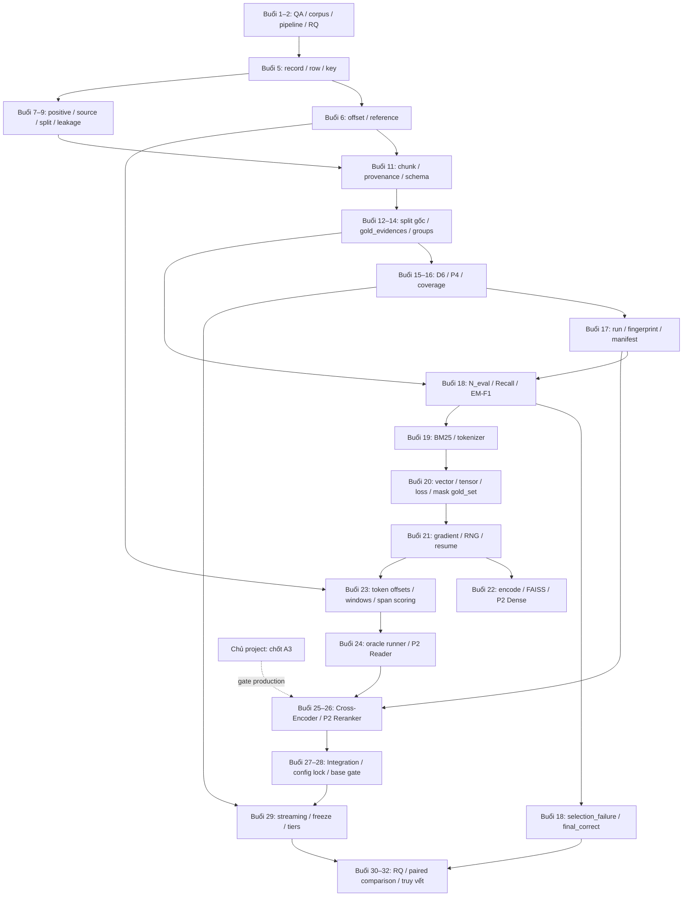

# 01 — Bản đồ khái niệm và thời điểm cần học

“Buổi đầu” là thời điểm **đề xuất giới thiệu vừa đủ để làm nhiệm vụ**, không chứng nhận đã học. Buổi 1–2 nhận biết bức tranh; buổi 3–4 chỉ kiểm môi trường; không yêu cầu hiểu GPU/PyTorch ở buổi đầu. Khi khái niệm được nhận biết sớm, phép tính và implementation vẫn để ở buổi sử dụng. [docs/superpowers/plans/2026-09-11-german-qa-learning-roadmap.md §Nhịp học và lịch dự kiến]

## 1. Đồ thị tiền đề

Mũi tên A → B nghĩa là cần hiểu A trước khi học B. Đây là thiết kế sư phạm rút từ nhiệm vụ nguồn, không phải đồ thị module hiện có.

**Không tạo vòng phụ thuộc học thuật:** nhận biết k/None trong schema buổi 11 không đòi sinh viên triển khai Reader. FAISS trong buổi 22 cần một lượt encode/search phục vụ chấm dev trước khi có quyết định checkpoint cuối; vấn đề catalog đặt T7.3 sau T7.2 được ghi riêng trong báo cáo B. [docs/superpowers/plans/2026-09-11-german-qa-task-catalog.md §Phụ thuộc toàn dự án]

## 2. Danh mục tiền đề just-in-time

Các tiền đề “Python cơ bản/string/dict/list/slicing/assert” là giả định người học do người dùng cung cấp; còn lại dùng các khái niệm cùng bảng. Mỗi hàng có nguồn mô tả nhiệm vụ/quy tắc liên quan, không dùng nguồn để giả vờ thời lượng sư phạm đã được đo.

| Khái niệm | Buổi đầu cần | Phải biết trước | Vì sao đưa vào lúc này; nguồn |
|---|---:|---|---|
| QA / extractive QA | 1 | Python string | Hỏi–đáp trích xuất chọn một đoạn text có thật làm đáp án. [docs/superpowers/plans/2026-09-11-german-qa-learning-roadmap.md §Chặng 1 — Hiểu đề tài và khảo sát project] |
| Closed-context / open-domain | 1 | QA / extractive QA | Closed-context nhận context sẵn; open-domain tìm passage trước khi đọc. [docs/superpowers/specs/2026-09-10-german-qa-retrieval-design.md §Kiến trúc và ranh giới module] |
| Corpus / passage | 1 | Python string | Corpus là tập đoạn có thể tìm; passage là một đoạn trong tập đó. [tests/test_bm25_retriever.py §PASSAGE_IDS] |
| Pipeline / module | 1 | QA / extractive QA | Pipeline nối các khối có trách nhiệm riêng; module là một khối chức năng. [docs/superpowers/specs/2026-09-10-german-qa-retrieval-module-specs.md §0. Nguyên tắc chung & phân chia trách nhiệm module] |
| Artifact / gate | 1 | Pipeline / module | Artifact là kết quả lưu được; gate là điều kiện có bằng chứng để chuyển bước. [.specify/memory/constitution.md §VI. Kiểm thử hành vi, nghiệm thu bằng bằng chứng] |
| RQ / baseline | 2 | Pipeline / module | RQ là câu hỏi nghiên cứu; baseline là cấu hình làm mốc so sánh. [docs/superpowers/specs/2026-09-10-german-qa-retrieval-design.md §RQ1 — Ảnh hưởng của quy mô corpus] |
| BM25 / Dense Retriever | 2 | Corpus / passage | BM25 là truy xuất theo từ; Dense là truy xuất qua biểu diễn vector. [docs/superpowers/specs/2026-09-10-german-qa-retrieval-design.md §Dữ liệu và định hướng mô hình] |
| Selection / Reranker | 2 | Pipeline / module | Selection chọn passage cho Reader; Reranker xếp lại candidate trong pool. [docs/superpowers/specs/2026-09-10-german-qa-retrieval-module-specs.md §8.3 Quy tắc xử lý] |
| Reader / answer span | 2 | QA / extractive QA | Reader chọn đoạn đáp án và vị trí start/end trong text passage. [docs/superpowers/specs/2026-09-10-german-qa-retrieval-module-specs.md §6.3 Quy tắc xử lý] |
| EM / F1 — nhận biết | 2 | RQ / baseline | EM đo khớp hoàn toàn sau chuẩn hóa; F1 đo khớp token. [docs/superpowers/specs/2026-09-10-german-qa-retrieval-module-specs.md §3.3 Quy tắc xử lý] |
| Interpreter / venv / dependency | 3 | Python cơ bản | Interpreter chạy Python; venv tách môi trường; dependency là gói code cần dùng. [docs/superpowers/plans/2026-09-11-german-qa-learning-roadmap.md §Chặng 2 — Setup môi trường tái lập] |
| Test / fixture | 3 | Python assert | Test kiểm hành vi; fixture là input nhỏ kiểm soát được để dự đoán output. [tests/test_schemas.py §qa_record] |
| CPU / GPU / Colab / T4 | 4 | Interpreter / venv / dependency | CPU xử lý tổng quát; GPU tăng tốc phép toán mô hình; Colab là môi trường chạy, T4 là GPU cần kiểm thực được cấp. [docs/superpowers/plans/2026-09-11-german-qa-learning-roadmap.md §Chặng 2 — Setup môi trường tái lập] |
| Checkpoint — nhận biết | 4 | CPU / GPU / Colab / T4 | Checkpoint là trạng thái mô hình được lưu để dùng hoặc tiếp tục chạy. [docs/superpowers/specs/2026-09-10-german-qa-retrieval-module-specs.md §5.8 Tài nguyên] |
| JSONL / Parquet / record / field | 5 | Python dict/list | JSONL lưu mỗi dòng một object; Parquet lưu dữ liệu bảng; record là một bản ghi và field là một trường. [notebooks/01_build_corpus_base.py §build_qa_records] |
| Row / question_key | 5 | JSONL / Parquet / record / field | Row là dòng dữ liệu; question_key là định danh câu hỏi sau chuẩn hóa để nhóm dòng. [notebooks/00_data_audit.py §main] |
| Offset / exclusive end | 6 | Python slicing | Offset là vị trí ký tự; end exclusive nghĩa ký tự tại end không nằm trong slice. [C:/Users/PC/.cache/huggingface/hub/datasets--deepset--germanquad/snapshots/a2f3a59f0be843fc305d0417d7292ef0b1a66884/plain_text/train/0000.parquet §record đầu id=51870] |
| Reference answer | 6 | Offset / exclusive end | Reference answers là các đáp án tham chiếu hợp lệ, kể cả đáp án không map thành evidence. [docs/superpowers/specs/2026-09-10-german-qa-retrieval-module-specs.md §1.2 QA / gold record — chỉ dùng cho GermanQuAD] |
| Positive / hard negative | 7 | Corpus / passage | Positive là bằng chứng liên quan; hard negative là đoạn khó nhưng được dùng như không liên quan khi train. [docs/superpowers/specs/2026-09-10-german-qa-retrieval-module-specs.md §2.3 Quy tắc xử lý] |
| Revision / snapshot / cache / license | 7 | JSONL / Parquet / record / field | Revision/snapshot xác định phiên bản; cache là bản lưu local; license mô tả điều kiện sử dụng được nguồn công bố. [src/hf_data.py §load_split] |
| Streaming — nhận biết | 7 | Revision / snapshot / cache / license | Streaming đọc dữ liệu lần lượt thay vì giữ toàn bộ trong RAM. [docs/superpowers/specs/2026-09-10-german-qa-retrieval-module-specs.md §2.8 Tài nguyên] |
| Audit / phân phối | 8 | Row / question_key | Audit kiểm giả định dữ liệu; phân phối mô tả số lượng/độ dài theo nhóm. [results/data_audit_report.json §germandpr_train_hard_negative_count_dist] |
| Split / leakage / D1 | 9 | Row / question_key | Split gán vai trò train/dev/test; D1 loại train trùng TestKeys và giữ đúng test gốc. [docs/superpowers/plans/2026-09-11-german-qa-task-catalog.md §T5.2 — Thẻ mẫu: Gán split theo D1] |
| Traceability / frozen / amendment | 10 | Artifact / gate | Traceability nối yêu cầu với bằng chứng; frozen không sửa trực tiếp; amendment là thay đổi phiên bản được duyệt. [.specify/memory/constitution.md §I. Spec là nguồn chuẩn kỹ thuật, đóng băng theo phiên bản] |
| D6 / P4 — nhận biết | 10 | Split / leakage / D1 | D6 quy định nguồn corpus; P4 lọc distractor theo title nguồn base thu trước dedup. [docs/superpowers/specs/2026-09-10-german-qa-retrieval-module-specs.md §Nhật ký quyết định V1.1] |
| Schema / validator / None | 11 | JSONL / Parquet / record / field | Schema quy định cấu trúc; validator kiểm hợp đồng; None biểu diễn không có đáp án ở cả 5 field. [docs/superpowers/specs/2026-09-10-german-qa-retrieval-module-specs.md §1.5 Prediction record (đầu ra pipeline — lưu để tính lại metric không cần chạy lại model)] |
| Normalization / NFC / hash / dedup | 11 | Python string | Normalization chuẩn hóa chuỗi; NFC thống nhất dạng Unicode; hash tạo định danh; dedup gộp cùng định danh. [docs/superpowers/specs/2026-09-10-german-qa-retrieval-module-specs.md §2.3 Quy tắc xử lý] |
| Chunk / overlap / provenance | 11 | Offset / exclusive end | Chunk là cửa sổ văn bản; overlap là phần giao; provenance lưu nguồn và khoảng ký tự parent. [docs/superpowers/specs/2026-09-10-german-qa-retrieval-module-specs.md §1.1 Passage record (Corpus)] |
| Source split / stable query_id | 12 | Split / leakage / D1 | ID mã hóa split gốc còn source_split ghi split đã gán. [docs/superpowers/specs/2026-09-10-german-qa-retrieval-module-specs.md §1.2 QA / gold record — chỉ dùng cho GermanQuAD] |
| Gold evidence / gold rỗng | 13 | Chunk / overlap / provenance; Reference answer | Gold evidence nối passage với answer và local offset; rỗng vẫn lưu record. [docs/superpowers/specs/2026-09-10-german-qa-retrieval-module-specs.md §1.2 QA / gold record — chỉ dùng cho GermanQuAD] |
| Dedup collision / occurrence remap | 13 | Normalization / NFC / hash / dedup; Gold evidence / gold rỗng | Khác text gốc nhưng cùng ID normalize có thể cần remap occurrence trên text đại diện. [docs/superpowers/specs/2026-09-10-german-qa-retrieval-module-specs.md §2.3 Quy tắc xử lý] |
| Positive occurrence union / group | 14 | Positive / hard negative; Chunk / overlap / provenance | Hợp tất cả chunk chứa trọn occurrence đáp án; nhóm hard negatives theo context gốc. [docs/superpowers/specs/2026-09-10-german-qa-retrieval-module-specs.md §2.3 Quy tắc xử lý] |
| Gold_set / false negative — nhận biết | 14 | Positive occurrence union / group | gold_set là toàn bộ positive IDs của query; false negative là gold bị dùng nhầm làm negative. [docs/superpowers/specs/2026-09-10-german-qa-retrieval-module-specs.md §5.3 Quy tắc xử lý] |
| Distractor / prefix / lịch R | 15 | D6 / P4 — nhận biết; Normalization / NFC / hash / dedup | Distractor thêm nhiễu; các tier lấy prefix cùng chuỗi đã lọc/sắp/đóng băng theo lịch R. [docs/superpowers/specs/2026-09-10-german-qa-retrieval-module-specs.md §2.3 Quy tắc xử lý] |
| Coverage / bảo toàn dòng | 16 | Gold evidence / gold rỗng; Source split / stable query_id | Coverage đếm record map được gold; bảo toàn dòng gồm cả dòng bị loại leakage. [docs/superpowers/plans/2026-09-11-german-qa-task-catalog.md §T5.8 — Phạm vi báo cáo và nghiệm thu] |
| Run_id / UUID / manifest / fingerprint | 17 | Artifact / gate; Normalization / NFC / hash / dedup | Run_id phân biệt lần chạy; manifest ghi cấu hình; fingerprint kiểm đúng byte artifact. [docs/superpowers/specs/2026-09-10-german-qa-retrieval-module-specs.md §8.7 Artifact] |
| Checkpoint bundle / canonical JSON | 17 | Checkpoint — nhận biết; Run_id / UUID / manifest / fingerprint | Bundle hash tổng hợp fingerprint thành phần bằng JSON canonical có thứ tự thống nhất. [docs/superpowers/specs/2026-09-10-german-qa-retrieval-module-specs.md §8.4 Cấu hình] |
| N_eval / n_latency / mẫu số | 18 | Coverage / bảo toàn dòng | N_eval là query có gold; n_latency đếm record hợp lệ cho từng stage. [docs/superpowers/specs/2026-09-10-german-qa-retrieval-module-specs.md §3.3 Quy tắc xử lý] |
| Recall / Hit / GoldCoverage / MRR | 18 | Gold evidence / gold rỗng; N_eval / n_latency / mẫu số | Recall=Hit có ít nhất một gold; GoldCoverage là tỉ lệ gold; MRR trung bình nghịch đảo hạng gold đầu. [tests/test_evaluation.py §test_recall_and_mrr_gold_at_rank_2_spec_example] |
| EM / F1 / max-over-references | 18 | Reference answer; Normalization / NFC / hash / dedup | Chuẩn hóa đáp án rồi lấy điểm tốt nhất qua các reference; không bỏ chữ Đức. [tests/test_evaluation.py §test_em_f1_einstein_spec_example] |
| Selection_failure / final_correct / bucket | 18 | Selection / Reranker; N_eval / n_latency / mẫu số | Bucket mô tả bước mất gold; final_correct ghi đáp án đúng độc lập với bucket. [docs/superpowers/specs/2026-09-10-german-qa-retrieval-module-specs.md §3.6 Kiểm thử] |
| Latency / percentile / warm-up | 18 | N_eval / n_latency / mẫu số | Latency là thời gian đo; percentile nội suy thứ hạng; warm-up bỏ lượt thử nhưng đo lại query chính thức. [docs/superpowers/specs/2026-09-10-german-qa-retrieval-module-specs.md §3.3 Quy tắc xử lý] |
| Tokenization / OOV / ranking | 19 | BM25 / Dense Retriever; Normalization / NFC / hash / dedup | Tokenization tách token; OOV là token ngoài từ vựng; ranking sắp kết quả theo điểm. [docs/superpowers/specs/2026-09-10-german-qa-retrieval-module-specs.md §4.5 Trường hợp biên] |
| Vector / dot product / CLS / dual encoder | 20 | BM25 / Dense Retriever | Vector biểu diễn số; dot product tính tương đồng; CLS là vector token đầu; dual encoder có hai tower độc lập. [docs/superpowers/specs/2026-09-10-german-qa-retrieval-module-specs.md §5.3 Quy tắc xử lý] |
| Tensor / batch / target / NLL / mask | 20 | Vector / dot product / CLS / dual encoder; Gold_set / false negative — nhận biết | Tensor chứa mảng số; batch nhóm query; target chỉ positive được chọn; NLL học ưu tiên target sau mask. [docs/superpowers/specs/2026-09-10-german-qa-retrieval-module-specs.md §5.3 Quy tắc xử lý] |
| Autograd / gradient / optimizer | 21 | Tensor / batch / target / NLL / mask | Gradient chỉ hướng thay đổi loss; autograd tính đạo hàm; optimizer cập nhật trọng số. [docs/superpowers/specs/2026-09-10-german-qa-retrieval-module-specs.md §5.6 Kiểm thử] |
| Stable seed / RNG / resume / accumulation | 21 | Checkpoint — nhận biết; Tensor / batch / target / NLL / mask | Seed cố định lựa chọn; RNG có trạng thái; resume khôi phục chạy; accumulation cộng gradient nhiều micro-batch. [docs/superpowers/specs/2026-09-10-german-qa-retrieval-module-specs.md §5.3 Quy tắc xử lý] |
| FAISS / ID map / encode / P2 Dense | 22 | Vector / dot product / CLS / dual encoder; Run_id / UUID / manifest / fingerprint | Encode tạo vector; FAISS tìm vector; ID map nối vị trí index với passage_id; P2 chọn trên dev/base. [docs/superpowers/specs/2026-09-10-german-qa-retrieval-module-specs.md §5.4 Cấu hình] |
| Token offset / overflow / logits / softmax | 23 | Offset / exclusive end; Autograd / gradient / optimizer | Token offset nối token với ký tự; overflow chia window; logits là điểm thô; softmax chuẩn hóa điểm ứng viên. [docs/superpowers/specs/2026-09-10-german-qa-retrieval-module-specs.md §6.3 Quy tắc xử lý] |
| Oracle / P2 Reader | 24 | Reader / answer span; Token offset / overflow / logits / softmax | Oracle đưa toàn bộ gold vào cùng Reader; chọn checkpoint Reader theo F1 oracle dev. [docs/superpowers/specs/2026-09-10-german-qa-retrieval-module-specs.md §8.3 Quy tắc xử lý] |
| Cross-Encoder / BCE / stable tie | 25 | Tensor / batch / target / NLL / mask; Selection / Reranker | Cross-Encoder đọc question và passage cùng nhau; BCE học nhãn 0/1; đồng điểm giữ rank retriever. [docs/superpowers/specs/2026-09-10-german-qa-retrieval-module-specs.md §7.3 Quy tắc xử lý] |
| Post-rerank / candidate provenance / A3 | 26 | Oracle / P2 Reader; Cross-Encoder / BCE / stable tie | Post-rerank là danh sách sau xếp lại; cần chỉ rõ candidate run dùng để chấm Recall@5. [docs/superpowers/specs/2026-09-11-german-qa-retrieval-v1.2-amendments-draft.md §A3 — Phân biệt điểm retriever và điểm sau rerank] |
| Orchestration / execution_failure | 27 | Run_id / UUID / manifest / fingerprint; Selection_failure / final_correct / bucket | Orchestration ghép các khối; lỗi runtime của một query được ghi lại cùng kết quả stage đã xong. [docs/superpowers/specs/2026-09-10-german-qa-retrieval-module-specs.md §8.5 Trường hợp biên] |
| Config lock / full base gate | 28 | Orchestration / execution_failure | Lock cố định checkpoint/config trước test; full base gate là nghiệm thu một pipeline đầy đủ trên test trước mở tier. [docs/superpowers/specs/2026-09-10-german-qa-retrieval-module-specs.md §8.6 Kiểm thử] |
| Streaming / freeze / reuse embeddings | 29 | Distractor / prefix / lịch R; FAISS / ID map / encode / P2 Dense | Freeze cố định chuỗi và fingerprints; reuse chỉ encode passage mới khi mở tier. [docs/superpowers/specs/2026-09-10-german-qa-retrieval-module-specs.md §2.3 Quy tắc xử lý] |
| Oracle gap / biểu đồ bucket / RQ1–RQ2 | 30 | Oracle / P2 Reader; Selection_failure / final_correct / bucket | Oracle gap so mốc Reader gold với end-to-end; biểu đồ bucket dùng cùng mẫu số. [docs/superpowers/specs/2026-09-10-german-qa-retrieval-design.md §RQ2 — Bottleneck dịch chuyển] |
| Paired comparison / manual review / giới hạn | 31 | Latency / percentile / warm-up; Oracle gap / biểu đồ bucket / RQ1–RQ2 | Ghép cặp giữ cùng điều kiện; manual review phân tích định tính ca được chọn có quy tắc. [docs/superpowers/specs/2026-09-10-german-qa-retrieval-module-specs.md §3.3 Quy tắc xử lý] |
| Reproduction / kết luận mô tả | 32 | Paired comparison / manual review / giới hạn; Run_id / UUID / manifest / fingerprint | Reproduction truy lại kết quả từ input/config; kết luận mô tả giới hạn trong phạm vi đã đo. [.specify/memory/constitution.md §IV. Tái lập và truy vết được] |

## 3. Cổng tiền đề cần kiểm trước khi viết bài

- Chặng 1: chỉ cần cây repo, nguồn chuẩn và record cache đã đọc; không chạy loader Hub.
- Chặng 3–4: phân biệt raw Parquet, artifact cũ và schema mục tiêu; dự đoán slice/giữ–loại–split trước khi nhìn code.
- Chặng 5–6: trước output thật phải có fixture/schema thống nhất; tính tay trước đọc kết quả test, không lấy kỳ vọng V1.0 làm chuẩn.
- Chặng 7–8: thêm kiến thức vector/tensor/gradient theo từng bước; CPU fixture trước T4; chờ chốt A3 cho production post-rerank.
- Chặng 9–10: manifest/lock/base gate có trước tier lớn; mọi kết luận có nguồn run.

Nguồn: [docs/superpowers/plans/2026-09-11-german-qa-learning-roadmap.md §Chặng 3 — Tìm hiểu dataset từ từng record]; [docs/superpowers/plans/2026-09-11-german-qa-learning-roadmap.md §Chặng 5 — Phân tích hợp đồng và build base V1.1]; [docs/superpowers/plans/2026-09-11-german-qa-learning-roadmap.md §Chặng 8 — Reader và Reranker]; [docs/superpowers/plans/2026-09-11-german-qa-learning-roadmap.md §Chặng 9 — Integration và thực nghiệm chính thức].

CẦN XÁC MINH: khả năng hiện tại của sinh viên với tập hợp, xác suất cơ bản và mảng nhiều chiều — giảng viên dùng câu hỏi dự đoán ở đầu chặng, không tự coi các tiền đề đã đạt. Thời lượng bù tiền đề nằm trong đề xuất ở báo cáo B.

